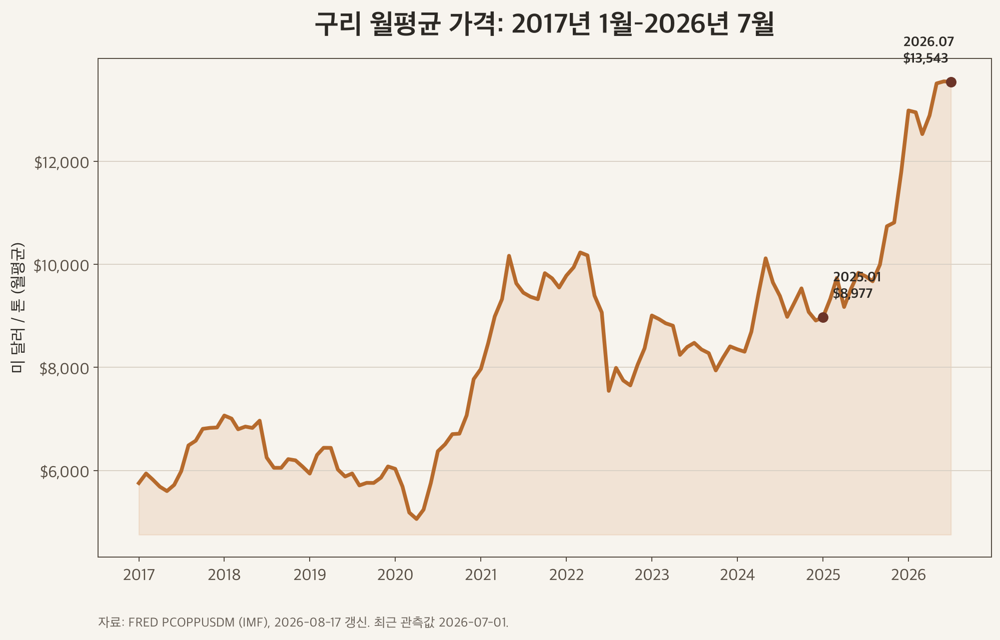
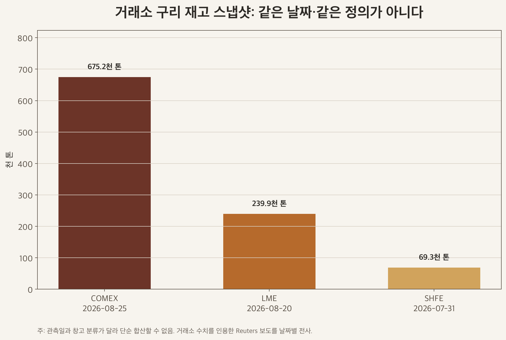
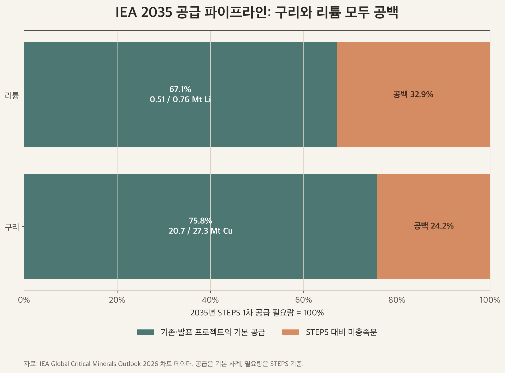

# 구리: 리튬처럼 폭락할 수 있을까

기준일: 2026-08-30

## Summary

**구리는 리튬처럼 폭락할까**

결론부터 말하면, 구리도 단기에는 리튬과 비슷한 하락 경로를 밟을 수 있다. 미국에 몰린 재고가 다시 풀리고, 선물 순매수 포지션이 청산되며, 경기 둔화가 겹치면 가격 하락 폭은 작지 않을 수 있다.

실제로 FRED 월평균 구리 가격은 2008년 7월 $8,407.02/t에서 같은 해 12월 $3,105.10/t로 63.1% 하락했다. 구리가 폭락하지 않는다는 주장은 역사와 맞지 않는다.

다만 이번 검토의 중심 가설은 조금 다르다. **같은 폭의 공급발 폭락이 중장기 기본 경로가 될 가능성은 리튬보다 낮다.** 구리는 대형 광산의 공급 반응이 느리고 수요가 전력망·건축·산업설비·운송·데이터센터 등으로 분산돼 있기 때문이다.

반면 이 판단도 “구리는 영구 부족, 리튬은 영구 과잉”이라는 뜻은 아니다.

IEA의 2026년 2035 시나리오를 같은 축으로 계산하면 기존·발표 프로젝트의 기본 공급은 STEPS 1차 공급 필요량의 구리 75.8%, 리튬 67.1%를 채운다. 둘 다 공급 공백이 남는다.

따라서 이 문서의 결론은 확정 예측이 아니라, 재고 위치·포지션·프로젝트 이행·정책 집행으로 계속 반증해야 하는 조건부 가설이다. ([IEA 2026](https://www.iea.org/reports/global-critical-minerals-outlook-2026/executive-summary))

## 자료 범위

대상: 구리 시장

## 1. 먼저 가격의 단위를 맞춘다

원자재 보고서에서 가장 쉬운 오류는 월평균과 장중 현물, 3개월 선물을 한 흐름으로 이어 붙이는 것이다. 여기서는 가격 변화율과 시나리오 앵커를 모두 FRED의 IMF 구리 월평균인 `PCOPPUSDM`, 단위 USD/t로 통일했다.

FRED는 2026년 8월 17일 갱신됐고 최근 관측값은 2026년 7월이다. ([FRED](https://fred.stlouisfed.org/series/PCOPPUSDM))

| 지표 | 월평균 가격 | 계산 또는 의미 |
|---|---:|---|
| 2025년 1월 | $8,976.68/t | 최근 상승 구간의 시작 앵커 |
| 2025년 연평균 | $9,946.88/t | 12개월 평균 |
| 2026년 1~7월 평균 | $13,137.77/t | 7개월 평균, 연간 평균이 아님 |
| 2026년 7월 | $13,542.82/t | 최신 월평균 |
| 2025년 1월→2026년 7월 | +50.9% | 동일 시계열로 재계산 |
| 2008년 7월→12월 | -63.1% | 수요 충격 때의 역사적 하락 사례 |

2026년 8월 장중 LME 가격은 이 표에 섞지 않았다. 월평균과 장중 가격을 분리하면 “현재 가격이 얼마인가”보다 “어떤 시간 단위의 가격을 말하는가”가 먼저 명확해진다.

## 2. 재고가 많다는 말보다 어디에 있는지가 중요하다

2026년 여름의 특징은 재고 총량 하나로 설명하기 어렵다. 8월 25일 COMEX 구리 재고는 675.185kt로 보도됐고, 8월 20일 LME 재고는 239.925kt, 7월 31일 SHFE 재고는 약 69.300kt였다. 미국 관세 위협과 지역 프리미엄이 물량을 COMEX 쪽으로 끌어당긴 결과일 수 있다. ([COMEX 보조 출처](https://www.marketscreener.com/news/us-tariff-threat-upends-copper-surplus-as-prices-test-all-time-peak-ce7858d8dd8eff2c), [LME 보조 출처](https://www.brecorder.com/news/amp/40435925), [SHFE 보조 출처](https://www.brecorder.com/news/40433245/copper-rises-as-lme-shanghai-inventories-fall-oil-steadies))

이 세 막대는 관측일과 창고 분류가 달라 단순 합산할 수 없다. COMEX 재고가 많아졌다는 사실은 세계 실물 구리가 충분하다는 뜻과 같지 않고, LME·SHFE 재고가 줄었다는 사실도 모든 민간 재고가 줄었다는 뜻과 같지 않다.

이 차트는 세계 총재고가 아니라 **가시 재고의 지역 불균형**을 보여준다.

익명으로 내려받을 수 있는 LME 일별 Stock Breakdown 파일은 등록이 필요했고 CME Copper Stocks 파일은 자동 다운로드에서 HTTP 403을 반환했다. 따라서 이 블록은 거래소 원자료를 인용한 Reuters 보도를 보조 출처로 사용했으며, 발행 후에도 공식 동일시점 파일을 확보하면 우선 교체해야 한다.

## 3. 포지션 청산은 실물 부족과 별개의 하락 경로다

CFTC의 2026년 8월 25일 COMEX Copper #1 Disaggregated Futures Only 자료에서 매니지드머니 롱은 92,107계약, 숏은 15,836계약이었다. 순매수는 76,271계약이고 전체 미결제약정은 283,299계약이다.

계약당 25,000lb를 적용하면 순매수의 명목 규모는 약 0.865Mt다. ([CFTC 공개 API](https://publicreporting.cftc.gov/resource/72hh-3qpy.json?%24limit=5&%24where=cftc_contract_market_code%3D%27085692%27%20and%20report_date_as_yyyy_mm_dd%3D%272026-08-25T00%3A00%3A00.000%27))

이 0.865Mt는 창고 재고가 아니며 인도 가능한 실물도 아니다. 다만 롱이 몰린 상태에서는 경기 지표 악화, 관세 기대 후퇴, 달러 강세 같은 사건이 포지션 청산을 통해 가격 하락을 증폭할 수 있다.

구리의 단기 하방은 실물 공급 증가만으로 발생하지 않는다.

## 4. 광산 공급은 집중돼 있고, 프로젝트 숫자는 총생산과 순증분을 나눠야 한다

USGS의 2026년 2월 자료에서 2025년 세계 구리 광산 생산은 약 23.0Mt로 추정된다. 칠레 5.3Mt, 콩고민주공화국 3.2Mt, 페루 2.7Mt를 더하면 11.2Mt, 세계의 48.7%다.

세계 정련 생산은 29.0Mt, 중국 정련 생산은 14.0Mt로 추정된다. 광산과 정련의 집중 지점이 서로 다르다. ([USGS 2026 Copper PDF](https://pubs.usgs.gov/periodicals/mcs2026/mcs2026-copper.pdf))

| 프로젝트 | 회사 공개 수치 | 분류 | 최신 일정·위험 |
|---|---:|---|---|
| Centinela Second Concentrator | 144kt/y Cu | 순증분 | 첫 구리 2027년, 비용 $4.4bn |
| Oyu Tolgoi 지하+노천 | 500kt/y Cu | 통합 총생산 | 2028~2036년 평균, 순증분으로 쓰지 않음 |
| Lumwana Super Pit | 240kt/y Cu | 확장 후 총생산 | 현재 약 120kt/y 대비 순증분 약 120kt/y, 첫 확장 구리 2028년 1분기 말 |
| Reko Diq | 이번 검토에서 물량 미사용 | 미분류 | 2026년 4월 개발 감속·재검토, 기존 비용과 첫 생산 일정의 신뢰도 하락 |

Centinela는 회사가 증분 물량을 명시했다. Oyu Tolgoi의 500kt/y는 노천과 지하를 합친 총생산이고, Lumwana의 240kt/y도 확장 후 총생산이다.

세 숫자를 모두 신규 공급으로 더하면 공급 증가를 과대평가한다. ([Antofagasta](https://www.antofagasta.co.uk/investors/news/2023/centinela-second-concentrator-project-approved-for-development/), [Rio Tinto](https://www.riotinto.com/en/operations/asia/oyu-tolgoi), [Barrick Lumwana](https://www.barrick.com/English/news/news-details/2026/q1-2026-results/default.aspx), [Barrick Reko Diq](https://www.barrick.com/English/news/news-details/2026/barrick-provides-an-update-on-reko-diq/default.aspx))

## 5. 구리와 리튬을 같은 축으로 비교한다

IEA의 2035 차트 원자료에서 구리 기본 공급은 20.7Mt, STEPS 1차 공급 필요량은 27.3Mt다. 충족률은 75.8%, 공백은 24.2%다.

리튬 기본 공급은 0.51Mt Li, STEPS 필요량은 0.76Mt Li로 충족률 67.1%, 공백 32.9%다. 두 수치는 광물별 단위가 다르므로 톤을 서로 비교하지 않고 충족률만 같은 축에 놓았다. ([IEA 구리 차트](https://www.iea.org/data-and-statistics/charts/expected-mine-supply-from-existing-and-announced-projects-and-primary-supply-requirements-for-copper-by-scenario-2035), [IEA 리튬 차트](https://www.iea.org/data-and-statistics/charts/expected-mine-supply-from-existing-and-announced-projects-and-primary-supply-requirements-for-lithium-by-scenario-2035))

| 비교 축 | 구리 | 리튬 | 투자 판단에 주는 의미 |
|---|---|---|---|
| 수요 집중도 | 전력망·건축·산업설비·운송·데이터센터 등으로 분산 | 배터리·EV에 더 집중 | 리튬은 단일 최종시장 변화가 공급망 전체에 더 빠르게 퍼질 수 있음 |
| 공급 탄력성·리드타임 | 대형 광산의 허가·건설·램프업이 길다 | 최근 경암·염호 증설 반응이 상대적으로 빨랐다 | 구리는 가격 상승 후 공급 반응이 늦게 나타날 수 있음 |
| 재고 위치 | COMEX·LME·SHFE에 가시 재고가 있으나 지역 이동이 크다 | 광산·정련·양극재·배터리 단계 재고가 더 중요하다 | 구리는 위치 왜곡, 리튬은 가시성 부족을 구분해야 함 |
| 투기 포지션 | CFTC 선물로 관측 가능 | 같은 기준의 대표 CFTC 지표가 없다 | 구리만 정량 비교하고 리튬 수치를 만들지 않음 |
| 재활용·대체재 | 스크랩 체계가 성숙했고 알루미늄 등 부분 대체 가능 | 배터리 재활용은 초기 성장 단계이며 화학계 전환 가능 | 장기 공급 공백을 줄일 수 있지만 속도와 경로가 다름 |
| 2035 파이프라인 | STEPS 대비 24.2% 공백 | STEPS 대비 32.9% 공백 | 둘 다 영구 과잉 또는 영구 부족으로 단정할 수 없음 |

IEA는 2025년 배터리 수요가 35% 넘게 늘어 1.5TWh를 웃돌았고, 2026년 초 리튬 가격이 두 배 넘게 반등했다고 설명한다. 가까운 시기의 리튬 공급과잉 경험을 2035년까지 직선으로 연장하면 안 되는 이유다. ([IEA Market overview 2026](https://www.iea.org/reports/global-critical-minerals-outlook-2026/market-overview))

## 6. 정책은 리튬의 집중 수요 지원과 구리의 장기 인프라 집행으로 나눠 본다

### 리튬: 직접 구매보조에서 세제·교체 지원으로

중국의 중앙정부 NEV 구매보조는 2022년 말 종료됐다. 2021~2022년의 직접 보조와 의무판매 중심 수요 견인은 EV·배터리·리튬 공급망에 집중적으로 전달됐다. ([중국 재정부](https://www.mof.gov.cn/gkml/caizhengwengao/wg2022/wg202203/202206/t20220623_3820629.htm))

그러나 정책 지원 자체가 사라진 것은 아니다. 2024~2025년에는 신에너지차 구매세가 차량당 최대 CNY30,000까지 면제되고, 2026~2027년에는 50% 감면과 최대 CNY15,000 한도로 축소된다. 2024년에는 자동차 이구환신 지원도 추가됐다. 직접 보조 종료, 세제 지원의 축소 연장, 공급과잉 대응형 교체 지원을 한 문장으로 묶으면 정책 강도를 잘못 읽는다. ([중국 세무총국](https://www.chinatax.gov.cn/eng/c102962/c102967/c102997/c103002/c5246324/content.html), [중국 정부 이구환신](https://big5.www.gov.cn/gate/big5/www.gov.cn/lianbo/bumen/202404/content_6951589.htm))

### 구리: 전력망 수요와 공급망 재배치는 다른 정책이다

중국 State Grid는 2026~2030년 고정자산 투자 계획을 최대 CNY4tn으로 제시했다. EU는 2030년까지 전력망 투자 필요액을 €584bn으로 보고 있고, 한국은 2025년 국가기간 전력망 확충 특별법의 후속 집행 단계에 들어갔다.

이 정책은 구매보조보다 인허가·건설 기간이 길고 송배전망·전선·전력기기 수요로 분산된다. ([중국 SASAC](https://en.sasac.gov.cn/2026/01/22/c_20333.htm), [EU Grids](https://energy.ec.europa.eu/topics/infrastructure/european-grids_en), [한국 산업통상자원부](https://www.motie.go.kr/kor/article/ATCL3f49a5a8c/170290/view))

미국의 정책은 수요를 만드는 전력망 정책과 달리 공급망의 위치를 바꾼다. 2025년 8월 1일부터 반제품 구리와 구리집약 파생품에 50% 관세가 적용됐지만 정련동은 즉시 적용대상에서 제외됐다. 2026년 4월 6일 개정은 관세 계산을 구리 함량이 아니라 전체 관세가격으로 넓히고 품목별 50%·25%·10% 구조를 뒀다. “미국이 모든 구리에 50%를 매겼다”는 요약은 정확하지 않으며, 실제 세율은 Annex의 HTS 품목을 확인해야 한다. ([White House 2025](https://www.whitehouse.gov/presidential-actions/2025/07/adjusting-imports-of-copper-into-the-united-states/), [White House 2026](https://www.whitehouse.gov/presidential-actions/2026/04/strengthening-actions-taken-to-adjust-imports-of-aluminum-steel-and-copper-into-the-united-states/))

한국 투자자에게 중요한 점은 세계 수급과 지역 프리미엄을 분리하는 것이다. 미국 관세 기대가 약해지거나 적용범위가 바뀌면 COMEX에 쌓인 재고가 재배치되면서 세계 광산 공급이 늘지 않아도 LME·아시아 가격이 흔들릴 수 있다.

## 7. 한국 상장사는 구리 가격의 순수 베타가 아니다

| 회사 | 구리 연결고리 | 함께 봐야 할 변수 |
|---|---|---|
| LS (006260) | LS MnM의 제련·정련, 전선·전력기기 계열사 | 제련수수료, 부산물 가격, 지주사 구조, 계열사 실적 |
| 풍산 (103140) | 동판·동대·동관 등 신동 제품 | 원재료 가격 전가, 선물 헤지, 방산 믹스 |
| LS ELECTRIC (010120) | 송배전·전력기기 투자 | 수주잔고, 납기, 원재료 전가, 제품 믹스 |

LS MnM은 99.99% LME Grade A 전기동과 680kt/y 생산능력을 제시하지만 LS는 여러 사업을 보유한 지주회사다. 풍산은 2025년 매출 구성에서 신동 69%, 방산 31%였고 원재료 가격 위험을 판매계약과 선물로 관리한다고 공시했다.

구리 가격이 오르면 세 회사의 주가가 같은 비율로 오른다는 식의 단순 연결은 성립하지 않는다. ([LS MnM](https://www.lsmnm.com/en/business/metals_01), [LS KRX 공시](https://kind.krx.co.kr/external/2026/03/12/002206/20260312005023/00591.htm), [풍산 KRX 공시](https://kind.krx.co.kr/external/2026/03/12/002229/20260312005057/11011.htm))

## 8. 확률 대신 조건으로 보는 Bull·Base·Bust

아래 가격 구간은 목표가격도 확률모델도 아니다. FRED 월평균의 최근 관측점인 2022년 7월 $7,544.81/t, 2024년 5월 $10,117.16/t, 2026년 7월 $13,542.82/t를 스트레스 테스트의 경계로 쓴 것이다.

| 시나리오 | 월평균 관측 앵커 | 발생 조건 | 무효화 신호 |
|---|---|---|---|
| Bull: 구조적 타이트닝 | $13,543/t 위에서 유지 | LME·SHFE 재고 감소, 광산 차질·프로젝트 지연, 중국·EU·한국 전력망 집행, 미국 밖 프리미엄 상승 | 2035 고생산 사례에 가까운 공급 가속, 가시 재고의 동시 증가, 전력망 집행 지연 |
| Base: 고가 정상화 | $10,117~$13,543/t | COMEX 재고 재배치, 예정 프로젝트의 단계적 램프업, 전력망 수요와 경기 둔화가 상쇄 | 포지션 급청산과 세계 제조업 침체 또는 반대로 광산 차질의 연쇄 발생 |
| Bust: 수요·포지션 충격 | $7,545~$10,117/t | 세계 경기 침체, 매니지드머니 롱 청산, 미국 재고 방출, 프로젝트 공급의 동시 도착 | LME·SHFE 재고 재감소, 프로젝트 지연, 정책 집행 가속 |

2008년과 같은 전면적 수요 충격이면 $7,545/t 아래도 가능하다. 하지만 이것은 리튬식 공급과잉만의 결과가 아니라 경기·신용·포지션이 함께 무너지는 별도 꼬리위험으로 보는 편이 타당하다.

## 9. 무엇을 보면 가설이 틀렸다고 판단할까

1. COMEX 재고 감소가 LME·SHFE 증가로 이어지는지, 아니면 실제 소비로 소진되는지 본다.
2. CFTC 매니지드머니 순매수가 줄 때 가격과 현물 프리미엄이 함께 약해지는지 본다.
3. Centinela·Oyu Tolgoi·Lumwana의 총생산이 아니라 분기별 실제 순증분과 램프업 지연을 본다.
4. IEA의 고생산 사례가 현실화되는지, 재활용이 1차 공급 필요량을 얼마나 줄이는지 본다.
5. 중국 CNY4tn, EU €584bn, 한국 전력망 정책이 계획이 아니라 발주·건설로 전환되는지 본다.
6. 미국 관세의 품목 범위가 바뀌어 지역 재고 이동 유인이 약해지는지 본다.

## Conclusion

이번 재검토의 판정은 다음과 같다. **단기에는 재고 이동과 포지션 청산이라는 리튬과 유사한 하락 경로가 있다.

중장기에는 구리의 느린 공급 반응과 분산된 정책 수요 때문에 같은 폭의 공급발 폭락 가능성은 상대적으로 낮다.**

그러나 구리도 2008년처럼 수요 충격에서 60% 넘게 하락한 이력이 있고, 리튬도 IEA 2035 시나리오에서 공급 공백이 남는다. 따라서 투자 논리는 “구리는 무조건 부족하다”가 아니라, **미국에 몰린 재고가 어디로 이동하는지, 투기 롱이 얼마나 남는지, 광산 순증분이 실제로 도착하는지, 장기 전력망 정책이 발주로 이어지는지**를 함께 추적하는 형태여야 한다.

이 문서는 공개자료를 바탕으로 한 교육·정보 목적의 섹터 분석이며 투자 권유나 목표가격 제시가 아니다. 원자재 가격과 관련 기업의 실적·주가는 환율, 헤지, 가공마진, 정책, 개별 사업 믹스에 따라 다르게 움직일 수 있다.

## Sources

- FRED, Global price of Copper, 2026-08-17 update: https://fred.stlouisfed.org/series/PCOPPUSDM
- IEA, Global Critical Minerals Outlook 2026 Executive summary, 2026-07-16: https://www.iea.org/reports/global-critical-minerals-outlook-2026/executive-summary
- IEA, Global Critical Minerals Outlook 2026 Market overview: https://www.iea.org/reports/global-critical-minerals-outlook-2026/market-overview
- IEA, Copper 2035 pipeline chart, 2026-07-09: https://www.iea.org/data-and-statistics/charts/expected-mine-supply-from-existing-and-announced-projects-and-primary-supply-requirements-for-copper-by-scenario-2035
- IEA, Lithium 2035 pipeline chart: https://www.iea.org/data-and-statistics/charts/expected-mine-supply-from-existing-and-announced-projects-and-primary-supply-requirements-for-lithium-by-scenario-2035
- USGS, Mineral Commodity Summaries 2026—Copper, 2026-02: https://pubs.usgs.gov/periodicals/mcs2026/mcs2026-copper.pdf
- CFTC, Public Reporting Disaggregated Futures Only API, 2026-08-25 observation: https://publicreporting.cftc.gov/resource/72hh-3qpy.json
- Antofagasta, Centinela Second Concentrator approval: https://www.antofagasta.co.uk/investors/news/2023/centinela-second-concentrator-project-approved-for-development/
- Rio Tinto, Oyu Tolgoi operation: https://www.riotinto.com/en/operations/asia/oyu-tolgoi
- Barrick, Q1 2026 results and Lumwana update: https://www.barrick.com/English/news/news-details/2026/q1-2026-results/default.aspx
- Barrick, Reko Diq update, 2026-04-02: https://www.barrick.com/English/news/news-details/2026/barrick-provides-an-update-on-reko-diq/default.aspx
- White House, Adjusting Imports of Copper into the United States, 2025-07-30: https://www.whitehouse.gov/presidential-actions/2025/07/adjusting-imports-of-copper-into-the-united-states/
- White House, 2026 copper amendment, 2026-04-02: https://www.whitehouse.gov/presidential-actions/2026/04/strengthening-actions-taken-to-adjust-imports-of-aluminum-steel-and-copper-into-the-united-states/
- China Ministry of Finance, NEV purchase subsidy notice: https://www.mof.gov.cn/gkml/caizhengwengao/wg2022/wg202203/202206/t20220623_3820629.htm
- State Taxation Administration of China, NEV purchase tax policy: https://www.chinatax.gov.cn/eng/c102962/c102967/c102997/c103002/c5246324/content.html
- Government of China, automobile trade-in policy, 2024-04: https://big5.www.gov.cn/gate/big5/www.gov.cn/lianbo/bumen/202404/content_6951589.htm
- SASAC, State Grid 2026–2030 investment plan, 2026-01-22: https://en.sasac.gov.cn/2026/01/22/c_20333.htm
- European Commission, European grids: https://energy.ec.europa.eu/topics/infrastructure/european-grids_en
- 산업통상자원부, 국가기간 전력망 확충 특별법 후속, 2025-03-18: https://www.motie.go.kr/kor/article/ATCL3f49a5a8c/170290/view
- LS MnM, Copper cathode: https://www.lsmnm.com/en/business/metals_01
- KRX, LS 2025 사업보고서: https://kind.krx.co.kr/external/2026/03/12/002206/20260312005023/00591.htm
- KRX, 풍산 2025 사업보고서: https://kind.krx.co.kr/external/2026/03/12/002229/20260312005057/11011.htm
- Reuters report citing COMEX data, 2026-08-25: https://www.marketscreener.com/news/us-tariff-threat-upends-copper-surplus-as-prices-test-all-time-peak-ce7858d8dd8eff2c
- Reuters report citing LME data, 2026-08-21: https://www.brecorder.com/news/amp/40435925
- Reuters report citing LME and SHFE data, 2026-08-04: https://www.brecorder.com/news/40433245/copper-rises-as-lme-shanghai-inventories-fall-oil-steadies
