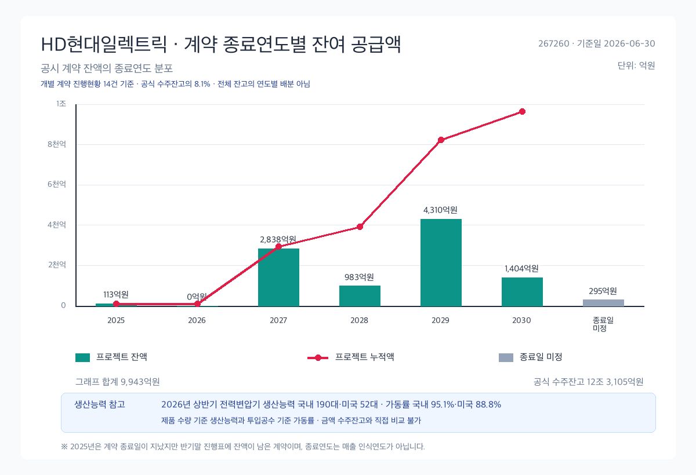
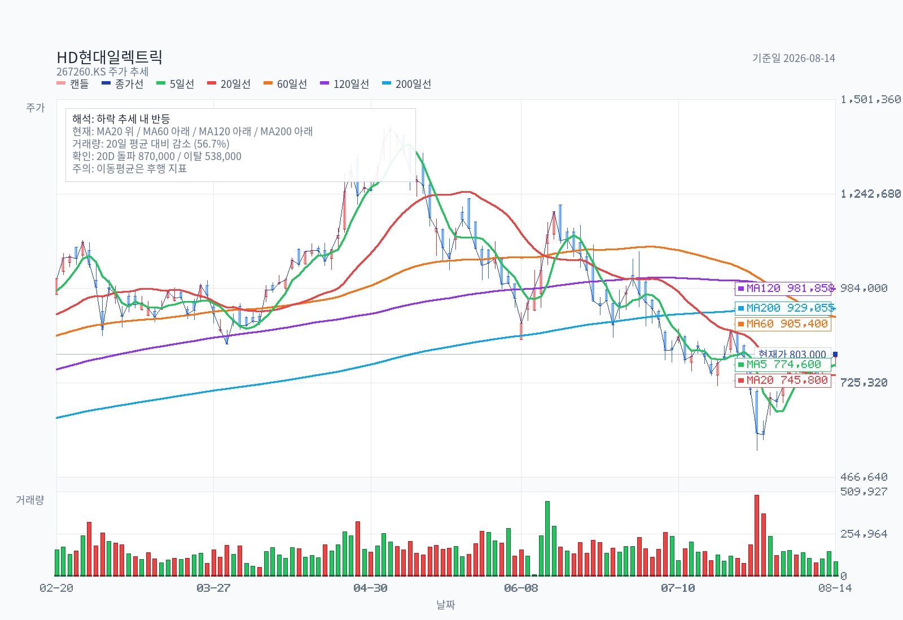
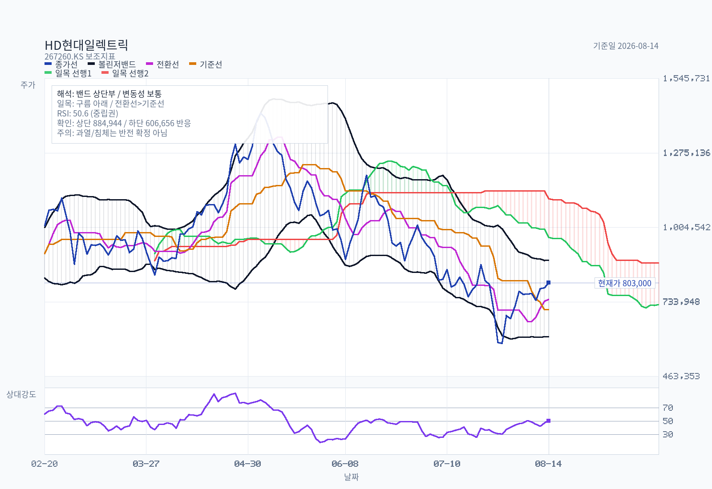
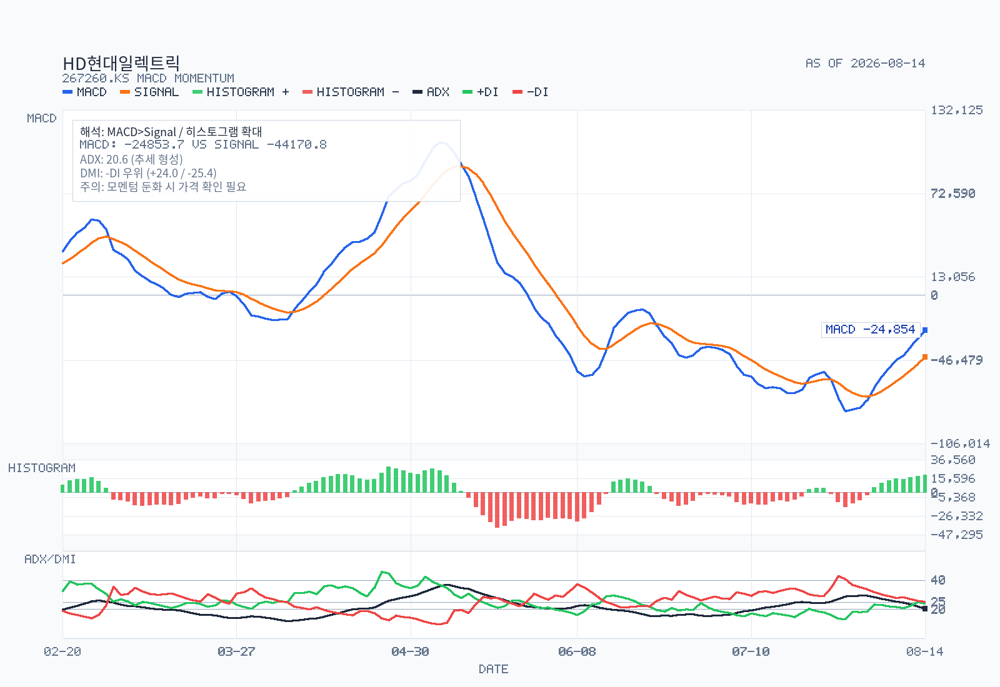
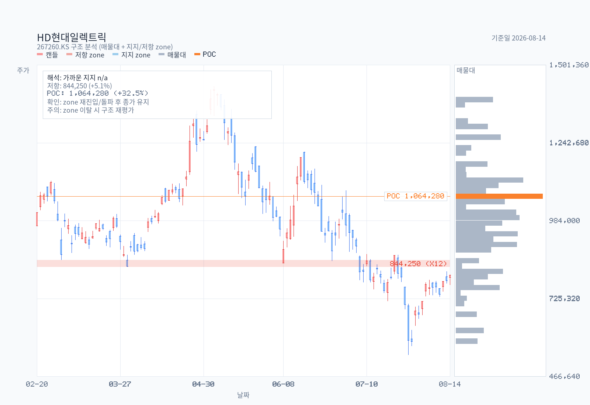

# HD현대일렉트릭 (267260) 결정 메모

기준일: 2026-08-15
최근 업데이트일: 2026-08-16
가격 기준일: 2026-08-14 종가 803,000원
목적: 전력기기 섹터·테마 학습 정리 / 시계 12~24개월
우선 질문: **사이클 피크가 언제인가**

## Decision Frame

이 메모는 "사이클 피크 시점"이라는 질문 하나를 축으로 재배열했다. 결론부터 말하면 **피크는 하나가 아니라 두 개이고, 둘의 시점이 다르다.**

1. **멀티플 피크는 이미 지났다 — 2026-05-07, 1,430,000원.** 그날 주가는 2026E EPS 대비 약 52배였다. 이후 2026-07-29 538,000원까지 −62% 하락했고 현재 803,000원(고점 대비 −43.8%)이다. 시장이 판정한 것은 실적이 아니라 배수였다.
2. **이익 피크는 아직 오지 않았다.** 1H26 신규수주 5.07조원, book-to-bill **2.33배**. 수주잔고는 6개월 만에 9.42조 → **12.31조원(+30.6%)**. 최근 수주 계약의 납기는 2029~2030년까지 걸려 있다. 회사는 2026-07-06 연간 수주 가이던스를 $4.2B → **$5.2B로 상향**했다.
3. **그러나 2027년은 물량이 막힌 해다.** 국내 전력변압기 생산능력은 380대/년으로 3년째 제자리이고 가동률은 95.1%다. 미국 2공장(3,852억)과 울산 증설(2,118억)은 **2027년 12월 완공**이다. 즉 2027년 성장은 물량이 아니라 단가로만 나와야 하는데, 하필 전기동이 전년 대비 **+31.7%** 올랐다.
4. **마진 개선의 기울기는 이미 완만해지고 있다.** 2Q26 OPM 25.1%로 여전히 확대 중이지만, 저마진 배전기기 매출이 QoQ +70.1%로 급증하며 믹스가 이동했다(SK증권이 명시적으로 지적). 마진 피크는 이익 피크보다 먼저 온다.
5. **컨센서스는 방향이 아니라 배수를 잘라냈다.** 24개 리포트 전부 BUY, TP 중앙값 1,150,000원. 그런데 TP 중앙값은 6월 1,450,000원에서 7월 1,165,000원으로 −20% 조정됐다. 실적 추정은 유지하면서 배수만 내린 것 — 셀사이드도 "이익이 꺾였다"고 보지는 않는다.

**아직 확신을 막는 것**: 신규수주의 분기별 추이가 반기 보고서로만 확인된다(분기 공시 없음). AI 데이터센터 capex 속도 조절론이 실제 발주 취소·지연으로 나타났는지는 이번 반기보고서로 확인되지 않는다. 이 둘이 다음 검증 대상이다.

## Summary

HD현대일렉트릭은 발전→송전→배전 전 단계 전력기기를 만드는 사업회사로, 1H26 매출 2.18조원(+13.4% YoY)·영업이익 5,453억원(+27.6% YoY, OPM 25.0%)을 냈다. 기준일(2026-08-15) 기준으로 **주가 사이클의 피크는 2026년 5월에 이미 지났지만, 이익 사이클의 피크는 수주잔고 납기상 2028~2029년 이전에 오기 어렵다.** 12.31조원 수주잔고는 TTM 매출의 2.84년치이고 1H26 book-to-bill은 2.33배로, 수요가 아니라 생산능력이 병목이다. 다만 2027년은 증설 완공(2027-12) 이전 물량 제약 구간이라 성장이 단가에 의존하고, 전기동 +31.7%와 저마진 배전기기 믹스 확대가 마진 피크를 이익 피크보다 먼저 불러올 수 있다. 현재 29.3배(2026E)는 글로벌 피어 대비 약 13% 할인 구간이다.

## Business and Thesis

**무엇을 파는가.** 발전·송전 단계(50kV 이상)의 전력변압기·고압차단기, 배전 단계(1~50kV)의 배전반·중저압차단기, 부하 단계의 회전기·저압전동기를 만든다. 여기에 전력변환(HD현대플라스포, 2022년 인수)과 ESS·CEMS를 신사업으로 붙이고 있다.

**가치를 만드는 축은 세 가지다.**

1. **초고압(765kV급) 변압기의 제조 진입장벽.** 이 등급은 설계·시험·레퍼런스가 모두 필요해 신규 진입이 사실상 불가능하다. 최근 수주가 전부 765kV·400kV급으로 올라온 것이 핵심이다(2025-09 AEP향 765kV 24대 2,580억, 2026-01 AEP 983억, 2026-05 Xcel 765kV 1,730억).
2. **북미 전력망 교체 + AI 데이터센터 수요의 겹침.** 매출처 상위가 NextEra Energy(15.9%), 사우디전력청(5.0%)이고, 2025년에는 Xcel Energy(9.9%)도 5% 이상이었다. 수출 비중 78%.
3. **수주산업 특유의 선반영 구조.** 지금 받는 주문이 2029~2030년 매출로 잡힌다. 그래서 "올해 실적"보다 "올해 수주"가 주가의 선행지표다 — 그리고 이것이 이번 하락장의 핵심 오해 지점이다.

**핵심 논지**: 이 회사의 이익은 이미 확보된 12.31조원 잔고에서 나온다. 따라서 12~24개월 시계에서 이익 리스크는 낮고, 리스크는 (a) 2027년 물량 제약 구간의 성장 둔화, (b) 원자재 단가 전가 실패, (c) 배수 재조정으로 압축된다. 사이클을 배우려는 목적이라면 이 종목은 **"수요 피크"와 "생산능력 피크"와 "멀티플 피크"가 서로 다른 시점에 온다**는 사례로 읽는 것이 가장 유익하다.

## Revenue Mix

**제품별 (1H26 누적, 연결)**

| 구분 | 1H26 | 비중 | 2025 | 2024 |
|---|---|---|---|---|
| 전력기기 (변압기, 고압차단기 外) | 1,476,122백만 | 67.8% | 2,835,195 (69.5%) | 2,035,525 (61.3%) |
| 회전기기 (회전기, 저압전동기 外) | 351,638백만 | 16.1% | 588,664 (14.4%) | 537,227 (16.2%) |
| 배전기기 外 (배전반, 전력제어 外) | 350,553백만 | 16.1% | 655,639 (16.1%) | 749,597 (22.6%) |
| **합계** | **2,178,313백만** | 100% | 4,079,498 | 3,322,349 |

전력기기 비중이 2024년 61.3% → 2025년 69.5%로 뛴 것이 마진 급등의 실체다. 1H26에 67.8%로 소폭 내려온 것은 배전기기가 2Q26에 QoQ +70.1%로 급증했기 때문이며, 이것이 SK증권이 지적한 "믹스 이동"이다.

**지역별**: 수출 1,706,656백만(78.3%) / 국내 471,657백만(21.7%). 2025년 수출 비중 77.1%(3,147,338/4,079,498)에서 소폭 상승. 국가별 세부 분해는 **별도 공시되지 않는다** — 증권사 리포트의 "북미/중동/유럽 지역별 매출" 도표는 회사 IR 자료 기반이며 사업보고서에서는 검증되지 않는다.

**고객 집중도 (1H26, 연결 매출 5% 이상)**

| 매출처 | 금액 | 비중 |
|---|---|---|
| NextEra Energy | 347,203백만 | 15.9% |
| 사우디 전력청(SEC) | 109,097백만 | 5.0% |

2025년에는 사우디전력청 10.3%, Xcel Energy 9.9%, NextEra 8.8%였다. **NextEra 단일 고객이 8.8% → 15.9%로 배가된 것은 양날의 검이다** — 북미 초고압 수요를 잡은 증거인 동시에 단일 고객 의존도가 커진 것이다.

## What The Latest Results Say

출처: 반기보고서(2026.06), 접수일 2026-08-14, rcept_no 20260814003228.

| 항목 | 2Q26 | 2Q25 | YoY | 1H26 | 1H25 | YoY |
|---|---|---|---|---|---|---|
| 매출액 | 1,141,813 | 906,219 | +26.0% | 2,178,313 | 1,920,887 | +13.4% |
| 매출총이익 | 384,008 | 294,123 | +30.6% | 745,405 | 629,607 | +18.4% |
| 매출총이익률 | 33.6% | 32.5% | +1.2%p | 34.2% | 32.8% | +1.4%p |
| 영업이익 | 287,035 | 209,142 | +37.2% | 545,304 | 427,321 | +27.6% |
| **영업이익률** | **25.1%** | **23.1%** | **+2.1%p** | **25.0%** | **22.2%** | **+2.8%p** |
| 순이익 | — | — | — | 413,828 | 295,326 | +40.1% |

(단위: 백만원. 1Q26 역산: 매출 1,036,500 / 영업이익 258,269 / OPM 24.9%)

**수주 — 이 메모에서 가장 중요한 표**

| 시점 | 수주총액 | 기납품액 | 수주잔고 |
|---|---|---|---|
| 2025-12-31 | 13,502,898 | 4,079,498 | **9,423,400** |
| 2026-06-30 | 14,488,813 | 2,178,313 | **12,310,500** |

- **1H26 신규수주 = 14,488,813 − 9,423,400 = 5,065,413백만원 (5.07조원)**
- **Book-to-bill = 5,065,413 / 2,178,313 = 2.33배**
- 수주잔고 6개월 증가율 **+30.6%**
- 잔고 커버리지 = 12,310,500 / TTM 매출 4,336,924 = **2.84년치**

수주산업에서 book-to-bill 2.33배는 사이클 피크의 모습이 아니다. 피크는 이 숫자가 1.0을 깨고 내려갈 때다.

**생산능력 — 병목의 위치**

| 품목 | 사업소 | 1H26 | 2025 | 2024 |
|---|---|---|---|---|
| 전력변압기 | 국내 | 190대 | 380대 | 360대 |
| 전력변압기 | 미국(HPT USA) | 52대 | 105대 | 105대 |
| 고압차단기 | 국내 | 400 BAY | 800 BAY | 800 BAY |
| 배전변압기 | 국내 | 1,500대 | 3,000대 | 3,000대 |

**3년째 사실상 제자리다.** 가동률은 국내 95.1%, 미국 88.8%, 중국 88.7%. 즉 최근 2년의 매출·마진 성장은 물량이 아니라 **단가와 믹스**에서 나왔다. 이것이 사이클 해석의 핵심이다.

**증설 (진행 중)**

| 투자 | 기간 | 총투자액 | 기투자 | 잔여 |
|---|---|---|---|---|
| 미국 HPT 2공장 신축 | '25.01~**'27.12** | 385,205 | 70,146 | 315,059 |
| 울산 변압기공장 증설 | '25.02~**'27.12** | 211,800 | 66,951 | 144,849 |
| 청주 배전캠퍼스 신축 | '23.05~'26.12 | 116,563 | 115,937 | 626 |
| 변압기 철심공장 | '22.10~'26.11 | 35,056 | 34,821 | 235 |
| 중저압차단기 자동화 | '24.01~'26.10 | 19,602 | 17,838 | 1,764 |
| **합계** | | **768,226** | **305,693** | **462,533** |

**두 개의 대형 증설이 모두 2027년 12월에 끝난다.** 물량 기여는 2028년부터다.

**원가**: 전기동 13,088$/톤(1H26 평균) vs 9,939$(2025) vs 9,144$(2024) → **+31.7% YoY**. STEEL PLATE 945,000원 vs 914,038원 → +3.4%. 원재료 매입액 1,482,522백만원 중 전장 32.6%, 철의장 34.5%.

**재무 체력**: 자본총계 2,258,295 / 부채비율 143.2%(전기말 134.6%) / 예금 1,009,952 − 차입금 114,467 = **순현금 8,955억원** / 이자보상배율 88.9배. 1H26 영업활동현금흐름 480,270, capex(유형+무형) 149,044 → **FCF 331,226백만원**.

**주의 신호 두 가지**:
- **계약자산 547,447백만원** (2025말 316,948 → +72.7%). 청구되지 않은 수익이 반년 만에 73% 늘었다. 수주산업에서 정상적일 수 있으나 회수 지연 여부는 추적 대상.
- **재고자산 1,538,739백만원** (+21.5% vs 2025말). 1H26 재고평가손실 5,714백만원 인식(1H25는 환입 1,793).
- **파생상품 손실**: 1H26 통화선도 당기손익 **−50,186백만원**(1H25 +40,790). 매도 포지션 USD 522.6M @ 평균 1,446.87원, 평균만기 2027-04-30. 원화 약세가 이어지면 헤지 손실이 계속된다.

## DART Recheck

| 주장 | 상태 | 확인값 또는 판단 | 출처 | 비고 |
|---|---|---|---|---|
| 수주잔고 12.31조원, 6개월 +30.6% | confirmed | 12,310,500백만 (2026-06-30) vs 9,423,400 (2025-12-31) | 반기보고서 II-4-다 수주상황 / 2025 사업보고서 | 회사 추정 환율 환산 기준 |
| 1H26 book-to-bill 2.33배 | confirmed (계산) | 신규수주 5,065,413 = 수주총액 14,488,813 − 전기이월 9,423,400 | 동일 | 공시 수식(수주총액=전기이월+당기수주)으로 역산 |
| 생산능력 3년째 제자리 | confirmed | 전력변압기 국내 380대(2025)=연율 380대(1H26 190대), 미국 105대 유지 | 반기보고서 II-3-다 생산능력 | 가동률 국내 95.1% |
| 증설 완공 2027-12 | confirmed | 미국 2공장 '25.01~'27.12, 울산 '25.02~'27.12 | 반기보고서 II-3-아 | 잔여투자 4,625억 |
| 2Q26 OPM 25.1%, 마진 확대 지속 | confirmed | 영업이익 287,035 / 매출 1,141,813 | 반기보고서 III 연결손익계산서 | 2Q25 23.1% 대비 +2.1%p |
| 전기동 +31.7% 원가 압박 | confirmed | 13,088$/t (1H26) vs 9,939$/t (2025) | 반기보고서 II-3-나 | LME 공시가, 기간평균 |
| NextEra 15.9% 고객집중 | confirmed | 347,203백만 / 2,178,313 | 반기보고서 II-4-나-4) | 2025년 8.8%에서 상승 |
| 2026 수주 가이던스 $4.2B→$5.2B 상향 | needs follow-up | 셀사이드(SK증권 2026-07-10)가 7/6 상향으로 보도 | 증권사 리포트 | **반기보고서에는 가이던스 기재 없음** — 회사 IR 원문 미확인 |
| 지역별(북미/중동/유럽) 매출 분해 | not separately disclosed | 수출/국내 2분류만 공시 | 반기보고서 II-4-가 | 리포트 지역별 도표는 IR 자료 기반 |
| 한전 170kV GIS 담합 관련 제재 | confirmed | 과징금 66.99억, 입찰참가자격제한 6개월(집행정지 인용), 한전 손배 20억 | 반기보고서 XI-2-가 | 금액은 소액이나 2026-09-18 2회 변론기일 |

## Order Backlog and Revenue Visibility



| 항목 | 값 | 해석 |
| --- | ---: | --- |
| 공식 연결 수주잔고 | 123,105억원 | 2026-06-30, 회사 예상 환율 환산 |
| 종료연도 확인 가능 개별 계약 잔액 | 9,648억원 | 진행현황 13건, 2030년까지 |
| 종료일 미정 개별 계약 잔액 | 295억원 | 미국법인향 230kV 변압기 1건 |
| 그래프 합계 / 공식 잔고 | 9,943억원 / 8.1% | 전체 잔고의 연도별 배분이 아님 |
| 잔고 / 상반기 매출 연율화 | 2.83배 | 연결 기준 단순 파생값 |
| 생산능력 참고 | 국내 190대·미국 52대 | 상반기 전력변압기; 가동률 국내 95.1%·미국 88.8% |

기준은 `official-contract-end-year`다. 즉 **프로젝트별 공시 잔여 수주액을 계약 종료연도에 묶은 값**이며 매출 인식연도가 아니다. 2025년 막대 113억원은 계약 종료일이 지났지만 반기말 진행표에 잔액이 남은 5건이다. 공식 잔고와 그래프 합계의 차이 113,162억원은 연도별 일정이 공시되지 않아 배분하지 않았다. 잔고만으로 마진, 취소, 납기 변경, 환율, 현금 전환을 추론할 수 없다. 상세 계산은 [수주잔고 분석](order-backlog-analysis.md)과 [정규화 데이터](order-backlog-data.json)에 있다.

## Street / Alternative Views

**셀사이드 (24개 리포트, 2025-10 ~ 2026-07-29, 5개 증권사 · 전부 BUY)**

| 증권사 | 애널리스트 | 일자 | TP | 직전 대비 | 핵심 |
|---|---|---|---|---|---|
| IBK투자증권 | 김태현 | 2026-07-29 | 1,200,000 | +14.3% | "성장성은 변함없다" |
| LS증권 | 성종화 | 2026-07-29 | 1,220,000 | −4.7% | "실적/수주, 증설 등 상대적 열위" |
| 대신증권 | 허민호 | 2026-07-29 | 1,150,000 | −23.3% | "주가는 하락했지만 펀더멘털은 강화 중" |
| 유안타증권 | 손현정·김고은 | 2026-07-29 | 1,165,000 | −19.7% | "주가는 빠졌지만 실적은 흔들리지 않았다" |
| SK증권 | 나민식 | 2026-07-29 | 900,000 | −18.2% | "무난한 실적발표" |

TP 중앙값 1,150,000원 / 평균 1,147,292원 / 범위 770,000~1,500,000원.

**TP 궤적이 이 종목의 성격을 그대로 보여준다** — 885,000(2025-10) → 1,125,000(2026-01) → 1,385,000(2026-04) → **1,450,000(2026-06)** → 1,165,000(2026-07). 셀사이드는 주가를 따라 올라갔다가 따라 내려왔다. TP는 선행지표가 아니라 후행지표였다.

**합의하는 것** (`Street view`): 2026년 매출 4.6~4.7조원(YoY +13~16%), OPM 26% 내외. 유안타 4조 6,330억/영업이익 1조 2,200억(OPM 26.3%), LS증권 4조 7,394억(+16.2%, 사측 가이던스 +9.0% 초과). 2027년 유안타 5조 1,871억(+12.9%)/영업이익 1조 5,712억.

**갈라지는 것**:
- **SK증권(TP 900,000, 컨센 대비 −21.7%)이 유일한 실질적 반대 목소리다.** 근거가 구체적이다 — *"개선의 기울기가 완만해지고 있다. 이는 (1) 전력기기 대비 수익성 낮은 배전기기 매출이 확대되며 믹스가 이동했고 (2) BESS 매출이 추가되었기 때문"*. 이 주장은 **반기보고서로 부분 확인된다**(`Confirmed by filing`): 배전기기 2Q26 QoQ +70.1%, 안좌 BESS 1,812억 계약 중 321억 매출 인식.
- **LS증권은 "증설 상대적 열위"를 지적한다** — 경쟁사 대비 capa 확대 폭이 작다는 것. 다만 같은 리포트에서 *"Capa 확대 효과: 1,000억원에서 5,000억원으로 5배 확대"*라고도 적어 내부적으로 상충한다. `needs follow-up`.
- **밸류에이션 기준이 제각각이다**: 대신은 TP 1,150,000을 "2026E PER 42배"로, 4월에는 "2029E EPS × PER 30배"로 산정했다. 유안타는 "28F PER 29배" 언급. **셀사이드가 어느 해 이익에 배수를 곱할지 계속 바꾸고 있다는 것 자체가 사이클 위치에 대한 합의가 없다는 신호다.**

**필링보다 앞서 나간 주장** (`Not separately disclosed`): 2026 수주 가이던스 $5.2B, 지역별 수주 금액, 북미 빅테크향 온사이트 발전 패키지 확대 — 전부 IR·간담회 기반이며 반기보고서에서 확인되지 않는다.

**리테일 / 독립 뷰** (`Independent view` — **출처 품질 낮음, 주의**): 네이버 블로그 검색 결과 34개 후보 중 실질 커버리지는 1개(stom7257)뿐이었고, 그마저 "전 재산 투자했다면" 류의 SEO 클릭베이트 형식이다. 분석적 가치는 낮지만 **시장 내러티브의 온도계로는 쓸 만하다**: 2026-08-01~08-07 세 편 모두 *"실적은 역대급인데 주가는 반토막"*을 제목으로 걸고, 하락 이유를 **"AI 데이터센터 투자 속도 조절론"**으로 지목한다. 즉 개인 투자자 층위에서도 이번 하락은 실적 훼손이 아니라 **미래 수요 서사의 훼손**으로 인식되고 있다. (교차 확인된 수치: 수주잔고 84.9억 달러 +7.6% QoQ, 변압기 3사 합산 영업이익 7,000억 돌파 — 회사 공시 12.31조원과 환율 감안 시 대체로 정합.)

**외국계 IB 뷰** (`Not separately disclosed`): 한국 뉴스 기준으로 **외국계 IB 커버리지가 확인되지 않는다.** 5개 쿼리로 수집한 기사 18건 중 16건이 HD현대일렉트릭을 언급하지만, 외국계 하우스(모건스탠리·골드만·JP모건·노무라·씨티·UBS·HSBC·맥쿼리 등)와 이 회사를 같은 문장에서 다루며 투자의견이나 목표주가를 제시한 사례는 **0건**이다. 같은 도구로 SK하이닉스를 조회하면 4건(JP모건 275만원 비중확대, 씨티 310만원, 모건스탠리 260만원)이 정상 추출되므로, 이는 도구 한계가 아니라 **실제로 국내 언론에 인용된 외국계 커버리지가 없다는 뜻**으로 읽어야 한다. 전력기기 중형주에 대한 외국계 리서치는 국내 언론이 잘 인용하지 않으므로, 확인이 필요하면 Bloomberg/Refinitiv 등 1차 단말이 필요하다.

## Current Valuation Snapshot

| 항목 | 값 | 산출 근거 |
|---|---|---|
| 현재가 (price, 2026-08-14 종가) | 803,000원 | Yahoo Finance 267260.KS (조회 2026-08-15) |
| 발행주식수 (shares out) | 36,047,135주 | 반기보고서 VII-2 (기준 2026-06-30) |
| 시가총액 (market cap) | **28.95조원** | 803,000 × 36,047,135 |
| 순현금 (net cash) | +8,955억원 | 예금 1,009,952 − 차입금 114,467 (2026-06-30) |
| EV | 28.05조원 | 시총 − 순현금 |
| Trailing PER (TTM) | **34.0배** | TTM 지배 EPS 약 23,600원 (2H25+1H26) |
| Forward PER (2026E) | **29.3배** | 2026E EPS 27,381원 (대신증권 2026-07-29 TP 1,150,000=42배 역산) |
| EV/Sales (TTM) | 6.5배 | TTM 매출 4.34조원 |
| EV/EBITDA (TTM, 근사) | 약 23.9배 | D&A 추정 기반 — 아래 주석 참조 |
| PBR (P/B) | **12.8배** | 지배 BPS 62,556원 (지배자본 2,254,984백만, 2026-06-30) |
| ROE (1H26 연율화) | 약 36.8% | 지배 NI 414,677 × 2 / 지배자본 |
| 배당수익률 (dividend yield) | 약 0.88% | 2025 DPS 7,100원 기준 (1H26 중간배당 2,600원) |
| FCF yield (1H26 연율화) | 약 2.3% | FCF 331,226 × 2 / 시총 |
| 자기주식 (treasury) | 자본조정 −15,241백만 | 별도 취득·처분 계획 공시 없음 (2026-06-30) |

- **EV/EBITDA 주석**: 반기보고서 손익계산서에 D&A 단일 라인이 없어, 유형자산 감가상각 25,654백만(1H26)을 연율화하고 무형 상각을 가산해 약 6,100억원으로 추정했다. **근사치이며 정밀 비교에는 부적합하다.**
- TTM 실적 = 2H25(매출 2,158,611 / 영업이익 567,992) + 1H26. TTM 매출 4,336,924 / 영업이익 1,113,296 / OPM 25.7%.

**피어 대비 위치**: 대신증권은 TP 1,150,000원을 "2026E 42배, 글로벌 피어 대비 25% 할증"으로 설명했다. 역산하면 **글로벌 피어 2026E PER ≈ 33.6배**. 현재가 29.3배는 그 피어 대비 **약 13% 할인**이다. 5월 고점 1,430,000원은 52배로 피어 대비 55% 할증이었다.

## Historical Valuation Bands

**주의**: 보유 아티팩트는 2년치 일봉(2024-08-14 ~ 2026-08-14)뿐이라 **3~5년 밴드를 온전히 구성할 수 없다**. 아래는 확보 가능한 구간의 실제 주가 범위 × 연간 지배 EPS로 만든 근사 밴드다. 2024년은 8월부터의 부분 구간이다. EV/EBITDA·P/B 시계열은 분기별 자본·D&A 시계열이 없어 **생략한다** — 억지로 채우면 오독을 부른다.

| 연도 | 주가 저점 | 주가 고점 | 지배 EPS | PER 저 | PER 고 |
|---|---|---|---|---|---|
| 2024 (8~12월, 부분) | 225,500 | 413,500 | 13,935 | 16.2배 | 29.7배 |
| 2025 | 264,500 | 976,000 | 20,354 | 13.0배 | 48.0배 |
| 2026 YTD | 538,000 | 1,430,000 | 27,381 (E) | 19.6배 | 52.2배 |
| **현재 (803,000)** | | | 27,381 (E) | **29.3배** | |

```
PER 밴드 (2024-08 ~ 2026-08, 연간 EPS 기준)
  60x |
  50x |                    ████ 48.0        ████ 52.2   <- 2026-05 고점
  40x |                    ████             ████
  30x |   ███ 29.7         ████             ████  ● 29.3  <- 현재
  20x |   ███              ████             ████ 19.6     <- 2026-07 저점
  10x |   ███ 16.2         ████ 13.0        ████
      +------------------------------------------------
         2024(부분)         2025             2026YTD
```

**읽는 법**: 현재 29.3배는 2026년 레인지(19.6~52.2배)의 중앙 아래, 2024년 부분 구간 상단(29.7배)과 거의 같다. **"싸다"고 부르기는 어렵고 "정상화됐다"가 정확하다.** 2025년 저점 13.0배는 EPS가 급등하기 전 주가 기준이라 현재와 직접 비교하기 어렵다.

## Chart and Positioning









### Rule Screen

- **Minervini Trend Template**: `incomplete` (RS percentile unavailable)
- **KRX 52주 신고가 리더십 점수**: `partial` — 확인 가능 항목 기준 **10/80점**

| 항목 | 상태 | 세부 |
|---|---|---|
| 현재가 > SMA50/150/200 | fail | 803,000 / 870,940 / 964,940 / 929,055 |
| SMA150 > SMA200 | pass | 964,940 / 929,055 |
| SMA50 > SMA150 and SMA200 | fail | 870,940 < 964,940 |
| SMA200 상승 (20거래일 전 대비) | pass | 929,055 vs 917,085 |
| 현재가 ≥ 52주 저가의 130% | pass | 179.8% |
| 현재가 ≥ 52주 고가의 75% | fail | 56.5% |
| RS percentile ≥ 70 | unavailable | RS 캐시 미생성 |
| Leadership / 52주 고가 근접도 | 0/25 | 56.5% |
| Leadership / 신고가 recency | 10/25 | 마지막 신고가 이후 68거래일 |
| Leadership / 60일 신고가 경신 빈도 | 0/15 | 0회 |
| Leadership / 추세·거래량 확인 | 0/15 | 정배열 no / 거래량 56.7% |

RS percentile이 비어 있어 시장 내 상대강도 판단은 보류한다. 그것을 빼고 봐도 **리더십 지표는 명백히 무너져 있다** — 52주 고가 대비 56.5%, 60일간 신고가 경신 0회.

**기술적 읽기**: 주가 803,000원은 MA20(745,800) 위로 올라왔지만 MA60(905,400)·MA120(981,858)·MA200(929,055) 아래다. 하락 추세 안의 반등 시도다. 일목균형표상 구름대 아래, 선행 구름도 약세. RSI14 50.6(중립), MACD는 시그널 상향 돌파했으나 여전히 0선 아래(히스토그램 확장 중). ADX 20.6으로 추세 강도는 약하고 −DI가 근소 우위. **거래량이 20일 평균의 56.7%로 매우 가볍다 — 반등의 신뢰도를 낮추는 요소다.**

**구조**: 유효 저항대 830,000~853,000원(터치 12회, 최근 2026-07-27, 스코어 0.881) — 현재가 바로 위다. 20일 돌파 레벨 870,000원, 20일 이탈 레벨 538,000원.

**파형**: 최고 신뢰도 후보는 corrective/bearish-correction(0.804) — A 2026-06-26 850,000 → B 2026-07-02 1,084,000 → C 2026-07-29 538,000.

**차트만의 결론**: **bearish continuation.** 830,000~853,000 저항대를 거래량과 함께 회복하기 전까지는 하락 추세 내 반등으로 취급하는 것이 맞다. 펀더멘털 판단과 차트 판단이 지금 정면으로 엇갈려 있으며, 이 메모는 그 불일치를 봉합하지 않고 그대로 남겨둔다.

## Governance and Structure

| 항목 | 내용 | 소액주주에게 의미 |
|---|---|---|
| 최대주주 | HD현대㈜ 12,764,785주 (**35.41%**) | 지주회사 지배. 기초 35.74%에서 소폭 감소 |
| 특수관계인 포함 | 아산사회복지재단 1.10%, 아산나눔재단 0.57%, 정기선 0.00%(156주) 등 → 약 37.1% | 지배력은 확고하나 절대다수는 아님 |
| 소액주주 | 169,798명, 18,381,689주 (**50.99%**) | 유통물량이 절반 이상 — 수급 변동성이 크다 |
| 교환사채 | HD현대㈜ 발행 EB의 교환대상 당사 주식 64,843주(0.2%) 포함 | 교환권 행사 시 오버행, 규모는 미미 |
| 구조 | **사업회사** (지주 HD현대 267250와 별개 상장) | 지주 할인 없음. 단 그룹 승계 이슈의 영향권 |
| 배당 | 2025 DPS 7,100원(배당성향 34.9%), 2024 5,350원(38.4%), 1H26 중간배당 2,600원 | 배당성향은 유지되나 수익률은 주가 상승으로 0.9%까지 희석 |
| 자기주식 | 자본조정 −15,241백만원, **당기 취득·처분 계획 공시 없음** | 주주환원은 배당 일변도 |
| 관계사 거래 | 2025-11 HD현대오일뱅크로부터 용인연구소 795억원 매입(이사회 2025-10-23 결의) | 특수관계인 자산 매입 — 가격 적정성은 외부 검증 불가 |
| 법적 리스크 | 한전 170kV GIS 담합: 공정위 과징금 66.99억(취소소송), 입찰참가자격제한 6개월(집행정지 인용), 한전 손배 20억. **2026-09-18 2회 변론기일** | 금액은 소액. 그러나 패소 시 **국내 한전 입찰 자격 제한**이 실질 리스크 (국내 매출 21.7%) |

회사는 담합 가담 사실을 부인하고 있다. 매출 구조상 국내 비중이 낮아 최악의 경우에도 영향은 제한적이지만, **9월 변론은 12~24개월 시계에서 확인해야 할 일정이다.**

## Catalysts

1. **3Q26 실적 및 수주 공시 (2026-10월 말 예상)** — 확인할 것은 이익이 아니라 **3Q 신규수주와 book-to-bill**. 반기보고서로만 잔고가 확인되므로 분기 IR 자료가 유일한 창구다.
2. **2026 연간 수주 가이던스 $5.2B 달성 여부** — 1H26에 이미 5.07조원(약 $3.6B 상당)을 채웠다면 상향 가이던스는 보수적일 수 있다. 초과 달성 시 재평가 촉매.
3. **미국 HPT 2공장·울산 증설 진척 (2027-12 완공)** — 공정률과 조기 가동 가능성. 잔여투자 4,625억원 집행 속도가 신호.
4. **북미 유틸리티 capex 계획 발표** — NextEra·Xcel·AEP의 자본지출 가이던스. 고객 집중도가 높아 이들 3사가 사실상 선행지표다.
5. **AI 데이터센터 발주 속도** — "속도 조절론"이 실제 발주 취소·연기로 나타나는지. 현재까지 공시상 취소 사례 없음.
6. **한전 담합 소송 2회 변론 (2026-09-18)**.
7. **사우디 132kV 변전소 30개+ / 400kV 2개 추가 발주 계획** (LS증권 언급) — 중동 파이프라인.

## Risks

| 리스크 | 근거 | 어떤 증거가 나오면 현실화 |
|---|---|---|
| **2027년 물량 제약 구간** | 생산능력 3년째 flat, 가동률 95.1%, 증설은 2027-12 완공 | 2027년 가이던스가 한 자릿수 성장으로 제시될 때 |
| **마진 피크 선행** | 배전기기 QoQ +70.1%, BESS 매출 추가, 전기동 +31.7% | 분기 OPM이 2개 분기 연속 하락할 때 |
| **원자재 전가 실패** | 전기동 13,088$/t (+31.7% YoY). 수주 후 납품까지 2~4년 시차 | 매출총이익률이 33% 아래로 내려갈 때 |
| **고객 집중** | NextEra 15.9%, SEC 5.0%. 2025년 상위 3사 합계 29.0% | NextEra의 capex 계획 하향 |
| **환헤지 손실 누적** | 1H26 통화선도 −502억원, 매도 USD 522.6M @1,446.87, 만기 2027-04 | 원/달러가 1,450원 위에서 고착될 때 |
| **AI 데이터센터 서사 훼손** | 리테일·셀사이드 모두 이번 하락의 원인으로 지목 | 하이퍼스케일러 capex 가이던스 하향 |
| **한전 입찰 제한 확정** | 집행정지 상태, 본안 진행 중 | 2026-09-18 이후 1심 판결 |
| **계약자산 급증** | 547,447백만 (+72.7% 6개월) | 회수 지연, 대손 인식 |
| **배수 재조정 지속** | P/B 12.8배는 여전히 높음. ROE 36.8%가 유지돼야 정당화 | ROE가 25% 아래로 내려갈 때 |

## Uncomfortable Questions

1. **생산능력이 3년째 380대로 묶여 있는데 매출이 2023년 2.70조 → 2025년 4.08조로 51% 늘었다. 이 증가분 중 정확히 얼마가 단가이고 얼마가 믹스인가?** 회사는 제품별 가격을 "수주 성격상 기재 곤란"으로 생략한다. 단가 상승분이 사이클 정점의 스팟 프리미엄이라면 2028년 증설 물량은 훨씬 낮은 단가로 채워질 수 있다.
2. **1H26 신규수주 5.07조원 중 765kV급 초고압 비중은 얼마인가?** 공시된 개별 계약(AEP 983억, Xcel 1,730억, National Grid 1,404억)을 다 합쳐도 5.07조원의 10%에 못 미친다. 나머지 90%의 제품 등급이 확인되지 않으면 "믹스 개선 지속" 주장은 검증 불가다.
3. **NextEra 한 곳이 매출의 15.9%인데, 이 물량은 몇 개 계약으로 구성되며 만기가 언제 몰려 있는가?** 단일 고객 의존이 1년 만에 8.8%→15.9%로 배가된 것은 성장의 증거인 동시에 집중 리스크다.
4. **회사가 7월 6일 수주 가이던스를 $4.2B→$5.2B로 올렸는데, 3주 뒤 주가는 538,000원까지 빠졌다. 시장은 가이던스를 안 믿은 것인가, 아니면 이미 그 이상을 반영하고 있던 것인가?** 후자라면 지금 29배도 여전히 기대를 담고 있는 가격이다.
5. **계약자산이 6개월 만에 +72.7% 늘었다. 매출인식 기준(진행률)이 공격적으로 바뀐 구간은 없는가?** 수주산업에서 계약자산 급증은 성장의 신호이기도 하고 인식 시점을 당긴 결과이기도 하다.
6. **통화선도 매도 포지션 5.2억 달러의 평균약정환율이 1,446.87원이다. 수출 비중 78% 회사가 원화 약세에서 오히려 손실을 본 구조를 주주는 어떻게 이해해야 하는가?** 1H26 −502억원은 영업이익의 9.2%에 해당한다.

## Decision-Changing Issues

1. **분기 book-to-bill이 1.0을 깨는가.** 이 메모의 모든 낙관은 2.33배라는 한 숫자 위에 서 있다. 이것이 1.0 아래로 두 분기 연속 내려가면 "이익 피크는 아직"이라는 결론은 즉시 무효다. **가장 중요한 단일 지표.**
2. **2027년 가이던스의 성장률.** 물량이 막힌 해에 회사가 몇 %를 제시하는가. 한 자릿수면 시장은 "증설 전 공백기"를 12개월간 할인할 것이다. 두 자릿수면 단가 전가력이 입증된다.
3. **분기 OPM의 방향.** 25.1%에서 확대가 멈추는 순간이 마진 피크다. 배전기기·BESS 믹스와 전기동 원가가 동시에 누르고 있어 3Q26~4Q26이 분수령이다.
4. **증설 완공 시점의 유지 여부.** 2027-12가 밀리면 물량 공백이 2028년까지 연장된다. 반대로 조기 가동하면 12~24개월 시계 안에 재평가 트리거가 된다.
5. **북미 유틸리티 3사(NextEra·Xcel·AEP)의 capex 가이던스.** 고객 집중도가 높아 이 3사의 계획이 사실상 회사의 선행 수주 지표다.

## Structured Stance

**현재 스탠스: 관찰 유지 — 사이클 위치는 "이익 성장 중, 배수 정상화 완료 직후"로 판정.**

사용자의 질문 "사이클 피크가 언제인가"에 대한 이 메모의 답은 다음과 같다.

- **주가·멀티플 피크: 2026-05-07에 이미 발생했다** (1,430,000원, 2026E 52배). 이건 과거형이다.
- **마진 피크: 임박했을 가능성이 있다.** 2H26~2027 상반기가 유력 구간. 근거는 저마진 믹스 확대와 전기동 +31.7%.
- **이익(절대액) 피크: 2028~2029년 이전에는 오기 어렵다.** 12.31조원 잔고, book-to-bill 2.33배, 2029~2030년까지 걸린 납기가 근거다.
- **수주 피크: 아직 신호 없음.** 오히려 가이던스가 상향됐다.

**왜 여기서 멈추는가.** 세 가지가 아직 검증되지 않았다. (a) 분기별 신규수주 추이가 반기 공시로만 확인되어 2H26 모멘텀을 알 수 없다. (b) 5.07조원 신규수주의 제품 등급 구성이 확인되지 않아 "믹스 개선 지속"을 검증할 수 없다. (c) 외국계 IB 뷰가 국내 언론 기준 0건이라 외국인 시각이 비어 있다.

**무엇이 판단을 바꾸는가.**
- **상향**: 3Q26 book-to-bill이 1.5배 이상 유지 + 2027 가이던스 두 자릿수 성장 + 830,000~853,000 저항대를 거래량 동반 회복.
- **하향**: book-to-bill 1.0 하회 + 분기 OPM 2개 분기 연속 하락 + NextEra/Xcel capex 가이던스 하향 중 둘 이상 동시 발생.
- 차트는 여전히 bearish continuation이고 거래량이 20일 평균의 57%에 불과하다. **펀더멘털이 좋다는 이유만으로 지금 차트를 무시할 근거는 없다.** 이 메모는 매수 신호가 아니라 사이클 지도다.

## Follow-up Research Prompts

1. **HD현대일렉트릭의 3Q26 IR 자료에서 분기 신규수주액과 지역별 수주 분해를 확보하라.** — *왜 중요한가*: 이 메모의 핵심 근거인 book-to-bill 2.33배는 반기 공시 역산이다. 분기 추이 없이는 모멘텀 변곡점을 놓친다. 사업보고서에는 분기 수주가 실리지 않으므로 IR 자료가 유일한 소스다.
2. **1H26 신규수주 5.07조원의 전압 등급별·제품별 구성을 회사 IR에 확인하라.** — *왜 중요한가*: 공시된 개별 계약을 다 더해도 10%에 못 미쳐, "고단가 초고압 중심"이라는 셀사이드 서사가 필링으로 검증되지 않는다.
3. **NextEra Energy·Xcel Energy·AEP의 최신 capex 가이던스와 변압기 조달 계획을 직접 확인하라.** — *왜 중요한가*: 상위 3사가 2025년 매출의 29%였다. 이들의 계획이 회사 수주의 실질 선행지표이며, "AI 데이터센터 속도 조절론"의 진위를 1차 소스로 판정할 수 있는 유일한 경로다.
4. **전기동 가격 상승분이 수주 계약에 어떤 방식으로 전가되는지(에스컬레이션 조항 유무) 확인하라.** — *왜 중요한가*: 납기가 2~4년인 수주에서 원자재 조항이 고정가라면 2026년 수주분의 마진은 지금 추정보다 크게 낮아진다. 반기보고서는 조항 내용을 공개하지 않는다.
5. **계약자산 547,447백만원의 구성과 회수 일정을 분기보고서 주석에서 추적하라.** — *왜 중요한가*: 6개월 +72.7%는 정상 성장일 수도, 인식 시점을 당긴 결과일 수도 있다. 수주산업 이익의 질을 가르는 항목이다.
6. **효성중공업·LS일렉트릭의 같은 분기 수주잔고·OPM·증설 일정을 동일 기준으로 나란히 놓아라.** — *왜 중요한가*: LS증권의 "증설 상대적 열위" 주장은 같은 리포트 안에서 상충한다. 국내 변압기 3사를 같은 날짜 기준으로 비교해야 이 회사의 상대 위치가 정해진다. 사용자의 학습 목적(섹터 이해)에도 직결된다.
7. **통화선도 5.2억 달러 포지션의 만기 분포와 2027년 손익 민감도를 산출하라.** — *왜 중요한가*: 1H26 −502억원은 영업이익의 9.2%다. 평균만기 2027-04-30이라 12~24개월 시계 안에 전부 소화된다.
8. **외국계 IB(모건스탠리·골드만·JP모건 등)의 한국 전력기기 섹터 뷰를 Bloomberg/Refinitiv 등 1차 단말에서 수집하라.** — *왜 중요한가*: 국내 언론 기준으로는 외국계 커버리지가 0건이라 이 메모에 외국인 시각이 비어 있다. 이번 하락의 주 원인이 외국인 수급이라면, 그들의 사이클 뷰가 국내 셀사이드보다 설명력이 높다.

## Update Log

- **2026-08-16**: 반기보고서 XI 단일판매·공급계약 진행현황 14건의 잔액을 계약 종료연도별로 재계산해 한글 수주잔고 그래프를 추가. 공식 연결 잔고 12.31조원과 그래프 합계 0.99조원을 별도 표시하고, 상반기 전력변압기 생산능력·가동률을 함께 표기함.
- **2026-08-15**: 최초 작성. 반기보고서(2026.06, 접수 2026-08-14) + 2025 사업보고서 + 한경컨센서스 24개 리포트 + 네이버 블로그 3편 + 2년치 일봉 기준. 외국계 IB 커버리지는 국내 뉴스 18건을 훑어 0건으로 확인(도구 정상 동작, 실제 커버리지 부재).

---

### Sources

| 구분 | 출처 | 일자 |
|---|---|---|
| 1차 | DART 반기보고서 (2026.06), rcept_no 20260814003228 | 2026-08-14 |
| 1차 | DART 사업보고서 (2025.12), rcept_no 20260316000940 | 2026-03-16 |
| 1차 | OpenDART 구조화 API (배당·주주·자기주식·증자) | 2026-08-15 조회 |
| 시장 | Yahoo Finance 267260.KS 일봉 484봉 (2024-08-14~2026-08-14) | 2026-08-15 조회 |
| 셀사이드 | 한경컨센서스 24개 리포트 (IBK·LS·SK·대신·유안타) | 2025-10~2026-07-29 |
| 리테일 | 네이버 블로그 stom7257 3편 — **출처 품질 낮음(SEO 클릭베이트)** | 2026-08-01~08-07 |
| 외국계 | 국내 뉴스 18건 스윕 → 외국계 IB 커버리지 0건 확인 | 2026-08-15 조회 |

### Artifacts

- `analysis-example/kr/HD현대일렉트릭/dart-browser-export.json` — 반기보고서 18개 섹션
- `analysis-example/kr/HD현대일렉트릭/chart-data.json` — 2년치 OHLCV
- `analysis-example/kr/HD현대일렉트릭/chart-analysis.md` — 기술적 분석 전문
- `analysis-example/kr/HD현대일렉트릭/analyst-report-insight.md` — 셀사이드 다이제스트 24건
- `analysis-example/kr/HD현대일렉트릭/naver-insights.md` — 리테일 뷰
- `analysis-example/kr/HD현대일렉트릭/order-backlog-analysis.md` — DART 계약 종료연도별 수주잔고 분석
- `analysis-example/kr/HD현대일렉트릭/assets/HD현대일렉트릭-order-backlog.png` — 한글 수주잔고 그래프
- `analysis-example/kr/assets/HD현대일렉트릭-chart*.png` — 차트 6종 + 구조/파형 CSV
