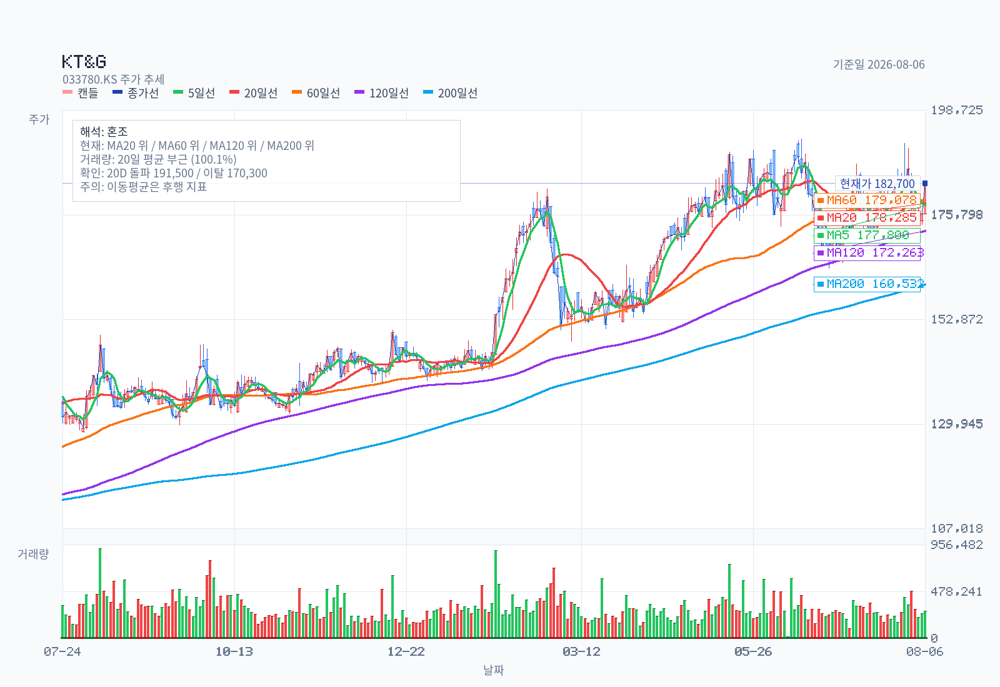

# KT&G 2분기: 본업은 좋았고 순이익은 더 좋아 보였다

기준일: 2026-08-06
최근 업데이트일: 2026-08-06

## Summary

**해외궐련 성장과 주주환원 검증**

[red: 해외궐련과 NGP가 이끈 영업이익 18.5% 성장은 매출총이익률과 현금흐름 개선이 동반된 양질의 성장이다.]

[blue: 순이익 152.3% 증가는 대부분 전년 영업외손실 기저이며, 해외 NGP 물량 정체와 건기식 해외 부진은 추가 확인이 필요하다.]

[brown: FY2027 컨센서스 EPS에 15배를 적용한 Base 적정가치는 195,000원이며, 예상 배당을 포함한 12개월 총수익률은 약 +10.6%로 계산된다.]

[brown: 하반기 자사주소각 규모와 2026년 연간 DPS는 아직 확정되지 않아 다음 재평가 변수로 남아 있다.]

## 자료 범위

- 대상: KT&G
- 티커: 033780
- 시장: KOSPI 보통주
- 전망 구간: 2026년 하반기~2027년 중반 약 12개월
- 기준 주가: 182,700원(2026-08-06 KRX 종가)

> 한 줄 결론: 해외궐련·NGP가 이끈 18.5% 영업이익 성장은 질이 좋았지만, 152.3% 순이익 증가는 대부분 전년 영업외손실 기저다. FY2027 컨센서스 EPS에 15배를 적용한 Base 적정가치는 195,000원, 예상 배당을 포함한 12개월 총수익률은 약 +10.6%다. 이 가격에서는 성장 지속 여부와 하반기 자사주 규모 확인이 필요하다.

이 문서는 공개자료를 바탕으로 한 일반 분석이며 특정 투자행동을 권유하지 않는다. `사실`은 공식 공시·IR, `회사 전망`은 회사가 제시한 방향, `증권가 추정`은 발표 전 리포트, `자체 추론`은 별도 계산·시나리오를 뜻한다.

## 1. 실적 요약

KT&G의 2Q26 연결 매출은 1조7,016억원, 영업이익은 4,145억원, 당기순이익은 3,621억원이었다. 전년 동기 대비 각각 9.9%, 18.5%, 152.3% 증가했다.

[회사 2Q26 IR](https://www.ktng.com/attach/download/bf38734f-984b-482e-b461-47a6177fd21b)의 반올림 수치와 [DART 연결 잠정실적](https://dart.fss.or.kr/dsaf001/main.do?rcpNo=20260806800305)의 매출 1,701,557백만원·영업이익 414,452백만원·순이익 362,086백만원이 일치한다. 아직 감사·검토 전 잠정치라는 점은 남아 있다.

| 항목 | 2Q26 실제 | 2Q25 | YoY | 판독 |
| --- | ---: | ---: | ---: | --- |
| 매출 | 1조7,016억원 | 1조5,479억원 | +9.9% | 해외궐련·NGP 중심 성장 |
| 매출총이익 | 8,625억원 | 7,523억원 | +14.6% | 매출보다 빠른 증가 |
| 영업이익 | 4,145억원 | 3,498억원 | +18.5% | 담배 부문이 증가분 대부분 견인 |
| 영업이익률 | 24.4% | 22.6% | +1.8%p | 제품·지역 믹스 개선 |
| 당기순이익 | 3,621억원 | 1,435억원 | +152.3% | 영업외 기저효과가 큼 |
| EPS | 3,509원 | 1,328원 | +164.2% | 자사주 소각으로 주당효과 확대 |

핵심은 매출 성장률보다 영업이익 성장률이 높았다는 점이다. 매출총이익률은 48.6%에서 50.7%로 2.1%p, 영업이익률은 22.6%에서 24.4%로 1.8%p 상승했다.

반면 순이익 증가율은 본업 체력보다 훨씬 크게 보이므로 따로 분해해야 한다.

## 2. 컨센서스 비교

지정된 국내 증권사 체인으로 수집한 2026-07-21 유안타증권 표의 발표 전 컨센서스와 비교하면 매출은 1.8%, 영업이익은 5.2%, 지배주주순이익은 14.9% 상회했다. 증권사 원문 추출 요약에는 최근 365일 54건 중 공개 PDF 46건을 반영했다.

| 항목 | 2Q26 실제 | 발표 전 컨센서스 | 차이 | 평가 |
| --- | ---: | ---: | ---: | --- |
| 매출 | 1조7,016억원 | 1조6,720억원 | +1.8% | 소폭 상회 |
| 영업이익 | 4,145억원 | 3,940억원 | +5.2% | 의미 있는 상회 |
| 지배주주순이익 | 3,643억원 | 3,170억원 | +14.9% | 영업외 기저 포함 |

FnGuide/WiseReport의 발표 전 분기 추정치도 매출 1조6,714억원·영업이익 3,967억원·순이익 3,187억원으로 방향은 같았다. [2026-08-06 조회 컨센서스](https://comp.wisereport.co.kr/samsung/company/c1010001.aspx?cmp_cd=033780) 기준이다.

`증권가 추정`: 발표 전 최신 증권사별 목표가 중앙값은 220,000원, 범위는 170,000~250,000원이며 PDF에서 확인된 등급은 BUY 9개·미확인 1개였다. 그러나 회사 발표는 2026-08-06 16:00였고 기준 시각까지 발표 후 후속 보고서는 없었다.

따라서 이 목표가와 FY2027 추정치는 실적 상향을 반영하지 않은 사전 기대치다.

`외국계 사전 시각`: 2026-07-08 국내 보도에서 BofA는 생산·유통 최적화와 고비용 원료 소진에 따른 하반기 해외궐련 마진 개선을 예상했고, Morgan Stanley는 당시 주가 기준 약 4% 배당수익률을 언급했다. 이는 모두 실적 발표 전 견해이며 2Q26 발표 후 외국계 후속 의견은 기준일까지 확인되지 않았다.

외국계 원문을 직접 확보한 것이 아니라 [해당 IB를 인용한 날짜가 명시된 국내 기사](https://www.insightkorea.co.kr/news/articleView.html?idxno=249840)에 한정해 반영했다.

## 3. 사업별 분석

| 부문 | 2Q26 매출 | YoY | 영업이익 | YoY | OPM | 이익의 성격 |
| --- | ---: | ---: | ---: | ---: | ---: | --- |
| 담배 | 1조2,185억원 | +11.7% | 3,825억원 | +18.8% | 31.4% | 해외궐련·NGP, 믹스 개선 |
| 건기식 | 2,238억원 | +1.5% | 100억원 | +61.3% | 4.5% | 국내 채널 회복, 해외 부진 지속 |
| 부동산 | 1,583억원 | +10.2% | 205억원 | +15.8% | 13.0% | 개발 매출 기여 |
| 기타 | 1,010억원 | +8.5% | 15억원 | -63.4% | 1.5% | 매출 성장 대비 수익성 약화 |

### 해외궐련: 물량과 단가·믹스가 함께 개선

`사실`: 해외궐련 매출은 5,577억원으로 18.9%, 판매량은 179.2억 개비로 7.3% 늘었다. 판매량보다 매출이 빨리 증가했고, 해외 판매량 내 중동·아프리카 비중은 31.3%에서 43.6%로 확대됐다. 1H26 전체 궐련 판매에서 해외 비중은 65.1%로 2025년 연간 62.5%보다 높아졌다.

`자체 추론`: 해외궐련 매출을 판매량으로 단순 나눈 대용치는 약 10.8% 상승했다. 이는 순수 가격 인상률이 아니라 가격·제품 믹스·지역 믹스·환율을 모두 포함한다.

따라서 “ASP가 10.8% 올랐다”고 단정할 수는 없지만, 물량만으로 설명되지 않는 질적 개선은 확인된다.

국내 궐련 판매량은 97.4억 개비로 0.6% 감소했지만 매출은 4,128억원으로 1.1% 늘었다. 1H26 국내 점유율은 67.9%로 2025년 연간 67.3%보다 높았다. 이는 2Q 단독 전년 대비 점유율이 아니므로 기간을 혼용하지 않았다.

### NGP: 국내 물량, 해외 매출이 각각 성장축

NGP 매출은 2,427억원으로 23.8% 증가했다. 국내 매출은 1,666억원(+18.9%), 해외는 761억원(+35.9%)이었다.

국내 스틱 판매량은 18.5억 개비로 20.9% 늘었고, 디바이스 점유율 48.2%(+2.7%p), 스틱 점유율 24.0%(+1.6%p)를 기록했다.

해외 스틱 판매량은 22.2억 개비로 0.5% 증가에 그쳤는데 매출은 35.9% 늘었다. `회사 설명`은 러시아 등 일부 물량 정체에도 유통 정상화와 기저효과가 매출을 끌어올렸다는 것이다.

`자체 판단`으로는 해외 NGP 성장의 질을 확신하려면 다음 분기에도 매출 증가와 물량 증가가 같이 나타나는지 확인해야 한다.

### 건기식: 회복은 맞지만 완결되지는 않았다

건기식 매출은 1.5% 증가에 그쳤지만 영업이익은 61.3% 늘어 마진이 2.8%에서 4.5%로 회복했다. 국내 매출은 1,742억원으로 7.8% 증가했고 고마진 전략 채널과 판촉 효율이 개선됐다.

반면 해외 매출은 중국 유통구조 재편 영향으로 15.9% 감소한 496억원이었다. 국내 믹스 개선은 긍정적이지만 해외 매출이 역성장한 상태라 “전면 회복”보다는 “수익성 우선 회복”으로 보는 편이 정확하다.

### 부동산·기타: 보조 기여, 핵심 성장축은 아님

부동산 개발 매출이 1,410억원으로 늘면서 부문 영업이익은 205억원을 기록했다. 다만 프로젝트 인식 시점에 따른 변동성이 있어 담배와 같은 반복 성장으로 평가하지 않았다.

기타 부문은 매출이 증가했지만 영업이익이 15억원으로 줄어 전사 이익 개선 기여가 작았다.

## 4. 이익의 질

본업 마진과 현금흐름은 양호했지만, 순이익 증가율에는 큰 기저효과가 섞여 있다.

`본업`: 2Q 매출총이익률 50.7%(+2.1%p), 영업이익률 24.4%(+1.8%p)로 개선됐다. 담배 부문 OPM도 29.5%에서 31.4%로 높아졌다.

`현금`: 1H26 연결 영업현금흐름은 7,655억원, 유형자산 취득은 2,171억원이었다. 단순 `OCF-유형자산 취득`은 5,484억원으로 1H25 399억원보다 크게 늘었다.

다만 2026년 반기보고서가 아직 제출되지 않아 이 수치는 IR-only이며, 무형자산·리스 등을 모두 반영한 표준 FCF가 아니다.

`운전자본`: 2026년 6월 말 매출채권은 2조488억원으로 2025년 말 1조6,914억원보다 늘었고, 재고는 3조1,001억원으로 3조2,848억원보다 줄었다. 해외 성장에 따른 채권 회수와 재고 정상화가 하반기 현금 전환의 핵심이다.

`순이익 기저`: DART 수치로 계산한 비영업 세전 기여(`세전이익-영업이익`)는 2Q25 -1,608억원에서 2Q26 +745억원으로 2,353억원 개선됐다. 이는 세전이익 증가 약 3,000억원의 78.4%다.

IR상 기타손익도 -1,754억원에서 +446억원으로 전환했다.

따라서 가장 지속성이 높은 신호는 순이익 +152.3%가 아니라 담배 매출 +11.7%, 담배 영업이익 +18.8%, 전사 영업이익률 +1.8%p다.

## 5. 주주환원

[DART 배당 공시](https://dart.fss.or.kr/dsaf001/main.do?rcpNo=20260806800319)에서 확인되는 2026년 중간배당은 주당 2,000원, 총액 2,076.2억원이다. 전년 중간배당 1,400원보다 600원 늘었다.

배당 기준일은 2026-08-21, 지급 예정일은 2026-09-07이다.

| 항목 | 확인된 사실 | 아직 추정인 부분 |
| --- | --- | --- |
| 중간배당 | 주당 2,000원 | 없음 |
| 2026 연간 DPS | 미공개 | Base에서 Fwd 12M 컨센서스 7,094원 사용 |
| 하반기 자사주 | 매입 후 소각 계획 | 시기·규모 미공개 |
| 4월 자사주 소각 | 10,866,189주 전량, 소각 후 103,810,456주 | 완료된 과거 조치 |

`회사 전망`: 2026년 연간 DPS를 기존 증가 추세보다 더 높이는 방향과 하반기 자사주 매입·소각 방침을 제시했다. 그러나 연간 DPS와 자사주 금액은 공시되지 않았다.

[4월 소각 공시](https://dart.fss.or.kr/dsaf001/main.do?rcpNo=20260416800490)의 10,866,189주를 하반기 추가 매입 규모로 재사용하면 안 된다.

현재가 기준 확정 중간배당만의 수익률은 1.09%다. 총주주수익률의 다음 재평가 요인은 하반기 자사주 규모와 연말 배당 확정치다.

## 6. 밸류에이션 시나리오

`증권가 추정`: [FnGuide/WiseReport](https://comp.wisereport.co.kr/samsung/company/c1010001.aspx?cmp_cd=033780)의 발표 전 FY2027 컨센서스는 매출 7조2,963억원, 영업이익 1조6,280억원, EPS 12,993원이다. 국내 증권사 체인에서 별도로 확인한 FY2027 컨센서스 EPS 12,926원과 0.5% 차이여서 방향성이 일치한다.

Base에는 더 넓은 집계의 12,993원을 사용했다.

2026-08-06 종가 182,700원은 FY2027E EPS의 14.1배다. 아래 적정가치는 확률가중 목표가가 아니라 조건별 범위다.

배당은 아직 확정되지 않은 연간 금액이므로 모두 `추정`으로 표시한다.

| 시나리오 | FY2027E EPS | PER | 적정가치 | 가격수익률 | 12M DPS 가정 | 배당수익률 | 12개월 총수익률 |
| --- | ---: | ---: | ---: | ---: | ---: | ---: | ---: |
| Bear | 11,694원(Base -10%) | 13배 | **152,000원** | -16.8% | 6,600원 | 3.6% | **-13.2%** |
| Base | 12,993원 | 15배 | **195,000원** | +6.7% | 7,094원 | 3.9% | **+10.6%** |
| Bull | 14,292원(Base +10%) | 17배 | **243,000원** | +33.0% | 7,800원 | 4.3% | **+37.3%** |

`Bear`: 해외궐련 성장 둔화, 건기식 해외 회복 지연, 하반기 추가 자사주 매입 부재를 가정했다. 배당은 중간 2,000원에 2025년 기말배당 4,600원이 유지된다고 단순 가정했다.

`Base`: 해외궐련 물량·믹스 성장이 정상화되며 FY2027 영업이익 1조6,280억원에 수렴하고, Fwd 12M 컨센서스 DPS 7,094원을 지급한다고 가정했다.

`Bull`: 해외궐련 고성장, NGP 수익성 강화, 배당과 자사주 확대가 동시에 나타난다고 가정했다. DPS 7,800원은 자체 시나리오이지 회사 가이던스가 아니다.

### 전망을 무효화할 조건

**Base 하향 무효화:** 향후 두 분기 해외궐련 매출 증가율이 한 자릿수로 둔화하고 물량이 정체되거나, FY2027 EPS 컨센서스가 11,700원 아래로 10% 이상 하향되거나, 건기식 해외 역성장이 지속되고 하반기 자사주 계획이 철회될 때다.

**Base 상향 무효화:** 해외궐련 매출이 두 분기 연속 15% 이상 성장하고 물량도 동행하며, NGP 이익 기여가 별도 확인되고, 연간 DPS·자사주 규모가 현재 Bull 가정을 웃돌 때다.

**배수 리스크:** 담배 규제·세율·환율 변화로 성장의 지속성이 약해지면 EPS가 유지돼도 13배 수준으로 디레이팅될 수 있다.

## 7. 주가 반응

[KT&G IR 안내](https://www.ktng.com/ir/overview)에 기재된 실적 발표 시각은 2026-08-06 16:00 KST다. 같은 날 KRX 종가 182,700원(+3.81%)은 15:30에 형성됐으므로 이 상승을 2Q26 실적 반응으로 단정할 수 없다.

[NXT 종목별 거래현황](https://www.nextrade.co.kr/menu/transactionStatusMain/menuList.do)에서 2026-08-06 20:05 최종가는 181,600원으로 전일 KRX 종가 대비 +3.18%였고, 당일 KRX 종가보다는 1,100원(-0.60%) 낮았다. 이는 발표 후 첫 판독이 “강한 추가 상승”보다는 소폭 부정~중립에 가까웠다는 신호다.

다만 NXT 거래량 57,090주는 당일 전체 거래량이며 16시 이후 거래만 분리되지 않아 반응 강도를 과대해석하면 안 된다. 다음 KRX 거래일 가격은 기준일 현재 존재하지 않는다.

기술적으로 종가는 MA20 178,285원과 MA200 160,532원 위, MA60 179,078원 위에 있지만 이동평균 배열은 혼조다. RSI14는 54.4, ADX14는 12.4로 추세 강도는 약하다. 168,000~174,400원이 1차 지지 구간, 187,000~192,400원이 저항 구간이다.

차트는 추격 매수보다 실적 후 저항 돌파와 거래량을 확인하라는 쪽이다. 자세한 계산은 차트 분석을 참고한다.

## 8. 리스크와 다음 분기 체크포인트

| 체크포인트 | 긍정 신호 | 경고 신호 | 이유 |
| --- | --- | --- | --- |
| 해외궐련 | 판매량 +7% 이상, 매출 두 자릿수 성장 지속 | 물량 정체와 매출/개비 대용치 하락 | 현재 이익 성장의 핵심 |
| 해외 NGP | 매출과 스틱 물량 동반 성장 | 매출만 증가하고 물량 0%대 지속 | 유통 정상화 기저와 실수요 구분 |
| 국내 NGP | 스틱 점유율 24% 이상, 물량 두 자릿수 성장 | 점유율·물량 동반 둔화 | 반복 가능한 성장축 여부 |
| 건기식 | 해외 매출 플러스 전환, OPM 5% 접근 | 중국 역성장 지속, 마진 재하락 | 회복의 폭과 질 확인 |
| 현금흐름 | 매출채권 회수, 재고 감소, OCF/OP 정상 유지 | 채권 증가와 재고 재축적 | 해외 성장의 현금 전환 검증 |
| 주주환원 | 자사주 규모·소각 일정과 연간 DPS 공시 | 계획 지연·규모 부재 | 현 밸류에이션의 재평가 요인 |

주요 하방 위험은 담배 규제·세금 인상, 환율 반전, 중동·CIS 유통 차질, 원재료 원가 재상승, 중국 건기식 구조조정 지연, 부동산 인식 시점 변동이다. 특히 해외궐련의 매출/판매량 대용치를 순수 ASP로 오인하거나 순이익 +152.3%를 장기 성장률로 외삽하는 오류를 피해야 한다.

## Update Log

### 2026-08-06

- 2Q26 IR과 DART 잠정실적·중간배당을 교차 확인했다.
- 발표 전 국내 증권사 컨센서스, 외국계 보도, KRX·NXT 가격을 시간대별로 분리했다.
- FY2027E EPS 기반 Bear·Base·Bull 적정가치와 예상 배당 포함 총수익률을 산출했다.

## Sources

- [KT&G 2Q26 공식 IR](https://www.ktng.com/attach/download/bf38734f-984b-482e-b461-47a6177fd21b), 2026-08-06.
- [DART 연결 잠정실적](https://dart.fss.or.kr/dsaf001/main.do?rcpNo=20260806800305), 2026-08-06.
- [DART 현금·현물배당 결정](https://dart.fss.or.kr/dsaf001/main.do?rcpNo=20260806800319), 2026-08-06.
- [KT&G IR 발표 시각](https://www.ktng.com/ir/overview), 2026-08-06.
- [FnGuide/WiseReport 컨센서스](https://comp.wisereport.co.kr/samsung/company/c1010001.aspx?cmp_cd=033780), 2026-08-06 조회, 발표 전 추정치.
- 국내 증권사 보고서 체인 요약, 기준일 2026-08-06.
- 외국계 시각 요약, 기준일 2026-08-06.
- [NXT 종목별 거래현황](https://www.nextrade.co.kr/menu/transactionStatusMain/menuList.do), 2026-08-06 20:05 조회.
