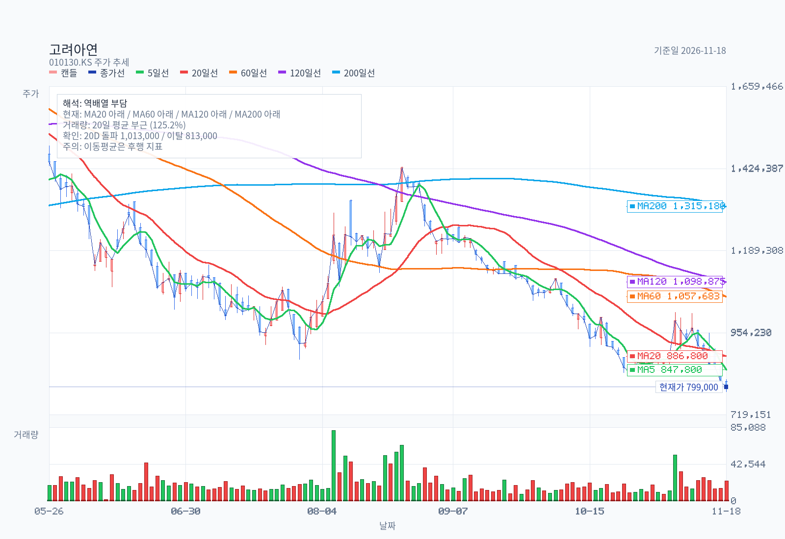
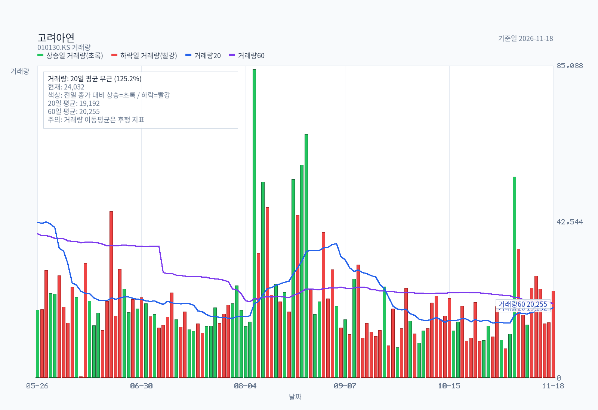
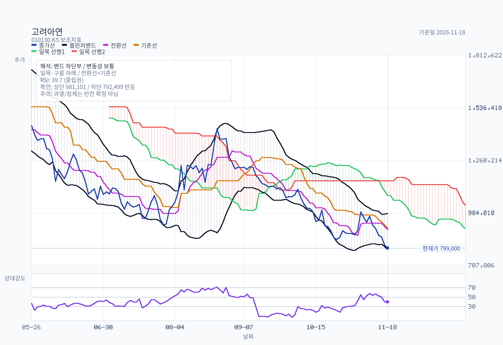
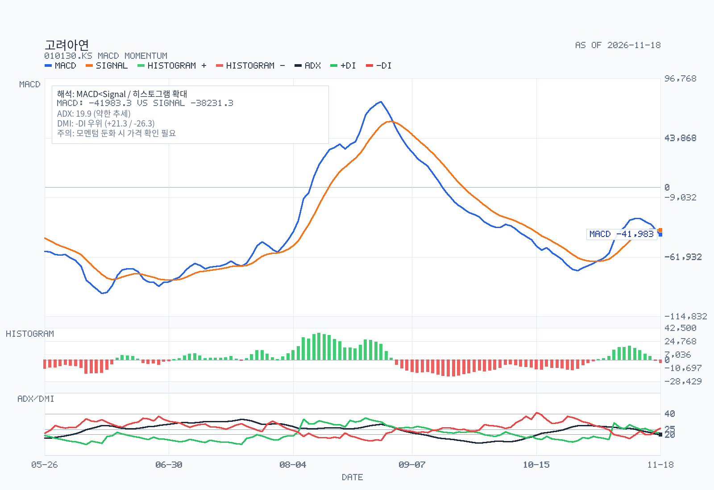
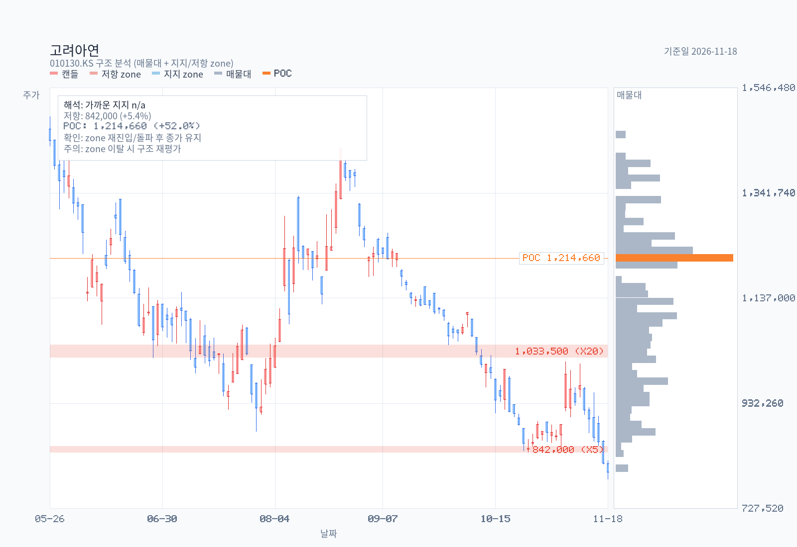
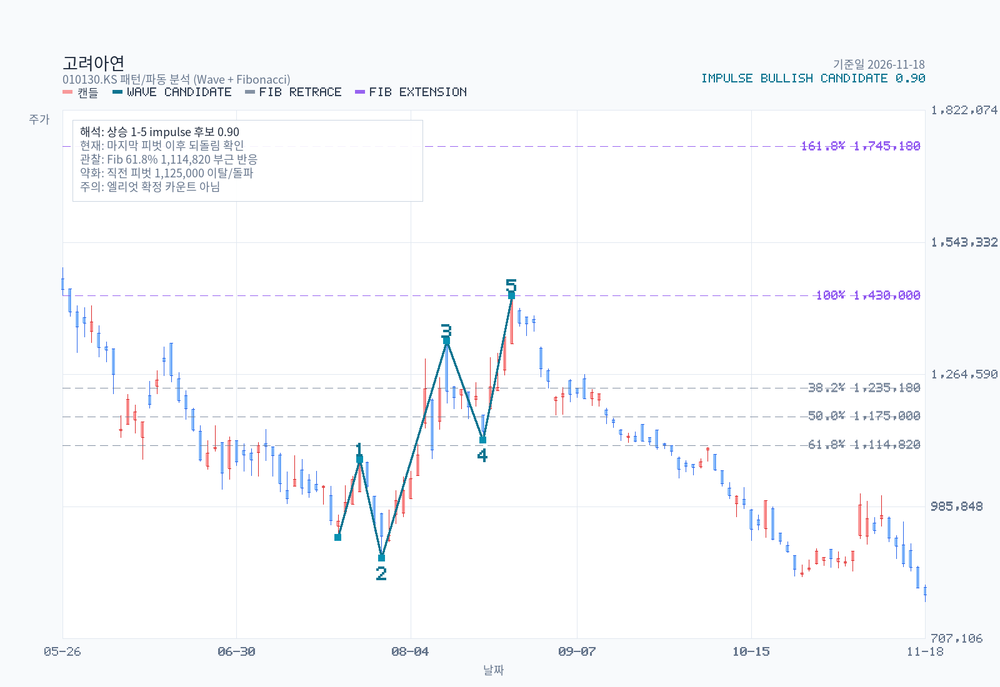

# Advanced Chart Analysis: 010130.KS

- Name: 고려아연
- Latest date: 2026-11-18
- Latest close: 799000.00
- Moving-average structure: strong-bearish
- Today's moving averages: MA5 847800.00, MA20 886800.00, MA60 1057683.33, MA120 1098875.00, MA200 1315180.00
- Bollinger read: lower-half
- Ichimoku read: below-cloud
- RSI state: neutral
- MACD state: bearish / below-zero
- ADX state: weak-trend / bearish / falling
- Volume regime: normal
- Chart-only flow: bearish continuation

## Moving Averages on Latest Date

| Date | MA5 | MA20 | MA60 | MA120 | MA200 |
| --- | --- | --- | --- | --- | --- |
| 2026-11-18 | 847800.00 | 886800.00 | 1057683.33 | 1098875.00 | 1315180.00 |

## Volume Moving Averages on Latest Date

| Date | Volume | VolMA20 | VolMA60 | Volume / VolMA20 |
| --- | --- | --- | --- | --- |
| 2026-11-18 | 24032 | 19192 | 20255 | 125.2% |

## Chart Images

The main chart uses OHLC candlesticks with upper and lower wicks, plus MA5, MA20, MA60, MA120, MA200, and volume bars. The separate volume chart enlarges participation detail with volume bars plus VolMA20 / VolMA60 lines. The overlay chart separates Bollinger Bands, Ichimoku cloud lines, and RSI14, and reserves 26 forward slots for the projected cloud. The momentum chart focuses on MACD, signal, histogram, and ADX/DMI so crossovers, momentum acceleration, and trend strength are easier to see. The structure chart pairs candles with a horizontal volume-by-price gutter (POC highlighted) and ATR-tolerance clustered support/resistance zones drawn as horizontal price bands (up to 3 each, within ±30% of current price). The pattern chart adds recent swing-pivot wave candidates and Fibonacci retracement/extension levels; labels are drawn only for candidates with confidence >= 0.55, while all candidates are exported to a sibling `-waves.csv`. The full zone roster — including broken or distance-filtered zones — is exported to a sibling `-zones.csv`.

## Support / Resistance Zones (Structure Chart)

| Type | Zone | Center | Touches | Last Touch | Score | Status |
| --- | --- | --- | --- | --- | --- | --- |
| resistance | 1,021,000 ~ 1,046,000 | 1,033,500 | 20 | 2026-10-14 | 0.712 | active |
| resistance | 836,000 ~ 848,000 | 842,000 | 5 | 2026-11-17 | 0.415 | active |

Full zone roster (including broken / distance-filtered): `고려아연-chart-structure-zones.csv`

## Pattern / Wave Candidates

Selected drawable candidate: impulse / bullish / confidence 0.905.

| Kind | Direction | Status | Confidence | Points |
| --- | --- | --- | --- | --- |
| impulse | bullish | drawable | 0.905 | start:2026-07-21@920,000 → 1:2026-07-24@1,085,000 → 2:2026-07-29@877,000 → 3:2026-08-11@1,335,000 → 4:2026-08-19@1,125,000 → 5:2026-08-25@1,430,000 |
| corrective | bearish-correction | drawable | 0.803 | A:2026-08-19@1,125,000 → B:2026-08-25@1,430,000 → C:2026-10-26@836,000 |
| impulse | bearish | drawable | 0.794 | start:2026-06-17@1,330,000 → 1:2026-06-26@1,021,000 → 2:2026-07-06@1,149,000 → 3:2026-07-21@920,000 → 4:2026-07-24@1,085,000 → 5:2026-07-29@877,000 |
| corrective | bullish-correction | drawable | 0.784 | A:2026-08-25@1,430,000 → B:2026-10-26@836,000 → C:2026-11-05@1,013,000 |
| impulse | bearish | drawable | 0.772 | start:2026-07-24@1,085,000 → 1:2026-07-29@877,000 → 2:2026-08-11@1,335,000 → 3:2026-08-19@1,125,000 → 4:2026-08-25@1,430,000 → 5:2026-10-26@836,000 |

Full wave roster: `고려아연-chart-pattern-waves.csv`

## Indicators

| Metric | Value |
| --- | --- |
| MA 5 | 847800.00 |
| MA 20 | 886800.00 |
| MA 60 | 1057683.33 |
| MA 120 | 1098875.00 |
| MA 200 | 1315180.00 |
| Bollinger Upper | 981100.80 |
| Bollinger Middle | 886800.00 |
| Bollinger Lower | 792499.20 |
| Bollinger Width | 21.27% |
| Tenkan | 896500.00 |
| Kijun | 905000.00 |
| Current Cloud A | 1075000.00 |
| Current Cloud B | 1153500.00 |
| Future Cloud A | 900750.00 |
| Future Cloud B | 1024000.00 |
| RSI 14 | 39.69 |
| MACD | -41983.27 |
| Signal | -38231.26 |
| Histogram | -3752.01 |
| MACD State | bearish / below-zero |
| Histogram State | expanding |
| ADX 14 | 19.91 |
| +DI | 21.35 |
| -DI | 26.31 |
| ADX State | weak-trend / bearish / falling |
| Avg Volume 20 | 19192 |
| Avg Volume 60 | 20255 |
| Volume vs Avg 20 | 125.2% |
| 20D Breakout Level | 1013000.00 |
| 20D Breakdown Level | 813000.00 |

## Read

- Trend structure: price is below MA5, MA20, MA60, MA120, and MA200, so the trend stack remains firmly bearish.
- Today's moving averages: MA5 847,800 / MA20 886,800 / MA60 1,057,683 / MA120 1,098,875 / MA200 1,315,180.
- Volatility: price is in the lower half of the Bollinger range, and band width is stable.
- Cloud read: price is below the current cloud, tenkan is below kijun, and the projected cloud is bearish.
- Momentum and participation: RSI14 is neutral at 39.69; MACD remains below signal, and MACD is below zero; histogram momentum is expanding; ADX still reads as a weak-trend environment, and trend strength is fading; volume is close to the 20-day average.
- Practical checklist: nearest support watch is 792,499; first recovery check is 886,800, then 896,500; 20-day breakout level sits at 1,013,000; 20-day breakdown level sits at 813,000; chart-only flow still reads as bearish continuation.

## Data Basis and Verification

- 수집: 2026-11-19 10:51 KST. 당일 장중 일봉 제외; 2024-11-19~2026-11-18의 485개 확정 일봉 기준.
- 종가 799,000원은 [고려아연 공식 홈페이지 시세](https://www.koreazinc.co.kr/?mainMenuId=kz-investment&menuId=kz-inv-ir-report-presentation&pageName=investment%2Fpresentation&subMenuId=kz-inv-ir-report) (2026-11-18 17:08:16) 및 [한국경제 일별시세](https://markets.hankyung.com/stock/010130/chart)와 교차 확인했다.
- Yahoo 거래량 24,032주와 한경 23,046주는 차이가 있다. 거래량 배율 및 차트 보조지표는 Yahoo 일봉 기준이며 거래소 확정 거래량과 동일하다고 단정할 수 없다.
- 파동 후보는 과거 구간의 패턴 탐지 결과다. 8월 상승 impulse 후보가 선택되었지만 현재 추세 판단은 하락 지속이며, 미래 상승 확인으로 해석하지 않는다.
