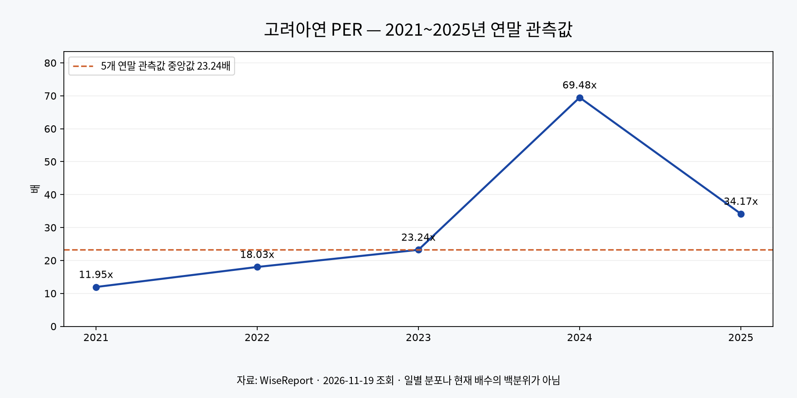
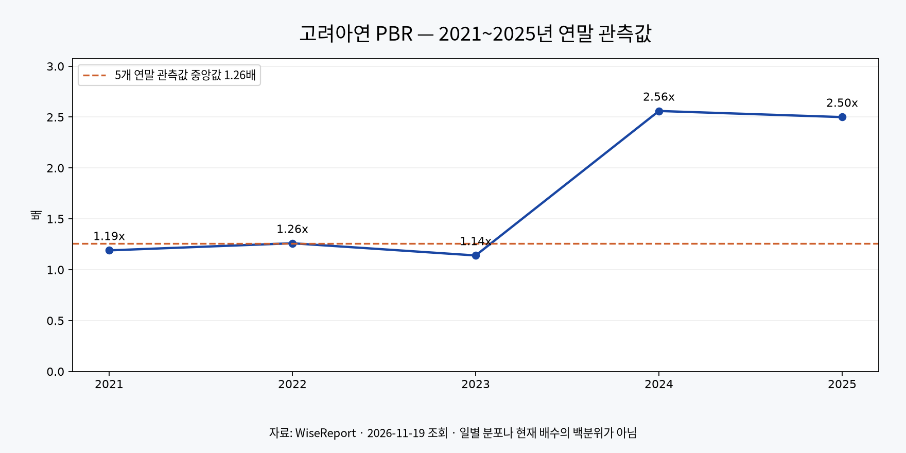
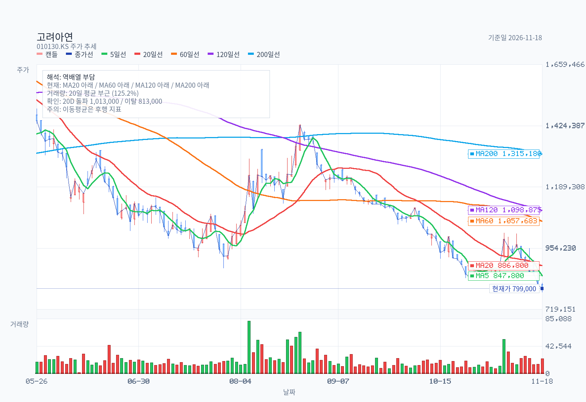
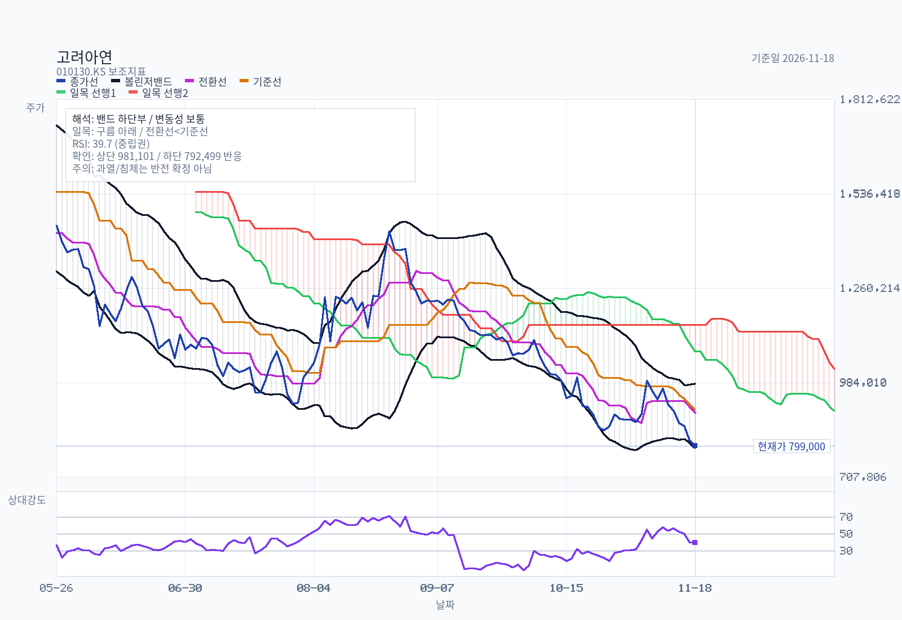
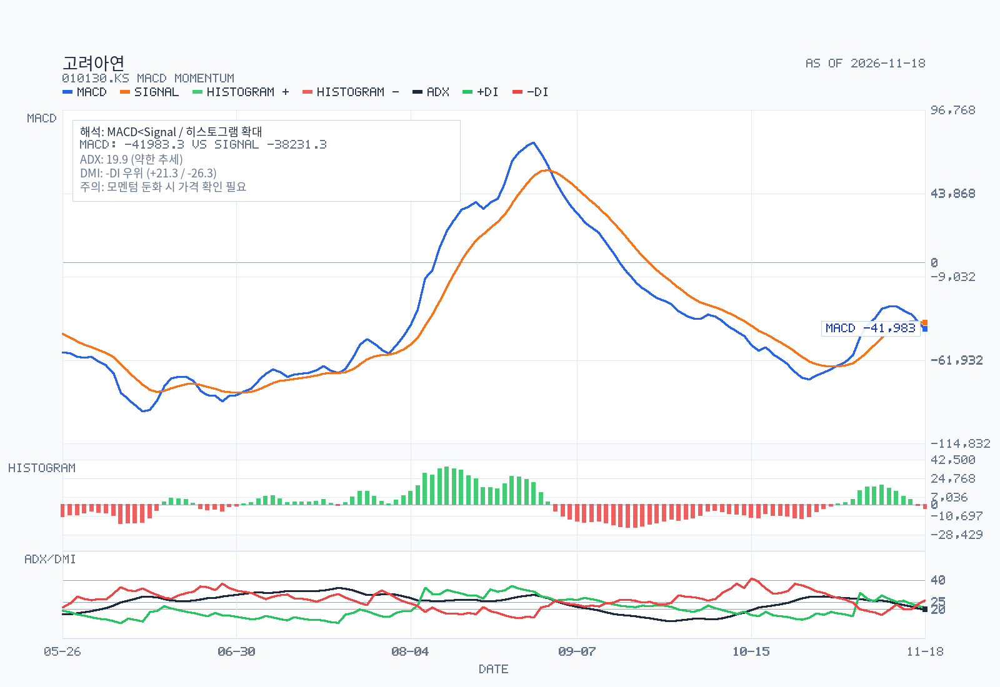
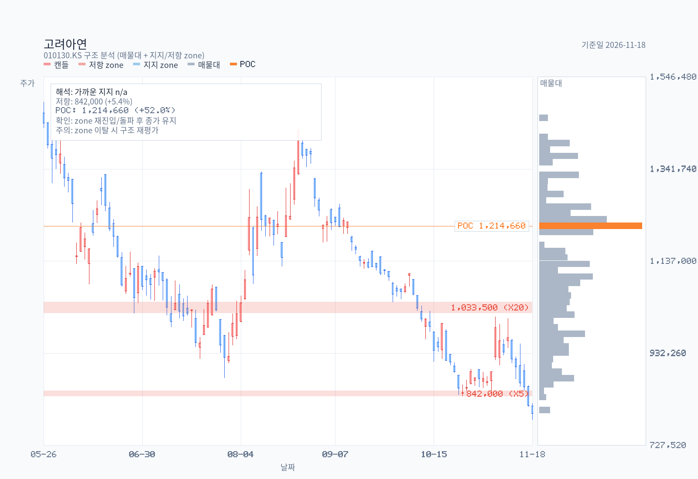

# 고려아연 투자 분석 — 제련 기술의 가치와 주주에게 남는 현금

- 한줄요약: 제련 경쟁력은 인정하되 투자·보증 부담을 먼저 확인한다.
- 기준일: 2026-11-19
- 최근 업데이트일: 2026-11-19
- 대상: 고려아연 보통주 · KOSPI 010130
- 유형: full memo · 12~24개월 투자 판단, 2030년 사업계획 별도 점검
- 가격: 2026-11-18 완료 거래일 종가 799,000원. 11월 19일 장중 가격 제외.
- 원형: Cyclical Manufacturing / Materials / Commodity-Linked Supplier. 해외 성장투자와 경영권 분쟁이 결합한 자본집약적 제련업체.
- Order-driven company: no. 금속 제련·판매의 수익성이 중심이다.

## Decision Frame

**고려아연을 좋게 볼 이유는 제련 기술이고, 지금 가격에서 기다릴 이유는 자금 구조다.** 복합 원료에서 여러 금속을 회수하는 역량은 공급망 재편의 수혜를 받을 수 있다. 다만 산업적 중요성이 소액주주 수익률로 이어지려면 투자비·보증·금융비용을 제하고도 현금이 남아야 한다.

| 판단을 바꿀 문제 | 확인한 사실 | 현재 판단 |
| --- | --- | --- |
| 기술이 가격 변동을 넘어 이익을 지키는가 | 3분기 본사 영업이익 −61.9% QoQ | 경쟁력과 이익 안정성을 구분 |
| 미국 투자 부담이 제한되는가 | 9월 말 대출 최종 계약 전, 모회사 보증 제공 예정 | 계약 조건 확인이 우선 |
| 장부 이익이 현금이 되는가 | TTM 순이익 +1.10조원, FCF −1.67조원 | 현금 전환 회복 필요 |
| 현 주가가 회복을 얼마나 반영했는가 | 과거 이익 PER보다 내년 PER이 높음 | 이익 감소와 부채 증가를 함께 평가 |
| 경영권 사건이 정리됐는가 | 서로 다른 소송·신청이 병행 | 승패 하나로 분쟁 종료 판단 유보 |

이 메모의 현재 입장은 **추가 검증 후 보류**다. 가격 하락 자체보다 미국 금융계약의 모회사 부담, 운전자본 회수, 성장사업의 실제 수익성을 먼저 본다.

## Summary

고려아연은 광산에서 나온 정광과 재활용 원료를 처리해 아연·연과 여러 부산물을 판매하는 회사다. 금속을 캐는 권리보다 원료를 분리·정제하고 더 많은 유가금속을 회수하는 기술이 경쟁력의 중심이다.

그 역량이 미국 공급망 투자로 연결되는 방향은 이해된다. 그러나 2026년 9월 말 공시에는 대규모 차입 계획과 고려아연의 보증 제공 예정이 함께 나온다.

투자금의 출처와 최종 위험 부담을 같은 뜻으로 읽으면 기업가치를 과대평가하기 쉽다.

기준일 2026년 11월 19일 현재, 수익성 회복과 자금조달 조건을 함께 확인하기 전까지 관찰한다. [DART 2026년 3분기보고서](https://dart.fss.or.kr/dsaf001/main.do?rcpNo=20261116000994)

## 이 글을 읽는 법

- DART는 공시 사실, 회사 IR은 경영진 계획, 증권사·블로그는 외부 해석으로 구분한다.
- 최근 12개월(TTM)은 2025년 연간에 2026년 1~9월을 더하고 2025년 1~9월을 뺀 값이다.
- 주당가치 계산은 자기주식을 제외한다. 발행주식 기준 시가총액도 비교용으로 따로 표시한다.
- 가치 민감도의 배수와 부채 경로는 작성자 가정이다. 생산능력·예상 매출·금융 약정은 확정 실적과 구분한다.

## Business and Thesis

### 복합 제련의 경제성은 무엇인가

아연·연 정광에는 주력 금속 외에 은·금·동과 다른 유가금속이 들어 있다. 고려아연은 이들을 제련 과정에서 회수해 판매한다.

투자자가 봐야 할 것은 단순한 금속가격 상승보다 **원료 한 단위에서 회수할 수 있는 가치와 이를 얻는 처리 비용의 차이**다. [DART 사업보고서 사업의 내용](https://dart.fss.or.kr/dsaf001/main.do?rcpNo=20260813001726)

수익은 제련수수료(TC), 원료 매입·판매 조건, 회수율, 금속가격·환율의 시차, 전력비·가동률이 함께 결정한다. 광석이 부족하면 광산의 협상력이 높아져 제련수수료가 낮아질 수 있다.

금속 수요가 좋아도 제련사 이익이 동시에 좋아진다고 단순화하기 어려운 이유다.

| 가치가 생기는 곳 | 검증할 지표 | 훼손되는 조건 |
| --- | --- | --- |
| 복합 원료의 분리·회수 | 회수 금속 확대와 별도 영업이익 | 원료비 상승·낮은 TC |
| 기존 제련소 운영 경험 | 수율·가동률·전력 단위비용 | 신규 공장의 램프업 지연 |
| 재활용 원료 활용 | 처리량과 연결 현금흐름 | 인수비·운전자본이 이익 초과 |
| 핵심광물 공급망 진입 | 실제 구매계약·가격·마진 | 정책 지원만 있고 수익성 미확인 |

회사의 본질은 경기민감 소재업이다. 핵심광물이라는 성장 서사가 붙어도 재고와 매출채권에 현금이 묶이는 구조, 대규모 설비의 고정비, 금속·환율 변동은 계속 작동한다.

이 메모는 그 위에 자본배분과 경영권 위험을 추가해 평가한다.

### 성장은 기존 제련 기술의 확장인가

미국 제련소와 게르마늄은 기존 회수·정제 역량의 적용 범위를 넓히는 사업이다. 니켈·동박·재생에너지·재활용도 원료와 전력, 배터리 소재의 연결을 지향한다.

기술적 연결성이 있어도 각 사업의 현금 회수 시점은 다르므로 한꺼번에 성공을 가정한 합산 가치를 제시하지 않는다.

게르마늄은 비교적 가까운 검증 대상이다. 11월 5일 IR은 Crude GeO₂ 판매를 2027년 상반기, 고순도 제품 전환을 2028년 상반기로 계획했다. 금속 기준 연간 생산능력 14.5톤과 14.2톤은 대체 단계다.

투자 계획 1,400억원을 약 200억원으로 낮춘 것은 긍정적이나, 수율·실현가격·고객 인증은 다음 단계의 증거다. [회사 IR 10쪽](https://investors.koreazinc.co.kr/media/clwppkhc/26q3-korea-zinc-ir-presentation-kr.pdf)

## Revenue Mix

회사 이름만 보고 아연 가격에만 초점을 맞추기 어렵다. 2026년 1~9월 본사 매출에서 은 비중은 48.7%로, 아연 19.3%보다 크다. 다만 금속 매출액은 해당 금속의 이익 기여와 다르다.

| 본사 제품 · 별도 | 2026년 1~9월 매출 | 본사 매출 비중 |
| --- | ---: | ---: |
| 은 | 5조 8,484억원 | 48.7% |
| 아연 | 2조 3,123억원 | 19.3% |
| 금 | 1조 6,364억원 | 13.6% |
| 연 | 1조 376억원 | 8.6% |
| 동 | 5,264억원 | 4.4% |
| 기타 | 6,366억원 | 5.3% |
| 합계 | 11조 9,977억원 | 100% · 반올림 차이 |

[DART 분기보고서 II.2](https://dart.fss.or.kr/dsaf001/main.do?rcpNo=20261116000994). 은 매출 비중은 2025년 33.0%에서 확대됐다. 원료비와 회수 조건을 차감한 은의 제품별 영업이익은 별도 공시가 없어 ‘이익의 절반이 은’으로 확대 해석하지 않았다.

연결 부문은 조정 전 매출 기준 비철금속 제조·판매 71.6%, 수출입 25.1%, 폐기물처리 등 3.3%다. 내부거래 제거 전 분모 19.71조원에서 산출한 비중으로, 연결 매출 18.53조원과 직접 섞지 않는다.

제조·판매 영업이익은 1조 3,901억원, 수출입 865억원, 폐기물처리 등은 97억원 적자였다. [DART 연결 주석 31](https://dart.fss.or.kr/dsaf001/main.do?rcpNo=20261116000994)

**지역은 판매 경로까지 확인되고 최종 고객은 제한적이다.** 본사 매출은 내수 약 30%, Local 및 직수출 약 70%다. 국내 Local을 포함한 수출 경로이므로 미국 최종 수요 비중으로 바꿔 쓸 수 없다.

연결 지역별 외부매출은 공시 분류상 본사 소재지 국가 13.33조원, 호주 0.87조원, 남미 4.34조원이다. 이 사업지역 표를 고객 도착지별 매출로 재해석하지 않았다.

고객 실명별 매출 순위와 상위 고객 집중도는 연간·분기 수익 및 부문 주석 점검 후에도 별도 확인되지 않았다. [DART II.4·연결 주석 31](https://dart.fss.or.kr/dsaf001/main.do?rcpNo=20261116000994)

## What The Latest Results Say

### 매출 성장만으로 체력이 좋아졌다고 보기 어렵다

3분기 연결 매출은 6조 861억원이지만 영업이익은 1,417억원, 영업이익률은 2.33%였다. 본사 별도 영업이익도 전분기 대비 61.9% 줄었다.

미국 연결 회계조정만으로 부진을 설명하기 어려운 결과다. 자세한 발표 전 기대 비교는 [별도 3분기 리뷰](https://kr-research-site.pages.dev/kr/korea-zinc-2026-q3/)에 남겼다.

[분기보고서](https://dart.fss.or.kr/dsaf001/main.do?rcpNo=20261116000994) · [회사 IR](https://investors.koreazinc.co.kr/media/clwppkhc/26q3-korea-zinc-ir-presentation-kr.pdf)

| 연결 지표 | 최근 12개월 · 2026-09-30까지 | 해석 |
| --- | ---: | --- |
| 매출액 | 23조 3,006억원 | 물량과 금속가격 효과가 함께 포함 |
| 영업이익 | 1조 9,034억원 | 좋은 상반기·전년 4분기 포함 |
| 지배주주순이익 | 1조 978억원 | 현재 분기 이익을 단순 연율화한 값과 구분 |
| 영업현금흐름 | −4,725억원 | 이익 대비 현금 전환 부진 |
| 유형·무형자산 현금 취득 | 1조 1,928억원 | 현금 기준 단순 CAPEX |
| 단순 FCF | **−1조 6,653억원** | 영업현금흐름에서 위 취득액 차감 |

[DART 2025년 연간](https://dart.fss.or.kr/dsaf001/main.do?rcpNo=20260813001726)과 [2026년 3분기](https://dart.fss.or.kr/dsaf001/main.do?rcpNo=20261116000994)의 같은 연결 계정을 대조한 작성자 계산이다. 금융상품 취득·기업 인수·배당은 이 단순 FCF에서 추가 차감하지 않았다.

2026년 1~9월 영업현금흐름은 −3,626억원이다. 금속가격이 상승하면 매출과 재고의 장부금액도 커질 수 있으므로 이익 증가의 질은 재고·매출채권이 매출 대비 안정되는지로 확인해야 한다.

운전자본 유출이 되돌아오는지, 추가 차입이 이를 메우는지를 다음 분기에 나눠 본다.

### 미국 투자: 직접 출자 비중과 최종 위험 부담은 다르다

**9월 말 공시는 외부 조달의 방향을 보여주지만 모회사 위험의 상한까지 확정해 주지는 않는다.** 총 투자 계획은 약 74.32억달러이며, 고려아연의 추가 자체 출자 계획은 5.85억달러다. 이 숫자만 비교해 나머지 자금을 무상 지원으로 취급할 수 없다.

| 재원·계약 | 공시 내용 | 확인 상태 |
| --- | --- | --- |
| JV 유상증자 재원 | 약 19.40억달러, 미국 지주회사에 출자 | 조달·출자 내역 확인 |
| 고려아연 자체 재원 | 5.85억달러, 2026~2029년 순차 출자 | 계획 |
| 미국 측 대출 | 약 46.98억달러 | 9월 말 최종 Credit Agreement 미체결 |
| CHIPS 보조금 | 약 2.10억달러 | 조달 계획 |
| 모회사 부담 | 담보·지급보증·이행보증 제공 예정 | 계약 세부 조건 점검 필요 |

[DART 분기보고서 사업의 내용 및 별도 주석 28](https://dart.fss.or.kr/dsaf001/main.do?rcpNo=20261116000994). 재원 항목은 공시 반올림치이므로 표시 합계와 총 투자 계획에는 차이가 있다. 실제 조달·인출·집행은 시점이 다르다.

같은 주석은 미국 전쟁부와 JP모건의 대출 약정액을 각각 23.49억달러로 제시한다. 별도로 이미 공시된 Completion Guaranty(준공보증), JV 지분·프로젝트 자산 담보도 확인된다.

또한 고려아연이 보유한 Crucible JV의 9.99% 지분 담보 제공과 채무불이행 시 의결권 행사 관련 약정이 나온다. 따라서 기술의 전략적 가치뿐 아니라 **공사비 초과·준공 지연·채무불이행의 부담이 어디로 돌아오는지**가 중요하다.

11월 15일 보도에 따르면 TVA가 11월 10일 230MW 전력 사용을 승인했으며 2029년 공급 예정이다. 이는 실행 위험을 줄이는 진척이다.

다만 개별 전력요금·원료 계약·판매 마진까지 확인한 사건은 아니다. 회사 11월 IR의 2027년 1분기 착공, 2030년 1분기 전 공정 가동 계획과 나눠 본다.

[뉴시스 2026-11-15](https://mobile.newsis.com/view_amp.html?ar_id=NISX20261115_0003868587) · [회사 IR 11쪽](https://investors.koreazinc.co.kr/media/clwppkhc/26q3-korea-zinc-ir-presentation-kr.pdf)

### 제한된 자금과 쓸 수 있는 현금을 구분한다

9월 말 장기금융상품 중 미국 프로젝트 관련 사용제한 자금은 2조 6,603억원이다. 이를 일반 운영·배당·채무상환에 쓸 수 있는 현금처럼 빼면 주당가치가 과대해질 수 있다.

반대로 이 자금은 향후 프로젝트 집행을 위해 확보된 재원이라는 점도 함께 봐야 한다.

순차입금은 리스를 포함한 차입금에서 현금·단기금융상품을 빼 **6조 9,008억원**으로 계산했다. 단기금융상품에 제한성 자금 846억원이 포함돼 완전한 가용현금 기준보다 낮게 잡힌 부채다.

장기 제한성 자금과 공정가치 금융자산은 별도 검토 대상으로 두었다. [DART 분기보고서 금융상품·차입금·제한성 자금 주석](https://dart.fss.or.kr/dsaf001/main.do?rcpNo=20261116000994)

유동 분류 금융부채는 약 5조 1,641억원이다. 공급자금융 1조 8,133억원은 이미 단기 차입금에 포함돼 다시 더하지 않았다. 10월 13일 발행한 3,000억원 사채는 채무상환 목적이며 9월 말 현금에 소급 가산하지 않았다.

만기 분산과 차환 조건은 별도로 관리할 변수다. [DART 연결 주석 16~17·29·33](https://dart.fss.or.kr/dsaf001/main.do?rcpNo=20261116000994)

미국 외 투자도 현금을 요구한다. 연결 유형자산 취득 약정 1조 1,418억원은 전체 프로젝트 예산과 중복될 수 있어 별도로 더한 총투자비를 만들지 않았다.

| 사업 | 2026년 1~9월 확인값 | 다음 검증 |
| --- | --- | --- |
| 켐코 · 니켈 | 기존 황산니켈 가동률 24%, 순손실 259억원 | 신설 제련소 잔여 700억원 집행과 판매계약 |
| 케이잼 · 동박 | 가동률 7%, 매출 124억원, 순손실 159억원 | 미국 ESS 고객 납품 확대·수율·손익분기 |
| Pedalpoint | 하위 연결 매출 4.07조원, 순이익 35억원 | 트레이딩 중심 외형과 재활용 부가가치 분리 |
| Ark Energy | 전력·개발사업, 일부 손익은 상위 회사에 포함 | 개별 정상화 이익·잔여 투자·배당 가능 현금 |

[DART II.2~3·연결 주석 1](https://dart.fss.or.kr/dsaf001/main.do?rcpNo=20261116000994). 위 가동률은 기존 해당 설비 기준이다. 순손익은 영업손익과 구분하며, 내부거래를 포함한 회사별 금액을 연결 실적에 합산하지 않았다.

켐코 지분은 73.44%, 케이잼·Pedalpoint는 100%다.

켐코와 케이잼의 낮은 가동률은 신사업을 무가치하게 만드는 증거까지는 아니다. 다만 투자금 회수에 필요한 생산·판매 규모에 아직 도달하지 못했다는 반대 증거로 읽는다.

## DART Recheck

연간·최신 분기 주석과 기준일 신규 공시를 대상으로 8개 주장을 다시 확인했다. 원문 위치와 수치는 [공시 검증 자료](dart-analysis.md) 및 [검증 캐시](dart-cache.json)에 보관했다.

| 주장 | 상태 | 확인값·판단 | 출처 |
| --- | --- | --- | --- |
| 은 매출 비중이 본사의 절반 가까이 확대 | confirmed | 별도 48.7%, 제품 이익 비중은 미공시 | Q3 II.2 |
| 호실적이 자금 부담을 해소 | contradicted | 누적 영업현금·TTM FCF 음수 | 연결 CF·연간 CF |
| 미국 위험은 직접 출자 5.85억달러로 제한 | contradicted | 모회사 보증·담보·준공보증 존재 | 연결 29·별도 28 |
| 미국 차입이 최종 계약까지 완료 | partially supported | 약정서 존재, 9월 말 최종 계약 전 | 연결 29·별도 28 |
| 소각만큼 유통주식 추가 감소 | contradicted | 자기주식 제외 분모에서는 중복 | 연결 21~22·33 |
| 동박·니켈이 이미 유의한 신규 이익 창출 | contradicted | 케이잼·켐코 누적 순손실 | 연결 1·II.3 |
| 경영권 분쟁 종료 | contradicted | 판결과 별개 신청이 병존 | 11-13·11-19 공시 |
| 최종고객 집중도·미국 IRR 확정 가능 | not separately disclosed | 해당 수치 공시 확인 못함 | 사업·부문·약정 주석 |

[Q3 보고서](https://dart.fss.or.kr/dsaf001/main.do?rcpNo=20261116000994), [2025년 보고서](https://dart.fss.or.kr/dsaf001/main.do?rcpNo=20260813001726), [11월 19일 판결](https://dart.fss.or.kr/dsaf001/main.do?rcpNo=20261119800002)·[신청](https://dart.fss.or.kr/dsaf001/main.do?rcpNo=20261119800003)을 교차 검증했다. ‘미공시’ 항목은 0으로 채우지 않았다.

## Street / Alternative Views

증권사는 기술·희소금속·주주환원을 긍정적으로 보지만, 이익 전망과 자금 부담을 함께 낮춰 잡고 있다. **목표가가 높다는 사실보다 어떤 자본·이익·차입을 가정했는지가 더 중요하다.**

| 2026-11-06 원문 | 의견·목표가 | 2027년 영업이익 전망 | 핵심 관점 |
| --- | --- | ---: | --- |
| 한화 | Buy · 127만원 | 1조 3,234억원 | 희소금속 프리미엄, PBR 2.4배 |
| iM | Buy · 125만원 | 1조 1,070억원 | 회복 시점 2027년 1분기, PBR 2.0배 |
| 신한 | 매수 · 150만원 | 1조 5,962억원 | 주주환원과 성장, 현금흐름 검증 |

[한화 원문](https://consensus.hankyung.com/analysis/downpdf?report_idx=653837) · [iM 원문](https://consensus.hankyung.com/analysis/downpdf?report_idx=653875) · [신한 원문](https://stock.pstatic.net/stock-research/company/21/20261106_company_700107000.pdf). 표본 3사의 목표가 중앙값은 127만원이며 시장 전체 의견 분포를 뜻하지 않는다.

한화와 iM은 각각 12개월 선행 BPS 530,015원·620,238원을 사용한다. 목표 PBR이 낮다고 항상 더 보수적인 가치평가가 되는 것은 아니다.

메리츠 10월 8일과 신한 8월 7일 자료는 미국 프로젝트의 조달비용과 오프테이크 조건을 기업가치의 핵심 변수로 지적했다. [메리츠 원문](https://consensus.hankyung.com/analysis/downpdf?report_idx=652803) · [신한 8월 원문](https://stock.pstatic.net/stock-research/company/21/20260807_company_42789000.pdf)

**Street view — 투자비의 그림자.** 한화 11월 6일 추정에서 연결 순차입금은 2026년 말 6.910조원에서 2027년 말 12.561조원으로 증가하고, EBITDA는 2.151조원에서 1.861조원으로 줄어든다. 이는 회사 확정 전망과 구분하지만, 미래 이익에 현재 부채만 차감한 가치평가가 낙관적으로 보일 수 있음을 보여준다.

**Independent view — 이익과 현금의 간격.** hoontrinh27의 11월 17일 글은 이익보다 현금흐름을, seulo_ol의 11월 15일 글은 전력 승인 이후 실제 사업 조건을 점검한다. blissyoon의 11월 18일 글은 성장투자와 지분 갈등의 연결을 해석한다. 이 관점은 질문을 만드는 데 쓰고, 금액과 법적 효력은 공시로 재검증했다.

[현금흐름 관점](https://m.blog.naver.com/hoontrinh27/224480941110) · [전력 승인 관점](https://m.blog.naver.com/seulo_ol/224478038152) · [경영권 갈등 관점](https://m.blog.naver.com/blissyoon/224480244669)

**Street view — 외국계 과거 의견.** 2025년 12월 17일 국내 보도에서 맥쿼리 홍광표의 미국 정부 전략자산 평가를 확인했다. 이는 과거 전략적 위상에 대한 의견이며 현재 실적 조정 후 의견으로 가져오지 않았다.

최신 외국계 원문·목표가·등급은 확보 범위에서 미확인이다. JP모건의 대출 주관 역할도 주식 리서치 매수 의견과 구분한다.

[서울경제TV 2025-12-17](https://www.sentv.co.kr/article/view/sentv202512170174)

## Current Valuation Snapshot

**과거 이익 PER 14.8배만 보고 싸다고 결론 내리기 어렵다.** 현재 주가에 내년 이익 전망을 적용하면 PER이 약 18.5배로 높아지고, 현금 기준 수익률은 음수다.

| 지표 | 값 | 기준 |
| --- | ---: | --- |
| Price | 799,000원 | 2026-11-18 완료 종가 |
| Market cap · 발행주식 기준 | 16조 6,775억원 | 발행주식 20,872,969주 |
| Market cap · 자기주식 제외 | 16조 2,942억원 | 20,393,232주, 이하 배수의 분자 |
| Trailing PER | 14.84배 | 최근 12개월 지배주주순이익 |
| Forward PER | 18.52배 | 2027E 지배주주순이익 8,797억원 · 2026-11-19 조회 |
| PBR / P/B | 1.53배 | 2026-09-30 지배주주자본 10조 6,197억원 |
| EV/EBITDA · TTM | 10.04배 | EV 23조 4,353억원 / EBITDA 2조 3,344억원 |
| EV/EBITDA · 2027E | 12.59배 | 위 EV / 한화 EBITDA 1조 8,610억원 · 2026-11-06 추정 |
| FCF yield | −10.22% | 단순 TTM FCF / 자기주식 제외 시가총액 |
| 순차입금 / TTM EBITDA | 2.96배 | 리스 포함 순차입금 |
| 과거 DPS 기준 배당수익률 | 2.50% | 2025년 DPS 20,000원 / 현재 가격 |

가격은 [회사 시세](https://www.koreazinc.co.kr/?mainMenuId=kz-investment&menuId=kz-inv-ir-report-presentation&pageName=investment%2Fpresentation&subMenuId=kz-inv-ir-report)와 [한국경제 일별시세](https://markets.hankyung.com/stock/010130/chart)로 교차 확인했다. 재무 입력은 [DART](https://dart.fss.or.kr/dsaf001/main.do?rcpNo=20261116000994), 2027년 순이익은 [WiseReport 11월 19일 조회](https://comp.wisereport.co.kr/company/c1010001.aspx?cmp_cd=010130), 2027년 EBITDA는 [한화 11월 6일](https://consensus.hankyung.com/analysis/downpdf?report_idx=653837) 기준이다.

EV는 자기주식 제외 시가총액에 위 순차입금과 비지배지분 장부가 2,402억원을 더했다. EBITDA는 영업이익에 영업비용에 포함된 감가상각·무형자산상각·사용권자산 감가상각을 더한 작성자 계산이다.

공식 IR이나 시세 제공업체의 조정 EBITDA·배수와 정의가 다를 수 있다.

### 부채가 늘면 기술 프리미엄의 몫도 줄어든다

**순차입금이 1조원 늘면 다른 조건이 같을 때 주당가치는 약 49,000원 줄어든다.** 미래 사업의 가치를 더할 때 그 사업을 짓는 부채도 함께 넣어야 하는 이유다.

아래는 2027년 EBITDA를 한화의 1.861조원으로 고정한 기말가치 민감도다. 배수 8·10·12배는 작성자의 비교 가정이며, 보수·기준·낙관의 확률이나 매매 목표가를 의미하지 않는다.

| 순차입금 가정 | EBITDA 8배 | 10배 | 12배 |
| --- | ---: | ---: | ---: |
| 9월 말 공시 기반 6.90조원 | 379,877원 | 562,389원 | 744,900원 |
| 작성자 중간 가정 9.00조원 | 276,944원 | 459,455원 | 641,967원 |
| 증권사 전망 참고 12.561조원 | 102,327원 | 284,838원 | 467,350원 |

계산은 `주당가치 = (EBITDA × 배수 − 순차입금 − 비지배지분) ÷ 자기주식 제외 주식 수`다. 비지배지분은 현재 장부가를 고정했고, 미래 배당·희석·추가 지분가치·현재가치 할인은 반영하지 않았다.

12.561조원 행은 증권사의 부채 증가 전망을 참고한 스트레스 입력이다. 증권사의 순차입금 정의와 이 글의 리스·금융자산 처리에는 차이가 있어 작성자의 확정 예측으로 채택하지 않았다. 사용제한 프로젝트 자금은 집행에 따라 감소하므로 향후 차입·투자·현금 잔액을 같은 시점으로 맞춰야 한다.

현재 부채를 고정하고 EBITDA 10배를 적용하면 현재 가격을 설명하는 데 약 **2.34조원**의 EBITDA가 필요하다. 부채가 12.561조원이면 약 **2.91조원**으로 높아진다.

한화의 2027년 EBITDA 1.861조원과의 차이는 기술 프리미엄, 더 높은 이익, 더 낮은 최종 부채 중 무엇으로 메울지 설명해야 한다.

게르마늄과 미국 사업을 회사 매출 계획만으로 별도 자산가치로 더하지 않았다. 기존 연결 이익에 포함되는 부분, 투자비·보증·차입금, 가동 초기 손실을 먼저 분리해야 중복 계산을 피할 수 있다.

## Historical Valuation Bands





| 연말 관측값 | 2021 | 2022 | 2023 | 2024 | 2025 |
| --- | ---: | ---: | ---: | ---: | ---: |
| PER | 11.95배 | 18.03배 | 23.24배 | 69.48배 | 34.17배 |
| PBR | 1.19배 | 1.26배 | 1.14배 | 2.56배 | 2.50배 |

자료는 [WiseReport 연간 표 · 2026-11-19 조회](https://comp.wisereport.co.kr/company/c1010001.aspx?cmp_cd=010130)다. 5개 연말 관측점의 중앙값은 PER 23.24배, PBR 1.26배다. 일별 배수 분포나 현재 주가의 역사적 백분위로 읽기에는 표본이 적다.

현재 PBR 1.53배는 2024~2025년 연말보다 낮다. 하지만 유상증자로 자본과 주식 수가 달라졌고 경영권 분쟁도 주가에 영향을 줬다.

옛 고점 배수를 정상 수준으로 되돌아갈 기준으로 사용하기 어렵다. 같은 정의의 역사적 EV/EBITDA 시계열은 확보하지 못해 밴드를 생략했다.

## Chart and Positioning









### Rule Screen

- Minervini Trend Template: `fail`
- KRX 52주 신고가 리더십 점수: `10/100` (Grade `D`)

| 항목 | 상태 | 세부 |
| --- | --- | --- |
| Minervini / 현재가 > SMA50/SMA150/SMA200 | fail | 현재가 799000.00 / SMA50 1007320.00 / SMA150 1193560.00 / SMA200 1315180.00 |
| Minervini / SMA150 > SMA200 | fail | SMA150 1193560.00 / SMA200 1315180.00 |
| Minervini / SMA50 > SMA150 and SMA200 | fail | SMA50 1007320.00 / SMA150 1193560.00 / SMA200 1315180.00 |
| Minervini / SMA200이 최근 20거래일 전보다 상승 | fail | 현재 SMA200 1315180.00 / 20거래일 전 1362930.00 |
| Minervini / 현재가 >= 52주 저가의 130% | fail | 현재가/52주 저가 100.0% |
| Minervini / 현재가 >= 52주 고가의 75% | fail | 현재가/52주 고가 37.8% |
| Minervini / RS percentile >= 70 | fail | RS percentile 29.7 |
| Leadership / 52주 고가 근접도 | 0/25 | 현재가/52주 고가 37.8% |
| Leadership / 최근 신고가 recency | 5/25 | 마지막 신고가 이후 179거래일 |
| Leadership / 최근 60거래일 신고가 경신 빈도 | 0/15 | 0회 |
| Leadership / 통합 KRX RS percentile | 0/20 | RS percentile 29.7 |
| Leadership / 추세/거래량 확인 | 5/15 | 정배열 no / 거래량 125.2% |

Minervini Trend Template 기준으로는 7개 조건이 미충족이라 아직 엄격한 통과 구간은 아닙니다. 한국형 52주 신고가 리더십 점수는 10/100, 등급 D입니다.

차트 흐름은 bearish continuation 쪽으로 읽히며, RS percentile 29.7 기준 시장 내 상대강도까지 함께 확인됩니다.

- RS 기준: 2026-11-18 통합 KOSPI+KOSDAQ 일반주 2,529개 시도, 2,472개 RS 적격, 5개 수집 실패. 캐시 생성 2026-11-19. 거래량 지표는 Yahoo 일봉 기준이며 거래소 확정치와 제공 범위가 다를 수 있다.
- 52주 고가·저가 및 신고가 빈도는 252거래일 **종가** 기준이다. 장중 고저가 기준 시장 시세 화면과 값이 다를 수 있다.


### 추세와 확인 가격

| 지표 | 2026-11-18 기준 |
| --- | ---: |
| MA5 / MA20 | 847,800원 / 886,800원 |
| MA60 / MA120 | 1,057,683원 / 1,098,875원 |
| 볼린저 하단 / 중앙 / 상단 | 792,499원 / 886,800원 / 981,101원 |
| 현재 일목 구름 | 1,075,000~1,153,500원, 주가가 아래 |
| RSI14 | 39.69 |
| MACD / Signal | −41,983 / −38,231 |
| ADX14 / +DI / −DI | 19.91 / 21.35 / 26.31 |
| 거래량 / 20일 평균 | 1.25배 · Yahoo 제공 일봉 |

첫 저항 구간은 836,000~848,000원이며, 더 위로 1,021,000~1,046,000원 매물대가 있다. 선택된 구조 규칙에서 현재가 아래 유효한 수평 지지대는 검출되지 않았다.

볼린저 하단은 변동성 경계이지 보장된 지지선은 아니다.

2024년 11월 19일부터 2026년 11월 18일까지 485개 확정 일봉을 사용했다. 통합 KRX 상대강도는 같은 날짜 2,472개 적격 종목 기준 29.7백분위다.

거래량은 Yahoo 24,032주와 한경 23,046주가 달라 보조지표를 단일 제공자 기준으로 유지했다. [Yahoo 일봉](https://query1.finance.yahoo.com/v8/finance/chart/010130.KS?range=2y&interval=1d) · [한국경제](https://markets.hankyung.com/stock/010130/chart)

주가가 모든 주요 이동평균과 구름 아래에 있고 MACD도 음수여서 **차트만의 결론은 하락 지속**이다. 가격 반등으로 추세 판단이 좋아질 수 있어도 대출·보증·현금 전환의 검증을 대신하지는 못한다.

## Governance and Structure

### 주주·이사회·환원

| 항목 | 확인값·시점 | 소액주주에게 중요한 이유 |
| --- | --- | --- |
| 최대주주 | 2026-09-30 와이피씨 25.21%, 특수관계인 합계 32.88% | 공시 묶음과 경영권 연합 전체를 구별 |
| 이사회 | 2026-06-30 총 14명, 사내 2·기타비상무 4·독립 8 | 분기 본문 생략으로 반기 상세 보완 |
| 의장 | 황덕남 독립이사, 2026-05-06 재선임 | 대표이사와 의장 역할 분리 |
| 자기주식 | 9월 말 479,737주, 발행주식의 약 2.30% | 가치평가에서 제외, 처분·소각 추적 |
| 현금 배당 | 2025년 DPS 20,000원, 2026년 1~3분기 각 5,000원 | 현금 유출 속 환원의 재원 확인 |

[DART 분기보고서 VII·연결 주석 21~23](https://dart.fss.or.kr/dsaf001/main.do?rcpNo=20261116000994) · [반기보고서 VI](https://dart.fss.or.kr/dsaf001/main.do?rcpNo=20260814003958). 와이피씨는 영풍의 100% 출자회사다. 공시된 특수관계인 지분을 증권사의 ‘영풍·MBK 측’ 묶음이나 주총 안건별 행사 가능 의결권과 일치시키지 않았다.

2026~2028년 1~3분기 각 5,000원 수준 유지 정책에는 경영환경·재무상황 전제가 있다. 2026년 누적 배당 15,000원을 연간 최종 배당으로 확정하지 않았다.

2027년 1월 13일 소각 예정인 246,665주는 이미 자기주식이다. 자기주식을 뺀 주당가치에서 소각 주식을 또 빼면 가치 증가를 중복 계산한다.

남은 233,072주의 임직원 보상 교부 가능성은 반대로 유통주식 수 증가 요인이다. [회사 IR 13~14쪽](https://investors.koreazinc.co.kr/media/clwppkhc/26q3-korea-zinc-ir-presentation-kr.pdf)

### 같은 분쟁이라도 법적 단계는 사건별로 다르다

| 사건 | 기준일에 확인한 단계 | 해석 범위 |
| --- | --- | --- |
| 2025-03-28 주총 일부 결의 취소 | 2026-11-12 1심 판결, 11-13 공시 | 회사는 항소 등 대응 예정 |
| HMG 관련 신주발행 무효 | 2026-11-13 항소심, 11-19 공시 | 1심 취소·원고 청구 기각, 별개 사건 |
| 대표이사·일부 이사 직무정지 | 2026-11-16 신청, 11-19 공시 | 가처분 인용·대표 교체 확정과 구별 |

[주총 취소 공시](https://dart.fss.or.kr/dsaf001/main.do?rcpNo=20261113801840) · [신주발행 항소심 공시](https://dart.fss.or.kr/dsaf001/main.do?rcpNo=20261119800002) · [직무정지 신청 공시](https://dart.fss.or.kr/dsaf001/main.do?rcpNo=20261119800003).

서로 다른 결론이 병존하므로 ‘분쟁에서 승리했다’는 한 문장으로 현재 상태를 정리하기 어렵다. 경영권 경쟁이 유통물량과 주가에 영향을 주더라도, 그 프리미엄을 장기 기업가치의 확정 항목으로 넣지 않았다.

연결 특수관계자 재화 판매는 2026년 1~9월 167억원, 매입은 1,568억원이며 매입 중 Crucible JV 관련 금액이 739억원이다. 연결에서 제거된 종속회사 거래가 있는 만큼 이 표의 판매 비중만으로 지배구조 위험을 판단하기 어렵다.

JV 거래의 세부 원가·이해상충·가격 적정성은 총액 공시를 넘는 후속 검증이 필요하다. [DART 연결 주석 30·별도 주석 29](https://dart.fss.or.kr/dsaf001/main.do?rcpNo=20261116000994)

## Catalysts

| 확인 일정 | 사건 | 투자 판단과 연결 |
| --- | --- | --- |
| 다음 금융계약 공시·IR | 미국 Credit Agreement·보증·인출 조건 | 최대 손실과 자금비용 구체화 |
| 2027-01-13 예정 | 자기주식 246,665주 소각 | 실제 실행, 임직원 교부 잔액 확인 |
| 2027년 초 실적발표 | 4분기 현금흐름·재고·채권 | 이익 회복과 현금 회수 동행 여부 |
| 2027년 상반기 계획 | Crude GeO₂ 판매·미국 착공 | 계약·수율·집행액 검증 |
| 소송별 진행 시점 | 항소·직무정지 신청 후속 결정 | 경영권과 투자 집행 안정성 |

실적발표의 정확한 날짜와 금융계약의 최종 체결일은 기준일 공개 자료에서 확정하지 못했다. 사건이 실제 확인될 때 다시 평가한다.

## Risks

**기본적인 반대 증거는 이미 현금흐름에 나타난다.** 금속가격이 오르고 장부 이익이 커져도 영업현금이 마이너스라면 대규모 신사업을 자력으로 뒷받침하기 어렵다. 낮은 TC·원가 시차가 이어지면 차입이 늘고 배당과 성장투자가 같은 현금을 요구한다.

미국의 정책 지원은 기술의 필요성을 보여주지만 공사비 초과·인력 확보·시운전·원료 조달·판매조건 위험은 남는다. 중국의 공급정책 변화로 희소금속 가격이 낮아지면 고객 확보와 별개로 투자 회수기간이 길어질 수 있다.

현재의 신중한 판단도 틀릴 수 있다. 원료 조건과 환율이 안정되고 운전자본이 빠르게 회수되거나, 모회사 부담이 명확히 제한된 저금리 금융계약과 수익성 있는 판매계약이 확인되면 지금의 우려는 줄어든다.

이 경우 핵심광물 기술의 프리미엄을 더 높게 평가할 근거가 생긴다.

## Uncomfortable Questions

1. **은·금 가격과 환율의 우호 효과를 빼도 제련 경쟁력이 ROIC를 개선했는가?** 연결 매출 성장과 다금속 생산능력만으로 자본수익률을 설명할 수 있는지 묻는다.
2. **미국이 투자비의 대부분을 조달한다는 설명은 보증과 비용 초과 부담까지 포함하는가?** 직접 출자 비중이 작아도 우발채무의 꼬리가 클 수 있다.
3. **이익을 현금으로 바꾸기 전에 배당과 여러 신사업을 동시에 유지할 수 있는가?** 차입으로 연결되는 환원인지 확인한다.
4. **미국 공장이 온산 기술을 재현하면 온산의 비용 경쟁력까지 복제되는가?** 현지 전력·인건비·원료·환경비용을 반영한 수익성이 필요하다.
5. **경영권 방어에 유리한 투자·지분 구조와 소액주주에게 유리한 자본배분이 항상 일치하는가?** 회사·반대 주주의 설명 모두 실제 계약과 자금 사용으로 검증한다.

## Decision-Changing Issues

| 순위 | 미해결 변수 | 판단을 바꾸는 증거 |
| --- | --- | --- |
| 1 | 미국 대출·보증의 최종 조건 | 금리·상환·담보·준공보증·구상권·추가 출자 범위가 확인된 계약 |
| 2 | 기존 사업의 현금 전환 | 운전자본 회수와 분기 영업현금 양수 전환, 부채 증가 억제 |
| 3 | 희소금속의 실제 수익 | 고객 인증·구매 물량·실현가격·제품별 이익 기여 |
| 4 | 신규 사업의 잔여 투자비 | 사업별 집행액·남은 투자·외부조달·공사비 초과 대책 |
| 5 | 경영권·법적 효력 | 사건별 후속 결정과 실제 이사회·의결권 변동 |

최신 외국계 원문 부재는 견해의 공백이다. 위 1~4번의 공시 증거보다 우선순위를 높이지 않았다.

## Structured Stance

**현재 입장: 추가 검증 후 보류.** 복합 제련 기술의 희소성은 인정한다. 그러나 현재 부채를 고정한 선행 배수만으로도 회복 기대가 필요하고, 투자 집행 뒤 주주에게 남는 현금은 더 불확실하다.

미국 최종 금융계약에서 모회사 보증·추가 출자 부담이 구체화되고, 운전자본 회수와 분기 영업현금흐름 양수 전환이 확인되면 관찰 강도를 높인다. 반대로 보증 범위가 확대되거나 현금 유출을 메우는 순차입금 증가가 지속되면 판단을 더 보수적으로 바꾼다.

이익 전망의 상향 없이 높은 전략광물 배수를 인정하는 방식과, 현금·부채 검증을 먼저 요구하는 이 메모는 결론이 다를 수 있다. 그 차이는 기술의 존재보다 기술이 만들어 낼 **보통주 주주의 현금 수익**을 언제 입증할 수 있느냐에 있다.

```guard-decision
stance: 추가 검증 후 보류
review_by: 2027-02-28
triggers:
  - direction: buy
    quote: 미국 최종 금융계약에서 모회사 보증·추가 출자 부담이 구체화되고, 운전자본 회수와 분기 영업현금흐름 양수 전환이 확인되면 관찰 강도를 높인다.
  - direction: sell
    quote: 보증 범위가 확대되거나 현금 유출을 메우는 순차입금 증가가 지속되면 판단을 더 보수적으로 바꾼다.
```

## Follow-up Research Prompts

1. **Crucible 대출의 최종 계약서에서 금리·보증 상한·완공 지연 시 추가 출자·담보 실행 조건은 무엇인가?** 미국 정부·은행·모회사 사이의 위험 배분이 지분가치의 핵심이다.
2. **9월 말 프로젝트 제한성 자금 2.66조원은 향후 어떤 공정에 얼마씩 투입되며, 이후 차입 인출과 어떻게 연결되는가?** 제한성 자금과 미래 순차입금을 이중으로 차감하지 않는 자금계획이 필요하다.
3. **재고·채권·채무 증가 중 가격 상승과 회수 지연은 각각 얼마인가?** 금속가격 정상화가 현금 회수로 이어질지 판단하는 근거다.
4. **Crude GeO₂의 고객 인증·장기 계약·수율·단위 원가는 어떤 수준인가?** 회사 매출 계획을 실제 이익과 현금으로 바꾸기 위한 조건이다.
5. **KEMCO·동박·재활용·재생에너지의 잔여 CAPEX와 손익분기 시점을 같은 표로 제시할 수 있는가?** 미국 프로젝트 외의 현금 요구를 빠뜨리지 않기 위해서다.
6. **오늘 공시한 직무정지 가처분과 주총결의 취소 본안의 후속 결과가 이사회 구성·투자 승인에 어떤 변화를 만드는가?** 소송의 신청·판결·확정·집행을 구분한 경영 안정성 평가가 필요하다.
7. **2027년 증권사별 BPS·순차입금·EBITDA 정의를 일치시키면 목표가 차이는 얼마나 남는가?** 성장 프리미엄과 회계·주식수 차이를 구분할 수 있다.

## Sources

- [DART 2026-11-16 분기보고서 · 2026년 9월 연결·별도 및 주석](https://dart.fss.or.kr/dsaf001/main.do?rcpNo=20261116000994)
- [DART 2026-08-13 기재정정 사업보고서 · 2025년 연간](https://dart.fss.or.kr/dsaf001/main.do?rcpNo=20260813001726)
- [고려아연 2026-11-05 3분기 공식 IR PDF](https://investors.koreazinc.co.kr/media/clwppkhc/26q3-korea-zinc-ir-presentation-kr.pdf)
- [뉴시스 2026-11-15 미국 프로젝트 전력 사용 승인 보도](https://mobile.newsis.com/view_amp.html?ar_id=NISX20261115_0003868587)
- [DART 2026-11-19 소송 판결 · HMG 신주발행 항소심](https://dart.fss.or.kr/dsaf001/main.do?rcpNo=20261119800002)
- [DART 2026-11-19 경영권 분쟁 소송 신청 · 직무정지 가처분](https://dart.fss.or.kr/dsaf001/main.do?rcpNo=20261119800003)
- [한화투자증권 2026-11-06 실적 리뷰 PDF](https://consensus.hankyung.com/analysis/downpdf?report_idx=653837)
- [iM증권 2026-11-06 실적 리뷰 PDF](https://consensus.hankyung.com/analysis/downpdf?report_idx=653875)
- [신한투자증권 2026-11-06 실적 리뷰 PDF](https://stock.pstatic.net/stock-research/company/21/20261106_company_700107000.pdf)
- [메리츠증권 2026-10-08 기업 점검 PDF](https://consensus.hankyung.com/analysis/downpdf?report_idx=652803)
- [신한투자증권 2026-08-07 미국 투자 점검 PDF](https://stock.pstatic.net/stock-research/company/21/20260807_company_42789000.pdf)
- [네이버 hoontrinh27 2026-11-17 이익과 현금흐름 글](https://m.blog.naver.com/hoontrinh27/224480941110)
- [네이버 seulo_ol 2026-11-15 미국 전력 승인 글](https://m.blog.naver.com/seulo_ol/224478038152)
- [네이버 blissyoon 2026-11-18 경영권 분쟁 글](https://m.blog.naver.com/blissyoon/224480244669)
- [서울경제TV 2025-12-17 맥쿼리 의견 인용 보도](https://www.sentv.co.kr/article/view/sentv202512170174)
- [고려아연 공식 홈페이지 2026-11-18 시세 · 2026-11-19 교차 확인](https://www.koreazinc.co.kr/?mainMenuId=kz-investment&menuId=kz-inv-ir-report-presentation&pageName=investment%2Fpresentation&subMenuId=kz-inv-ir-report)
- [한국경제 2026-11-18 일별시세 · 2026-11-19 조회](https://markets.hankyung.com/stock/010130/chart)
- [WiseReport 2026-11-19 조회 · 연간 실적·2027년 예상·연말 배수](https://comp.wisereport.co.kr/company/c1010001.aspx?cmp_cd=010130)
- [Yahoo Finance 2026-11-19 수집 · 2024-11-19~2026-11-18 일봉](https://query1.finance.yahoo.com/v8/finance/chart/010130.KS?range=2y&interval=1d)
- [DART 2026-08-14 반기보고서 · 2026년 6월 이사회](https://dart.fss.or.kr/dsaf001/main.do?rcpNo=20260814003958)
- [DART 2026-11-13 소송 판결 · 주총 일부 결의 취소 1심](https://dart.fss.or.kr/dsaf001/main.do?rcpNo=20261113801840)

- [작성자 2026-11-19 고려아연 3분기 리뷰 · 추가 읽을거리](https://kr-research-site.pages.dev/kr/korea-zinc-2026-q3/)
