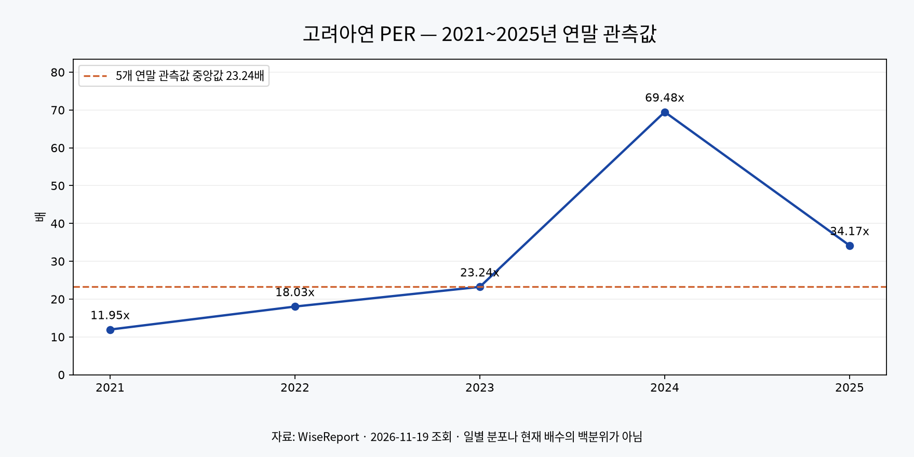
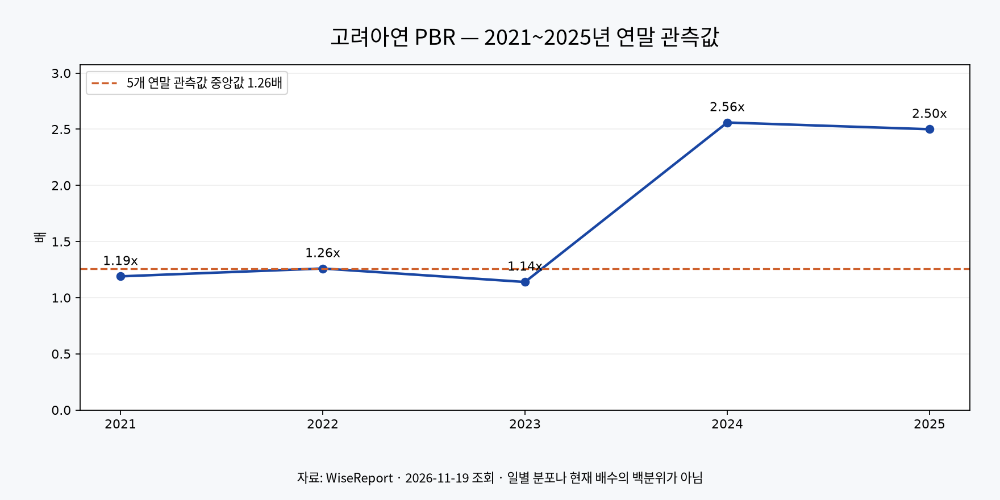

## P/E Valuation Band (4Y)

| Metric | 2025 year-end observation | Min | Median | Max | Percentile | Band |
| --- | --- | --- | --- | --- | --- | --- |
| P/E | 34.2x | 11.9x | 23.2x | 69.5x | 80.0% | upper |

## P/B Valuation Band (4Y)

| Metric | 2025 year-end observation | Min | Median | Max | Percentile | Band |
| --- | --- | --- | --- | --- | --- | --- |
| P/B | 2.5x | 1.1x | 1.3x | 2.6x | 80.0% | upper |

## EV/EBITDA Valuation Chart

> Skipped: insufficient data points. At least 3 years of positive data required.
