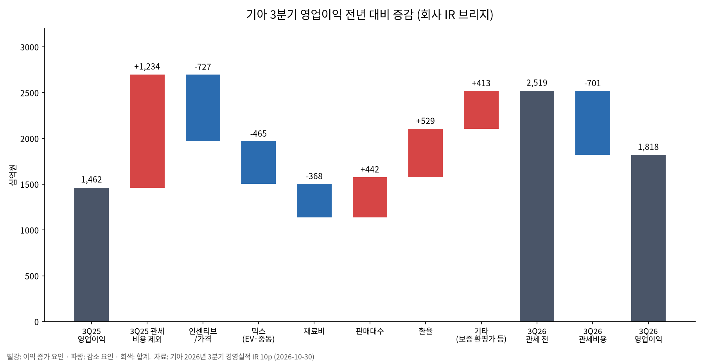

# 기아(000270) | 2026년 3분기 실적 리뷰 — 관세는 줄었는데 왜 이익은 기대에 못 미쳤나

- 대상: 기아
- 티커: 000270
- 기준일: 2026-11-01
- 가격 기준: 2026-10-30 종가 94,800원 (네이버 증권 일별 시세)
- 성격: 2026-10-30 발표된 3분기 잠정실적(연결, 외부감사인 검토 전)에 대한 실적 후 노트. 2026-10-11 작성한 기아 투자 메모의 전제를 이번 숫자로 다시 점검한다.
- 자료 구분: **사실**은 DART 공시·기아 IR 자료, **컨콜 발언**은 언론이 전한 2차 인용, **계산**은 작성자 산출, **추론**은 작성자 해석이다.

## Summary

**3분기 실적, 관세 인하분 5,330억원을 할인과 EV 믹스가 지웠다**

기아의 3분기 영업이익은 1조8,183억원으로 전년보다 24.3% 늘었다. 하지만 FnGuide 컨센서스 2조3,574억원보다 22.9% 적었고, 직전 분기 2조6,286억원보다 30.8% 줄었다. 전년 대비 증가분은 거의 전부 미국 관세 비용 감소(1조2,340억원 → 7,010억원) 덕분이다. 관세를 빼고 보면 영업이익은 전년보다 약 1,770억원 줄었다. 회사는 인센티브·가격(-7,270억원), EV·중동 믹스(-4,650억원), 재료비(-3,680억원)를 감소 요인으로 들었다. [기아 IR 3분기 경영실적](https://worldwide.kia.com/files/investors/business-sales-result/le/215521707/mauv/215523199wkmu.pdf)

[blue: 4분기도 3분기 수준의 이익률이 이어질 것이라고 회사가 직접 말했고, 주가는 발표 당일 12.47% 빠진 94,800원으로 52주 신저가에 마감했다.] 10월 11일 메모에서 잡아 둔 9만~9.5만원 매수 검토 구간에 가격은 들어왔다. 그러나 그 구간의 전제였던 "이익 회복"이 이번 분기에 확인되지 않았다. 그래서 이번에는 가격보다 기준 이익 가정을 먼저 낮춘다.

## 무슨 일이 있었나 — 숫자 요약

3분기 잠정실적 공시 기준이다. 판매대수는 3분기 기준 역대 최다였고 매출도 늘었다. 이익률만 크게 낮아졌다. [DART 잠정실적 공시](https://dart.fss.or.kr/dsaf001/main.do?rcpNo=20261030800558)

| 항목 | 3Q26 | 3Q25 | 전년비 | 2Q26 | 전분기비 |
| --- | ---: | ---: | ---: | ---: | ---: |
| 매출액 | 31조5,974억원 | 28조6,860억원 | +10.1% | 33조0,371억원 | -4.4% |
| 영업이익 | 1조8,183억원 | 1조4,623억원 | +24.3% | 2조6,286억원 | -30.8% |
| 영업이익률 | 5.8% | 5.1% | +0.7%p | 8.0% | -2.2%p |
| 지배주주 순이익 | 1조2,868억원 | 1조4,248억원 | -9.7% | 2조3,276억원 | -44.7% |
| 도매 판매 | 84만7,355대 | 78.5만대 | +7.9% | 85.2만대 | -0.6% |

순이익이 영업이익과 반대로 줄어든 것은 금융·기타손익이 전년 +2,630억원에서 -1,220억원으로 바뀐 영향이 크다. 지분법이익도 1,610억원에서 1,260억원으로 줄었다. [기아 IR 3분기 경영실적](https://worldwide.kia.com/files/investors/business-sales-result/le/215521707/mauv/215523199wkmu.pdf)

판매는 나쁘지 않았다. 미국 소매판매는 23.7만대(+7.8%)로 점유율이 5.3%에서 5.8%로 올랐고, 서유럽은 14.5만대(+16.9%)였다. 인도 도매는 38.5% 늘었다. 반면 아프리카·중동 도매는 중동 분쟁으로 28.4% 줄었다. 전동화 비중은 하이브리드 20.7%, 전기차 14.8%로 각각 5.5%p, 5.9%p 올랐다.

## 왜 기대에 못 미쳤나 — 회사가 밝힌 이유

### 1. 관세 효과를 걷어내면 이익은 줄었다

이번 분기 전년 대비 이익 증가는 대부분 관세가 만들었다. 미국의 한국산 자동차 관세율이 25%에서 15%로 내려가면서 분기 관세 비용이 1조2,340억원에서 7,010억원으로 줄었다. 회사 브리지대로 관세 전 영업이익을 비교하면 3Q25 2조6,960억원, 3Q26 2조5,190억원이다. 관세가 없었다면 오히려 1,770억원 감익이었다는 뜻이다. [현대차그룹 뉴스룸 기아 3분기 실적](https://www.hyundaimotorgroup.com/ko/news/kia-2026-q3-earnings)

| 회사 브리지 항목 (전년 대비) | 금액 | 회사 설명 |
| --- | ---: | --- |
| 관세 비용 감소 | +5,330억원 | 관세율 25% → 15% |
| 인센티브·가격 | -7,270억원 | 인센티브 -6,060억원, 가격 -1,210억원 |
| 믹스 | -4,650억원 | EV 비중 확대, 아중동 판매 차질에 따른 지역·차급 믹스 |
| 재료비 | -3,680억원 | 알루미늄·구리 등 비철금속 가격 상승 |
| 판매대수 | +4,420억원 | 도매판매 +7.9% |
| 환율 | +5,290억원 | 평균 달러원 1,385원 → 1,423원 |
| 기타비용 감소 | +4,130억원 | 판매보증충당부채 환평가 +6,700억원 포함 |

회사가 따로 언급한 중동 영향 -2,090억원은 브리지에 별도 막대가 없다. 감소 요인 합계 1조5,600억원이 인센티브·믹스·재료비 세 항목의 합과 정확히 맞기 때문에, 중동 영향은 믹스 안에 들어간 것으로 읽는다. 둘을 따로 더하면 이중 계산이 된다.

### 2. 가장 큰 구멍은 인센티브, 특히 전기차 할인

감소 요인 중 가장 큰 것은 인센티브다. 매출원가율이 81.1%에서 84.1%로 3.0%p 올랐는데, 회사는 이 중 1.9%p를 인센티브 증가, 1.2%p를 재료비로 설명했다. 국내와 서유럽의 전기차 할인이 중심이었다. 서유럽 EV 판매는 6.3만대로 163% 늘었고 EV 비중은 43.2%까지 올라갔다. [blue: 많이 팔았지만 싸게 팔았고, 그 차들이 원래 이익률이 낮은 전기차였다.]

컨콜에서 회사는 EV 인센티브 전략을 2027년까지 유지하겠다고 했다. 3분기 EV 인센티브는 2분기와 비슷한 수준이라고 했다. 대신 향후 3년 동안 배터리·모터 등 전동화 부품 원가를 연 10%씩 낮춰 2~3년 안에 EV 수익성을 하이브리드 수준으로 끌어올리겠다고 했다. [대한경제 컨콜 정리](https://www.dnews.co.kr/uhtml/view.jsp?idxno=202610301902557110993) [brown: 할인은 지금 확정된 비용이고 원가 절감은 앞으로의 목표라서, 적어도 2027년까지는 할인 부담이 이익률을 누를 가능성이 높다고 본다.]

### 3. 전분기 대비로는 환율이 가장 컸다

전년 대비와 전분기 대비의 주범이 다르다. 2분기 8.0%에서 3분기 5.8%로 이익률이 떨어진 것을 회사 브리지로 보면 환율이 -5,330억원으로 가장 크다. 평균 달러원이 1,502원에서 1,423원으로 5.2%, 유로원이 6.2% 내렸다. 믹스 -1,780억원, 재료비 -1,220억원, 인센티브·가격 -880억원이 뒤를 이었다. [기아 IR 3분기 경영실적](https://worldwide.kia.com/files/investors/business-sales-result/le/215521707/mauv/215523199wkmu.pdf)

회사는 3분기 이익률을 누른 요인을 원자재 1.2%p, 아중동 0.7%p(이상 전년 대비), 환율 1.7%p(전분기 대비)로 정리했다. 기준 시점이 다른 숫자를 회사가 묶어 말한 것이라 단순 합산해서 해석하지 않는다. [헤럴드경제](https://biz.heraldcorp.com/article/10920849)

### 4. 일회성 성격의 보증충당부채 환평가 이익이 꽤 컸다

눈여겨볼 부분은 "기타비용 감소" 안에 있는 판매보증충당부채 환평가 이익이다. 전년 대비 +6,700억원, 전분기 대비 +6,510억원이다. 판관비율이 13.8%에서 10.1%로 낮아진 것도 판매보증비가 9,200억원 줄어든 영향이다.

**계산:** 관세 효과에 이 환평가 효과까지 빼면 전년 대비 영업이익은 약 8,470억원(-1,770억원 - 6,700억원) 줄어든 셈이다. [brown: 환평가 이익은 환율 방향에 따라 반대로 손실이 될 수 있는 항목이라, 반복되는 본업 이익으로 보기는 어렵다고 판단한다.] 전분기 대비로도 환율의 판매 손실 -5,330억원을 환평가 이익 +6,510억원이 사실상 상쇄했다. 원화 강세의 실제 본업 부담은 표면 숫자보다 크다.

## 무엇이 서프라이즈였나

판매대수는 예상대로였다. 실적 전 증권사 프리뷰는 84.4만~84.7만대를 예상했고 실제 84.7만대가 나왔다. 프리뷰의 영업이익 추정치는 2.20조~2.50조원이었다. 실적 전에 7곳 모두 목표주가를 낮춰 이미 눈높이를 내린 상태였는데도, 가장 보수적이던 LS증권 2.2조원보다 실제치가 약 17% 낮았다. **차이는 판매가 아니라 단가와 비용에서 났다.** [디지털데일리](https://www.ddaily.co.kr/page/view/2026103017185984991)

긍정적인 부분도 있다. [red: 미국 하이브리드 판매가 6.9만대로 117.8% 늘었고, 미국 하이브리드 점유율은 10.6%로 4.4%p 올랐다.] HMGMA에서 스포티지 하이브리드 생산도 시작했다. [red: 관세 협상 결과가 실제 비용 감소로 확인됐고, 순현금은 19조7,960억원으로 연초보다 오히려 늘었다.] [기아 IR 3분기 경영실적](https://worldwide.kia.com/files/investors/business-sales-result/le/215521707/mauv/215523199wkmu.pdf)

## 가이던스와 주주환원 — 바뀐 것과 그대로인 것

| 항목 | 회사 입장 (컨콜) |
| --- | --- |
| 2026년 판매 목표 335만대 | 유지 |
| 2026년 수익성 | 연초 가이던스 대비 "다소 미달". 상반기 실적에 3분기 수준 이익률을 더해 추정하라고 언급 |
| 4분기 | "드라마틱한 턴어라운드는 쉽지 않다" |
| 2027년 | 중동 영향이 풀리면 정상 수익성으로 회귀한다는 관점 유지 |
| 중장기 | 영업이익률 10%, 2030년 EV 100만대 계획 유지 |
| 주주환원 | 최소 주당배당금 6,000원, 총주주환원율 35% 유지. 자사주 매입·소각보다 배당을 우선 |

출처는 [대한경제](https://www.dnews.co.kr/uhtml/view.jsp?idxno=202610301902557110993), [뉴스핌](https://www.newspim.com/news/view/20261030001152), [허프포스트코리아](https://www.huffingtonpost.kr/article/261702)다. 연초 가이던스로 알려진 영업이익 10.2조원·이익률 8.3%는 증권사 리포트가 전한 값이라 회사 원문으로는 확인하지 못했다.

"배당 우선" 발언은 숫자로 보면 이해가 된다. **계산:** 3분기 누적 지배주주 순이익 5조4,458억원에 4분기 1.2조~1.5조원을 더하면 2026년 순이익은 6.6조~7.0조원 정도다(4분기는 회사가 말한 3분기 수준 이익률을 쓴 작성자 가정). 최소 배당 6,000원에 상장주식 3억9,041만주를 곱하면 약 2조3,425억원으로, 순이익의 33~35%다. [blue: 배당만으로 총주주환원율 35%를 거의 다 채우므로, 올해 추가 자사주 매입 여력은 크지 않다고 본다.]

같은 날 공시된 자기주식 처분 175만4,496주(0.45%)는 2026년 임금협상에 따라 11월 30일 직원 30,916명에게 지급하는 것이다. 주주환원이 아니라 임직원 보상이며, 처분 후 남는 자사주는 거의 없다. [DART 자기주식처분결정](https://dart.fss.or.kr/dsaf001/main.do?rcpNo=20261030000550)

## 주가 반응은 과했나

10월 30일 기아는 시가 108,600원에서 출발해 장중 93,400원까지 밀렸고 94,800원(-13,500원, -12.47%)에 마감했다. 거래량은 302만주로 직전일의 3배를 넘었다. 최근 1년 기준 종가와 장중 모두 최저치다. [네이버 증권 기아 시세](https://m.stock.naver.com/domestic/stock/000270/price) 같은 날 코스피도 AI 투자심리 위축으로 3.48% 내렸다. 시장 하락을 빼도 기아는 약 9%p 더 빠졌다. [Investing.com 코리아](https://kr.investing.com/news/earnings/article-93CH-2151862)

Street view: 씨티는 목표주가를 124,000원으로 내리고 2026~2028년 순이익 추정치를 13~22% 낮췄다. 국내 증권사의 실적 후 리뷰는 11월 1일 현재 아직 올라오지 않았다. 실적 전 프리뷰 7건의 목표주가는 16만~26만원(중앙값 16.5만원)이었고, 10월 한 달에만 기아 목표주가 하향이 19건이었다. [Investing.com 코리아](https://kr.investing.com/news/earnings/article-93CH-2151862)

[brown: 이익 추정치가 13~22% 내려가는 상황에서 시장 대비 9%p 추가 하락은 과하다고 보기 어렵다. 다만 배당수익률이 6%를 넘으면서 하방을 받치는 힘은 커졌다.]

## 밸류에이션 다시 보기

94,800원 기준 시가총액은 약 37.0조원이다. 3분기 말 연결 순현금은 19조7,960억원으로 시가총액의 절반을 넘는다. 최소 배당 6,000원 기준 배당수익률은 6.3%다.

| 기준 이익 (작성자 계산) | 지배주주 순이익 | PER |
| --- | ---: | ---: |
| 3분기 순이익 × 4 (연환산) | 약 5.15조원 | 약 7.2배 |
| 2026년 추정 (4분기 3분기 수준 가정) | 6.6조~7.0조원 | 약 5.3~5.6배 |

10월 11일 메모의 기준 시나리오는 2027~2028년 정상화 순이익을 7.5조~8.5조원으로 놓고 PER 6~7배를 적용해 115,263~152,403원을 산출했다. 비관 시나리오는 순이익 5.0조~6.0조원이었다. [blue: 3분기 연환산 순이익 5.15조원은 기준이 아니라 비관 시나리오 범위에 들어간다.]

**작성자 가정 수정:** 회사가 2027년에도 EV 인센티브를 유지한다고 했고 원화 강세가 4분기에도 이어질 것이라고 봤으므로(4분기 달러원 1,320~1,340원 언급), 기준 순이익을 6.5조~7.5조원으로 낮춘다. 같은 PER 6~7배를 적용하면 기준 가치는 약 **99,900~134,500원**이다. 현재가는 새 기준 하단보다 약 5% 낮다. 기존처럼 기준 하단에 20% 안전마진을 요구하면 매수 검토 가격은 약 8만원 수준으로 내려간다. 이는 회사 목표나 증권사 목표주가가 아닌 작성자의 가정이다.

## 투자 논리에서 바뀐 것

10월 11일 메모의 철회 조건 중 하나는 "영업이익률 7% 미만이 두 분기 지속"이었다. 3분기 5.8%가 나왔고 회사는 4분기도 비슷하다고 했다. 4분기 실적이 나오는 2027년 1월 말이면 이 조건이 충족될 가능성이 높다. 미국 SUV·하이브리드 판매 기반과 관세 부담 완화라는 강점은 확인됐다. 하지만 그 이익이 유럽·국내 전기차 할인과 원화 강세로 새어 나가는 구조도 함께 확인됐다.

**판단:** 기존 "가격 조건부 매수 검토"에서 **"관찰 유지, 이익 가정 하향"**으로 한 단계 낮춘다. 배당수익률 6%대와 순현금이 하방을 받치므로 매도 근거로 보지는 않는다. 다만 9만원대라는 가격만으로 매수 조건이 충족됐다고 보지 않는다. 아래 세 가지 중 둘 이상이 확인되면 다시 높인다.

1. **EV 인센티브의 정점 확인:** 4분기 또는 2027년 1분기 브리지에서 인센티브·가격 항목이 전년 대비 플러스로 돌아서는지 본다. 회사는 3분기 EV 인센티브가 2분기 수준이라고 했다.

2. **환평가를 뺀 본업 이익률:** 판매보증충당부채 환평가를 제외하고도 영업이익률 7% 이상을 지키는지 본다. 환평가 이익이 손실로 돌아서면 표면 이익률은 더 낮아질 수 있다.

3. **주주환원의 실제 규모:** 2026년 결산 배당이 최소 6,000원을 넘는지, 자사주 매입이 사실상 중단되는지 본다. 배당 우선은 총주주환원율 35% 안에서의 순서 변경일 뿐 환원 확대가 아니다.

## 앞으로 볼 일정

- 2026-11-02 이후: 국내 증권사 실적 리뷰 리포트와 목표주가 변경. 2027년 영업이익 추정치(실적 전 한화 11.16조원, 키움 10.93조원)가 얼마나 내려오는지 본다.
- 2026-11-04~05: 국내 NDR. 2027년 사업계획과 EV 인센티브 언급을 확인한다.
- 2027년 1월 말: 4분기 실적과 2027년 가이던스, 결산 배당.

본 메모는 공개 자료의 사실 정리와 조건부 계산이며 매매 권유가 아니다.

### 확인 한계

컨퍼런스콜 발언은 회사 녹취나 스크립트가 아직 게시되지 않아 언론 보도를 통한 2차 인용이다. 2분기 관세 비용 절대액과 유로원 평균환율 절대값은 IR 자료에 없어 확인하지 못했다. 국내 증권사의 실적 후 리포트는 11월 1일 기준 공개된 것이 없어 실적 전 프리뷰만 반영했다. 일부 매체는 10월 30일 종가를 95,600원(-11.73%)으로 보도했으나, 네이버 증권 일별 시세의 확정 종가 94,800원(-12.47%)을 기준으로 했다.

## Sources

- [DART 잠정실적 공시 (2026-10-30)](https://dart.fss.or.kr/dsaf001/main.do?rcpNo=20261030800558)
- [DART 자기주식처분결정 (2026-10-30)](https://dart.fss.or.kr/dsaf001/main.do?rcpNo=20261030000550)
- [기아 IR 2026년 3분기 경영실적](https://worldwide.kia.com/files/investors/business-sales-result/le/215521707/mauv/215523199wkmu.pdf)
- [현대차그룹 뉴스룸 기아 3분기 실적](https://www.hyundaimotorgroup.com/ko/news/kia-2026-q3-earnings)
- [대한경제 컨콜 정리](https://www.dnews.co.kr/uhtml/view.jsp?idxno=202610301902557110993)
- [뉴스핌](https://www.newspim.com/news/view/20261030001152)
- [디지털데일리](https://www.ddaily.co.kr/page/view/2026103017185984991)
- [헤럴드경제](https://biz.heraldcorp.com/article/10920849)
- [허프포스트코리아](https://www.huffingtonpost.kr/article/261702)
- [Investing.com 코리아](https://kr.investing.com/news/earnings/article-93CH-2151862)
- [네이버 증권 기아 시세](https://m.stock.naver.com/domestic/stock/000270/price)
