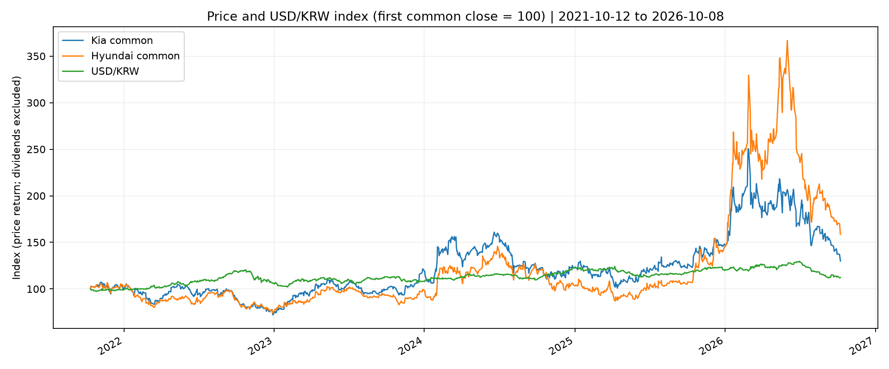
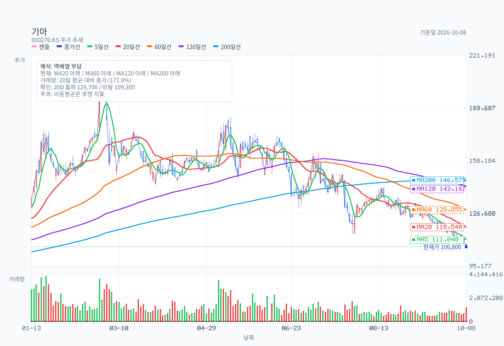
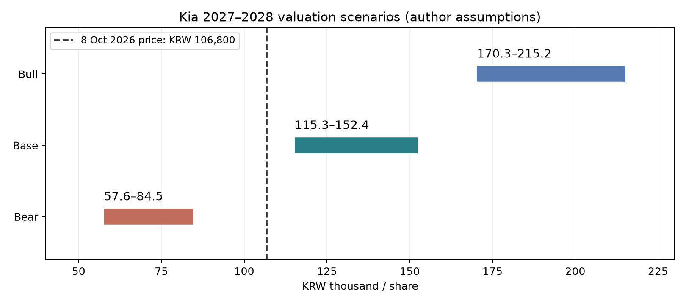

# 기아: 현대차와 한국·미국 동급 차량을 비교해봤다

기준일: 2026-10-11
최근 업데이트일: 2026-10-11

## 자료 범위

- 주가 기준: **2026-10-08 종가**. 10월 9일 한글날 휴장, 10~11일 주말.
- 대상: 기아 보통주 **000270**, 필수 비교 현대차 보통주 **005380**
- 투자 기간: 향후 1~2년. 다른 제조사는 차량 경쟁력 비교 대상으로 한정한다.
기업 유형: 경기민감 완성차 제조업. SUV·HEV 구성, 미국 판매의 질, 관세·현지화 비용, 현금 환원이 핵심이다.

자료 구분: **사실**은 공시·제조사 자료, **계산**은 수록 원자료에서 산출, **추론/가정**은 작성자의 투자 판단이다.

## Decision Frame

**판단: 기아는 현대차보다 자동차 본업의 이익과 배당에 투자하려는 경우 상대적으로 매력적이다. 신규 매수는 가격 안전마진 또는 이익 회복 확인을 조건으로 둔다.** 106,800원은 기준 시나리오 하단 115,263원보다 약 8% 낮다.

비관 시나리오에서는 57,631~84,526원까지 가치가 내려가므로 낮은 PER만으로 충분한 안전마진을 확보했다고 판단하지 않는다. 아래 가치는 회사 목표나 증권사 목표주가가 아니라 작성자의 가정이다.

| 판단을 바꾸는 질문 | 현재 판단과 확인 조건 |
| --- | --- |
| 미국 판매 증가가 할인 이후 이익으로 남는가? | 모델 판매량과 미국 HEV 확대는 긍정적이다. 모델별 실거래가·이익률은 별도로 확인되지 않아 판매 증가만으로 수익성 개선을 확정할 수 없다. |
| 기아와 현대차의 본업 마진 차이가 유지되는가? | 현대차 금융사업을 분리한 자동차부문과 기아 연결을 비교한다. 제조 기반·차종 구성·회계 범위가 완전히 동일하지는 않다. |
| 관세와 환율이 수익성 개선을 상쇄하는가? | 통관가격, 생산지, 미국 부품 조달, 인센티브와 보증충당부채를 함께 확인한다. 달러 강세를 무조건 호재로 보지 않는다. |
| 매수 가격은 얼마인가? | 기준 가치 하단에 20% 안전마진을 적용하면 **약 92,200원**. 실적 전제가 유지될 때 **9만~9.5만원**을 가격 조건으로 둔다. 10.68만원 부근에서는 아래 실적 확인 조건을 우선한다. |
| 무엇이 추론의 한계인가? | 모델별 이익률·실거래가와 지역별 순이익을 확인하지 못한 항목은 계산하지 않는다. 수록된 가격과 판매의 시점이 달라 가격 탄력성을 직접 추정하지 않는다. |

## 사업과 투자 논리

기아의 투자 논리는 완성차 판매량 증가 자체보다 **고수익 차종 구성과 관세 이후 이익 회복**에 있다. 미국 SUV·HEV, 한국 HEV·EV, 유럽 EV의 수요를 각각 따로 본다.

현대차와 플랫폼·기술·공급망을 공유한다는 점은 개발 규모의 장점인 동시에 그룹 내 거래·자본 배분과 공동 품질 문제의 위험이다. 현대차 주식 보유로 기아의 차량 이익을 간접 보유하는 것과 기아 보통주를 직접 보유하는 것은 배당·금융사업·지분법·우선주 때문에 동일하지 않다.

실적·차량·주가의 비교표는 뒤의 검증된 자료와 연결한다. 회사의 미래 목표는 실현된 이익으로 취급하지 않는다.

특히 로보틱스·자율주행의 가치를 자동차 정상 이익 PER에 추가하려면 지분 귀속, 매출과 현금 흐름의 별도 증거가 필요하다. 이번 기준 가치에는 별도의 미래사업 프리미엄을 넣지 않았다.

### 동급 SUV·HEV·EV 판매와 공개 구매가

2026년 1~9월 미국 스포티지 145,746대(+8.7%)는 투싼 181,687대(+10.0%)보다 작지만, 텔루라이드 110,038대(+19.0%)는 팰리세이드 98,682대(+6.4%)를 앞섰다. 토요타 RAV4는 253,664대(−29.2%), 혼다 CR-V의 2차 집계는 336,844대(+9.5%), 포드 익스플로러는 189,210대(+17.6%)다.

한국에서는 쏘렌토 74,933대(+1.7%), 스포티지 46,015대(−17.4%), 셀토스 39,701대(−7.8%)로 미국과 방향이 다르다. 같은 기간 미국 EV6 6,264대(−43.5%)와 국내 EV6 7,197대(−11.6%)도 약하다.

차급별 주요 경쟁차의 **양국 판매량·증감 대수·증감률 표**는 동급 차량 근거표에 실었다.

LA·애틀랜타·뉴욕권의 특정 VIN 공개 호가 스냅샷도 같은 근거표에 제조사 혜택·딜러 수수료와 함께 정리했다. 예를 들어 LA의 스포티지 2026 LX FWD 광고가는 $30,657, RAV4 2026 LE HEV FWD는 $35,115다.

검색 수집 시점이 9월인 행도 있어 10월 11일 유효한 오퍼로 보장하지 않는다. **가솔린과 하이브리드의 차이**, 재고·지역·프로모션 시점 차이가 있으므로 차액을 동일사양 가격 우위나 실제 계약가로 해석하지 않는다.

공개 견적에서 세금·등록비를 제외한 가격이며, 모델별 인센티브·마진을 추정하는 입력으로 직접 쓰지 않았다.

## 기업 실적·자동차 수익성·현금 흐름

**공시 사실/계산:** 기아 2025 연결감사·2026 반기 연결검토, 현대차 2026 반기 연결검토 원문을 기준으로 했다. 반기 누적과 독립 분기를 구별한다.

아래는 **조원**, 마진·성장률은 계산이다. [기아 연결검토](https://worldwide.kia.com/files/investors/audit-business-report/zh/211913106/xdaa/211913123cjep.pdf), [기아 연간감사](https://worldwide.kia.com/files/investors/audit-business-report/vj/203433769/pgxh/203433757ktha.pdf), [현대차 연결검토](https://www.hyundai.com/content/dam/hyundai/ww/en/images/company/investor-relations/financial-Information/report-en/2026/2026-q2-consolidated-audit-report-en.pdf).

| 회사·기간 | 매출 | 영업이익 | 이익률 | 지배 순이익 |
| --- | ---: | ---: | ---: | ---: |
| 기아 2024 연간 | 107.449 | 12.667 | 11.79% | 9.773 |
| 기아 2025 연간 | 114.141 | 9.078 | 7.95% | 7.561 |
| 기아 2025 상반기 | 57.367 | 5.773 | 10.06% | 4.662 |
| 기아 2026 상반기 | **62.539** | **4.834** | **7.73%** | **4.159** |
| 현대차 2025 상반기 | 92.694 | 7.235 | 7.81% | 6.156 |
| 현대차 2026 상반기 | **95.154** | **5.366** | **5.64%** | **4.856** |

기아 상반기 매출 +9.01%, OP -16.28%, 지배 순이익 -10.79%; 현대차는 +2.65%, -25.84%, -21.11%다. 기아가 상대적으로 방어했지만 양사 모두 매출 증가가 이익 증가로 이어지지 않았다.

기아의 2026년 2분기 OP는 2.629조원, 마진 7.96%(공식 발표 반올림 8.0%)로 1분기 7.5%에서 회복했다. 이 개선을 연간 실적 확정으로 확대하지 않는다.

| 같은 상반기 2026 비교 | 기아 | 현대차 | 범위 차이 |
| --- | ---: | ---: | --- |
| 본업 비교 매출, 조원 | 연결 62.539 | 자동차 외부매출 71.371 | 현대차 내부거래 매출 제외 |
| 이익, 조원 | 연결 OP 4.834 | 자동차 부문 OP 3.845 | 현대차 연결조정 별도 |
| 이익률, % | **7.73** | **5.39** | 완전히 같은 회계범위는 아님 |
| 금융부문 OP, 조원 | 분리된 대규모 금융 연결부문 없음 | **1.338** | 현대차 금융영업을 자동차와 구분 |
| 관계·공동기업 투자손익, 조원 | **0.358** | **1.320** | 영업이익 아래; 현대차 수치 전체를 기아 기여로 표현하지 않음 |

현대차는 기아 지분 **35.17%**를 보유하고 지분법을 적용한다. 기아의 높은 이익 일부가 현대차 투자자에게도 간접 귀속된다.

양사 동시 투자 시 기아 이익과 그룹 공통 위험에 일부 중복 노출된다. 기아는 모델별 이익률을 보고하는 구조가 아니므로 스포티지·쏘렌토의 이익률을 이 표에서 분배하지 않았다.

제품 구성은 공시 분류를 유지했다. 기아 2025 세계 SUV 비중 69%, 미국 RV 75.0%·전동화 20.7%는 서로 분모·차종 범주가 다르다. 2026 상반기 미국 HEV 10.6만대(+115.1%), 판매비중 24.6%는 미국 제품 구성 개선을 보여준다.

현대차는 제네시스와 금융사업을 포함하므로 브랜드별 RV/SUV를 동일 분류로 검증하지 않은 채 비중 우위를 단정하지 않는다. [기아 2026-09 투자자 자료](https://worldwide.kia.com/files/investors/ir-activities/gp/212366693/vtqa/212366785zmyx.pdf), 양사 공시 분석.

| 현금 흐름, 조원 | 기아 2025 | 기아 2026 상반기 | 현대차 2026 상반기 |
| --- | ---: | ---: | ---: |
| 영업현금흐름 | 9.054 | 7.167 | 4.850 |
| 유형·무형 취득 현금지출 | 4.993 | 2.334 | 5.138 |
| 단순 FCF | **4.061** | **4.833** | **-0.289** |

FCF는 영업현금흐름에서 유형·무형 취득을 뺀 파생치다. 현대차에는 금융채권·리스영업이 섞여 있어 자동차부문 FCF의 우열 표로 읽지 않는다.

기아 상반기의 양호한 현금 창출도 운전자본 계절성이 있어 두 배로 연율화하지 않는다. 기아 2025 FCF/2026-10-08 시총 약 41.696조원 = **9.74%**는 연간 과거 현금 흐름을 현재 가격으로 나눈 참고 수익률이다.

현대차의 같은 자동차부문 FCF 수익률은 미확인이다.

기아 2026-06-30 **단순 순현금 21.397조원**은 현금+단기금융상품에서 공시된 차입금·사채를 뺀 값이다. 리스부채와 장기 금융상품은 제외했다.

운영·설비·개발·품질 대응 자금까지 전부 배당할 수 있는 현금으로 보지 않는다. 지배자본은 64.688조원이다.

현대차 금융부문 부채 206.853조원은 금융자산 영업의 조달재원이며 전체를 자동차 순차입금으로 차감하는 EV 계산은 하지 않는다.

## 주주환원과 지배구조

기아 [2026 CEO Investor Day](https://www.kiamedia.com/us/en/media/pressreleases/24588/2026-kia-ceo-investor-day)는 2026~2028 TSR 35% 이상을 배당·자사주 매입 및 소각으로 목표한다. 현대차 [2026 CEO Investor Day](https://www.hyundai.news/uk/articles/press-releases/2026-ceo-investor-day.html)는 이익 대비 환원 35% 이상, 최소 연 DPS 10,000원·분기 2,500원 정책을 설명한다.

이것은 회사 정책이지 주식 투자자의 연간 수익률 35% 보장이 아니다. 기아는 현재가 대비 과거 배당수익률이 높고, 현대차는 최소 DPS 정책과 금융·제네시스·미래사업 노출을 함께 가진다.

기아의 최신 정정 반기보고서는 2026-09-16 정정 내용을 포함한다. 임직원 보상용 자기주식 **1,810,273주** 계획의 취득/처분 기재 수정이며 이를 소각으로 간주하지 않는다.

[기아 정정 반기보고서](https://worldwide.kia.com/files/investors/audit-business-report/xv/211913165/cqvu/211913201qkrf.pdf). 상장주식수·자기주식·기말 유통주식수·가중평균 EPS 분모를 구별한다.

기아 연결 주석에는 **매출 10% 이상인 단일 외부고객이 없다고 명시**되어 있다. 개별 상위고객의 정확한 비중은 따로 확인되지 않았다.

관련당사자·대규모기업집단의 순수 매출 열을 합한 2025 매출 5.117조원은 연결매출의 약 4.48%다. 별도재무제표의 계열사 내부매출 비중과 다르다.

그룹 판매망·공동 개발·지분 구조 때문에 공동 위험이 존재하지만 이를 단일고객 집중으로 잘못 표시하지 않는다.

## DART Recheck

| 투자 중요 주장 | 결과 | 확인 범위 |
| --- | --- | --- |
| 기아 H1 매출62.539조·OP4.834조 | 확인 | 반기 연결검토 PDF8쪽 |
| 기아 본업 마진이 현대차보다 높다 | 부분 확인 | 기아7.73%/현대차 자동차 외부매출 분모5.39%; 부문·연결조정 차이 |
| 현대차 금융부채 모두 자동차 순차입금이다 | 반박 | 현대차 주석37 PDF65쪽 |
| 현대차 전체 지배이익/보통주수로 EPS를 계산해도 된다 | 반박 | 우선주 이익배분 주석30 PDF54쪽 |
| 기아 현금 창출은 양호하다 | 기간 한정 확인 | 기아 반기검토 PDF11쪽 FCF 계산 |
| 기아 모델별 이익률은 공개되어 있다 | 확인한 부문 주석에서 미공시 | 단일 보고부문; 모델별 이익 분해 없음 |
| 기아 10% 이상 단일 외부고객이 없다 | 확인 | 연간감사 주석4·반기검토 PDF18쪽 |
| 원화 약세는 항상 이익에 긍정적이다 | 반박 | 보증부채 환산 부담·현대차 공식 손익 브리지 |

접근·검증 한계: OpenDART 키가 없어 기아의 DART 출력형 사업·정정 반기보고서와 공식 감사·검토 PDF를 읽었다. 현대차 반기 검토주석은 읽었지만 최신 연간 DART 전체 목차 심층 검토는 완결하지 못했다.

모든 PDF 페이지의 문자 추출과 모든 문단의 독립 검증은 다르다. 상세 문서 목록·쪽수·커버리지는 공시 분석과 커버리지 기록에 보존했다.

## 관세·환율·주가

확인한 [미 상무부·USTR 시행 공고](https://www.federalregister.gov/documents/2025/12/04/2025-21940/implementing-certain-tariff-related-elements-of-the-us-korea-strategic-trade-and-investment-deal)는 한국산 해당 자동차·부품의 기본세율과 추가 232조 관세 합계를 15%로 정했다(기본세율 15% 미만 조건, 2025-11-01 통관분 소급). **이 문서 확인을 2026-10-11 모든 세번의 실효세율을 전수 검증했다는 의미로 읽으면 안 된다.** 후속 정책과 원산지·상계 조건은 회사의 실제 관세 비용과 함께 확인한다.

MSRP에 15%를 곱해 제조사 관세 비용을 계산하지 않았다. 자세한 범위는 정책 검증에 남겼다.

**계산:** 공통 일자 2021-10-12를 100으로 놓으면 2026-10-08 기아 **129.93**, 현대차 **158.68**, 달러원 **112.21**이다. 주가는 배당을 포함하지 않은 비조정 종가, 환율은 Yahoo Finance의 참고용 통화 호가다.

배당 재투자 수익률 비교나 한국은행 고시 환율 비교가 아니다. 환율 마지막 값은 1,342.99원/$이며 한국 종가 시각과 완전히 일치하는 가격은 아니다.

국가 간 차량 가격을 이 환율로 환산해 저렴함을 판정하지 않았다.

| 완결 월간 변화율 기간 | 표본 수 | 기아–달러원 상관 | 현대차–달러원 상관 |
| --- | ---: | ---: | ---: |
| 전체, 2021-11~2026-09 | 59 | -0.020 | -0.062 |
| 2022년 | 12 | +0.098 | -0.003 |
| 2023년 | 12 | +0.079 | -0.048 |
| 2024년 | 12 | +0.270 | -0.114 |
| 2025년 | 12 | -0.017 | +0.079 |
| 2026년 1~9월 | 9 | -0.176 | -0.049 |

전체 양사 주가의 월간 변화율 상관은 **0.867**이다. 원/달러 변화와 주가 변화의 동시 상관은 약하고 구간별 부호도 바뀐다.

표본이 작은 연도별 상관으로 미래 수익률을 예측하지 않는다. 환율의 영업 효과가 없다는 뜻도 아니다.

수요·관세·할인·시장 배수 변화가 함께 주가에 반영되며, 외화 보증부채는 기말 환율의 영향을 받는다.

## 현재 가치평가와 과거 범위

시세 2026-10-08, 재무 공급자 FnGuide 조회 2026-10-11. 실제·전망·정책을 분리했다.

[기아 EPS·BPS](https://navercomp.wisereport.co.kr/v2/company/c1050001.aspx?cmp_cd=000270&cn=), [현대차 EPS·BPS](https://navercomp.wisereport.co.kr/v2/company/c1050001.aspx?cmp_cd=005380).

| 항목 | 기아 보통주 | 현대차 보통주 | 기준 |
| --- | ---: | ---: | --- |
| 종가, 원 | 106,800 | 324,500 | 2026-10-08 |
| 최근 4분기 EPS, 원 | 18,004 | 30,697 | 공급자 TTM; 연간실적과 구별 |
| PER, 배 | **5.93** | **10.57** | 종가/TTM EPS |
| 최근 분기 BPS, 원 | 166,439 | 467,197 | 공급자 기준 |
| PBR, 배 | **0.64** | **0.69** | 종가/BPS |
| 2025 ROE, % | 12.9 | 8.4 | 연간 실제; 증권사 실적표 |
| 2025 회계연도 보통주 DPS, 원 | 6,800 | 10,000 | 공식 IR 배당 이력 |
| 위 DPS/현재 종가, % | **6.37** | **3.08** | 세전·과거 배당 기준; 미래 확정액 아님 |
| 2026E EPS, 원 | 20,765 | 36,678 | 기아 한화 10-08 / 현대차 FnGuide 전망, 공급자 다름 |
| 위 전망 EPS로 계산한 PER, 배 | 5.14 | 8.85 | 전망 가정 참고치 |
| 2027E EPS, 원 / PER, 배 | 22,942 / 4.66 | 41,359 / 7.85 | 위 공급자 전망; 확정 실적 아님 |

현대차에는 여러 우선주가 있고 금융사업을 연결한다. 보통주 시총을 전체 지배 순이익에 나누면 우선주 몫을 무시한다.

현대차 한화 보고서 자체 EPS 38,548원(2026E)은 위 공급자 EPS와 달라 동일 기준 비교에서 제외했다. 보통주 EPS와 자동차부문 이익률을 우선하며 금융부채 전체를 자동차 제조부문의 순차입금으로 쓰지 않았다.

EV/EBITDA의 공통 자동차 사업 기준과 장기 일간 배수 밴드는 이번 자료에서 완성하지 못했다.

| 연말 표본 | 기아 PER / PBR, 배 | 현대차 PER / PBR, 배 |
| --- | ---: | ---: |
| 2021 | 7.00 / 0.94 | 미확인 |
| 2022 | 4.44 / 0.60 | 5.68 / 0.48 |
| 2023 | 4.59 / 0.85 | 4.67 / 0.58 |
| 2024 | 4.12 / 0.71 | 4.60 / 0.51 |
| 2025 | 6.37 / 0.77 | 8.39 / 0.67 |

출처: 기아는 [WiseReport 기반 과거 표의 2차 집계](https://jugamap.keywordegg.com/stock/000270/valuation), 현대차는 위 FnGuide 실적표. **연말 점 표본이며 일간 역사 밴드·분위수가 아니다.** 연간 실적을 사후 반영하므로 당시 알려진 선행 배수와도 다르다.

기아 현재 PBR은 이 표본의 하단에 가깝지만 PER은 중상단이다. 현재 PER이 최근 몇 년의 최저라고 표현하지 않는다.

미래 이익률이 낮아지면 낮은 PBR의 할인도 정당화될 수 있다. 상세 계산과 공급자 차이는 시장 자료 분석에 기록했다.

## Street / Alternative Views

최근 365일 창(2025-10-11~2026-10-11) 한경 공개 검색에서 양사 각각 42개 보고서를 발견하고 전부 다운로드·추출했다. 전체 기간 보고서 반복 평균과 **브로커별 최신 1개** 집계를 구별했다.

기아 최신 9개 브로커 중 TP가 있는 8개 중앙값 21만원(17만~26만원), 현대차 9개 중앙값 67만원(57만~95만원)이다. 일부는 수개월 오래된 보고서이며 시장 전체 실시간 컨센서스는 아니다.

출처 역할은 **증권사 전망**으로, 공시 사실과 다르다. 기아 digest, 현대차 digest.

| 보고서 | 핵심 논점, 작성자 요약 | 이번 판단과의 관계 |
| --- | --- | --- |
| [한화 기아, 2026-10-08](https://consensus.hankyung.com/analysis/downpdf?report_idx=652811), TP 26만원 | 2026E OP 9.832조, 2027E 11.157조. 단기 EV 믹스·원자재 부담과 중기 북미 HEV 현지생산 효과 | 이익 전망은 회복을 시사하지만 이번 기준은 더 낮은 9.5~10.5조 범위를 사용 |
| [LS 기아, 2026-07-27](https://consensus.hankyung.com/analysis/downpdf?report_idx=651125), TP 20만원 | 외형과 이익 성장의 간격, 관세·환율 영향 | 판매만으로 이익 증가를 단정하지 않는 근거 |
| [메리츠 기아, 2026-07-27](https://consensus.hankyung.com/analysis/downpdf?report_idx=651089), TP 22만원 | 기아의 차량사업 비교 우위와 자동화·로봇 기대 | 본업 비교는 검증하고 미래사업 옵션은 이번 가치에서 제외 |
| [한화 현대차, 2026-10-08](https://consensus.hankyung.com/analysis/downpdf?report_idx=652810), TP 67만원 | 생산 정상화·신차로 반등 예상, 2027E OP 12.459조 | 현대차 회복 시 상대 기아 우위가 줄 수 있다는 반증 |

기아 목표주가에는 미래사업 기대와 적용 배수가 섞여 있어 이번 자동차 정상 이익 가치와 차이가 크다. 목표 상승여력만으로 매수하지 않는다.

자동 추출에서 iM 기아 TP 24,000원은 PDF 대조 후 240,000원으로 교정했고, 현대차 유안타 투자의견도 PDF로 교정했다. 원본과 교정본은 모두 보존했다.

네이버 블로그는 요청 범위에 따라 수집하지 않았으며 외국계 IB 의견을 기억에서 추가하지 않았다.

## Chart and Positioning

2026-10-08 종가 106,800원은 MA5 **111,040**, MA20 **118,540**, MA60 **128,855**, MA120 **143,187**, MA200 **146,575**원을 모두 밑돈다. RSI14 **17.11**, MACD **-5,232.97**, ADX14 **27.28**, 거래량은 20일 평균의 **171%**다.

볼린저 하단 106,873원 아래, 일목 구름대 아래이고 하락 방향의 추세가 나타난다. 과매도는 가격 매수 조건을 대신하지 않는다. 1차 회복 확인은 113,050원 전환선과 MA20, 이후 MA60이다.

과거 데이터에서 만든 고정 지표라 미래의 같은 가격이 계속 같은 지표가 되는 것은 아니다. 상세 차트와 보조 지표.

### Rule Screen

Minervini 가격·이평 조건은 실패, 전체 판정은 시장 전체 RS 원자료가 없어 **incomplete**이다. KRX 52주 신고가 리더십 점수도 시장 전체 자료 부족을 명시하며 상대강도 순위를 만들어 넣지 않았다.

규칙별 확인표. 가치 매수와 추세 매수의 조건을 구분한다.

가격 조건에 도달해도 핵심 이익 전제가 약해지면 매수 구간을 다시 계산하고, 추세 확인을 선호하면 MA20 회복·유지 후 영업실적 확인을 함께 기다린다.

## 가치평가 시나리오와 매수 조건

2027~2028년의 정상화 이익을 평가하는 **작성자 가정**이다. 주식수는 390,412,998주를 고정했다.

자기주식을 제외한 평균 유통주식수 대신 상장주식수를 쓰는 보수적 단순화이며, 추가 소각 효과는 반영하지 않았다. 매출·영업이익·순이익은 각각 독립 가정이므로 세율이나 지분법 이익을 임의의 고정 공식으로 확정하지 않는다.

| 가정 | 비관 | 기준 | 낙관 |
| --- | ---: | ---: | ---: |
| 매출, 조원 | 115~125 | 125~135 | 135~150 |
| 영업이익, 조원 | 6.5~8.0 | 9.5~10.5 | 12.0~13.5 |
| 지배 순이익으로 사용하는 가정, 조원 | 5.0~6.0 | 7.5~8.5 | 9.5~10.5 |
| EPS, 원/주 | 12,807~15,368 | 19,210~21,772 | 24,333~26,895 |
| 적용 PER, 배 | 4.5~5.5 | 6.0~7.0 | 7.0~8.0 |
| 적정 가치, 원/주 | **57,631~84,526** | **115,263~152,403** | **170,332~215,157** |
| 106,800원 대비 가격 변화, 배당 제외 | -46.0~-20.9% | +7.9~+42.7% | +59.5~+101.5% |

비관은 수요 둔화, 관세 순부담 확대, 미국·유럽 가격 경쟁과 달러원 1,250~1,350원 가정이다. 기준은 관세 제도의 큰 추가 악화 없이 미국 HEV·텔루라이드 성장과 현지화가 할인·증설 비용을 상쇄하고 달러원이 1,350~1,450원인 경우다.

낙관은 현지화 가동률 상승, 관세 순부담 완화, ASP·HEV 구성 개선과 할인 통제, 달러원 1,450~1,550원 가정이다. 환율은 시나리오 환경 변수이며 원당 영업이익 민감도를 역산한 결과가 아니다.

낙관에서조차 보증비용 통제를 요구한다.

기준 PER 6~7배는 저평가가 일부 해소된다는 가정이고, 낙관 7~8배는 이익 성장과 현금 환원의 지속성을 요구한다. 역사 밴드와 비교하더라도 과거 상단 배수에 최고 이익을 동시에 적용하는 것은 피한다.

기아 지배 순이익 1조원 변화는 이 주식수에서 EPS 약 **2,561원**, PER 6배에서 가치 약 **15,369원**의 차이를 만든다.

**가격 조건:** 기준 하단 115,263원 × 80% = 92,210원이다. 따라서 실적 전제가 유지될 때 9만~9.5만원을 분할 매수 검토 구간으로 설정한다.

비관 가치보다 높아 원금 보호를 뜻하지 않는다.

**실적 확인 조건:** 현재가 부근에서는 연속 두 분기 영업이익률 8% 이상, 인센티브·판매보증 비용의 매출 대비 비율 안정, 미국 HEV·핵심 SUV 판매 증가, 현지화 생산 증가와 가동률 개선, 선언한 주주환원의 실제 집행을 함께 요구한다. 8%는 작성자의 체크 기준이며 공시 확정 목표와 구별한다. 조건이 충족되면 가격만 기다리기보다 기준 가치의 이익 가정을 다시 계산한다.

**철회 조건:** 이익률 7% 미만이 두 분기 지속되거나, 판매 증가에도 할인·품질 비용이 악화하거나, 관세·현지화 비용이 예상보다 커지는 경우 기준 이익 가정을 하향한다. 배당수익률이 높아졌다는 이유로 자동 매수하지 않는다.

향후 배당은 순이익과 자본 배분에 따라 달라진다.

## Uncomfortable Questions

1. 스포티지·텔루라이드의 판매 성장에서 신차 효과와 할인 확대를 어떻게 분리할 것인가? 공식 ASP가 올라도 지역·사양 구성과 환율이 원인일 수 있다.
2. 기아가 현대차보다 높은 본업 마진을 관세·현지화·보증비용 이후에도 유지할 수 있는가? 연결 범위가 다른 두 수치를 단순히 우열로 읽어서는 안 된다.
3. EV 판매 확대가 매출만 늘리고 차량당 공헌이익을 낮추는 것은 아닌가? EV6의 가격 재설정과 다른 EV 출시가 기존 모델을 잠식하는지도 확인해야 한다.
4. 원화 약세를 기대했는데 기말 보증충당부채와 해외 투자 비용이 이득을 상쇄하면 무엇이 남는가?
5. TSR 35% 이상 목표가 투자자에게 연 35% 수익을 약속하는 것으로 오해되고 있지 않은가? 회사의 이익 대비 환원 비율과 주가 수익률은 서로 다르다.

## Decision-Changing Issues

| 우선순위 | 확인할 변수 | 판단 변화 |
| --- | --- | --- |
| 1 | 관세·인센티브·보증비용 이후 영업이익률 | 8% 이상 지속이면 정상 이익 유지, 7% 미만 지속이면 기준 시나리오 하향 |
| 2 | 미국 HEV·텔루라이드·스포티지의 판매 구성과 현지 생산 | 판매 증가와 할인 안정이 동반될 때 본업의 재평가 근거 강화 |
| 3 | 영업현금흐름, 투자 지출과 환원 집행 | 이익 성장에도 현금 전환이 악화하면 높은 배당의 지속성 재검토 |
| 4 | EV6·EV9의 가격·인센티브와 모델 간 잠식 | 전기차 물량 증가보다 공헌이익 방어 여부가 중요 |
| 5 | 현대차와 기아의 상대 배수 및 지분법·금융 영향 | 기아의 이익 우위가 줄거나 상대 가격이 크게 오르면 상대 매력 재검토 |

## Structured Stance

- 현재 스탠스: **기아를 상대적으로 선호하되 신규 매수는 조건부.** 본업 현금 흐름과 배당을 우선하는 관점이다.
판단의 근거: 낮은 현재 PER, 미국 SUV·HEV의 판매 기반, 관세 충격 이후 이익 회복 가능성. 기준 가치에 미래사업 옵션 프리미엄은 넣지 않았다.

현 단계의 제약: 현재가의 기준 가치 하단 대비 할인은 약 8%이며 모델별 이익률·실거래가를 충분히 관측할 수 없다. 가격 하락과 기술적 과매도를 가치 확정으로 취급하지 않는다.

매수 판단이 강화되는 조건: 9만~9.5만원 가격 구간에서 이익 전제 유지, 또는 현재가 부근에서 위 실적 확인 조건 충족.

판단이 약해지는 조건: 할인·관세·보증비용 악화로 영업이익률 7% 미만 지속, 현금 환원 축소, 핵심 차종 수요 약화.

## Update Log

### 2026-10-11 — 최초 상세 분석

한국·미국 차량 비교, 현대차 기업 비교, 공식 공시·IR, 최근 365일 증권사 자료, 최근 5년 주가·환율을 결합한다. 같은 날 동급 SUV·HEV·EV 경쟁차의 2026년 1~9월 판매량·증감률과 미국 3개 지역의 VIN별 공개 호가를 보강했다.

후속 날짜의 업데이트는 이 기준일을 보존하고 새 날짜 블록으로 추가한다.
