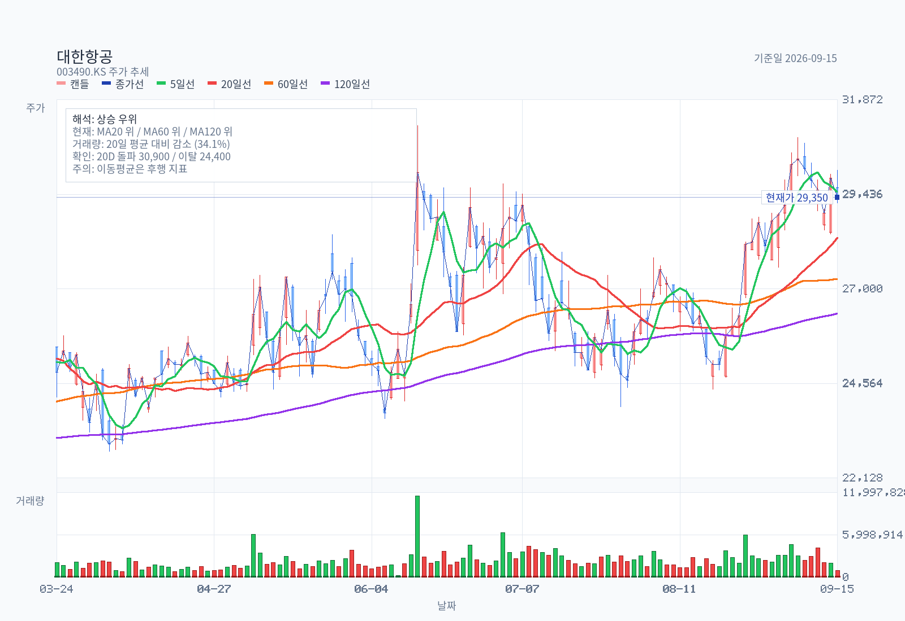
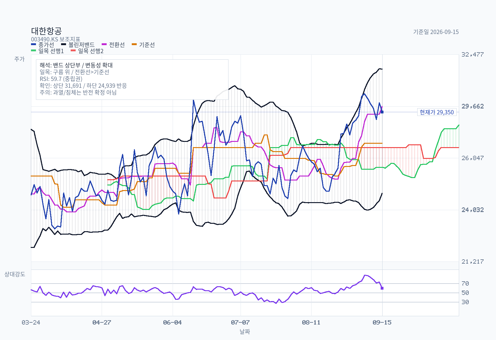
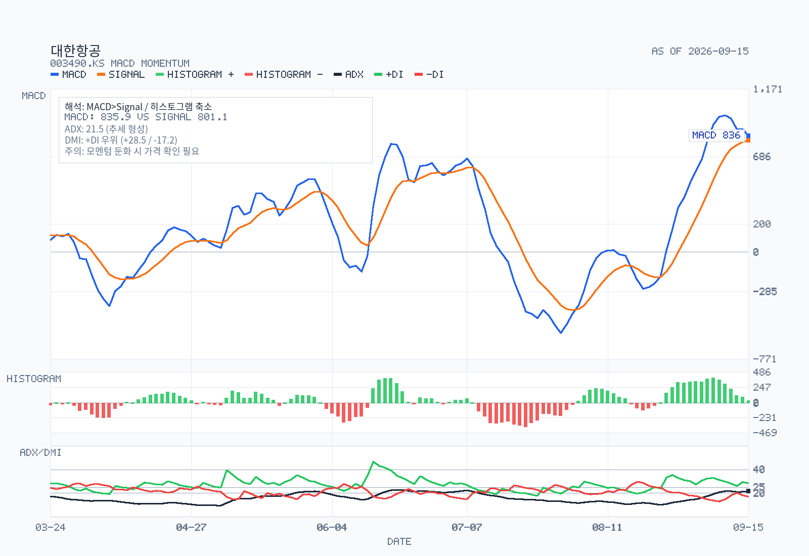
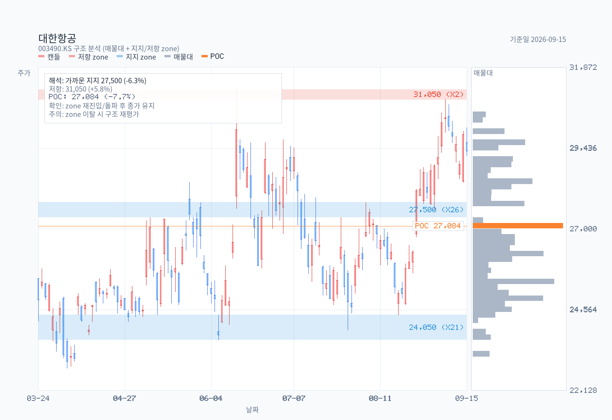
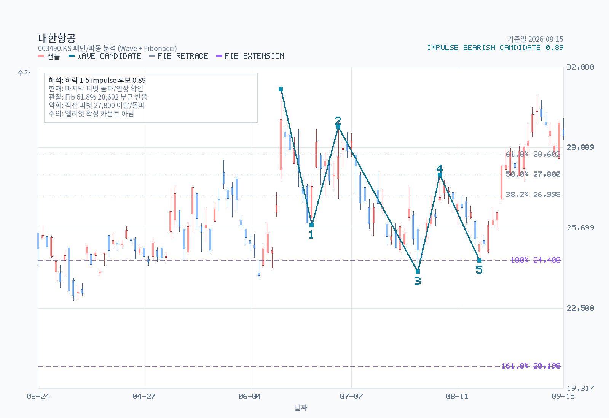

# 대한항공 (003490) 1차 분석 메모 — 통합 대한항공 1편

기준일: 2026-09-15

- 종가: 29,350원 (KOSPI, 2026-09-15)
- 시가총액(보통주): 약 10.81조원 (유통 보통주 368,220,609주 × 29,350원)
- 52주 고가 / 저가: 31,200원 (2026-06-15) / 21,000원 (2025-11-24)
- 연초 대비: +32.2% (2026-01-02 종가 22,200원 기준)
- 최신 정기공시: 반기보고서 (2026.06), 2026-08-14 제출
- 분석 모드: 1차 분석(quick view+), 6~15개월 이벤트 시계
- 시리즈 구성: 1편 대한항공(통합 본체) → 2편 아시아나항공·한진칼(이벤트/지배구조)

## Research Brief

- Security: 대한항공 보통주(003490), KOSPI, 사업회사. 우선주(003495)는 범위 밖.
- 구조: 한진칼(180640)이 지분 26.13%를 가진 사업자회사이자, 아시아나항공(020560) 지분 63.88%를 가진 모회사. 아시아나는 2026-12-16 합병기일에 소멸한다.
- Priority lens: "합병 이벤트가 대한항공 주주에게 무엇을 남기는가" — 희석, 재무구조, 이익 체력.
- Workflow: DART(OpenDART 반기보고서·주요사항) → 차트 → 셀사이드 5건 → 메모. Naver 블로그 pass: no (1차 분석, 리테일 테마주 아님). Analyst report pass: yes (KOSPI 대형주, 커버리지 충분).
- Out of scope: 아시아나 합병 차익거래, 한진칼 경영권 분쟁 프리미엄 → 2편.

## Summary

대한항공은 이제 "아시아나를 살 수 있느냐"를 묻는 종목이 아니다. 2026-08-12 소규모합병 승인 이사회로 법적 절차가 끝났고, 2026-09-15 공정위가 마일리지 통합안을 승인하면서 12월 17일 통합 대한항공 출범 전 행정 절차도 사실상 마무리됐다. **합병은 끝났고, 이제 적자 아시아나를 흡수한 숫자가 남았다.**

별도 대한항공은 2Q26에 매출 5조 199억원(역대 2분기 최대), 영업이익 2,618억원(-34.4% YoY)을 냈다. 유가 급등에도 화물 매출 1조 5,419억원(+46.1% YoY)이 이익을 받쳤고, 컨센서스(624억원)를 크게 넘었다. 반면 연결 기준 1H26은 영업이익 3,103억원, 당기순손실 5,664억원이다. 아시아나항공이 1H26에 영업손실 4,086억원, 순손실 6,588억원을 냈기 때문이다. [blue: 합병 후에는 이 적자가 비지배지분 없이 전부 대한항공 주주 몫으로 들어온다.]

주가는 29,350원으로 연결 PBR 약 1.03배, 52주 고점 대비 -5.9% 위치다. 셀사이드 5건은 모두 BUY, 목표주가 33,000~40,000원이지만 2026E 순이익 추정은 180억~7,570억원으로 극단적으로 흩어져 있다. [brown: 시장은 2026년이 아니라 합병 비용이 빠진 2027년 이익(PER 5.1~7.4배)을 사고 있는 것 같다.] 1차 판단은 Neutral-positive다. 방향은 맞지만, 2027년 이익이 실제로 1조원대 중반 이상 나오는지 확인되기 전까지는 가격이 먼저 간 구간이다.

## Decision Frame

1차 분석에서 판단을 가르는 축은 네 가지다.

**1. 희석은 생각보다 작다.**

아시아나 발행주식 205,990,711주 중 대한항공 보유분 131,578,947주(63.88%)를 뺀 74,411,764주가 합병비율 0.2736432로 교환된다. 새로 발행되는 대한항공 주식은 약 2,036만주로, 현재 유통 보통주 대비 약 5.53%다.

**2. 재무구조는 합병으로 나빠진다.**

연결 부채비율은 FY2025말 339.9%에서 2026년 6월말 390.7%로 올랐다. 별도 부채비율은 270.9%다. 아시아나 연결 자본총계는 2,136억원에 부채 11.74조원이라, 합병은 자본보다 부채를 훨씬 많이 들여온다.

**3. 이익 체력은 화물이 결정한다.**

2Q26 별도 화물 매출이 +46.1% 늘면서 유가 부담을 상쇄했다. AI 관련 IT 화물과 K-beauty 수출이 수요를 만들었고(대한항공 2026-07-13 잠정실적), 중동 항공사 운항 축소로 환승 수요도 넘어왔다. 이 두 요인 모두 구조적인지, 이벤트성인지가 아직 섞여 있다.

**4. 합병 시너지는 2027년에 가격이 매겨진다.**

iM증권은 통합 효과로 보수적으로 연간 3,000~4,000여억원의 영업이익 플러스를 제시했다(2026-06-19). 증권사 목표주가 산정 기준이 2027년으로 넘어갔다(신한투자증권 2026-06-29). 결국 2027E 이익이 컨센서스대로 나오느냐가 주가의 거의 전부다.

## Business and Thesis

대한항공은 여객·화물·항공우주 3개 사업을 한다. 한진칼이 보통주 26.13%(특수관계자 포함 26.94%, 2026-06-30)를 가진 한진그룹 핵심 사업회사다. 주요 종속회사는 아시아나항공(63.88%), 진에어(54.91%), 한국공항 등이며, 에어부산·에어서울은 아시아나를 통해 지배한다.

합병 구조는 대한항공이 아시아나항공을 흡수합병하는 소규모합병이다. 반대의사 통지 주식수가 발행주식총수의 20%에 미달해 대한항공 쪽은 주주총회 대신 2026-08-12 이사회로 승인했다(대한항공 기타경영사항 2026-08-12). 아시아나는 같은 날 임시주총에서 합병안을 가결했다.

| 항목 | 내용 | 출처 |
|---|---|---|
| 합병 결정 | 2026-05-13 이사회, 2026-05-14 합병계약 | 주요사항보고서(회사합병결정) 2026-05-13 |
| 합병비율 | 대한항공 1 : 아시아나항공 0.2736432 | 주요사항보고서 |
| 증권신고서 효력 | 2026-07-24 | 금융감독원 효력발생안내 |
| 합병 승인 | 2026-08-12 (대한항공 이사회 / 아시아나 임시주총) | 기타경영사항, 임시주주총회결과 |
| 아시아나 매수청구 | 행사기간 2026-08-12~09-01, 매수예정가 7,030원, 대금 지급 2026-10-01 | 증권신고서, 허프포스트코리아 |
| 합병기일 / 등기 | 2026-12-16 / 2026-12-17 통합 출범 | 증권신고서 |
| 합병신주 상장 | 2027-01-04 예정 | 디지털투데이 |
| LCC 3사 통합 | 진에어가 에어부산·에어서울 흡수, 2027-03-17 출범 | 대한항공·한진칼 기타경영사항 2026-08-21 |
| 마일리지 | 공정위 2026-09-15 승인, 탑승 1:1 / 제휴 1:0.82 | 아시아투데이 2026-09-15 |

지주회사 행위제한 이슈도 남아 있다. 아시아나가 한진칼의 손자회사로 편입된 시점부터 2년 유예를 받았고, 2026-12-11까지 증손회사 지분 문제를 해소해야 한다(이데일리). LCC 3사 합병비율은 진에어 1 : 에어부산 0.2862684 : 에어서울 0.7501939다.

## What The Latest Results Say

| (백만원) | 1H26 | FY2025 | FY2024 |
|---|---:|---:|---:|
| 연결 매출액 | 13,888,118 | 25,225,542 | 17,870,718 |
| 연결 영업이익 | 310,273 | 1,113,589 | 2,110,200 |
| 연결 당기순이익 | △566,417 | 647,273 | 1,381,858 |
| 지배주주 순이익 | △266,066 | 779,674 | 1,317,262 |
| 별도 매출액 | 9,535,043 | 16,501,852 | 16,116,620 |
| 별도 영업이익 | 778,739 | 1,539,252 | 1,903,362 |
| 별도 당기순이익 | 145,384 | 964,930 | 1,222,459 |

출처: 대한항공 반기보고서 (2026.06) 요약재무정보.

1H26 별도 영업이익률은 8.2%인데 연결 영업이익률은 2.2%다. 이 6%p 차이가 아시아나를 비롯한 자회사가 깎아먹는 몫이다.

| 1H26 주요 종속기업 (백만원) | 매출액 | 영업이익 | 반기순이익 |
|---|---:|---:|---:|
| 아시아나항공(연결) | 3,524,559 | (408,636) | (658,846) |
| 진에어 | 783,274 | (15,490) | (45,872) |
| 한국공항 | 307,785 | 25,327 | 20,317 |

2Q26 별도 실적은 매출 5조 199억원(+25.9% YoY), 영업이익 2,618억원(-34.4% YoY, OPM 5.2%)이다. 국제선 여객 매출은 2조 7,274억원(+19.9% YoY), 화물 매출은 1조 5,419억원(+46.1% YoY)이었다(유안타증권 2026-07-15). 상반기 별도 영업이익은 7,787억원으로 전년 대비 288억원 늘었다.

3Q26 전망은 좋다. iM증권은 7월 리포트에서 별도 영업이익 5,520억원(+46.7% YoY)을 제시했고, 6월 리포트에서는 4,649억원(+23.6% YoY)이었다. 원·달러 환율이 2분기 말 1,542원에서 9월 4일 1,346원으로 내려온 것이 고유가 부담을 상쇄하는 구조다(이투데이). [red: 유류할증료 이연 효과가 2Q에는 마이너스였지만 3Q에는 +2,000여억원 플러스로 돌아선다는 게 iM증권의 계산이다.]

## DART Recheck

| 클레임 | 공시 확인 결과 | 판정 |
|---|---|---|
| 합병비율 1 : 0.2736432 | 주요사항보고서(회사합병결정) 2026-05-13, 정정 2026-06-26·07-13 | 확인 |
| 소규모합병, 주총 갈음 이사회 승인 | 기타경영사항(자율공시) 2026-08-12 | 확인 |
| 대한항공의 아시아나 지분 63.88% | 반기보고서 종속기업 현황, 131,578,947주 | 확인 |
| 한진칼 지분 26.13% | 반기보고서 연결재무제표 주석 | 확인 |
| 아시아나 1H26 순손실 6,588억원 | 반기보고서 주요 종속기업 요약 경영성과 | 확인 |
| 2026-08-12 주식소각 | 보통주 52주·종류주 3주, 단주 정리 성격 (주주환원 아님) | 확인 |
| 대한항공씨앤디서비스 100% 인수 | 타법인주식취득결정 2026-03-12, 7,500억원, 취득예정일 2026-09-30으로 정정(2026-08-28) | 확인 |
| 아시아나 매수청구 최종 규모 | 2026-09-15 현재 DART·기사에서 확인 불가 | 미확인 |

## Street / Alternative Views

한경 컨센서스 기준 최근 5건은 전부 BUY다. 목표주가는 중앙값 40,000원, 평균 38,200원, 범위 33,000~40,000원이다.

| 증권사 | 날짜 | 의견 | 목표주가 | 2026E 순이익(십억원) | 2027E 순이익(십억원) |
|---|---|---|---:|---:|---:|
| LS증권 (이재혁) | 2026-07-15 | BUY | 33,000 | 18 | 1,700 |
| iM증권 (배세호) | 2026-07-15 | BUY | 40,000 | 757 | 1,457 |
| 유안타증권 (최지운) | 2026-07-15 | BUY | 38,000 | 128 | 967 |
| 상상인증권 (이서연) | 2026-06-30 | BUY | 40,000 | 351 | 1,667 |
| iM증권 (배세호) | 2026-06-19 | BUY | 40,000 | 763 | 1,368 |

의견은 한 방향인데 숫자는 전혀 한 방향이 아니다. 2026E 순이익이 LS증권 180억원에서 iM증권 7,570억원까지 40배 넘게 벌어져 있다. 유안타증권은 지배순이익, 나머지는 순이익 기준이라 정의 차이도 있다. [brown: 그래도 차이의 대부분은 아시아나 적자와 합병 관련 일회성 비용을 얼마나 반영하느냐에서 나오는 것 같다.] [blue: 2026E EPS가 LS증권 60원이면 올해 PER은 사실상 의미가 없다.]

반대편 시각은 두 가지다. 첫째, 고유가다. 2Q26 영업이익 -34.4%는 미국-이란 분쟁 장기화로 연료비가 뛴 결과이고(반기보고서 사업의 개요), 유가가 다시 오르면 3Q 호실적 전망도 무너진다. 둘째, 화물 강세의 지속성이다. 중동 항공사 운항 축소에 따른 환승·화물 반사이익은 분쟁이 끝나면 되돌려질 수 있다.

## Current Valuation Snapshot

| 지표 | 값 | 기준 |
|---|---:|---|
| 주가 | 29,350원 | 2026-09-15 |
| 시가총액(보통주) | 약 10.81조원 | 368,220,609주 |
| 연결 지배주주 자본 | 10조 5,125억원 | 2026-06-30 |
| 연결 BPS | 약 28,464원 | 보통+우선 369,331,400주 |
| PBR (연결, 반기말) | 약 1.03배 | |
| 2027E PER | 5.1배 (LS) ~ 7.4배 (iM) | 각 사 2027E |
| 12M Fwd PBR | 0.94배 | 유안타 12M Fwd BPS 31,189원 |
| 배당 | 보통주 750원 (FY2025) | 사업보고서 |

유안타증권은 Target PBR 1.2배(글로벌 FSC Peer)를, 상상인증권은 2027E EPS 4,525원에 Target PER 8.9배를 적용했다. 두 방식 모두 2027년 이익 정상화를 전제로 한다. [brown: 합병신주 약 2,036만주가 2027-01-04 상장되면 주당 지표는 다시 5% 남짓 희석되니, 2027E EPS도 그만큼 깎아서 봐야 할 것 같다.]

## Chart and Positioning

이동평균은 정배열이다. SMA20 28,315원, SMA60 27,253원, SMA120 26,362원 위에 주가가 있고, 일목 구름 위, MACD는 0선 위 bullish다. RSI는 중립, 거래량은 평소보다 적다(chart-basics.js, 2026-09-15).

구조상 지지대는 27,350~27,800원(터치 26회)과 23,650~24,400원이다. 저항대는 30,900~31,200원으로, 6월 15일 52주 고점 31,200원과 9월 7일 고점 30,900원이 겹친다. [brown: 합병 승인과 마일리지 승인이라는 호재가 다 나온 상태에서 저항대를 거래량 없이 두 번째 두드리는 모양이라, 돌파보다는 박스권 상단 확인이 먼저인 것 같다.]

## Catalysts

| 시점 | 이벤트 | 방향 |
|---|---|---|
| 2026-09-30 | 대한항공씨앤디서비스 인수 종결 예정 | 중립 (7,500억원 현금 유출) |
| 2026-10-01 | 아시아나 매수청구 대금 지급 | 규모 확인 필요 |
| 2026-10 중순 | 3Q26 잠정실적 | 상방 (별도 OP 컨센 4,649억~5,520억원) |
| 2026-11-02~12-03 | 아시아나 편명 대한항공 편명 전환 | 실행 리스크 |
| 2026-12-11 | 지주회사 행위제한 해소 기한 | 규제 |
| 2026-12-16~17 | 합병기일 / 통합 대한항공 출범 | 이벤트 |
| 2027-01-04 | 합병신주 약 2,036만주 상장 | 오버행 |
| 2027-03-17 | 통합 진에어 출범 | 자회사 재편 |

## Risks

**1. 유가 재상승.**

2Q26에 매출이 +25.9% 늘었는데 영업이익이 -34.4%였다. 연료비 민감도가 매출 성장을 전부 지워버릴 수 있다는 걸 이미 한 번 보여줬다.

**2. 아시아나 적자의 완전 흡수.**

1H26 아시아나 순손실 6,588억원 중 지금은 36.12%가 비지배지분으로 빠진다. 합병 후에는 100%가 대한항공 주주 몫이다.

**3. 합병신주 오버행.**

아시아나 주주가 받은 대한항공 신주 약 2,036만주는 차익 실현 물량이 될 수 있다. 금호건설이 보유한 아시아나 22,899,353주(11.12%)만 해도 합병 후 약 627만주의 대한항공 주식이 된다.

**4. 통합 실행.**

조종사 노조 서열 합의가 남아 있고(머니투데이 2026-09-15), 예약·발권 시스템 이관이 11~12월에 몰려 있다.

**5. 부채비율.**

연결 부채비율 390.7%는 금리와 환율에 민감하다. 대한항공은 2026년 들어서만 채무증권 증권신고서를 여러 차례 냈다(2월·5월·9월).

## Uncomfortable Questions

**1. 2026E 순이익 180억원과 7,570억원 중 누가 맞나.**

같은 반기보고서를 보고 증권사 추정이 40배 넘게 갈렸다. 3Q 실적과 합병 일회성 비용 규모가 나오기 전에는 PER 기반 목표주가를 믿기 어렵다.

**2. 화물 +46.1%는 몇 분기짜리인가.**

AI 서버·IT 화물은 구조적일 수 있지만, 중동 항공사 이탈 반사이익은 분쟁이 끝나면 되돌아간다. 둘을 나눈 공시는 없다.

**3. 통합 시너지 3,000~4,000억원은 언제 들어오나.**

노선 재배치와 기재 운영 효율은 2027년 이후, 통합 비용은 2026~2027년에 먼저 나간다. 시너지보다 비용이 먼저 찍히는 구간이 최소 2~3개 분기 있을 수 있다.

## Structured Stance

- 1차 판단: Neutral-positive (확신도 중간)
- 한 줄 논리: 합병 불확실성은 해소됐고 별도 이익 체력은 견조하지만, 주가(PBR 약 1.03배)는 이미 2027년 정상화를 반영하기 시작했다.
- 긍정으로 바꿀 신호: 3Q26 별도 영업이익 5,000억원 이상 + 연결 순이익 흑자전환, 31,200원 저항대 거래량 동반 돌파.
- 부정으로 바꿀 신호: 유가 재급등으로 3Q 컨센서스 하향, 아시아나 매수청구 대금이 예상보다 큰 규모로 확인, 27,350원 지지대 이탈.
- 가격 기준: 27,350~27,800원 지지 / 30,900~31,200원 저항.

## 2편에서 답할 질문

1편은 통합 본체 대한항공을 봤다. 2편은 이 합병의 반대편에 있는 두 종목을 본다.

**Q1. 아시아나항공을 지금 사서 합병신주를 받는 게 의미가 있나.**

2026-09-15 기준 대한항공 29,350원 × 0.2736432 = 교환가치 약 8,031원인데 아시아나 종가는 7,880원이다. 스프레드는 약 1.9%이고, 매수청구가 7,030원은 대한항공이 25,690원 아래로 빠질 때만 의미가 생긴다. 매수청구 기간이 끝난 지금, 남은 3개월의 스프레드가 리스크 대비 충분한지 따져봐야 한다.

**Q2. 한진칼의 20.57% 대 20.15%는 어디로 가나.**

호반건설은 2026-07-10 한진칼 지분을 18.46%에서 20.15%로 늘렸다(보유목적 단순투자). 조원태 회장 측은 2026-08-11 보고에서 산업은행 포함 31.15%, 산은 10.58%를 빼면 약 20.57%다. 격차 0.42%p에서 산은·델타·국민연금이 어느 쪽에 서는지가 2편의 핵심이다.

**Q3. 한진칼이 LCC 합병에서 받을 "주주보호방안"은 무엇인가.**

한진칼과 대한항공은 2026-08-21 에어서울 합병 관련 주주영향평가를 9월 중순까지 끝내고 9월 중 주주보호방안을 검토한다고 공시했다. 이 방안이 배당·자사주 같은 주주환원으로 나오는지가 분쟁 국면의 표심과 연결된다.

**Q4. 2026-12-11 지주회사 행위제한 해소는 누가 얼마에 사는 구조인가.**

에어부산·아시아나IDT·한진세이버 등 아시아나 보유 지분 정리 방식에 따라 대한항공의 현금 유출과 한진칼 지배구조가 동시에 바뀐다.

**Q5. 통합 대한항공의 합산 재무는 어떻게 보이나.**

2027년 첫 연결 재무에서 PPA(자산 재평가)와 영업권, 마일리지 부채 재측정이 자본을 얼마나 흔드는지 확인해야 한다.

## Follow-up Research Prompts

- 3Q26 잠정실적 발표 후 연결 순이익과 합병 일회성 비용 분리
- 아시아나 매수청구 최종 규모 공시 확인 (합병등종료보고서)
- 한진칼 주주영향평가·주주보호방안 이사회 결의 공시 확인
- 에어부산·아시아나IDT 지분 정리 방식 공시

## Update Log

- 2026-09-15: 최초 작성 (1차 분석, 네이버 블로그 1편 원고)

## Sources

- DART 대한항공 반기보고서 (2026.06) — https://dart.fss.or.kr/dsaf001/main.do?rcpNo=20260814002803 (2026-08-14 제출, 조회 2026-09-15)
- DART 대한항공 주요사항보고서(회사합병결정) — https://dart.fss.or.kr/dsaf001/main.do?rcpNo=20260513000797 (2026-05-13)
- DART 대한항공 기타경영사항(소규모합병 승인) — https://dart.fss.or.kr/dsaf001/main.do?rcpNo=20260812800337 (2026-08-12)
- DART 대한항공 주식소각결정 — https://dart.fss.or.kr/dsaf001/main.do?rcpNo=20260812800623 (2026-08-12)
- DART 대한항공 기타경영사항(에어서울 합병 주주보호 계획) — https://dart.fss.or.kr/dsaf001/main.do?rcpNo=20260821800754 (2026-08-21)
- DART 대한항공 타법인주식취득결정(대한항공씨앤디서비스) — https://dart.fss.or.kr/dsaf001/main.do?rcpNo=20260312802349 (2026-03-12, 정정 2026-08-28)
- DART 호반건설 주식등의대량보유상황보고서(한진칼) — https://dart.fss.or.kr/dsaf001/main.do?rcpNo=20260710000462 (2026-07-10)
- DART 조원태 주식등의대량보유상황보고서(한진칼) — https://dart.fss.or.kr/dsaf001/main.do?rcpNo=20260811000560 (2026-08-11)
- DART 금호건설 주식등의대량보유상황보고서(아시아나항공) — https://dart.fss.or.kr/dsaf001/main.do?rcpNo=20260908000174 (2026-09-08)
- 한경 컨센서스 애널리스트 리포트 5건 (LS증권·iM증권·유안타증권·상상인증권, 2026-06-19~2026-07-15) — https://consensus.hankyung.com/analysis/downpdf?report_idx=650767 외 (조회 2026-09-15)
- 대한항공 뉴스룸, 2026년 2분기 잠정실적 발표 — https://news.koreanair.com/%EB%8C%80%ED%95%9C%ED%95%AD%EA%B3%B5-2026%EB%85%84-2%EB%B6%84%EA%B8%B0-%EC%9E%A0%EC%A0%95%EC%8B%A4%EC%A0%81-%EB%B0%9C%ED%91%9C (2026-07-13)
- 디지털투데이, 합병비율 대한항공 1대 아시아나항공 0.2736432 — https://www.digitaltoday.co.kr/news/articleView.html?idxno=665570
- 허프포스트코리아, 아시아나 주식매수청구권 — https://www.huffingtonpost.kr/article/259060
- 신한투자증권 목표주가 상향 (비즈니스포스트) — https://www.businesspost.co.kr/BP?command=article_view&num=441036 (2026-06-29)
- 이투데이, 원화 강세 호재 삼키는 고유가 — https://www.etoday.co.kr/news/view/2623668
- 아주경제, 통합 진에어 2027-03-17 출범 — https://www.ajunews.com/view/20260821170152498
- 이데일리, 대한항공 아시아나 자회사 인수 검토 — https://edaily.co.kr/News/Read?mediaCodeNo=257&newsId=03217686645514520
- 아시아투데이, 공정위 마일리지 통합안 승인 — https://www.asiatoday.co.kr/kn/view.php?key=20260915010005568 (2026-09-15)
- 머니투데이, 마일리지 결정으로 통합 대한항공 행정절차 완료 — https://www.mt.co.kr/industry/2026/09/15/2026091514355478884 (2026-09-15)
- Yahoo Finance 003490.KS 일봉 2025-09-15~2026-09-15 — `chart-data.json` / `chart-analysis.md` (조회 2026-09-15)
