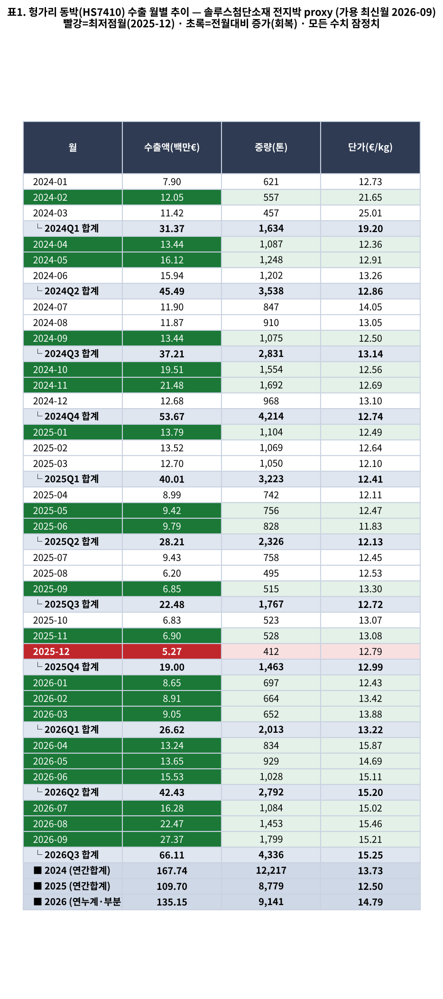
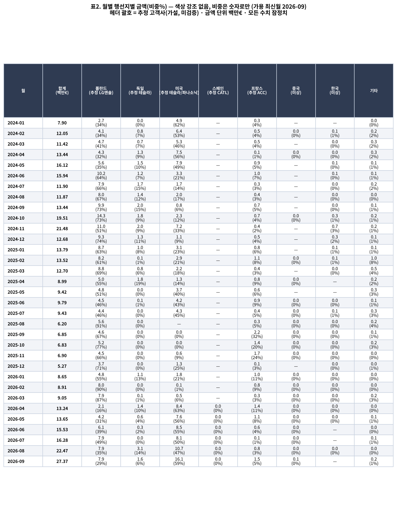
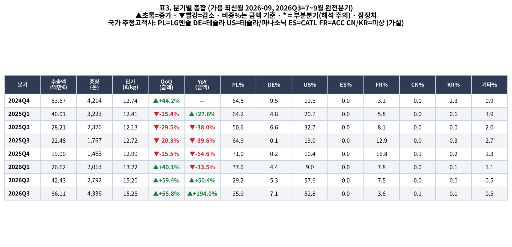
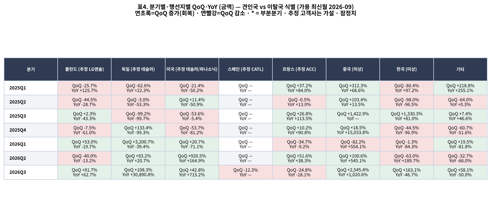

# 솔루스첨단소재(336370) 전지박 수출 대리지표(Proxy) 분기 업데이트 — 2026년 9월 기준

기준일: 2026-11-25

> **데이터 메타** · 데이터셋 updated: **2026-11-13 11:00 (+0100)** · 가용 최신월: **2026-09** · API 호출시각: **2026-11-25 00:12 UTC / 09:12 KST**
> **출처**: Eurostat Comext **DS-045409** (EU trade since 1988 by HS2-4-6 and CN8) — 헝가리(HU) 동박(HS **7410**) 수출(flow=2), 월별(freq=M), 지표 VALUE_IN_EUROS·QUANTITY_IN_100KG, partner WORLD/PL/DE/US/ES/FR/CN/KR. (호출 방식: 단일 호출로 8개 행선지×2개 지표 일괄 수신)

## 한 줄 요약

**2026년 3분기(Jul–Sep) 헝가리 동박수출은 €66.1M으로 QoQ +55.8%·YoY +194.0% — '급증(YoY 플러스 전환)'이 2026Q2(+50.4%)에 이어 2개 분기 연속되며 가속됐다.** 저점(2025-12 €5.27M) 이후 **9개월 연속 월별 증가**. 견인국은 **미국(추정 테슬라/파나소닉, 3Q 비중 52.8%·YoY +715%)**이 1위로 올라섰고 **폴란드(추정 LG에너지솔루션, 35.9%·YoY +63%)**가 동반 급증. 이탈국은 **프랑스(추정 ACC, QoQ −24.8%·YoY −18.1%)**. 솔루스 3Q26 **전지박 매출 916억원(YoY +151.6%, 창사 최대)**과 방향이 정합하나, Eurostat는 '급증(매출·물량)'만 포착할 뿐 솔루스 영업적자 확대(전력가·감가상각)는 담지 못한다.

---

## 1. 핵심 추세 (proxy 기준, 잠정치)

### 분기 추이 (수출액, 백만€)
| 분기 | 수출액 | QoQ | YoY | 해석 |
|---|---:|---:|---:|---|
| 2025Q1 | 40.0 | −25.4% | +27.6% | |
| 2025Q2 | 28.2 | −29.5% | −38.0% | 하강 |
| 2025Q3 | 22.5 | −20.3% | −39.6% | 하강 |
| 2025Q4 | **19.0** | −15.5% | −64.6% | **바닥(저점)** |
| 2026Q1 | 26.6 | +40.1% | −33.5% | 회복 진입(QoQ+), 급증 아님(YoY−) |
| 2026Q2 | 42.4 | +59.4% | **+50.4%** | **급증 전환(YoY 플러스 첫 전환)** |
| **2026Q3** | **66.1** | **+55.8%** | **+194.0%** | **급증 지속·가속(QoQ+·YoY+)** |

- **저점은 2025년 12월(€5.27M, 월별 표1 빨강)**. 이후 **2026-01(€8.65M) → … → 09(€27.37M)까지 9개월 연속 월별 증가**(표1 초록). 2026-07 €16.3M → 08 €22.5M → 09 €27.4M로 하반기 들어 증가 기울기가 더 가팔라졌다.
- **회복 진입 vs 급증 구분**: 직전 루틴(2026-04 기준)에서 2026Q1은 'QoQ+·YoY−'의 **회복 진입** 단계였다. 이번 분기에는 **2026Q2에 YoY가 플러스로 전환(+50.4%)하며 '급증' 국면에 진입**했고, **2026Q3에 YoY +194.0%로 가속**됐다. 분기 기준으로 '급증(YoY 플러스 전환)'이 확정·지속되는 것을 처음 확인한다.

### 금액 회복 vs 물량 회복 (가격효과 분리)
| 구간 | 수출액(백만€) | 중량(톤) | 단가(€/kg) |
|---|---:|---:|---:|
| 2025Q4 (저점) | 19.0 | 1,462.7 | 12.99 |
| 2026Q1 | 26.6 | 2,012.9 | 13.22 |
| 2026Q2 | 42.4 | 2,791.6 | 15.20 |
| **2026Q3** | **66.1** | **4,336.2** | **15.25** |

- **물량이 급증의 본체**: 2026Q3 중량 4,336.2톤(QoQ +55.3%)으로 금액(+55.8%)과 거의 동률 증가 → 이번 급증은 **단가효과가 아니라 실물 출하량 급증**이 주도. 저점(2025Q4) 대비 물량은 약 **3.0배**.
- **단가는 레벨 업 후 안정**: €12.99(저점) → €13.22 → €15.20 → €15.25/kg. 2026Q2에 한 단계 올라선 뒤 Q3는 유사 수준 유지. 단가 상승은 고부가 미국향 믹스 확대 + 유로 환산 효과로 추정(솔루스 공식 판가 인상분은 4분기부터 반영 예정이라 Q3 단가에는 미반영 가능성). 금액·물량 동반 급증은 긍정적이나 단가 수준은 FX·믹스 변동에 민감하므로 추세로만 해석.

---

## 2. 행선지(추정 고객사)별 흐름

> **추정 고객사 매핑은 가설이며 검증된 사실이 아니다.** 헝가리 적출 통계에는 솔루스 외 타사·타품목이 섞일 수 있다.
> PL=LG에너지솔루션 · DE=테슬라 · US=테슬라/파나소닉 · ES=CATL · FR=ACC · CN/KR=미상

### 2026Q3 행선지 비중 (수출액 기준)
- **US(미국/추정 테슬라·파나소닉) 52.8%(€34.87M), QoQ +42.8%·YoY +715%** — **처음으로 최대 행선지로 등극**, 이번 급증의 1위 엔진. 북미 램프업이 데이터로 확정.
- **PL(폴란드/추정 LG엔솔) 35.9%(€23.75M), QoQ +91.7%·YoY +62.7%** — 2위 엔진, 미국과 함께 급증. 과거 압도적 1위에서 미국에 비중을 내줬으나 절대금액은 분기 최대.
- DE(독일/추정 테슬라) 7.1%(€4.67M), QoQ +108.3% — 회복세이나 YoY는 직전년 기저가 0 수준이라 수치(+30,891%) 해석 주의.
- **이탈/약세**: FR(프랑스/추정 ACC) 3.6%(€2.38M), **QoQ −24.8%·YoY −18.1%** — 유일하게 뒷걸음. ES(CATL)·CN·KR은 사실상 0~미미(각 0.1% 이하).

### 견인국 교대 정리
- 2025년까지 PL(폴란드) 단일 의존(비중 60~77%) → 2026년 들어 **US가 급부상해 Q2·Q3 최대 행선지로 교대**. 포트폴리오가 PL·US 양강으로 다변화된 점은 질적 개선(가설적 해석).
- (상세 수치는 표3·표4 참조)

---

## 3. 솔루스 직전 분기 실적과 대조

**솔루스첨단소재 2026년 3분기(3Q26) 잠정실적** (2026-11-12 발표, 언론·증권사 리포트 기준):

| 항목 | 3Q26 | QoQ | YoY |
|---|---:|---:|---:|
| 연결 매출 | 1,255억원 | — | +83% |
| **전지박 매출** | **916억원** | **+22.1%** | **+151.6%** |
| OLED 매출 | 339억원 | +26.0% | +5.6% |
| 영업손익 | **−301억원** | (적자 확대) | (전년 −260억) |
| 헝가리 가동률 | **74%** | (2Q 67%) | (1Q 47%) |

- **방향 일치(정합)**: 솔루스 **전지박 매출 QoQ +22.1%·YoY +151.6%** ↔ Eurostat 헝가리 동박수출 **2026Q3 QoQ +55.8%·YoY +194.0%**. 두 지표 모두 **분기 최대·급증(YoY 세 자릿수 플러스)**을 동일하게 가리킨다. 가동률이 47%→67%→74%로 상승한 흐름은 Eurostat 물량 급증(2025Q4 1,463톤 → 2026Q3 4,336톤, 약 3.0배)과 정합.
- **괴리(수준·기울기)**: Eurostat QoQ(+55.8%)가 솔루스 전지박 QoQ(+22.1%)보다 가파르다. 원인 추정 — ① Eurostat는 €·HS7410 기준(타사·타품목·회로박 혼입 가능), 솔루스는 원화·전지박 부문 기준, ② EUR/KRW 환율·통관 시점과 매출 인식 시점 차이, ③ US 고부가 믹스 확대가 € 금액을 추가로 끌어올렸을 가능성. **수준(level)이 아닌 방향(trend)으로만** 대조해야 함을 재확인.
- **proxy가 못 보는 것 — 수익성**: Eurostat €단가는 올랐지만(€15.25/kg) 솔루스는 **영업적자 −301억으로 오히려 확대**됐다. 헝가리 전력가격이 2Q €109.2 → 3Q €151.1/MWh(약 +38%)로 급등했고 감가상각비가 늘어, 외형 급증이 아직 손익으로 연결되지 못했다. 회사는 일부 고객사와 **판가 인상 협의를 완료(4분기부터 반영)**했고 유진투자증권은 내년 하반기 흑자전환 가능성을 제시. **proxy는 '급증(매출·물량)'은 잘 잡지만 마진 국면은 담지 못한다**는 한계를 이번 분기가 명확히 보여준다.

> 비교 정렬: 이 루틴은 3Q26 실적발표(11/12) 직후 시점 실행. 3Q26 실적이 커버하는 기간(2026-07~09) = Eurostat 2026Q3 데이터와 정확히 일치하므로 직접 대조 가능.

---

## 4. 표 (PNG)

| 표 | 내용 | 파일 |
|---|---|---|
| 표1 | 월별 추이(수출액/중량/단가, 최저점·회복 색표시, 분기·연간 합계) | `table1-monthly-2026-09.png` |
| 표2 | 월별 행선지별 금액·비중(전 국가, 추정 고객사 헤더, 색상 강조 없음) | `table2-destination-2026-09.png` |
| 표3 | 분기별 종합(QoQ/YoY ▲▼, 행선지 비중 전체) | `table3-quarterly-2026-09.png` |
| 표4 | 분기별 행선지별 QoQ·YoY(견인/이탈 식별) | `table4-country-qoq-yoy-2026-09.png` |

---

## 5. 한계 및 가정 (반드시 함께 읽을 것)

- **Proxy 가정의 한계**: '헝가리 동박(HS7410) 수출 = 솔루스 전지박'은 가정이다. ① 헝가리 내 솔루스 외 타사·타품목(회로박 등 다른 동박 포함)이 혼입될 수 있고, ② Eurostat는 €·HS코드 기준, 솔루스 실적은 원화·전지박 부문 기준이라 **수준(level)이 아닌 추세(trend)로만** 비교해야 한다. 이번 분기 QoQ 기울기 괴리(+55.8% vs +22.1%)가 그 사례다.
- **고객사 매핑은 가설**: 행선지국→고객사 매핑(US=테슬라/파나소닉, PL=LG엔솔 등)은 검증된 사실이 아니다. 헝가리 내 타 적출 주체가 섞일 수 있다.
- **DE 등 소규모 행선지의 YoY 왜곡**: 독일 YoY +30,891%처럼 직전년 기저가 0 수준인 국가의 증감률은 숫자가 과장되므로 절대금액·비중으로 해석할 것.
- **잠정치·개정 리스크**: Eurostat 역내 상세는 7~11주 지연되며 모든 수치는 **잠정치로 후속 개정 가능**. 특히 최신 2~3개월(2026-07~09)은 개정폭이 상대적으로 클 수 있다.
- **수익성 미포착**: proxy는 수출 금액·물량만 포착하며, 솔루스의 영업손익(전력가·감가상각·판가)·흑자전환 시점은 별도 실적·IR로 확인해야 한다.

---

## 6. 레퍼런스 신뢰도 평가

| 항목 | 등급 | 코멘트 |
|---|---|---|
| 데이터 출처 신뢰도 | **A (높음)** | Eurostat Comext는 EU 공식 무역통계. API·메타데이터(updated 2026-11-13) 명확, 단일 호출 재현 가능. |
| Proxy 가정 타당성 | **B+ (보통상)** | 이번 분기 솔루스 전지박(YoY +151.6%)과 Eurostat(YoY +194.0%) 방향 정합이 2개 분기 연속 확인돼 가산. 단, QoQ 기울기 괴리·통화/품목 불일치로 수준 비교는 불가. |
| 고객사 매핑 | **C (낮음, 가설)** | 행선지→고객사 추정은 미검증 가설. US 부상·PL 다변화 해석은 보조용으로만. |
| 결측·개정 리스크 | **B− (주의)** | 최신 2~3개월(07~09) 잠정·개정 가능성, 일부 국가(ES/CN/KR) 결측·미미. 4Q26 확정 시 재검증 필요. |
| 종합 | **B+** | 추세·국면(급증) 판단에는 충분히 유용. 단, 절대 수준·고객사 귀속·수익성은 신뢰도 낮으므로 실적·IR과 병행 필요. |

---

### 출처
- Eurostat Comext DS-045409 API (헝가리 HS7410 수출, freq=M, flow=2, indicators=VALUE_IN_EUROS·QUANTITY_IN_100KG). 데이터셋 updated 2026-11-13 11:00(+0100). 호출 2026-11-25 00:12 UTC / 09:12 KST. 원자료 `eurostat-raw-2026-09.json`.
- 솔루스첨단소재 3Q26 실적(2026-11-12 발표): 디지털데일리(전지박 916억·OLED 339억·분기 최대), ZDNet·뉴스핌·아주경제(영업손실 −301억, 전력가 €109.2→€151.1/MWh), 핀포인트뉴스(가동률 47→67→74%, 판가 인상·내년 하반기 흑전 전망, 유진투자증권), 딜사이트·디일렉(매출 1,255억 YoY +83%) 등 언론 보도(잠정실적 기준).

*본 문서는 자동 분기 루틴 산출물이며 모든 수치는 잠정치입니다. 투자 판단의 책임은 이용자에게 있습니다.*
