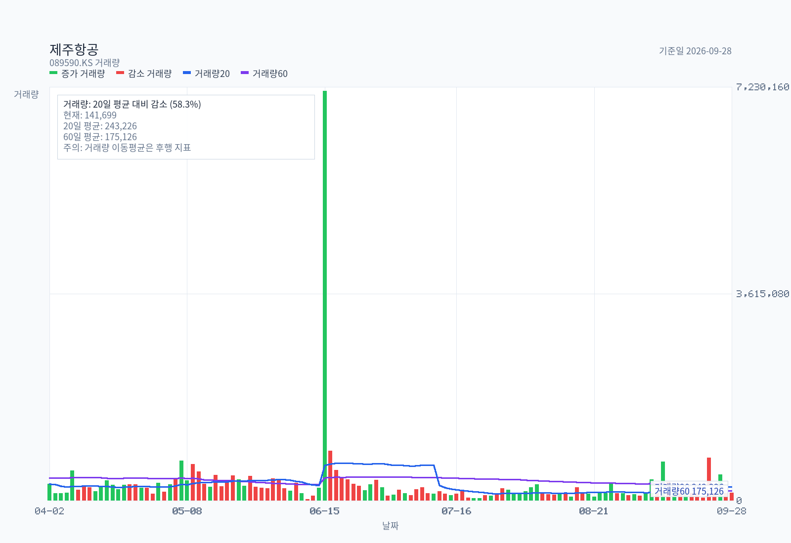
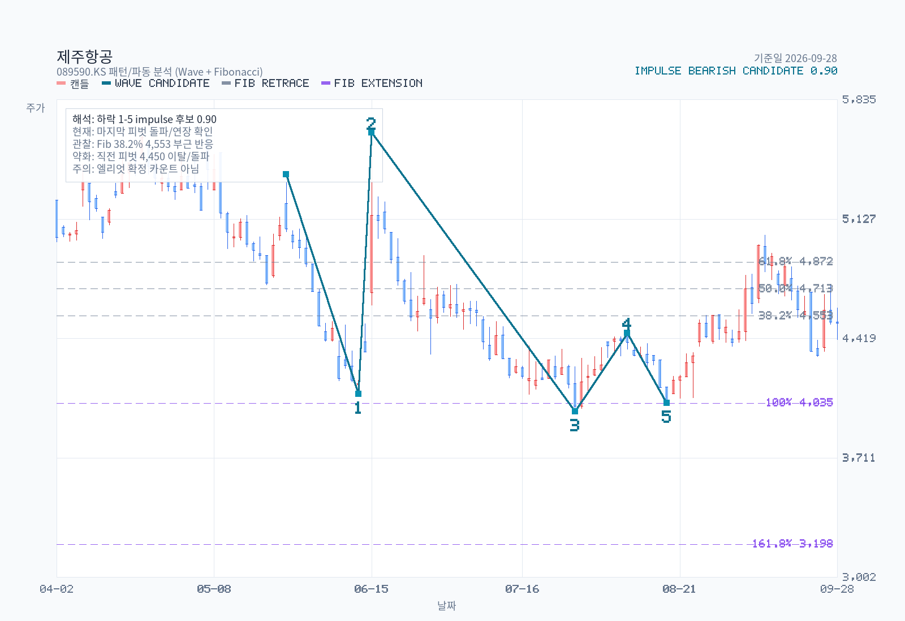

# Advanced Chart Analysis: 089590.KS

- Source: [Yahoo Finance 089590.KS daily OHLCV](https://query1.finance.yahoo.com/v8/finance/chart/089590.KS?range=2y&interval=1d&includeAdjustedClose=true&events=div%2Csplits), fetched 2026-09-28. The chart uses the provider's historical price adjustment; chart signals do not establish operating or valuation facts.
- Name: 제주항공
- Latest date: 2026-09-28
- Latest close: 4510.00
- Moving-average structure: pullback-inside-uptrend
- Today's moving averages: MA5 4455.00, MA20 4609.00, MA60 4405.17, MA120 4689.50, MA200 5020.93
- Bollinger read: mid-band
- Ichimoku read: inside-cloud
- RSI state: neutral
- MACD state: bearish / above-zero
- ADX state: weak-trend / bullish / falling
- Volume regime: light
- Chart-only flow: bullish continuation

## Moving Averages on Latest Date

| Date | MA5 | MA20 | MA60 | MA120 | MA200 |
| --- | --- | --- | --- | --- | --- |
| 2026-09-28 | 4455.00 | 4609.00 | 4405.17 | 4689.50 | 5020.93 |

## Volume Moving Averages on Latest Date

| Date | Volume | VolMA20 | VolMA60 | Volume / VolMA20 |
| --- | --- | --- | --- | --- |
| 2026-09-28 | 141699 | 243226 | 175126 | 58.3% |

## Chart Images

The main chart uses OHLC candlesticks with upper and lower wicks, plus MA5, MA20, MA60, MA120, MA200, and volume bars. The separate volume chart enlarges participation detail with volume bars plus VolMA20 / VolMA60 lines. The overlay chart separates Bollinger Bands, Ichimoku cloud lines, and RSI14, and reserves 26 forward slots for the projected cloud. The momentum chart focuses on MACD, signal, histogram, and ADX/DMI so crossovers, momentum acceleration, and trend strength are easier to see. The structure chart pairs candles with a horizontal volume-by-price gutter (POC highlighted) and ATR-tolerance clustered support/resistance zones drawn as horizontal price bands (up to 3 each, within ±30% of current price). The pattern chart adds recent swing-pivot wave candidates and Fibonacci retracement/extension levels; labels are drawn only for candidates with confidence >= 0.55, while all candidates are exported to a sibling `-waves.csv`. The full zone roster — including broken or distance-filtered zones — is exported to a sibling `-zones.csv`.

## Support / Resistance Zones (Structure Chart)

| Type | Zone | Center | Touches | Last Touch | Score | Status |
| --- | --- | --- | --- | --- | --- | --- |
| support | 4,325 ~ 4,370 | 4,348 | 26 | 2026-09-22 | 0.881 | active |
| support | 3,985 ~ 4,090 | 4,049 | 9 | 2026-08-25 | 0.360 | active |
| resistance | 5,630 ~ 5,640 | 5,637 | 3 | 2026-06-15 | 0.299 | active |

Full zone roster (including broken / distance-filtered): `chart-structure-zones.csv`

## Pattern / Wave Candidates

Selected drawable candidate: impulse / bearish / confidence 0.901.

| Kind | Direction | Status | Confidence | Points |
| --- | --- | --- | --- | --- |
| impulse | bearish | drawable | 0.901 | start:2026-05-26@5,390 → 1:2026-06-11@4,090 → 2:2026-06-15@5,640 → 3:2026-07-29@3,985 → 4:2026-08-10@4,450 → 5:2026-08-19@4,035 |
| corrective | bullish-correction | drawable | 0.805 | A:2026-08-10@4,450 → B:2026-08-19@4,035 → C:2026-09-09@5,030 |
| impulse | bullish | drawable | 0.747 | start:2026-05-20@4,735 → 1:2026-05-26@5,390 → 2:2026-06-11@4,090 → 3:2026-06-15@5,640 → 4:2026-07-29@3,985 → 5:2026-08-10@4,450 |
| impulse | bearish | drawable | 0.733 | start:2026-04-21@5,640 → 1:2026-05-20@4,735 → 2:2026-05-26@5,390 → 3:2026-06-11@4,090 → 4:2026-06-15@5,640 → 5:2026-07-29@3,985 |
| impulse | bullish | drawable | 0.607 | start:2026-06-11@4,090 → 1:2026-06-15@5,640 → 2:2026-07-29@3,985 → 3:2026-08-10@4,450 → 4:2026-08-19@4,035 → 5:2026-09-09@5,030 |

Full wave roster: `chart-pattern-waves.csv`

## Indicators

| Metric | Value |
| --- | --- |
| MA 5 | 4455.00 |
| MA 20 | 4609.00 |
| MA 60 | 4405.17 |
| MA 120 | 4689.50 |
| MA 200 | 5020.93 |
| Bollinger Upper | 4969.94 |
| Bollinger Middle | 4609.00 |
| Bollinger Lower | 4248.06 |
| Bollinger Width | 15.66% |
| Tenkan | 4597.50 |
| Kijun | 4545.00 |
| Current Cloud A | 4240.00 |
| Current Cloud B | 4812.50 |
| Future Cloud A | 4571.25 |
| Future Cloud B | 4507.50 |
| RSI 14 | 44.06 |
| MACD | 21.83 |
| Signal | 56.39 |
| Histogram | -34.55 |
| MACD State | bearish / above-zero |
| Histogram State | contracting |
| ADX 14 | 17.09 |
| +DI | 22.80 |
| -DI | 19.17 |
| ADX State | weak-trend / bullish / falling |
| Avg Volume 20 | 243226 |
| Avg Volume 60 | 175126 |
| Volume vs Avg 20 | 58.3% |
| 20D Breakout Level | 5030.00 |
| 20D Breakdown Level | 4310.00 |

## Read

- Trend structure: price is below MA20 but still above MA60, which keeps this closer to a pullback than a full trend break.
- Today's moving averages: MA5 4,455 / MA20 4,609 / MA60 4,405 / MA120 4,690 / MA200 5,021.
- Volatility: price is around the middle of the Bollinger range, and band width is stable.
- Cloud read: price is inside the current cloud, tenkan is above kijun, and the projected cloud is bullish.
- Momentum and participation: RSI14 is neutral at 44.06; MACD remains below signal, and MACD is above zero; histogram momentum is contracting; ADX still reads as a weak-trend environment, and trend strength is fading; volume is light versus the 20-day average.
- Practical checklist: nearest support watch is 4,310; first recovery check is 4,545, then 4,598; 20-day breakout level sits at 5,030; 20-day breakdown level sits at 4,310; chart-only flow still reads as bullish continuation.
