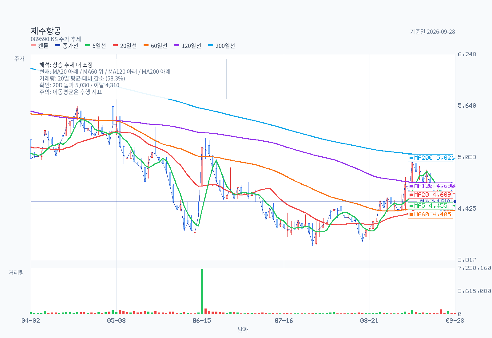
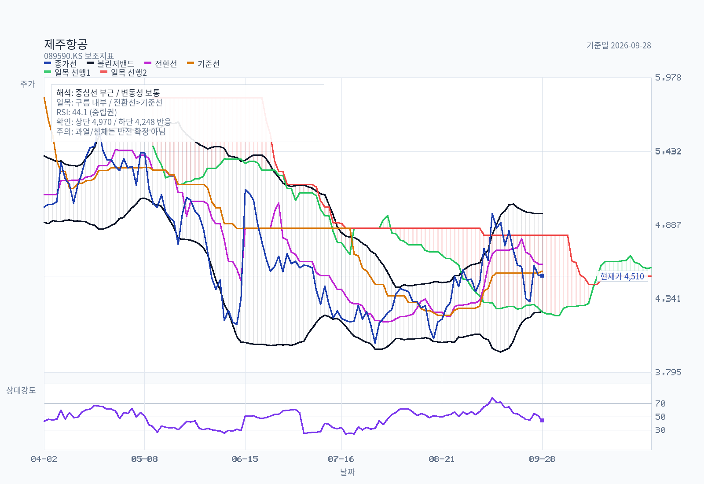
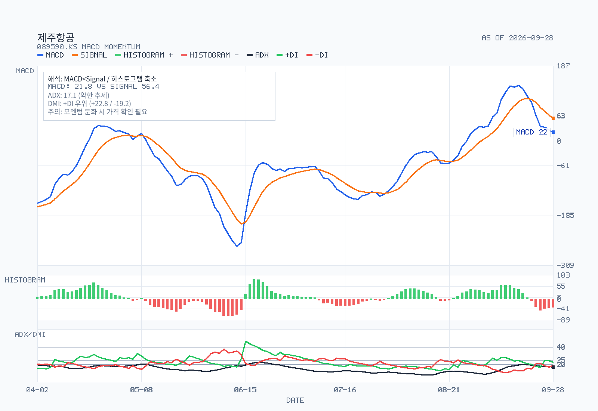
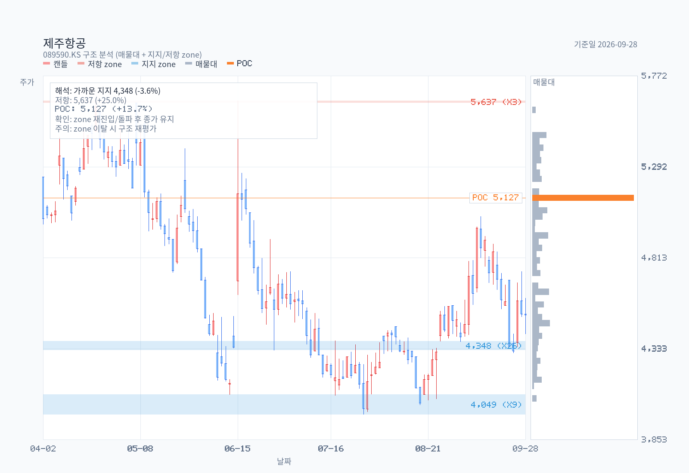

# 제주항공(089590): 회복된 영업손익과 아직 부족한 현금 여력

- **기준일:** 2026-09-28 장 마감. 코스피 보통주, 향후 1~2년 **신규 매수** 관점. 가격은 2026-09-28 종가, 최근 재무는 2026-06-30 연결 반기보고서 기준이다. 회계 수치의 원문 접근 한계는 [공시 근거표](dart-analysis.md)에 기록했다.
- **판단:** **대기.** 트리니티항공보다 상반기 손익과 운영 현금흐름은 낫다. 그러나 2분기 단독 적자, 항공기 취득 후 현금 유출, 높은 단기부채 때문에 한 번의 상반기 흑자만으로 1~2년 보통주 수익률을 확신하기 어렵다.
- **사업 유형:** 단거리 여객 중심의 경기 민감·자산 집약 운송업. 여객 판매에는 제조업식 수주잔고를 적용하지 않는다.

## Decision Frame

1. **본업은 회복했으나 분기 방향은 불안정하다.** 2026년 상반기 연결 매출 9,780억 원·영업이익 240억 원, 2분기 **3개월 열**은 매출 4,618억 원·영업손실 450억 원이다. 상반기 숫자를 2분기 실적으로 부르지 않는다. [반기보고서](https://kind.krx.co.kr/common/disclsviewer.do?acptno=20260814002923&docno=&method=search&viewerhost=)
2. **현금흐름은 항공기 취득을 견디는지가 관건이다.** 상반기 연결 영업현금흐름 1,489억 원에는 이자 지급 268억 원이 이미 반영됐다. 리스 원금 803억 원과 유형자산 취득 2,481억 원을 추가 반영하면 단순 잔액은 **−1,795억 원**이다. 항공기 취득이 매 반기 같은 규모라는 예측은 아니다. [공시 근거표](dart-analysis.md)
3. **재무 완충력과 안전 신뢰가 함께 필요하다.** 6월 말 현금 1,911억 원, 유동 차입금 4,548억 원, 리스부채 8,857억 원이다. 2024-12-29 사고의 최종 조사 결과와 수요·운임에 대한 독립적 영향은 공시만으로 분리할 수 없다. [반기보고서](https://kind.krx.co.kr/common/disclsviewer.do?acptno=20260814002923&docno=&method=search&viewerhost=), [항공철도사고조사위원회 예비보고서 목록](https://araib.molit.go.kr/USR/airboard0201/m_34497/dtl.jsp?r_id=344)
4. **주가가 싸 보이는 배수는 검증이 필요하다.** 2026-09-28 종가 4,510원과 최근 공시 발행주식 80,640,985주(6월 말)를 곱한 시총은 약 3,637억 원. 6월 말 연결 총자본 2,394억 원 대비 단순 P/B는 약 1.52배지만, 자본 성격의 신종자본증권과 계속되는 항공기 투자 때문에 보통주 안전마진을 뜻하지 않는다. [반기보고서](https://kind.krx.co.kr/common/disclsviewer.do?acptno=20260814002923&docno=&method=search&viewerhost=), [가격 데이터](chart-data.json)

## Summary

2023년 팬데믹 이후 회복 이익이 2024년에 둔화하고 2025년에 적자로 바뀐 뒤, 2026년 상반기에는 다시 영업흑자가 났다. 그러나 상반기 순손실과 2분기 영업적자, 항공기 투자 지출은 회복의 지속성을 아직 입증하지 못한다. **다음 두 분기에서 운임·탑승률과 영업마진이 함께 개선되고, 리스 지급 및 필수 항공기 투자 후 현금 부족이 줄어드는지** 확인한 뒤 매수를 재검토한다.

## Business and Thesis

제주항공은 B737 계열 중심의 국내·국제 여객 운송 사업자다. 2026년 상반기 연결 매출의 약 95.9%가 항공운송에서 발생했고, 국내선 1만3,403편·약 237만 명, 국제선 2만5,293편·약 422만 명을 운송했다. 별도 항공운송 매출 내 여객 비중은 약 96.6%다. 여객 수요·좌석당 운임·가동률이 고정비 흡수력을 좌우한다. [반기보고서 사업의 내용](https://kind.krx.co.kr/common/disclsviewer.do?acptno=20260814002923&docno=&method=search&viewerhost=)

2026년 상반기 국내선·국제선 공시 평균 여객 단가는 각각 약 6만 원·18만 원이다. 2025 **연간** 평균 5만 원·15.6만 원과는 계절 및 노선 구성이 달라 동일 노선의 운임 인상률로 읽을 수 없다. 월평균 여객기 가동시간은 2024년 연간 438시간, 2025년 연간 384시간, 2026년 상반기 353시간이었다. 수익성 회복 가설의 반대 증거는 2026년 2분기 적자와 가동시간 감소다. 노선별 공헌이익과 사고에 따른 운임 할인분은 별도 공시되지 않는다. [공시 근거표](dart-analysis.md)

| 연결 기준 | 2022 연간 | 2023 연간 | 2024 연간 | 2025 연간 | 2026 상반기 누적 |
| --- | ---: | ---: | ---: | ---: | ---: |
| 매출, 억 원 | 7,025 | 17,240 | 19,358 | 15,799 | 9,780 |
| 영업손익, 억 원 | −1,775 | +1,698 | +799 | −1,117 | +240 |
| 영업현금흐름, 억 원 | +1,245 | +3,882 | +1,633 | +61 | +1,489 |

연간 연결표는 [2024 사업보고서](https://kind.krx.co.kr/external/2025/03/18/001337/20250318006242/11011.htm)와 [2025 사업보고서](https://kind.krx.co.kr/external/2026/03/18/002060/20260318009589/11011.htm), 반기값은 [2026 반기보고서](https://kind.krx.co.kr/common/disclsviewer.do?acptno=20260814002923&docno=&method=search&viewerhost=)에 근거한다. 2022년 별도 매출 6,956억 원·영업손실 약 1,750억 원을 이 연결표와 혼합하지 않는다. 2024-12-29 사고 뒤 2025년 매출과 운임·가동률이 약해졌으나, 사고가 그 변화 중 얼마를 설명하는지는 환율·경쟁 공급·노선 변화와 분리되지 않는다.

## Revenue Mix

2026년 상반기 **연결** 항공운송 매출은 약 9,380억 원, 전체 연결 매출의 95.9%다. **별도 항공운송** 매출 9,380억 원 내 여객 약 9,060억 원, 화물 약 63억 원, 기타 약 257억 원이다. 이 비율의 분모는 별도 항공운송 매출이며 연결 총매출과 혼동하지 않는다. 국가별 매출, 일본 등 개별 노선별 이익, 상위 고객 집중도는 현재 공시 세트에서 별도 확인되지 않았다. 소비자 여객 사업에서는 기업 고객 집중도보다 노선·판매 채널·계절 집중도를 봐야 한다. [반기보고서 사업의 내용](https://kind.krx.co.kr/common/disclsviewer.do?acptno=20260814002923&docno=&method=search&viewerhost=)

## What The Latest Results Say

| 연결 기준 | 2025 상반기 누적 | 2026 상반기 누적 | 해석 |
| --- | ---: | ---: | --- |
| 매출 | 7,171억 원 | 9,780억 원 | 수요·운임·공급 구성의 합산 회복 |
| 영업손익 | −744억 원 | +240억 원 | 상반기 영업이익률 약 2.5% |
| 순손익 | −426억 원 | −325억 원 | 금융·기타손익 이후 보통주 이익은 적자 |
| 영업현금흐름 | −1,256억 원 | +1,489억 원 | 개선, 이자 지급 포함 |
| 리스 원금 지급 | 642억 원 | 803억 원 | 영업현금흐름 밖의 재무현금 유출 |
| 유형자산 취득 | 826억 원 | 2,481억 원 | 신기재 도입으로 투자 부담 확대 |

2026년 2분기 **연결 단독 3개월** 영업손실은 450억 원이다. 별도 잠정실적의 2분기 영업손실 524억 원과 기준이 다르다. 상반기 영업현금흐름에서 리스 원금을 빼면 686억 원이지만, 유형자산 취득까지 빼면 −1,795억 원이다. 이는 단순 기간 현금 잔액이지 정상화 FCF 추정이나 모든 항공기 취득의 반복 예측이 아니다. [공시 근거표](dart-analysis.md)

6월 말 유동자산 6,400억 원, 유동부채 1조4,386억 원으로 유동비율 약 44.5%다. 차입금 4,548억 원은 **유동 차입금만**이며 총 금융차입금으로 표기하지 않는다. 리스부채 8,857억 원, 충당부채 4,302억 원에는 정비·복구 의무가 포함된다. 비유동 손해배상충당부채 527억 원의 최종 사고별 배상액을 이 수치로 단정하지 않는다. [반기보고서 연결 재무상태·주석](https://kind.krx.co.kr/common/disclsviewer.do?acptno=20260814002923&docno=&method=search&viewerhost=)

## Fleet, Safety and Capital Needs

2018년 B737-8 확정 40대·옵션 10대 계약은 2026년 6월 확정 물량 8대 취소 후 **확정 32대·옵션 10대**가 됐다. 상반기 중 B737-8 4대 도입, B737-800 1대 반납·2대 매각을 공시했고, 6월 말까지 B737-8 12대를 금융리스로 전환했다. 공시 계약의 46.36억 달러는 리스트 가격이며 실거래 취득가가 아니다. 본 확인 범위에서는 6월 말 **총 운항 기단 수를 확정하지 못했다**. [반기보고서 약정·연혁](https://kind.krx.co.kr/common/disclsviewer.do?acptno=20260814002923&docno=&method=search&viewerhost=), [계약 정정](https://kind.krx.co.kr/common/disclsviewer.do?acptno=20260609000797&docno=&method=search&viewerhost=)

2025 사업보고서는 2024-12-29 7C2216 사고의 이사회 보고를, 2026 반기보고서는 4월 22일 안전위원회 신설과 5월 8일 안전 정책·계획 보고를 기재한다. [항공철도사고조사위원회](https://araib.molit.go.kr/USR/airboard0201/m_34497/dtl.jsp?r_id=344)에는 예비보고서가 공개돼 있다. 이 자료로 최종 원인·책임이나 사고만의 주가·수요 기여분을 확정하지 않는다. 회사의 [2025년 항공안전투자 공시](https://static.jejuair.net/cms/images/file_upload/20250829114537504.pdf)는 2026년 경년항공기 교체 계획 3,335.7억 원 등을 제시하지만 계획은 집행 실적과 다르다.

## DART Recheck

| 주장 | 상태 | 확인값 또는 판단 | 출처 | 비고 |
| --- | --- | --- | --- | --- |
| 상반기 영업흑자이나 2분기 단독 적자 | partially supported | 연결 +240억 원 / 2분기 −450억 원 | [2026 반기](https://kind.krx.co.kr/common/disclsviewer.do?acptno=20260814002923&docno=&method=search&viewerhost=) | KRX 접수 확인, 본문은 동일 제출문서 전사본 대조 |
| 리스·유형자산 취득 후 현금 부족 | partially supported | +1,489−803−2,481=−1,795억 원 | [공시 근거표](dart-analysis.md) | 이자는 CFO에 반영; 반기 본문 접근 한계 |
| B737-8 확정 계약 8대 축소 | confirmed | 40→32대, 옵션 10대 유지 | [KRX 정정](https://kind.krx.co.kr/common/disclsviewer.do?acptno=20260609000797&docno=&method=search&viewerhost=) | 리스트 가격은 실제 구매가 아님 |
| 최대주주 지배력과 주식 수 | partially supported | 6월 말 80,640,985주, AK홀딩스 50.37% | [반기](https://kind.krx.co.kr/common/disclsviewer.do?acptno=20260814002923&docno=&method=search&viewerhost=), [대량보유](https://kind.krx.co.kr/external/2026/06/29/001214/20260629002413/00636.htm) | 가격 기준일과 주식 수 공시일 다름 |
| 사고의 독립적 수요·주가 영향 | not separately disclosed | 원인별 정량 분해 불가 | [2025 사업보고서](https://kind.krx.co.kr/external/2026/03/18/002060/20260318009589/11011.htm) | 조사 최종 결론으로 해석 금지 |

## Street / Alternative Views

[365일 공개 보고서 수집](analyst-report-insight.md)에서는 iM증권 2026-02-10·02-24·05-11 보고서 3건이 추출됐다. 모두 매수·목표가 8,500원이지만 **같은 증권사**의 과거 의견이고 최신 보고서가 2026년 2분기 실적 발표 전이다. 원문 확인된 [미래에셋증권 2025-11-20 보고서](https://securities.miraeasset.com/bbs/download/2140146.pdf?attachmentId=2140146)는 중립·목표가 5,500원으로 재무와 공급 경쟁을 경계했다. 목표가 두 수치를 2026-09-28 현재 컨센서스나 기대수익률로 적용하지 않는다. 회사 공시가 증명하는 것은 상반기 영업흑자와 큰 투자현금 유출까지다.

## Current Valuation Snapshot

| 항목 | 2026-09-28 기준 판단 |
| --- | --- |
| 종가·시총 | 4,510원; 6월 말 공시 발행주식 80,640,985주 적용 **약 3,637억 원**. [일봉](chart-data.json), [반기](https://kind.krx.co.kr/common/disclsviewer.do?acptno=20260814002923&docno=&method=search&viewerhost=) |
| 후행·선행 PER | 후행 이익 적자, 검증된 최신 이익 전망 부족으로 의미 있는 값 산출 보류 |
| 단순 P/B | 약 **1.52배**(시총 / 2026-06-30 연결 총자본 2,394억 원). 2025년 발행 1,000억 원 신종자본증권은 회계상 자본이나 경제적 조달비용이 있다. 이를 기계적으로 제외한 자본 1,394억 원 대비 약 2.61배는 분석용 민감도일 뿐 공시상 보통주 BPS가 아니다. |
| EV/EBITDA | 리스·신종자본증권 처리와 정상화 이익을 통일할 수 없어 보류 |
| FCF 수익률 | 상반기 리스 원금·유형자산 취득 반영 잔액이 음수여서 정상화 수익률 산출 보류 |

## Historical Valuation Bands

2022년 적자와 증자, 2023년 회복기 고이익과 현물출자 신주 발행, 2025년 재적자와 신종자본증권, 2026년 항공기 도입이 겹친다. 3~5년 P/E와 EV/EBITDA 밴드는 적자와 리스 회계로 비교가 왜곡된다. 단순 P/B도 자본 성격의 조달액과 항공기 감가·정비 의무를 함께 보지 않으면 저평가를 증명하지 못한다. 정상화 리스 지급 후 현금 창출력과 완전희석 주당가치를 먼저 확인한다.

## Chart and Positioning









### Rule Screen

2026-09-28 종가 4,510원은 MA5 4,455원·MA60 4,405원 위, MA20 4,609원·MA120 4,690원·MA200 5,021원 아래다. RSI14 44.1, MACD는 신호선 아래, ADX14 17.1로 추세 강도는 약하다. 당일 거래량은 20일 평균의 58.3%다. [차트 산출물](chart-analysis.md)

| 규칙 | 결과 | 근거 |
| --- | --- | --- |
| Minervini Trend Template | 미완료 | 가격이 MA120·200 아래; 표준 MA50·150과 전체 RS 검증 미실시 |
| KRX 52주 신고가 리더십 점수 | 부분 평가 | 통합 시장 RS 백분위 미산출, 점수를 0으로 대체하지 않음 |
| 가격 확인 | 4,310원 이탈 / 5,030원 회복 | 최근 20거래일 저점·고점, 투자 판단의 보조 신호 |

차트만으로는 강한 상승 추세라고 보기 어렵다. 2년 종가 2024-09-30 9,010원에서 2026-09-28 4,510원으로 약 49.9% 하락했다. 가격 하락 자체는 이익·현금흐름 개선의 증거가 아니다.

## Governance and Structure

2026-06-30 보통주 80,640,985주, 자기주식 69,874주다. AK홀딩스 직접 40,618,523주(50.37%), 특별관계인 합계 43,239,552주(53.62%)이며 [6월 29일 대량보유 공시](https://kind.krx.co.kr/external/2026/06/29/001214/20260629002413/00636.htm)에는 담보 계약 대상 주식 38,140,964주(47.30%)가 표시된다. 담보 계약은 매각 확정이 아니지만 지배주주 자금 사정과 소수주주 위험을 함께 살필 이유가 된다. [반기보고서](https://kind.krx.co.kr/common/disclsviewer.do?acptno=20260814002923&docno=&method=search&viewerhost=)

2022년 현금 증자와 2023년 현물출자 신주 발행 이력이 있고, 2025년 1,000억 원 신종자본증권(표면 6.5%)을 발행했다. 최근 이익과 현금 유출만으로 미래 증자를 단정할 수는 없지만 추가 자본조달 조건은 반드시 보통주 기준으로 평가해야 한다. 자기주식 규모는 작고, 안전위원회 신설은 감시 체계의 시작이지 사고 위험 해소의 실적 증거는 아니다.

[2026-06-01 기업지배구조보고서](https://kind.krx.co.kr/external/2026/06/01/001789/20260601002837/99667.htm)상 이사회는 사내이사 2명·사외이사 4명·기타비상무이사 1명이다. 김이배 대표이사가 의장을 겸하고 안전위원장도 맡는다. 사외이사 4명은 감사위원회에 참여한다. 이사회 의장과 경영진의 분리가 없어 안전·대규모 기재투자에 대한 독립적 견제의 **실제 운영**을 확인할 필요가 있다. 같은 보고서는 2025년 결산배당을 실시하지 않았고, 구체적인 정량 중장기 주주환원 기준은 계속 검토 중이라고 적었다. 따라서 현재 배당수익률을 매수 근거로 삼지 않는다.

## Catalysts

- 2026년 3분기·4분기 연결 운임, 가동률, 영업마진의 동반 회복.
- B737-8 도입·기존기 교체 후 연료·정비 효율과 리스 지급 후 현금흐름 개선.
- 안전 조사 진행과 신뢰 회복을 수요·운임 지표로 검증할 수 있는 시점.

## Risks

- 2026년 2분기처럼 매출 증가와 영업적자가 공존할 수 있다. 유가·환율·경쟁 공급과 정비비가 마진을 압박한다.
- 항공기 취득, 높은 유동부채와 리스, 손해배상·정비 충당부채가 추가 조달을 요구할 수 있다.
- 사고 조사와 안전 신뢰의 불확실성은 수요와 자금조달 조건에 영향을 줄 수 있으나 영향액은 공개 자료로 분리되지 않는다.

## Uncomfortable Questions

1. 국제선 평균 운임 상승이 같은 노선의 가격 결정력인가, 노선·계절 믹스인가?
2. B737-8 도입 후 리스 원금과 필수 기재 투자를 자체 현금으로 지속 감당할 수 있는가?
3. 2분기 단독 적자가 성수기 전 일시 비용인가, 공급 경쟁이 만든 구조적 마진 저하인가?
4. 안전 투자 계획의 실제 집행과 운항 지표는 어디서 확인할 수 있는가?
5. 추가 조달 시 신종자본증권 보유자와 기존 보통주 주주의 경제적 우선순위는 어떻게 달라지는가?

## Decision-Changing Issues

1. **분기 영업마진:** 2분기 적자 이후 두 분기 연속 흑자와 운임·가동률 개선이 나오는가.
2. **리스·투자 후 현금:** 신규 항공기 도입 주기에도 현금 유출 규모가 줄고 유동 차입금을 상환하는가.
3. **안전 및 배상:** 조사·소송 진행에 따른 추가 충당부채와 고객 수요 지표가 어떻게 변하는가.
4. **조달·희석:** 차입 만기와 737-8 잔여 도입 자금이 보통주 희석 없이 조달되는가.

## Structured Stance

**대기, 트리니티항공보다는 우선 관찰.** 상반기 영업흑자와 현금 유입은 상대 우위지만 2분기 손실과 항공기 취득 후 현금 부족이 신규 매수를 막는다. 다음 두 분기 연결 영업마진이 플러스이고 리스 원금·필수 투자 후 현금 부족이 지속적으로 축소되면 매수 검토로 올린다. 영업적자가 재확대하거나 추가 자본조달이 기존 주주에게 크게 불리하면 회피한다.

## Follow-up Research Prompts

1. 2026년 3분기 연결 국제선 운임·탑승률·가동시간은 같은 계절인 2025년 3분기 대비 얼마나 바뀌었는가? 노선 믹스 효과를 가려내기 위해서다.
2. 확정 B737-8 잔여 인도 일정과 항공기별 금융리스·현금 구매 조건은 무엇인가? 투자 현금 유출의 반복성을 판단하기 위해서다.
3. 향후 12개월 차입금·리스 원금 만기와 제한성 현금은 얼마인가? 현금 1,911억 원의 실제 완충력을 알기 위해서다.
4. 안전위원회의 집행 지표와 사고 조사·배상 관련 추가 공시가 있는가? 평판과 현금 위험을 구분하기 위해서다.
5. AK홀딩스 담보계약 만기·담보 유지 조건이 바뀌었는가? 지배주주 자금 부담을 확인하기 위해서다.
6. 회사가 공개한 국가별·노선별 수익성 또는 운임 자료가 새로 있는가? 집계 평균만으로 구조적 경쟁력을 판단하기 어렵기 때문이다.

```guard-decision
stance: 대기
review_by: 2026-11-30
triggers:
  - direction: buy
    quote: 다음 두 분기 연결 영업마진이 플러스이고 리스 원금·필수 투자 후 현금 부족이 지속적으로 축소되면 매수 검토로 올린다.
  - direction: sell
    quote: 영업적자가 재확대하거나 추가 자본조달이 기존 주주에게 크게 불리하면 회피한다.
```
