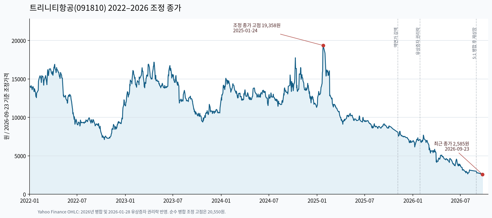
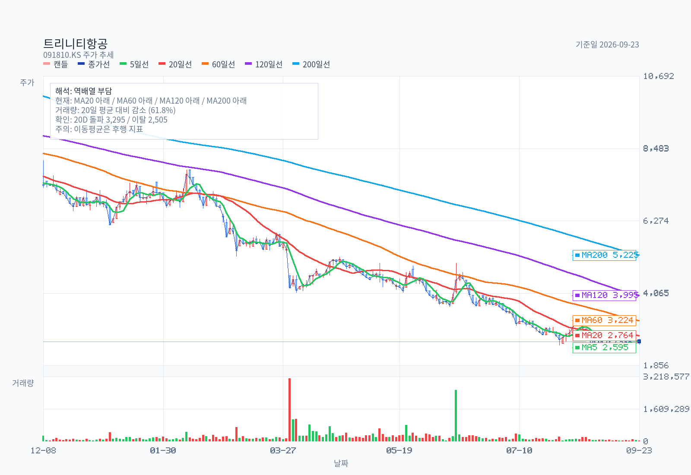
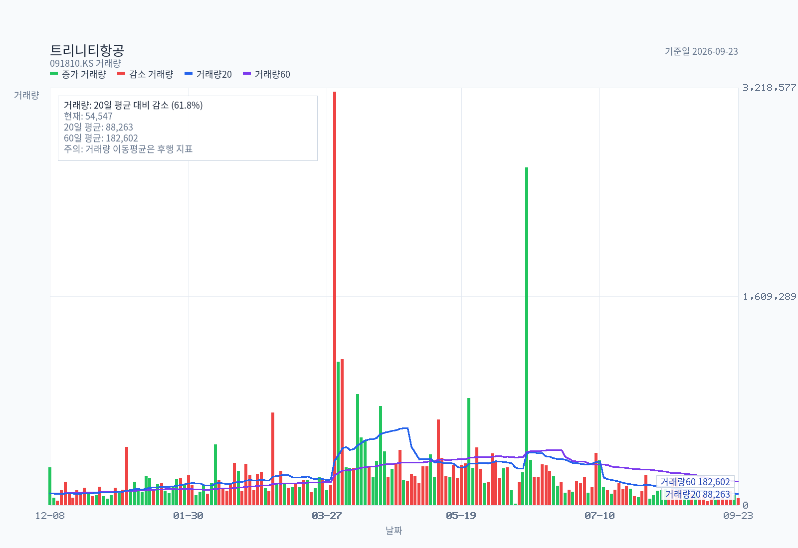
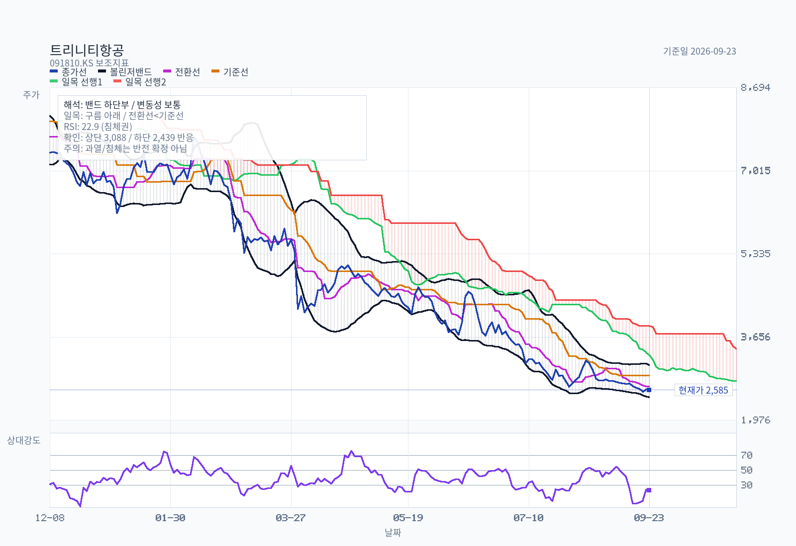
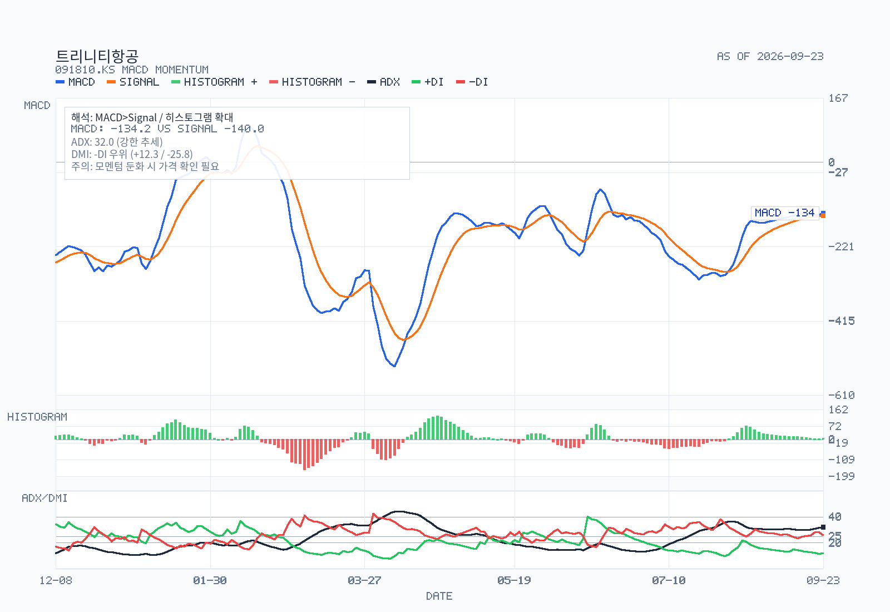
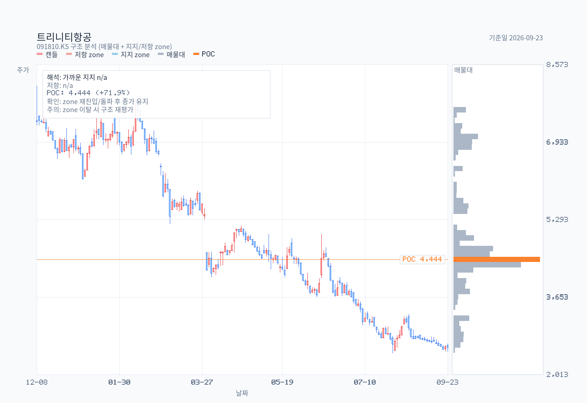
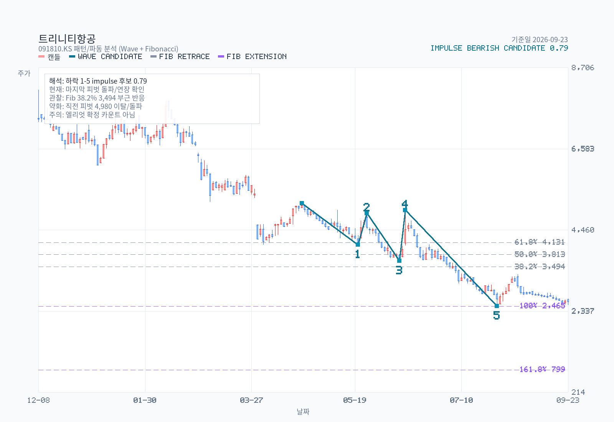

# 트리니티항공(091810.KS) 차트 분석

- 작성·조회일: 2026-09-28. Yahoo Finance 일별 OHLCV 5년치, 최근 거래일 2026-09-23.
- 가격 조정: 2026년 5대 1 병합과 2026-01-28 유상증자 권리락이 반영된 제공업체 시계열. 원거래가와 차이가 있으므로 [조정 방법 및 낙폭 계산](price-adjustment.md)을 함께 확인한다.
- 데이터 처리: 거래량 0주로 반복 기입된 거래정지·비거래일 38개 행을 제외하고 이동평균을 계산했다.
- 장기 차트: 
- Name: 트리니티항공
- Latest date: 2026-09-23
- Latest close: 2585.00
- Moving-average structure: strong-bearish
- Today's moving averages: MA5 2595.00, MA20 2763.75, MA60 3223.67, MA120 3995.25, MA200 5225.02
- Bollinger read: lower-half
- Ichimoku read: below-cloud
- RSI state: oversold
- MACD state: bullish / below-zero
- ADX state: strong-trend / bearish / flat
- Volume regime: light
- Chart-only flow: bearish continuation

## Moving Averages on Latest Date

| Date | MA5 | MA20 | MA60 | MA120 | MA200 |
| --- | --- | --- | --- | --- | --- |
| 2026-09-23 | 2595.00 | 2763.75 | 3223.67 | 3995.25 | 5225.02 |

## Volume Moving Averages on Latest Date

| Date | Volume | VolMA20 | VolMA60 | Volume / VolMA20 |
| --- | --- | --- | --- | --- |
| 2026-09-23 | 54547 | 88263 | 182602 | 61.8% |

## Chart Images

The main chart uses OHLC candlesticks with upper and lower wicks, plus MA5, MA20, MA60, MA120, MA200, and volume bars. The separate volume chart enlarges participation detail with volume bars plus VolMA20 / VolMA60 lines. The overlay chart separates Bollinger Bands, Ichimoku cloud lines, and RSI14, and reserves 26 forward slots for the projected cloud. The momentum chart focuses on MACD, signal, histogram, and ADX/DMI so crossovers, momentum acceleration, and trend strength are easier to see. The structure chart pairs candles with a horizontal volume-by-price gutter (POC highlighted) and ATR-tolerance clustered support/resistance zones drawn as horizontal price bands (up to 3 each, within ±30% of current price). The pattern chart adds recent swing-pivot wave candidates and Fibonacci retracement/extension levels; labels are drawn only for candidates with confidence >= 0.55, while all candidates are exported to a sibling `-waves.csv`. The full zone roster — including broken or distance-filtered zones — is exported to a sibling `-zones.csv`.

## Pattern / Wave Candidates

Selected drawable candidate: impulse / bearish / confidence 0.793.

| Kind | Direction | Status | Confidence | Points |
| --- | --- | --- | --- | --- |
| impulse | bearish | drawable | 0.793 | start:2026-04-21@5,160 → 1:2026-05-20@4,070 → 2:2026-05-26@4,900 → 3:2026-06-11@3,650 → 4:2026-06-15@4,980 → 5:2026-07-29@2,465 |
| corrective | bearish-correction | drawable | 0.776 | A:2026-06-11@3,650 → B:2026-06-15@4,980 → C:2026-07-29@2,465 |
| impulse | bullish | drawable | 0.772 | start:2026-05-20@4,070 → 1:2026-05-26@4,900 → 2:2026-06-11@3,650 → 3:2026-06-15@4,980 → 4:2026-07-29@2,465 → 5:2026-08-31@3,295 |
| corrective | bullish-correction | drawable | 0.757 | A:2026-06-15@4,980 → B:2026-07-29@2,465 → C:2026-08-31@3,295 |
| impulse | bearish | drawable | 0.713 | start:2026-03-25@5,900 → 1:2026-04-02@4,070 → 2:2026-04-21@5,160 → 3:2026-05-20@4,070 → 4:2026-05-26@4,900 → 5:2026-06-11@3,650 |

Full wave roster: `chart-pattern-waves.csv`

## Indicators

| Metric | Value |
| --- | --- |
| MA 5 | 2595.00 |
| MA 20 | 2763.75 |
| MA 60 | 3223.67 |
| MA 120 | 3995.25 |
| MA 200 | 5225.02 |
| Bollinger Upper | 3088.03 |
| Bollinger Middle | 2763.75 |
| Bollinger Lower | 2439.47 |
| Bollinger Width | 23.47% |
| Tenkan | 2655.00 |
| Kijun | 2880.00 |
| Current Cloud A | 3291.25 |
| Current Cloud B | 3877.50 |
| Future Cloud A | 2767.50 |
| Future Cloud B | 3417.50 |
| RSI 14 | 22.86 |
| MACD | -134.21 |
| Signal | -140.04 |
| Histogram | 5.83 |
| MACD State | bullish / below-zero |
| Histogram State | expanding |
| ADX 14 | 32.01 |
| +DI | 12.26 |
| -DI | 25.79 |
| ADX State | strong-trend / bearish / flat |
| Avg Volume 20 | 88263 |
| Avg Volume 60 | 182602 |
| Volume vs Avg 20 | 61.8% |
| 20D Breakout Level | 3295.00 |
| 20D Breakdown Level | 2505.00 |

## Read

- Trend structure: price is below MA5, MA20, MA60, MA120, and MA200, so the trend stack remains firmly bearish.
- Today's moving averages: MA5 2,595 / MA20 2,764 / MA60 3,224 / MA120 3,995 / MA200 5,225.
- Volatility: price is in the lower half of the Bollinger range, and band width is stable.
- Cloud read: price is below the current cloud, tenkan is below kijun, and the projected cloud is bearish.
- Momentum and participation: RSI14 is oversold at 22.86; MACD remains above signal, and MACD is below zero; histogram momentum is expanding; ADX shows a strong trend, with -DI in front, and trend strength is flat; volume is light versus the 20-day average.
- Practical checklist: nearest support watch is 2,505; first recovery check is 2,655, then 2,764; 20-day breakout level sits at 3,295; 20-day breakdown level sits at 2,505; chart-only flow still reads as bearish continuation.
