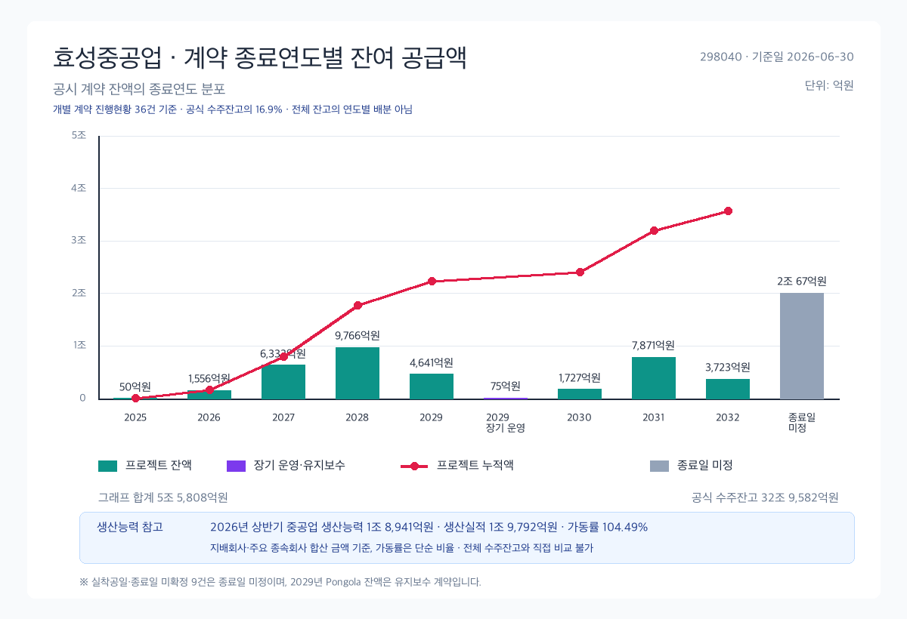
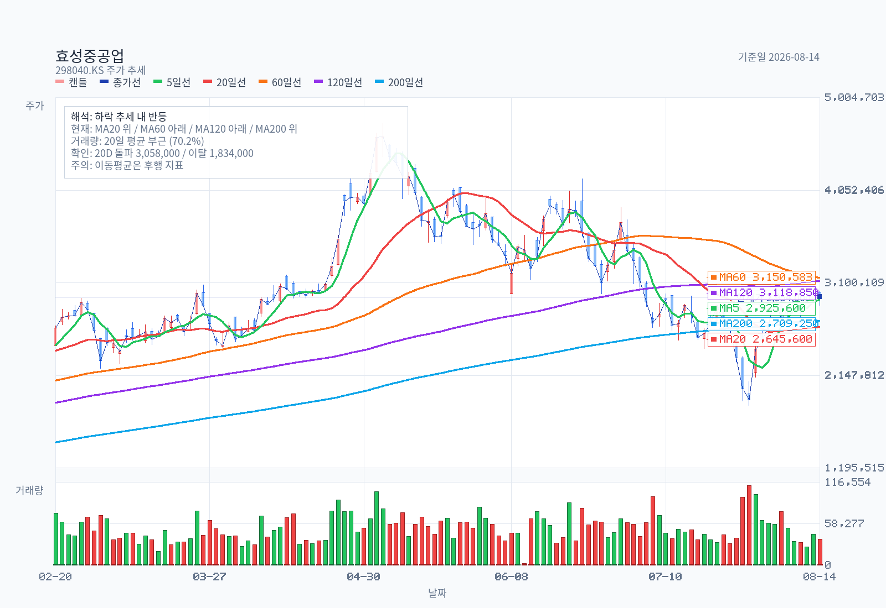
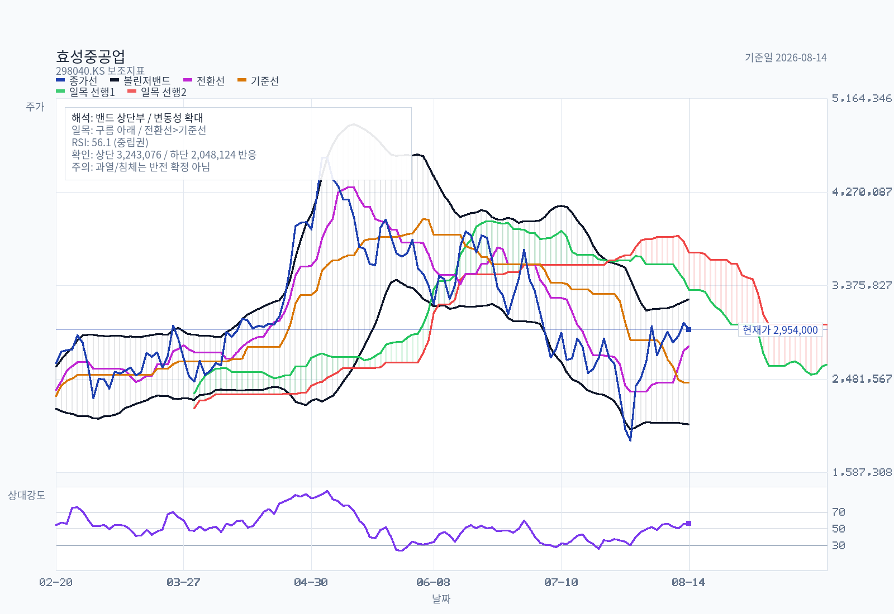
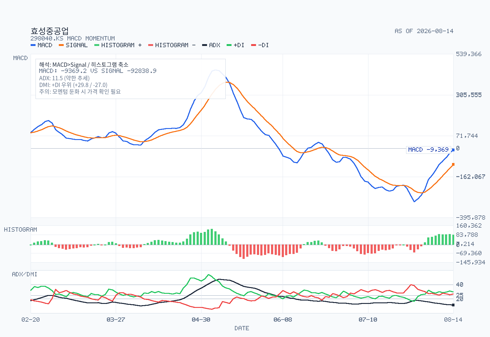
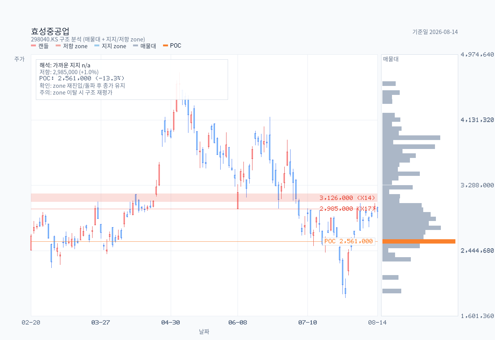

# 효성중공업: 전력기기 호황과 건설의 부담

기준일: 2026-08-15
최근 업데이트일: 2026-08-16

## Summary

효성중공업은 중공업(전력기기)과 건설을 겸업하는 사업회사로, 1H26 연결 매출 3.045조원(+17.1% YoY)·영업이익 4,166억원(+56.2% YoY, OPM 13.7%)을 냈다. 기준일(2026-08-15) 기준으로 **주가·배수 피크는 2026년 5월에 지났고, 이익 피크는 수주잔고 납기상 2029년 이전에 오기 어렵다.** 중공업 수주잔고 23.83조원은 연환산 매출의 4.07년치이고 1H26 book-to-bill 3.76배로, HD현대일렉트릭(2.84년·2.33배)보다 커버리지가 길다.

다만 가동률이 이미 104.5%여서 미국 증설 완료(2028-06) 전까지 성장은 단가와 믹스에 의존하고, 전기동 +31.5%가 그 단가를 잠식한다. 현재 36.0배(2026E)는 HD현대일렉트릭 29.3배 대비 **23% 프리미엄**이며, 이는 중공업 부문 마진이 대등(24.4% vs 25.0%)하다는 점과 수주 커버리지 우위로 일부만 설명된다.

건설 부문은 흔히 지목되는 PF 리스크가 실제로는 작다(연대보증 514억, 자본 대비 1.9%) — 진짜 부담은 리스크가 아니라 **마진 희석**이다.

## 자료 범위

가격 기준일: 2026-08-14 종가 2,954,000원
우선 질문: **(1) 사이클 피크가 언제인가 (2) HD현대일렉트릭 대비 밸류에이션 갭이 정당한가**

## Decision Frame

이 메모는 두 개의 질문을 축으로 재배열했다. 결론부터 말한다.

**질문 1 — 사이클 피크는 언제인가.**

### 1. 멀티플 피크는 이미 지났다 — 2026-05-07, 4,742,000원.

그날 주가는 2026E EPS 82,104원(IBK투자증권 2026-08-03) 대비 **57.8배**였다. 이후 2026-07-30 1,834,000원(22.3배)까지 −61.3% 하락했고 현재 2,954,000원(고점 대비 −37.7%, 36.0배)이다.

**주목할 점: HD현대일렉트릭도 정확히 같은 날 2026-05-07에 고점을 찍었다.** 이것은 종목 이슈가 아니라 섹터 전체의 배수 리레이팅이 끝난 날이다.

### 2. 이익 피크는 아직 오지 않았다.

1H26 중공업 신규수주 11.01조원, book-to-bill **3.76배**. [red: 중공업 수주잔고는 6개월 만에 15.94조 → **23.83조원(+49.6%)**.] 회사는 2026년 중공업 수주 가이던스를 8.4조 → **12조원으로 43% 상향**했다(SK증권·IBK투자증권 2026-08-03).

최대 계약인 765kV 변압기·리액터 공급계약(7,871억원)의 납기는 **2031-01-31**, 노르웨이 Statnett 420kV 계약(3,723억원)은 **2032-01-30**까지 걸려 있다.

### 3. 그런데 효성의 병목은 HD현대일렉트릭보다 더 단단하다.

1H26 가동률이 **104.49%**다. [blue: 100%를 넘었다는 건 이미 정격 생산능력을 초과해 돌리고 있다는 뜻이다(HD현대일렉트릭은 95.1%).] 미국 HICO 증설은 총 1억 8,011만 달러 중 5,062만 달러만 집행됐고 투자기간이 **2028년 6월**까지다.

[brown: 즉 효성의 물량 제약 구간은 2027년 한 해가 아니라 **2027~2028년 2년**이다.]

### 4. 마진 피크는 아직 판정할 수 없다.

2Q26 중공업 OPM 20.2%(SK증권)는 1Q26 13.4%에서 급등했는데, 이 점프의 상당 부분은 1Q26에서 이연된 매출 약 1,000억·영업이익 약 400억이 2Q에 반영된 것이다(IBK투자증권). 즉 2Q 마진은 부풀려져 있고 1Q 마진은 눌려 있다.

두 분기를 합친 1H26 연결 OPM 13.7%가 실제 수준이다.

### 5. 원가 압력은 HD현대일렉트릭과 동일하다.

[blue: 전기동 내수가가 1H26 19,386~21,575원/kg으로 2025년 13,432~17,727원/kg 대비 **중간값 +31.5%** 올랐다(HD현대일렉트릭 +31.7%와 사실상 같은 숫자).] 강판은 2,688원/kg으로 보합이다.

**질문 2 — HD현대일렉트릭 대비 밸류에이션 갭이 정당한가.**

**통념과 반대다. 지금 효성중공업이 HD현대일렉트릭보다 비싸다.**

| | 효성중공업 | HD현대일렉트릭 |
|---|---|---|
| 2026E PER | **36.0배** | **29.3배** |
| 1H26 연결 OPM | 13.7% | 25.0% |
| PBR | 10.65배 | 12.8배 |
| ROE (1H26 연율화) | 20.1% | 36.8% |
| 수주잔고 / 연환산 매출 | **4.07년** | 2.84년 |
| 1H26 book-to-bill | **3.76배** | 2.33배 |

효성은 마진이 절반이고 ROE도 절반인데 이익 배수는 23% 더 높다. 이 프리미엄을 정당화하는 것은 **수주의 양과 기간**뿐이다.

그리고 그 프리미엄에는 두 가지 성격이 섞여 있다 — 하나는 정당하고, 하나는 착시다.

**정당한 부분 — 성장률.** IBK 추정 EPS는 2025년 55,755원 → 2026E 82,104원(+47.3%) → 2027E 109,666원(+33.6%) → 2028E 142,033원(+29.5%)이다. 2027E 기준으로 보면 효성은 **26.9배**로 떨어진다. 배수가 성장으로 빠르게 녹는 구조다.

**착시인 부분 — 건설 희석.** 효성의 연결 OPM 13.7%는 중공업이 나빠서가 아니라 매출의 33.2%를 차지하는 건설 부문이 OPM 7.0%로 끌어내리기 때문이다. 중공업 부문만 떼면 1H26 부문 OPM은 **24.4%**로 HD현대일렉트릭의 25.0%와 거의 같다.

**즉 "효성은 마진이 낮은 회사"라는 인식은 사업 자체가 아니라 사업 구성의 문제다.**

**결론**: 갭은 절반만 정당하다. 중공업만 보면 두 회사의 수익성은 대등하고, 효성의 수주 커버리지가 더 길다.

그러나 그 장점은 이미 가격에 들어가 있고, 오히려 초과 반영되어 있다. **12~24개월 시계에서 효성의 리스크는 이익이 아니라 "이미 프리미엄을 받고 있다"는 사실 자체다.**

**아직 확신을 막는 것**: (a) 765kV 7,871억 계약의 상대방이 연결 자회사 HICO America다 — 외부 수주인지 내부 이전인지 반기보고서만으로는 분리되지 않는다. (b) 연결조정 영업손실이 2025년 연간 −421억에서 1H26 반기 −1,493억으로 급증했는데 구성이 공시되지 않는다. 이 둘이 다음 검증 대상이다.

## Business and Thesis

**무엇을 파는가.** 두 개의 사업부문이다.

**중공업 (1H26 매출 66.3%)**: 초고압·중저압 변압기, 차단기, 배전반 등 전력기기(전력PU)와 산업용 전동기, 발전기, 감속기 등 회전기기(기전PU). 여기에 HVDC, STATCOM, ESS, 전력설비 자산관리 솔루션(ARMOUR+)을 붙이고 있다.

**건설 (1H26 매출 33.2%)**: "효성해링턴플레이스" 브랜드의 주택·재개발·재건축, 업무·상업시설, 토목·SOC. 종속회사 진흥기업(주)이 함께 수행한다.

**가치를 만드는 축은 네 가지다.**

### 1. 초고압 변압기의 제조 진입장벽 + 미국 현지 생산.

창원 외에 Memphis(Hyosung HICO), Nantong(중국), Pune(인도)에 생산거점을 두고 있다. 미국 관세·통상 리스크에 대해 회사가 명시적으로 "미국 내 생산기지를 확보하여 통상위험에 대응"한다고 기재했다.

이것이 HD현대일렉트릭 대비 차별점이다.

### 2. 북미 전력망 교체 + AI 데이터센터 수요의 직접 노출.

HICO America Sales & Tech의 최종 고객 명단에 **Softbank(9%), X.AI(3%)**가 들어 있다. 나머지는 Constellation(15%), Intersect(13%), Dominion(9%), PSE(8%), AEP(8%), WESCO(6%), LS Power(5%), Southern(4%).

Hyosung HICO 기준으로는 Eversource Energy(22%), American Electric Power(17%), Intersect Power(15%). **AI 데이터센터 개발사가 고객 명단에 실명으로 올라온 것은 반기보고서에서 확인되는 사실이다.**

### 3. 수주산업 특유의 선반영 구조.

2026-02 체결한 765kV 계약의 납기가 2031년 1월이다. 지금 받는 주문이 2030~2031년 매출로 잡힌다.

"올해 실적"보다 "올해 수주"가 선행지표다.

### 4. 전력 + 건설의 결합 = 데이터센터 신사업.

회사는 "전력사업부문의 전력공급·에너지 효율화 기술과 건설부문의 시공 역량을 기반으로 데이터센터 사업을 신규 성장동력으로 육성"한다고 명시했다. 이것이 겸업 구조의 유일한 전략적 정당화 논리다 — 그리고 이미 가산랜드마크데이터센터PFV에 대한 지급보증으로 재무제표에 나타나 있다.

**핵심 논지**: 이 회사의 12~24개월 이익은 이미 확보된 32.96조원(중공업 23.83 + 건설 9.12) 잔고에서 나온다. 따라서 이익 리스크는 낮다.

리스크는 (a) 가동률 104.5%에서의 물량 상한, (b) 전기동 단가 전가 실패, (c) **HD현대일렉트릭 대비 프리미엄 배수의 재조정**으로 압축된다. 사이클 학습 목적이라면 이 종목은 **"같은 사이클을 타는 두 회사가 왜 다른 배수를 받는가"**의 사례로 읽는 것이 가장 유익하다.

## Revenue Mix

**사업부문별 (연결)**

| 구분 | 1H26 | 비중 | 2025 | 비중 | 2024 | 비중 |
|---|---|---|---|---|---|---|
| 중공업 | 2,017,762백만 | 66.26% | 4,149,258 | 69.52% | 3,098,831 | 63.31% |
| 건설 | 1,011,988백만 | 33.23% | 1,786,501 | 29.93% | 1,765,459 | 36.07% |
| 기타(임대 등) | 15,437백만 | 0.51% | 32,753 | 0.55% | 30,690 | 0.62% |
| **합계** | **3,045,187백만** | 100% | 5,968,512 | 100% | 4,894,980 | 100% |

**사업부문별 영업손익 (연결)**

| 구분 | 1H26 영업손익 | OPM | 2025 | OPM | 2024 | OPM |
|---|---|---|---|---|---|---|
| 중공업 | 492,949백만 | **24.4%** | 738,068 | 17.8% | 367,867 | 11.9% |
| 건설 | 71,091백만 | **7.0%** | 46,899 | 2.6% | 47,554 | 2.7% |
| 공통 | 1,901백만 | — | 4,095 | — | 2,263 | — |
| 연결조정 | **(149,332)백만** | — | (42,094) | — | (55,205) | — |
| **합계** | **416,609백만** | **13.7%** | 746,968 | 12.5% | 362,479 | 7.4% |

**이 표에서 읽어야 할 세 가지.**

### 1. 중공업 OPM이 2년 만에 11.9% → 24.4%로 올랐다.

[red: 이것이 주가 3배 상승의 실체다.]

### 2. 건설 OPM도 2.6% → 7.0%로 개선됐다.

시장이 건설을 "썩은 부문"으로 취급하지만, 1H26 숫자는 그 반대다. [red: 2Q26 건설은 매출 5,491억(+19% YoY), 영업이익 344억으로 **전년 동기 적자에서 흑자전환**했다(SK증권 2026-08-03).]

### 3. 연결조정 영업손실이 급증했다.

2025년 연간 −421억이던 것이 1H26 반기에만 −1,493억이다. 반기 기준으로 3.5배 이상이다.

**부문 합산 OPM(중공업 24.4%)과 연결 OPM(13.7%)의 차이 대부분이 여기서 나온다.** 반기보고서는 이 조정의 구성을 공시하지 않는다. [brown: 별도 매출의 18.83%가 HICO(연결 자회사)향이라는 점을 감안하면 미실현이익 제거일 가능성이 높지만, 이는 추론이지 확인된 사실이 아니다.]

**수출/내수 (별도 기준)**

| 구분 | 1H26 수출 | 1H26 내수 | 수출 비중 |
|---|---|---|---|
| 중공업 | 1,002,873백만 | 484,979백만 | 67.4% |
| 건설 | — | 642,131백만 | 0% |
| **전사** | **1,002,873백만** | **1,141,475백만** | **46.8%** |

HD현대일렉트릭의 수출 비중 78.3%와 비교하면 크게 낮다. **이유는 사업 자체가 아니라 건설이 100% 내수이기 때문이다.** 중공업만 보면 67.4%다.

국가별 세부 분해는 **별도 공시되지 않는다.**

**고객 집중도 (별도 기준, 1H26)**

| 매출처 | 비중 | 성격 |
|---|---|---|
| HICO (HICO America Sales & Tech) | 18.83% | **연결 자회사 (내부거래)** |
| 한국전력 | 9.09% | 중공업 / 국내 |
| 부산 우암1구역 재개발조합 | 4.95% | 건설 |
| 부평 산곡 재개발조합 | 3.95% | 건설 |
| NSW ELECTRICITY (호주) | 3.54% | 중공업 / 수출 |
| 성남 중1구역 도시환경정비조합 | 3.43% | 건설 |
| 한화오션 | 3.06% | 중공업 (선박용 회전기기 추정) |
| 평택가재 | 2.59% | 건설 |
| STATNETT (노르웨이) | 1.89% | 중공업 / 수출 |

**최대 매출처가 자기 자회사다.** 이것은 미국 현지 판매법인을 거치는 구조상 자연스럽지만, 동시에 **"외부 최종수요가 얼마인가"를 별도 기준으로는 읽을 수 없게 만든다.** 최종 고객은 자회사 단위 공시(위 Business 섹션)로만 간접 확인된다.

## What The Latest Results Say

**연결 손익계산서 (반기보고서 2026-08-13 제출)**

| 항목 | 2Q26 (3개월) | 2Q25 (3개월) | YoY | 1H26 (누적) | 1H25 (누적) | YoY |
|---|---|---|---|---|---|---|
| 매출액 | 1,686,978백만 | 1,525,285 | +10.6% | 3,045,187 | 2,601,420 | **+17.1%** |
| 매출원가 | 1,287,977 | 1,203,939 | +7.0% | 2,376,141 | 2,086,019 | +13.9% |
| 매출총이익 | 399,001 | 321,346 | +24.2% | 669,046 | 515,400 | +29.8% |
| 판관비 | 116,599 | 144,688 | −19.4% | 221,063 | 227,233 | −2.7% |
| **영업이익** | **264,286** | **164,261** | **+60.9%** | **416,609** | **266,648** | **+56.2%** |
| OPM | **15.7%** | 10.8% | +4.9%p | **13.7%** | 10.3% | +3.4%p |
| 법인세차감전순이익 | 236,863 | 107,064 | +121.2% | 366,001 | 237,514 | +54.1% |
| 순이익 | 171,741 | 87,349 | **+96.6%** | 263,069 | 190,978 | +37.7% |
| 지배주주 순이익 | 172,588 | 92,523 | +86.5% | 259,843 | 194,679 | +33.5% |
| 기본 EPS | 18,534원 | 9,936원 | +86.5% | **27,905원** | 20,907원 | +33.5% |

**1Q26 역산**: 매출 1,358,209백만 / 영업이익 152,323백만 / **OPM 11.2%**. 2Q26 OPM 15.7%와의 4.5%p 격차 대부분은 1Q → 2Q 이연(매출 약 1,000억, 영업이익 약 400억)으로 설명된다(IBK투자증권 2026-04-28, 2026-06-11).

**매출총이익률이 19.8% → 22.0%로 올랐다.** 원가율 개선이 마진 확대의 실체이고, 판관비는 오히려 절대액이 줄었다(−2.7%). 이건 믹스와 단가가 동시에 좋아졌다는 뜻이다.

**주의해야 할 두 줄**: 금융수익 4,502억 / 금융비용 4,573억. 총액이 매우 크지만 순액은 −71억이다.

이는 2,105건의 선물환계약 평가·거래손익이 총액으로 계상되기 때문이며, 실질 손익 영향은 미미하다. **금융손익만 보고 "환에서 크게 벌었다/잃었다"고 읽으면 오독이다.**

**수주 상황 (2026-06-30 기준, 백만원)**

| 부문 | 전기말 잔고 (2025-12-31) | 1H26 수주액 | 1H26 매출액 | 당기말 잔고 | b2b |
|---|---|---|---|---|---|
| 중공업 (지배+주요종속 합산) | 15,936,349 | **11,010,478** | 2,924,567 | **23,834,404** | **3.76배** |
| 건설 — 효성중공업 | 5,518,255 | 447,126 | 642,766 | 5,322,614 | 0.70배 |
| 건설 — 진흥기업 | 3,531,186 | 673,807 | 403,762 | 3,801,231 | 1.67배 |
| **합계** | **24,985,790** | **12,131,411** | **3,971,095** | **32,958,249** | 3.05배 |

- 중공업 잔고 커버리지: 23.83조 ÷ (1H26 매출 2.92조 × 2) = **4.07년치**
- 건설 잔고 커버리지: 9.12조 ÷ (1H26 매출 1.05조 × 2) = **4.36년치**
회사 가이던스: 2026년 중공업 신규수주 8.4조 → **12조원**(+43% 상향, 2026-08-03 실적발표)

**여기에 해석이 필요한 불일치가 하나 있다.** DART 기준 1H26 중공업 수주액이 이미 11.01조인데 연간 가이던스는 12조다. 반기에 가이던스의 92%를 채웠다는 뜻이 된다.

두 가지 가능성이 있다 — (a) 가이던스가 보수적이거나, (b) DART 수주액과 회사 가이던스의 집계 기준이 다르다. **DART 수주표에는 "지배회사 및 주요 종속회사의 실적을 단순 합산한 금액으로, 내부거래가 제거되지 않아 연결기준 금액과 차이가 있을 수 있습니다"라고 명시돼 있다.** 765kV 계약(7,871억)의 상대방이 HICO America인 것을 보면 (b)일 가능성이 높다.

**이 기준 차이를 무시하고 "이미 가이던스를 초과 달성"이라고 읽으면 안 된다.**

**생산능력과 가동률 (중공업, 지배+주요종속 합산)**

| 구분 | 1H26 | 2025 | 2024 |
|---|---|---|---|
| 생산능력 | 1,894,093백만 | 3,128,398 | 2,540,371 |
| 생산실적 | 1,979,213백만 | 3,258,122 | 2,600,598 |
| **가동률** | **104.49%** | 104.15% | 102.37% |

**3년 연속 100%를 넘겼다.** 회사는 "가동률은 생산실적을 생산능력으로 단순히 나눈값으로 실제 법인별, 제품별 가동률과는 차이가 발생합니다"라고 단서를 달았지만, 방향은 분명하다 — **증설 없이는 물량이 더 안 나온다.**

**증설 현황 (Hyosung HICO, 미국 Memphis)**

| 투자기간 | 총투자액 | 기투자액 | 향후투자액 |
|---|---|---|---|
| 2025-01 ~ 2026-12 | 67,160천USD | 31,132천USD | 36,029천USD |
| 2025-07 ~ 2028-06 | 180,114천USD | 50,622천USD | **129,492천USD** |

지배회사 설비투자도 1H26에 945.9억원을 집행해 계획(282.8억)의 **3.3배**를 썼고, 신설·증설만 692.5억으로 전년 동기(233.0억) 대비 3배다. **투자는 실제로 가속되고 있다.** 다만 두 번째 미국 프로젝트가 2028년 6월까지이므로 **효과 발현은 2028년 이후**다.

## DART Recheck

반기보고서(2026-08-13 제출, rcept_no 20260813001554)에서 **직접 확인된 것**:

- 사업부문별 매출·영업손익·자산·부채 (II-7 사업부문별 요약 재무현황)
- 중공업/건설 수주잔고 및 1H26 수주액 (II-4 수주상황)
- 가동률 104.49%, 생산능력·생산실적 (II-3)
- 전기동 단가 19,386~21,575원/kg (II-3)
- 주요 매출처 및 비중, 자회사별 최종고객 (II-4)
- PF 연대보증 및 우발부채 (주석 31)
- 특수관계자 지급보증 4,328.95억 (주석)
- 단일판매·공급계약 진행 현황 (XI-1)
- 최대주주 지분 (VII-1), 자기주식 12,807주 (OpenDART tesstkAcqsDspsSttus)

**확인되지 않는 것 — 여기서 멈춰야 하는 지점**:

| 항목 | 상태 |
|---|---|
| 국가별·지역별 매출 분해 | **미공시**. 별도 기준 수출/내수 총액만 있다. 증권사 리포트의 "북미 비중 53%"(IBK 2026-04-28)는 회사 IR 자료 기반이며 반기보고서에서 검증되지 않는다 |
| 분기별 신규수주 추이 | **반기 단위로만 공시**. 1Q26 4.17조는 증권사 리포트(SK증권 2026-04-27)에만 있다 |
| 연결조정 영업손실 −1,493억의 구성 | **미공시**. 미실현이익 제거 추정은 추론이다 |
| 765kV 계약 7,871억의 최종 외부 수요 | **분리 불가**. 계약 상대는 연결 자회사 HICO America다 |
| 중공업 부문의 제품별(변압기/차단기/회전기) 분해 | **미공시**. HD현대일렉트릭은 전력기기/회전기기/배전기기 3분류를 공시하지만 효성은 중공업 단일 라인이다 |
| 2026년 수주 가이던스 12조 | **IR 자료 기반**. 반기보고서에 기재 없음 |

**HD현대일렉트릭 대비 공시 품질이 낮다.** 제품별 분해가 없어 "어느 제품이 마진을 끌어올렸는가"를 필링만으로는 답할 수 없다. 이 메모의 중공업 마진 논의가 HD현대일렉트릭 메모보다 거친 이유다.

## Order Backlog and Revenue Visibility

| 항목 | 값 | 해석 |
| --- | ---: | --- |
| 공식 수주잔고 합계 | 329,582.49억원 | 중공업·건설, 지배회사·주요 종속회사 단순합산 |
| 종료연도 확인 가능 개별 계약 잔액 | 35,741.67억원 | 27건, 프로젝트는 2032년까지 |
| 종료일 미정 개별 계약 잔액 | 20,066.74억원 | 실착공일 또는 계약종료일 미확정 9건 |
| 그래프 합계 / 공식 잔고 | 55,808.41억원 / 16.9% | 전체 잔고의 연도별 배분이 아님 |
| 잔고 / 같은 수주표 매출 연율화 | 4.15배 | 수주표 단순합산 범위; 중공업만 4.07배 |
| 생산능력 참고 | 18,940.93억원 | 상반기 중공업; 생산실적 19,792.13억원·가동률 104.49% |

기준은 `official-contract-end-year`다. 즉 **프로젝트별 공시 잔여 수주액을 계약 종료연도에 묶은 값**이며 매출 인식연도가 아니다. 2029년 Pongola 잔액 74.62억원은 설비 납품이 아니라 O&M이어서 별도 색으로 분리했다.

공식 잔고와 그래프 합계의 차이 273,774.08억원은 연도별 일정이 공시되지 않아 배분하지 않았다. 잔고만으로 마진, 취소, 인허가·착공 지연, 내부거래, 환율, 현금 전환을 추론할 수 없다.

상세 계산은 수주잔고 분석과 정규화 데이터에 있다.

## Street / Alternative Views

### 셀사이드 컨센서스

**컨센서스 스냅샷** (한경 컨센서스, lookback 305일, 31개 리포트 전량 추출 성공)

- 투자의견: **BUY 31 / HOLD 0 / SELL 0**
- 목표주가: 중앙값 ₩3,520,000, 평균 ₩3,652,903, 범위 ₩1,800,000 ~ ₩5,000,000
- 커버리지 증권사: 6곳 (IBK투자증권, LS증권, SK증권, 유안타증권, 유진투자증권, 대신증권)
- 최신: 2026-08-03 IBK투자증권 김태현

**주의**: 중앙값 ₩3,520,000은 1년치 리포트를 섞은 값이라 현재 뷰가 아니다. **2026-08-03 실적 발표 직후 3개 리포트의 TP는 ₩4,000,000 / ₩4,100,000 / ₩4,300,000**이며, 이 클러스터 기준 상승여력은 현재가 대비 **+35~46%**다.

| 증권사 | 애널리스트 | 날짜 | 의견 | TP | 직전 대비 |
|---|---|---|---|---|---|
| IBK투자증권 | 김태현 | 2026-08-03 | BUY | ₩4,100,000 | **−16.3%** |
| LS증권 | 성종화 | 2026-08-03 | BUY | ₩4,300,000 | −8.5% |
| SK증권 | 나민식 | 2026-08-03 | BUY | ₩4,000,000 | 0.0% |
| 유안타증권 | 손현정·김고은 | 2026-07-14 | BUY | ₩5,000,000 | 0.0% |
| 유진투자증권 | 허준서 | 2026-04-17 | BUY | ₩4,000,000 | — |
| 대신증권 | 허민호 | 2026-02-02 | BUY | ₩3,300,000 | — |

**목표주가 궤적 — 배수만 잘렸다**

| 시점 | 컨센서스 TP (중앙값) |
|---|---|
| 2025-10 | ₩1,830,000 |
| 2025-11 | ₩2,660,000 |
| 2026-01 | ₩2,860,000 |
| 2026-02 | ₩3,300,000 |
| 2026-03 | ₩3,520,000 |
| 2026-04 | ₩4,200,000 |
| 2026-06 | **₩4,950,000** (피크) |
| 2026-07 | ₩4,500,000 |
| 2026-08 | ₩4,100,000 |

6월 피크에서 8월까지 **−17.2%** 조정됐다. HD현대일렉트릭의 TP 중앙값이 같은 기간 −20% 조정된 것과 같은 패턴이다.

**IBK투자증권이 TP를 내린 방식이 핵심이다** (2026-08-03):

> "기존에는 북미 중심의 우호적인 사업환경을 반영해 Target PER 50.1배(2022~25년 연간 최고 PER 평균에 20% 할증)를 적용했으나, **업종 전반의 밸류에이션 조정을 감안해 할증을 제거하고 과거 4년 최고 PER 평균인 41.7배를 적용함**"

- 12M Forward EPS 98,182원 × Target PER 41.7배 = 적정주가 4,097,073원
EPS 추정 변경: 2026E 84,862 → **82,104**(−3.3%), 2027E 115,427 → **109,666**(−5.0%)

**즉 셀사이드는 이익을 −3~5% 미세 조정하고 배수를 50.1배 → 41.7배(−16.8%)로 잘랐다.** HD현대일렉트릭과 완전히 동일한 패턴이다 — **시장이 판정한 것은 이익이 아니라 배수다.**

**IBK 실적 추정 (2026-08-03 기준)**

| | 2024 | 2025 | 2026E | 2027E | 2028E |
|---|---|---|---|---|---|
| 당기순이익 (십억원) | 223 | 503 | 768 | 1,024 | 1,324 |
| EPS (원) | 23,876 | 55,755 | 82,104 | 109,666 | 142,033 |
| EPS 증가율 | +92.0% | +133.5% | +47.3% | +33.6% | +29.5% |

**유안타증권 (2026-06-11, TP ₩5,000,000)**: 2026년 연결 매출 7조 2,880억(+22.1%), 영업이익 **1조 1,833억**(+58.4%, OPM 16.2%). 중공업 부문 2026년 매출 5조 1,848억 전망.

**의견 분산**: 유안타 TP ₩5,000,000은 컨센서스 중앙값 대비 +42.0%, 대신증권의 2월 TP ₩3,300,000과는 51% 차이다. **LS증권은 밸류에이션 기준 연도를 4월 "2026E EPS 대비 글로벌 피어 14.0% 할증"에서 8월 "2027E EPS 대비 글로벌 피어 8.3% 할인"으로 옮겼다.** HD현대일렉트릭 메모에서 지적한 것과 같은 현상이다 — **셀사이드가 어느 해 이익에 배수를 곱할지 계속 바꾸는 것 자체가 사이클 위치에 합의가 없다는 신호다.**

### 리테일 / 네이버 블로그 뷰

네이버 블로그 패스를 실행했다(검색 쿼리 7개, 후보 28명). **적격 블로거는 1명(pisak001)뿐이었고, 그마저 투자 분석 블로그가 아니다.**

| 블로거 | 포스트 | 커버 기간 | 최신 |
|---|---|---|---|
| pisak001 ("방구석 공인중개사") | 3 | 2026-04-30 ~ 2026-08-09 | 2026-08-09 |

포스트 제목: "폭락 후 50% 반등한 효성중공업 주가, 주식 시장이 놓친 진짜 상승 시그널"(2026-08-09), "'아직도 저평가' 효성중공업 주가 진짜 500만원 찍나?"(2026-05-05), "1주에 400만원 우량주, 효성중공업 주가 전망 500만원 가능할까"(2026-04-30).

**평가: 독립적 분석으로 취급할 수 없다.** 세 편 모두 증권사 리포트를 재서술한 콘텐츠이고, 제목 형식이 클릭 유도형이다. 5월 초 고점 부근(4,742,000원 직전)에 "아직도 저평가 / 500만원" 콘텐츠가 나왔고, 7월 저점 구간에는 글이 없다가 반등 후 다시 나왔다. **이것은 뷰가 아니라 심리 지표로만 쓸 수 있다 — 리테일 콘텐츠가 고점과 반등 국면에만 생산됐다는 사실 자체.**

외국계 IB 커버리지는 이번 패스에서 별도로 수집하지 않았다. 필요하면 `kr-foreign-analyst`로 추가 확인이 필요하다.

## Current Valuation Snapshot

| 항목 | 값 | 산출 근거 |
|---|---|---|
| 현재가 (price, 2026-08-14 종가) | 2,954,000원 | Yahoo Finance 298040.KS (조회 2026-08-15) |
| 발행주식수 (shares out) | 9,324,548주 | 자본금 46,622,740,000 ÷ 액면 5,000원 (2026-06-30) |
| 자기주식 (treasury) | 12,807주 (0.14%) | 단주 발생분. 실질적으로 없음 |
| 시가총액 (market cap) | **27.54조원** | 2,954,000 × 9,324,548 |
| 총차입금 | 6,348억원 | 유동 560,989 + 비유동 73,815백만 |
| 현금및현금성자산 | 1,726억원 | 2026-06-30 |
| 순차입금 | **+4,622억원** | 총차입금 − 현금 |
| EV | 28.01조원 | 시총 + 순차입금 |
| Trailing PER (TTM) | **47.0배** | TTM 지배 EPS 62,830원 (2H25 + 1H26) |
| **Forward PER (2026E)** | **36.0배** | 2026E EPS 82,104원 (IBK 2026-08-03) |
| Forward PER (2026E, 대안) | 38.8배 | 2026E EPS 76,158원 (SK증권 2026-08-03) |
| Forward PER (2027E) | **26.9배** | 2027E EPS 109,666원 (IBK) |
| 12M Forward PER | 30.1배 | 12M fwd EPS 98,182원 (IBK) |
| EV/Sales (TTM) | 4.37배 | TTM 매출 6.41조원 |
| PBR | **10.65배** | 지배 BPS 277,474원 (지배자본 2,587,324백만) |
| ROE (1H26 연율화) | **20.1%** | 지배 NI 259,843 × 2 ÷ 지배자본 |
| 부채비율 | **213.5%** | 부채 5,826,243 ÷ 자본 2,728,790 |
| 유동비율 | **94.4%** | 유동자산 4,644,061 ÷ 유동부채 4,919,012 |
| 배당수익률 | **0.25%** | 2025 DPS 7,500원 기준 |
| 배당성향 (2025) | 13.4% | 현금배당 69,838백만 ÷ 지배 NI |

TTM 실적 = 2H25 + 1H26. TTM 매출 6,412,279백만 / 영업이익 896,929백만 / **OPM 14.0%**.

**EV/EBITDA는 산출하지 않았다.** 반기보고서 손익계산서에 D&A 단일 라인이 없고, 건설·중공업 혼합 구조라 근사치의 오차가 커서 비교에 부적합하다.

**유동비율 94.4%는 100%를 밑돈다.** 다만 유동부채 4.92조 중 초과청구공사 5,980억 + 기타유동부채 2조 87억은 상당 부분 선수금 성격이라 즉시 상환 의무가 아니다. **경보로 읽기보다 수주산업의 운전자본 구조로 읽는 것이 맞다.** 다만 부채비율 213.5%는 HD현대일렉트릭(순현금 8,955억) 대비 명확한 열위다.

## HD현대일렉트릭 대비 정밀 비교

같은 기준일(2026-08-15), 같은 가격 기준일(2026-08-14 종가)의 두 회사 비교다.

| 항목 | 효성중공업 (298040) | HD현대일렉트릭 (267260) | 우위 |
|---|---|---|---|
| 주가 | 2,954,000원 | 803,000원 | — |
| 시가총액 | 27.54조원 | 28.95조원 | HDEL |
| **2026E PER** | **36.0배** | **29.3배** | **HDEL (저평가)** |
| 2027E PER | 26.9배 | n/a | — |
| PBR | 10.65배 | 12.8배 | 효성 |
| ROE (1H26 연율) | 20.1% | 36.8% | HDEL |
| 순현금/순차입금 | −4,622억 (순차입) | +8,955억 (순현금) | **HDEL** |
| 1H26 매출 | 3.045조 (+17.1%) | 2.18조 (+13.4%) | 효성 |
| 1H26 영업이익 | 4,166억 (+56.2%) | 5,453억 (+27.6%) | 효성 (성장률) |
| 1H26 연결 OPM | 13.7% | **25.0%** | **HDEL** |
| 중공업/전력기기 부문 OPM | 24.4% | 25.0% | 대등 |
| 수주잔고 | 23.83조 (중공업) | 12.31조 | 효성 |
| 잔고 / 연환산 매출 | **4.07년** | 2.84년 | **효성** |
| 1H26 book-to-bill | **3.76배** | 2.33배 | **효성** |
| 가동률 | **104.5%** | 95.1% | HDEL (여력) |
| 증설 완공 | 2028-06 (미국 2차) | 2027-12 | HDEL (빠름) |
| 수출 비중 | 46.8% (중공업 67.4%) | 78.3% | HDEL |
| 전기동 상승률 | +31.5% | +31.7% | 동일 |
| 배당수익률 | 0.25% | 0.88% | HDEL |
| 5월 고점 PER (2026E) | 57.8배 | 52.2배 | — |
| 고점 대비 하락 | −37.7% | −43.8% | — |

**갭 해석 — 세 문장으로 요약한다.**

### 1. 효성이 이기는 곳은 수주다.

잔고 커버리지 4.07년 vs 2.84년, book-to-bill 3.76 vs 2.33. 2029~2031년 매출 가시성은 효성이 명확히 우위다.

### 2. HD현대일렉트릭이 이기는 곳은 재무 품질과 가격이다.

순현금 8,955억 vs 순차입 4,622억, ROE 36.8% vs 20.1%, 그리고 2026E 29.3배 vs 36.0배. **더 좋은 재무구조를 더 싸게 산다.**

### 3. 효성의 프리미엄은 "2027년 이후를 먼저 사는 것"이다.

2027E 기준 26.9배까지 내려가지만, 그건 EPS +33.6%가 실현된다는 전제다. 가동률 104.5%에서 미국 증설이 2028-06에나 끝나는 회사가 2027년에 EPS를 33% 늘리려면 **단가와 믹스로만 해야 한다.** [brown: 이 전제가 이 종목의 유일한 취약 고리다.]

**학습 관점 정리**: 두 회사는 같은 사이클을 타고 같은 날 고점을 찍었지만, 시장은 **"마진이 높은 회사"보다 "잔고가 긴 회사"에 더 높은 배수를 줬다.** 전력기기 사이클 후반에는 현재 수익성보다 수주 가시성이 배수를 결정한다는 사례다 — 다만 그 선호가 옳은지는 2027년 실적으로만 판정된다.

## Historical Valuation Bands

**주의**: 보유 아티팩트는 2년치 일봉(2024-08-14 ~ 2026-08-14)뿐이다. 아래는 확보 가능한 구간의 실제 주가 범위 × 연간 지배 EPS로 만든 근사 밴드이며, 2024년은 8월부터의 부분 구간이다.

| 연도 | 주가 저점 | 주가 고점 | 지배 EPS | PER 저 | PER 고 |
|---|---|---|---|---|---|
| 2024 (8~12월, 부분) | 239,000 (09-09) | 518,000 (11-12) | 23,876 | 10.0배 | 21.7배 |
| 2025 | 382,000 (04-09) | 2,483,000 (11-04) | 55,832 | 6.8배 | 44.5배 |
| 2026 YTD | 1,736,000 (01-02) | 4,742,000 (05-07) | 82,104 (E) | 21.1배 | **57.8배** |
| **현재 (2,954,000)** | | | 82,104 (E) | **36.0배** | |

PER 밴드 (2024-08 ~ 2026-08, 연간 EPS 기준)

| 시점 | 표시 값 |
| --- | --- |
| 2024(부분) | 2025 2026YTD |

**읽는 법**: 현재 36.0배는 2026년 레인지(21.1~57.8배)의 **중간 부근**이고, 2025년 최고치 44.5배보다는 낮다. **자체 역사 기준으로는 "상단권"이 아니라 "중립"이 정확한 표현이다** — 이 종목의 프리미엄 문제는 자기 역사가 아니라 동종 비교에서 나온다. 2024~2025년의 한 자릿수 PER은 EPS가 급등하기 전 주가 기준이라 현재와 직접 비교할 수 없다(2024년 EPS 23,876원 → 2026E 82,104원, 3.4배).

**주의**: 위 저점·고점은 일중 저가/고가 기준이며, 2026년 저점은 7월 급락 저점(1,834,000원, 07-30)이 아니라 **연초 1월 2일의 1,736,000원**이다. 5월 고점 대비 −61.3%였던 7월 저점은 22.3배에 해당한다.

## Chart and Positioning

**기술적 상태 (2026-08-14 기준)**

| 지표 | 값 | 해석 |
|---|---|---|
| 종가 | 2,954,000원 | — |
| MA5 / MA20 | 2,925,600 / 2,645,600 | 단기 상승 |
| MA60 / MA120 / MA200 | 3,150,583 / 3,118,850 / 2,709,250 | **MA60·MA120 아래, MA200 위** |
| 이동평균 구조 | rebound-inside-downtrend | **하락 추세 내 반등** |
| RSI14 | 56.14 | 중립 |
| MACD / Signal | −9,369 / −92,839 | 시그널 상회, 0선 아래 |
| MACD 히스토그램 | +83,470, 축소 중 | 반등 모멘텀 둔화 |
| ADX14 / +DI / −DI | 11.50 / 29.75 / 26.96 | **약한 추세** (ADX 하락) |
| 일목균형표 | 구름대 아래 | 하락 우위 |
| 볼린저 | 상단 절반, 밴드 확장 | 변동성 확대 |
| 거래량 / VolMA20 | 70.2% | **평균 이하** |
| 52주 최고 / 최저 | 4,742,000 (2026-05-07) / 1,073,000 (2025-08-20) | 고점 대비 −37.7% |
| YTD | +60.1% (2026-01-02 1,845,000 대비) | — |

**구조적 가격대**

| 유형 | 구간 | 중심 | 터치 | 최근 터치 | 상태 |
|---|---|---|---|---|---|
| 저항 | 2,985,000 | 2,985,000 | 17회 | 2026-08-14 | active |
| 저항 | 3,075,000 ~ 3,177,000 | 3,126,000 | 14회 | 2026-07-07 | active |

- 20일 돌파 레벨: **3,058,000원** / 20일 이탈 레벨: **1,834,000원**
- 최근접 지지 관찰: 2,048,124원

**읽는 법**: 현재가 2,954,000원은 **17회 터치된 2,985,000원 저항 바로 아래**에 붙어 있다. 거래량은 20일 평균의 70%로 얇고, ADX 11.5는 추세가 없는 상태다.

MA60(3,150,583)을 회복하지 못하면 **여전히 하락 추세 안의 반등**이다. 차트만으로는 "range-bound or base-building" — 방향성 신호가 아니라 **재축적 구간**으로 읽어야 한다.

**두 저항대가 겹치는 2,985,000 ~ 3,177,000 구간이 이번 반등의 1차 판정선이다.**

## Governance and Structure

**주주 구성 (2026-06-30)**

| 주주 | 관계 | 주식수 | 지분율 | 변동 |
|---|---|---|---|---|
| (주)효성 | 최대주주 | 3,027,801 | **32.47%** | — |
| 조현준 | 임원 | 932,455 | **10.00%** | +1,135주 (장내 매수) |
| 송광자 | 기타 | 68,530 | 0.73% | — |
| 조현상 | 계열회사 임원 | 61,369 | 0.66% | +1,270주 (장내 매수) |
| 조인서 | 기타 | 2,291 | 0.02% | — |

**최대주주 및 특수관계인 합계 약 43.9%** (위 5인 외 조인영 0.03%, 조양래 0.01%, 이미경 0.01%, 조재현 등 소액 특수관계인 포함). 지배구조가 안정적이며 적대적 M&A 리스크는 사실상 없다.

**구조상 유의점**:

효성중공업은 (주)효성의 **자회사인 사업회사**다. 지주회사가 아니다.

동명 계열사인 `효성`(004800), `HS효성`(487570), `효성티앤씨` 등과 혼동하지 말아야 한다.

- **(주)효성과 브랜드사용료 약정**을 체결하고 있다 — 연결매출액 및 광고선전비 기준으로 산정해 지급한다.
**(주)효성으로부터 계약이행보증 등 366.8억원의 지급보증을 받고 있다.** 반대로 효성중공업이 특수관계자에게 제공하는 지급보증은 **4,328.95억원**이다.

연구개발 조직이 **(주)효성 산하 중공업연구소와 효성중공업 자체 조직으로 이원화**되어 있다. R&D 성과의 귀속이 100% 자사가 아니다.

**조현준·조현상 두 사람이 모두 1H26 중 장내 매수**를 했다. 규모는 작지만(합계 2,405주) 방향은 매수다.

**배당 정책**

| 연도 | DPS | 배당총액 | 배당성향 | 수익률 |
|---|---|---|---|---|
| 2025 | 7,500원 | 698.4억원 | 13.4% | 0.40% |
| 2024 | 5,000원 | 465.6억원 | 20.9% | 1.20% |

DPS는 올렸지만 이익이 더 빨리 늘어 배당성향은 20.9% → 13.4%로 낮아졌다. 중간배당은 최근 3사업연도 중 없었다.

**현재가 기준 수익률 0.25%는 배당 매력이 사실상 없는 수준이다.**

**주요 종속회사** (24개사, 주요 7개사)

| 회사 | 소재지 | 사업 | 자산총액 |
|---|---|---|---|
| HICO AMERICA Sales&Tech, INC | Pittsburgh, USA | 변압기 판매 | 1,312,296백만 |
| 진흥기업(주) | 인천 연수구 | 건설 | 563,127백만 |
| KB와이즈스타전문투자형사모부동산투자신탁제11호 | 서울 중구 | 부동산 임대 | 412,276백만 |
| Nantong Hyosung Transformer | Nantong, China | 변압기 제조 | 312,200백만 |
| Hyosung HICO, Ltd. | Memphis, USA | 변압기 제조 | 273,142백만 |
| HYOSUNG T&D INDIA | Pune, India | 차단기 제조 | 221,095백만 |
| Hyosung UK Limited | London, UK | 판매업 | 15,720백만 (2025-10 신설) |

## 건설 부문 — 리스크인가 옵션인가

이 질문은 효성중공업 고유의 것이라 별도 섹션으로 다룬다. **결론: 현재 시점에서 건설은 리스크가 아니라 마진 희석 요인이다.

단, 데이터센터 PFV 보증은 별개로 지켜봐야 한다.**

**(1) PF 우발채무는 작다**

| 구분 | 보증한도 | 보증금액 | 대출잔액 |
|---|---|---|---|
| 연대보증 — 정비사업 (본PF, 2년 이내) | 7,200백만 | 6,000백만 | 6,000백만 |
| 연대보증 — 기타사업 (본PF, 2년 이내) | 45,391백만 | 45,391백만 | 6,991백만 |
| **합계** | **52,591백만** | **51,391백만** | **12,991백만** |

**PF 연대보증 총액 514억원은 자본총계 2.73조원의 1.9%에 불과하다.** 지급보증(별도 항목)은 0이다. 건설사 PF 위기 국면에서 통상 문제가 되는 규모와는 차원이 다르다.

과거 사고 사례인 용인신갈동 미착공 사업장 PF대출 2,350억원은 **기업구조조정촉진법 및 특별약정서에 따라 지급보증 의무가 없으며**, 관련 소송(엠제이파트너스 vs 채권금융기관협의회)은 **2023-10-12 대법원에서 최종 승소**로 종결됐다.

**(2) 별도로 봐야 할 것 — 책임준공과 특수관계자 보증**

- **중도금대출 책임준공 확약 1,799.6억원** (금융약정 총액 2조 7,760억원에 포함)
- **특수관계자 지급보증 4,328.95억원**:

| 특수관계자 | 금액 | 성격 |
|---|---|---|
| 효성에스티티지디씨(주) | **3,147억원** | 시설자금 외 (가산랜드마크데이터센터PFV 관련) |
| 린데수소에너지(주) | 635억원 | 차입금 (KDB산업은행) |
| 순천에코그린(주) | 454억원 | 계약이행보증 및 자금보충약정 |
| 옥산오창고속도로(주) | 93억원 | 차입금 |

**가장 큰 항목은 데이터센터 PFV 관련 3,147억원이다.** 이것은 건설업의 전통적 주택 PF가 아니라 **신사업(데이터센터)에 수반된 신규 익스포저**다. 회사가 "데이터센터를 신규 성장동력으로 육성"한다고 선언한 것의 재무적 실체가 여기 있다.

**규모는 자본의 11.5%로 PF 연대보증보다 6배 크다. 이 사업의 진행 상황이 향후 건설 부문 리스크의 실제 축이다.**

**(3) 공사 수익 인식은 건전하다**

| 항목 | 2026-06-30 | 2025-12-31 |
|---|---|---|
| 미청구공사 (자산) | 352,560백만 | 260,759백만 |
| 초과청구공사 (부채) | 597,956백만 | 586,370백만 |
| **순 초과청구** | **+245,396백만** | +325,611백만 |

**청구가 공정을 앞서 있다(초과청구 > 미청구).** 미청구공사가 급증하면 부실 징후지만, 현재는 반대다. 다만 미청구공사가 6개월 만에 +35.2% 늘어난 것은 관찰 대상이다.

**(4) 건설 실적은 개선 중이다**

- 건설 OPM: 2024년 2.7% → 2025년 2.6% → **1H26 7.0%**
2Q26 건설: 매출 5,491억(+19% YoY), 영업이익 344억 — **전년 동기 적자에서 흑자전환** (SK증권 2026-08-03)

- 건설 수주잔고 9.12조원 (4.36년치). 진흥기업 b2b 1.67배로 오히려 늘고 있다
신규 대형 수주: 답십리 자동차 부품상가 재개발 5,428억(2026-06-23), 오정 군부대일원 도시개발 1,727억(2026-02-12)

**종합 판정**: 건설은 지금 손실을 내는 부문이 아니다. **문제는 이 부문이 전체 매출의 33%를 차지하면서 OPM 7%로 연결 마진을 13.7%까지 끌어내린다는 것 — 즉 리스크가 아니라 밸류에이션 할인의 구조적 원인이다.** 만약 회사가 건설을 분리하거나 데이터센터 시공으로 고부가화하는 데 성공하면 그것이 리레이팅 트리거가 된다.

## 주요 계약 현황 (XI-1 단일판매·공급계약)

**중공업 — 진행 중 대형 계약**

| 신고일 | 계약명 | 상대방 | 계약금액 | 종료일 | 누적 공급 |
|---|---|---|---|---|---|
| 2026-02-10 | **765kV Transformer and Reactor Purchase Agreement** | HICO America Sales & Tech (**연결 자회사**) | **787,064백만** | **2031-01-31** | 0 (1차 수금조건 미도래) |
| 2024-07-08 (3차 정정 2026-02-26) | 420kV 변압기 등 | 노르웨이 송전청 Statnett SF | 372,324백만 | **2032-01-30** | 0 (1차 수금조건 미도래) |
| 2025-07-01 | Global Purchase Agreement | HICO America (**연결 자회사**) | 290,429백만 | 2027-12-31 | 238,014백만 |
| 2024-05-09 | 강원풍력 리파워링 (90.3MW) | 강원풍력발전 | 231,000백만 | 2026-09-30 | 212,555백만 |
| 2026-03-11 | 호주 Tangkam BESS 공급·일괄공사 | Tangkam BESS Pty Ltd | 142,540백만 | 2027-12-31 | 2,753백만 |
| 2022-05-04 | 남아공 Pongola·Elandskop 변전소 BESS | 남아공 국영전력 | 122,173백만 | 2029-10-02 | 114,711백만 |
| 2023-11-09 (정정 2026-02-10) | 420kV 변압기 등 | Statnett SF | 113,586백만 | 2028-05-31 | 21,551백만 |

**건설 — 진행 중 대형 계약 (5,000억 이상)**

| 신고일 | 계약명 | 계약금액 | 누적 공급 |
|---|---|---|---|
| 2021-12-30 (정정 2026-06-22) | 산곡 도시환경정비사업 | 614,973백만 | 202,246백만 |
| 2026-06-23 | 답십리 자동차 부품상가 재개발 | 542,797백만 | 0 |
| 2024-03-21 | 성남 중1구역 도시환경정비 | 511,798백만 | 229,866백만 |

**이 표에서 가장 중요한 한 줄**: 최대 계약(7,871억, 765kV)과 3위 계약(2,904억, Global Purchase)의 **상대방이 모두 연결 자회사 HICO America다.** 합계 1조 775억원이 그룹 내부 거래로 공시되어 있다. 이는 미국 최종 고객에게 가는 물량의 중간 단계이지만, **"단일판매·공급계약 공시 금액"을 외부 수주로 그대로 합산하면 중복 계상이 된다.** 셀사이드 리포트의 수주 집계를 볼 때 반드시 확인해야 하는 지점이다.

## Catalysts

| 시점 | 이벤트 | 판정 기준 |
|---|---|---|
| 2026-11 (예상) | **3Q26 실적** | 2Q 이연분 정상 인식 여부 / 중공업 OPM 20% 유지 여부 / 3Q 신규수주 |
| 2026-09-30 | 강원풍력 리파워링 완공 | 잔여 매출 인식 |
| 2026-12 | 미국 HICO 1차 증설(6,716만USD) 완료 | 2027년 생산능력 증분 확인 |
| 2027-03 (예상) | **2026 사업보고서** | 연간 중공업 수주 12조 가이던스 달성 여부 / 국가별 매출 / 제품별 분해 |
| 상시 | **765kV 후속 수주** | SK증권이 명시한 1순위 모니터링 포인트 |
| 상시 | KPX 장주기 BESS 500MW 매출화 | 4.2MW Modular PCS 양산 이후 인식 시점 |
| 상시 | 데이터센터 사업 진행 | 효성에스티티지디씨 3,147억 보증의 사업 진척도 |
| 2028-06 | 미국 HICO 2차 증설(1.8억USD) 완료 | **물량 제약 해소 시점** |

## Risks

### 1. 밸류에이션이 동종 대비 프리미엄이다 (최우선)
2026E 36.0배는 HD현대일렉트릭 29.3배 대비 +23%다. 마진(13.7% vs 25.0%)과 ROE(20.1% vs 36.8%)는 열위다. [blue: 섹터 조정이 재개되면 프리미엄 종목이 먼저 맞는다.] 5월 고점 57.8배 → 7월 저점 22.3배의 진폭이 이 종목의 배수 변동성을 보여준다.

### 2. 가동률 104.5% — 물량 상한
증설 완료가 2028년 6월이다. 2027년 성장은 단가·믹스로만 만들어야 하는데, 전기동이 +31.5% 올랐다. **IBK 추정 2027E EPS +33.6%는 이 제약 하에서 달성되어야 하는 숫자다.**

### 3. 원가 전가 실패 위험
전기동 19,386~21,575원/kg (2025년 13,432~17,727 대비 +31.5%). 강판은 보합. 수주산업 특성상 계약 시점과 원자재 투입 시점 간 시차가 있어, 2024~2025년 저가 수주분이 남아 있으면 마진이 눌린다.

### 4. 내부거래 비중과 실질 외부 수요의 불투명성
별도 매출의 18.83%가 HICO향이고, 최대 공시 계약 두 건(1조 775억)의 상대방도 HICO America다. 연결조정 영업손실이 반기에만 −1,493억으로 급증했다. **외부 최종수요의 실제 크기와 마진 기여를 필링으로 분리할 수 없다.**

### 5. 재무구조 — 순차입 상태 + 유동비율 94.4%
HD현대일렉트릭이 순현금 8,955억인 반면 효성은 순차입 4,622억이다. 부채비율 213.5%. 대규모 증설(향후 1.65억USD)과 배당을 동시에 감당해야 한다. 1H26 재무활동 현금흐름은 −2,526억이었다.

### 6. 데이터센터 PFV 보증 3,147억
자본의 11.5%. 주택 PF보다 큰 신규 익스포저이고, 사업 성격상 회수 기간이 길다. **건설 리스크의 실제 축은 여기다.**

### 7. 공시 품질 열위
제품별·국가별 분해가 없어 마진 개선의 원인을 필링으로 특정할 수 없다. HD현대일렉트릭 대비 검증 가능성이 낮다.

### 8. 중국·인도 후발업체 가격 경쟁
회사가 직접 기재했다 — Nantong 법인은 "중국 경쟁사의 가격 경쟁 심화로 글로벌 시장가격 하락 위험", India 법인은 "유럽 업체의 인도 현지법인 및 중국 경쟁사들의 공격적인 가격 전략으로 시장가격 하락" 위험에 노출.

## Uncomfortable Questions

### 1. 왜 효성이 HD현대일렉트릭보다 비싼가?

연결 마진 절반, ROE 절반, 순차입 상태인데 2026E 배수는 23% 높다. 수주 커버리지 우위(4.07년 vs 2.84년)만으로 이 갭이 설명되는가, 아니면 시장이 건설 희석을 과소평가하고 있는가?

### 2. 1H26 수주 11.01조가 연간 가이던스 12조의 92%라면, 가이던스는 왜 12조인가?

회사가 보수적인 것인가, 아니면 DART 단순합산 수주액과 가이던스의 집계 기준이 다른 것인가? 후자라면 **"이미 92% 달성"이라는 서사 자체가 틀린 것이다.**

### 3. 765kV 7,871억 계약이 자회사향이면 이건 수주인가 이전인가?

최종 외부 고객의 확정 주문이 얼마인지 반기보고서로는 알 수 없다.

### 4. 연결조정 영업손실이 왜 반기에만 −1,493억인가?

2025년 연간이 −421억이었다. 미실현이익 제거라면 재고가 미국에서 팔릴 때 환입되지만, 만약 다른 원인이라면 중공업 부문 OPM 24.4%는 신뢰할 수 없는 숫자가 된다.

### 5. 가동률 104.5%에서 2027년에 어떻게 성장하는가?

증설은 2028-06 완료다. 단가 인상만으로 EPS +33.6%가 나오려면 전기동 +31.5%를 전가하고도 남는 판가 인상이 필요하다.

### 6. 건설이 좋아지고 있는데 왜 아무도 이야기하지 않는가?

OPM 2.6% → 7.0%, 2Q26 흑자전환. 만약 이것이 추세라면 연결 OPM 13.7%는 바닥이고, 시장의 "건설 = 할인 요인" 프레임이 틀린 것이다.

## Decision-Changing Issues

| 이슈 | 확인 방법 | 판정 시점 |
|---|---|---|
| 3Q26 중공업 OPM이 20%를 유지하는가 | 3Q26 실적발표 | 2026-11 |
| 연간 수주가 12조를 넘어서는가 | 2026 사업보고서 II-4 | 2027-03 |
| 연결조정 손실이 3Q에 환입되는가 | 3Q 보고서 사업부문별 요약 | 2026-11 |
| 건설 OPM 7%가 유지되는가 | 3Q26 부문별 실적 | 2026-11 |
| 765kV 후속 수주가 나오는가 | 단일판매·공급계약 공시 | 상시 |
| HD현대일렉트릭과의 배수 갭이 축소/확대되는가 | 양사 주가 + 컨센서스 EPS | 상시 |
| 데이터센터 PFV 사업 진척 | 사업보고서 특수관계자 주석 | 2027-03 |

## Structured Stance

**사이클 위치 판정 (질문 1)**

| 피크의 종류 | 시점 | 근거 |
|---|---|---|
| **멀티플 피크** | **2026-05-07 (과거형)** | 4,742,000원 = 2026E 57.8배. HD현대일렉트릭과 같은 날 |
| **마진 피크** | **미정 — 2027년 유력** | 1H26 중공업 부문 24.4%. 전기동 +31.5%와 물량 제약이 2027년에 겹침 |
| **이익 피크** | **2029년 이후** | 잔고 23.83조(4.07년치), 최대 계약 납기 2031-01 |
| **생산능력 피크** | **2028-06 이후 완화** | 현재 가동률 104.5%, 미국 2차 증설 완료 시점 |

**밸류에이션 판정 (질문 2)**

현재 36.0배(2026E)는 **HD현대일렉트릭 대비 23% 프리미엄**이다. 자체 역사 밴드(2026년 21.1~57.8배)로는 중간 부근이라 비싸 보이지 않는다 — **프리미엄 문제는 자기 역사가 아니라 동종 비교에서만 드러난다.** 프리미엄의 정당한 근거는 수주 커버리지(4.07년)와 EPS 성장률(+47.3% → +33.6%)이고, 정당하지 않은 부분은 **연결 OPM 13.7%·ROE 20.1%·순차입 4,622억이라는 열위한 재무 실체**다. 2027E 26.9배까지 배수가 녹지만 그것은 물량 제약 구간에서 EPS +33.6%가 실현된다는 전제 위에 있다.

**종합 스탠스 (12~24개월 시계, 학습 목적)**

**이익 사이클은 살아 있고, 이 회사는 그 사이클의 정중앙에 있다.** 32.96조 총 수주잔고와 2031~2032년까지 걸린 납기가 그 근거다. "실적이 꺾인다"는 서사는 반기보고서와 맞지 않는다.

**그러나 가격은 이미 그 사실을 알고 있다.** 5월 고점 57.8배에서 36.0배로 내려왔지만, 이는 동종 최대 경쟁사보다 23% 비싼 수준이다. 자체 밴드로는 중립이어서 **"싸졌다"는 착각을 만들기 쉬운 구간**이다.

**두 종목 중 하나를 고른다면, 같은 사이클에 대해 HD현대일렉트릭이 더 나은 가격과 더 나은 재무구조를 제공한다.** 효성을 선택하는 근거는 단 하나 — 2027~2029년 매출 가시성을 더 길게 사려는 경우다.

**효성 고유의 비대칭 기회는 건설이다.** 시장은 건설을 할인 요인으로 취급하지만 OPM은 2.6% → 7.0%로 개선 중이고 2Q26에 흑자전환했다. 이 추세가 확인되면 **연결 OPM 13.7%가 바닥이었다는 재평가**가 가능하다.

이것이 이 종목에서 가장 덜 반영된 변수다.

**차트는 아직 확인 신호를 주지 않았다.** MA60(3,150,583) 아래, 구름대 아래, ADX 11.5, 거래량 평균의 70%. 2,985,000~3,177,000 저항대 돌파 전까지는 하락 추세 내 반등이다.

**한 문장 요약**: 효성중공업은 이익 사이클의 중앙에 있고 수주 가시성은 업계 최고지만, 그 우위가 이미 동종 대비 23% 프리미엄으로 가격에 반영되어 있어 **지금은 "좋은 회사"이지 "싼 주식"이 아니다.**

## Update Log

**2026-08-16**: 반기보고서 XI 단일판매·공급계약 진행현황 36건의 잔액을 계약 종료연도별로 재계산해 한글 수주잔고 그래프를 추가. 공식 수주표 잔고 합계 32.96조원과 그래프 합계 5.58조원을 별도 표시하고, 상반기 중공업 생산능력·생산실적·가동률을 함께 표기함.

**2026-08-15 (최초 작성)**: 2026년 반기보고서(2026-08-13 제출, rcept_no 20260813001554) 기준 최초 메모. 가격 기준일 2026-08-14 종가 2,954,000원.

셀사이드 31개 리포트(한경 컨센서스, 6개 증권사) 전량 추출. 네이버 블로그 적격 1명(분석 가치 낮음으로 판정).

우선 질문 2축(사이클 피크 / HD현대일렉트릭 대비 밸류에이션 갭)으로 구성.

## Sources

- [DART 공시 · 접수번호 20260813001554](https://dart.fss.or.kr/dsaf001/main.do?rcpNo=20260813001554)

- DART 반기보고서 (2026.06) — https://dart.fss.or.kr/dsaf001/main.do?rcpNo=20260813001554 (2026-08-13 제출, 조회 2026-08-15)
- OpenDART 구조화 데이터 (fnlttSinglAcntAll, alotMatter, tesstkAcqsDspsSttus) — 조회 2026-08-15
- 한경 컨센서스 애널리스트 리포트 31건 — 증권사 리포트 요약 참조 (조회 2026-08-15)
- Yahoo Finance 298040.KS 일봉 2024-08-14 ~ 2026-08-14 — 일별 가격 데이터 / 차트 분석 (조회 2026-08-15)
- 네이버 블로그 — 독립 블로그 견해 (조회 2026-08-15)
- HD현대일렉트릭 비교 수치 — 비교 리서치 (기준일 2026-08-15)
