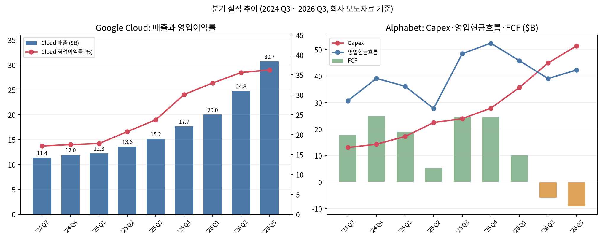

# 알파벳(구글) 2026년 3분기 실적 리뷰 — 단기 반응과 장기 논리

기준일: 2026-11-01
대상: 알파벳(구글)
티커: GOOGL
- 주가 기준: **2026-10-30(금) 종가**. 10-31은 토요일이다. GOOGL 279.84달러, GOOG 278.22달러.
- 실적 발표: 2026-10-28(수) 장 마감 후, 8-K 보도자료. 10-Q는 2026-10-29 제출.
- 투자 기간: 3~5년 보유. 분기 숫자의 맞고 틀림보다 장기 논리가 바뀌었는지를 본다.
- 자료 구분: **사실**은 SEC 공시·회사 보도자료·공식 콜 기록, **계산**은 수록 숫자로 직접 산출, **추론/가정**은 작성자 판단이다. 단위는 별도 표기가 없으면 미국 달러.

## Summary

**클라우드는 두 배로 컸는데 주가는 13% 빠졌다, 장기 보유자가 볼 것은 현금흐름이다**

알파벳의 3분기 매출은 1,275.8억 달러로 전년보다 24.7% 늘었고, 구글 클라우드 매출은 307.1억 달러로 102.6% 늘었다. 그런데 GOOGL은 발표 다음 날 12.64% 떨어졌고, 10-30 종가 279.84달러는 발표 전보다 13.87% 낮다.

단기 실망은 세 가지가 겹친 결과다. 주당순이익(EPS)은 2.12달러로 컨센서스 3.02달러를 크게 밑돌았지만, 이 중 0.55달러는 지분증권 평가손실 때문이다. 검색 매출 성장률은 12%로 2분기 17%보다 둔화했다. 잉여현금흐름(FCF)은 -90.7억 달러로 2개 분기 연속 적자다.

장기 논리에서 바뀐 것은 이익이 아니라 현금의 흐름이다. [red: 클라우드 백로그 5,608억 달러와 36.2%의 클라우드 영업이익률은 AI 투자의 수요 쪽 근거를 강화했다.] [blue: 반대로 올해 자사주 매입은 0이고, 주식 발행과 회사채로 투자금을 조달하는 구조로 바뀌었다.] 10-30 종가는 2027년 컨센서스 EPS의 18.4배이고, 작성자 기준 시나리오(273.6~334.4달러)의 하단에 걸쳐 있다. [brown: 지금 가격은 기준 시나리오를 상당 부분 할인했지만, 2027년 capex 가이던스가 나오는 4분기 실적(2027년 2월 예상) 전까지는 FCF 불확실성이 주가를 누를 가능성이 높다.]

## 숫자로 보는 3분기

**사실/계산:** [3분기 보도자료(8-K Ex.99.1)](https://www.sec.gov/Archives/edgar/data/1652044/000165204426000080/googexhibit991q32026.htm)와 [10-Q](https://www.sec.gov/Archives/edgar/data/1652044/000165204426000084/goog-20260930.htm) 기준이다. 전년 수치는 [2025년 3분기 보도자료](https://www.sec.gov/Archives/edgar/data/1652044/000165204425000087/googexhibit991q32025.htm)의 값을 쓴다. 단위는 억 달러, 증감률은 직접 계산했다.

| 항목 | 2025 3Q | 2026 2Q | 2026 3Q | YoY | QoQ |
| --- | ---: | ---: | ---: | ---: | ---: |
| 총매출 | 1,023.5 | 1,198.0 | **1,275.8** | +24.7% | +6.5% |
| 검색 및 기타 | 565.7 | 632.7 | 633.5 | +12.0% | +0.1% |
| 유튜브 광고 | 102.6 | 110.6 | 112.1 | +9.2% | +1.4% |
| 구글 네트워크 | 73.5 | 73.0 | 74.6 | +1.4% | +2.1% |
| 구독·플랫폼·기기 | 128.7 | 129.1 | 142.9 | +11.0% | +10.7% |
| 구글 클라우드 | 151.6 | 247.7 | **307.1** | +102.6% | +24.0% |
| 영업이익 | 312.3 | 407.7 | **405.8** | +29.9% | -0.5% |
| 영업이익률 | 30.5% | 34.0% | 31.8% | +1.3%p | -2.2%p |
| 희석 EPS(달러) | 2.87 | 9.11 | **2.12** | -26.1% | — |
| 지분증권 효과 제외 EPS(달러, 계산) | 2.19 | 2.85 | **2.67** | +21.9% | — |
| Capex | 239.5 | 449.2 | **513.6** | +114.4% | +14.3% |
| 영업현금흐름 | 484.1 | 390.7 | 422.9 | -12.6% | +8.2% |
| 잉여현금흐름(영업현금흐름-Capex) | 244.6 | -58.6 | **-90.7** | 적자 전환 | 적자 확대 |

세그먼트 이익은 방향이 갈렸다. 구글 서비스(검색·유튜브·구독 등) 영업이익은 391.6억 달러, 이익률은 40.7%다. 전년 3분기 서비스 이익에는 유럽연합(EC) 과징금 35억 달러가 들어 있어 단순 증가율 +16.8%는 부풀려져 있다. 과징금을 빼면 증가율은 약 +5.8%로 낮아진다(작성자 추정, 회사는 조정치를 따로 공시하지 않음).

클라우드 영업이익은 111.2억 달러로 1년 만에 3배가 됐고, 이익률은 23.7%에서 36.2%로 올라갔다. 반면 세그먼트에 배분하지 않는 알파벳 본사 비용은 76.6억 달러로 전년 44.7억 달러보다 71% 늘었다. 회사는 이 비용이 주로 공동 AI 연구개발이라고 설명한다.

## 단기: 컨센서스와 주가 반응

**사실:** 컨센서스는 [CNBC 2026-10-28](https://www.cnbc.com/2026/10/28/alphabet-googl-earnings-q3-2026.html) 보도 기준이다. EPS와 매출은 LSEG, 영업이익은 FactSet이며, 클라우드·검색·capex·FCF는 CNBC가 제공사를 밝히지 않았다.

| 항목 | 실제 | 컨센서스 | 결과 |
| --- | ---: | ---: | --- |
| EPS | 2.12달러 | 3.02달러 | 미달(평가손실 0.55달러 포함) |
| 매출 | 1,275.8억 | 1,282.2억 | 소폭 미달 |
| 구글 클라우드 매출 | 307.1억 | 287억 | 상회 |
| 검색 및 기타 | 633.5억 | 649.6억 | 미달 |
| 영업이익 | 405.8억 | 431.9억 | 미달 |
| 분기 Capex | 513.6억 | 550.9억 | 예상보다 적게 집행 |
| 잉여현금흐름 | -90.7억 | -27.0억 | 미달 |

시장은 클라우드 하나만 예상을 넘고 나머지는 대부분 밑돈 분기로 읽었다. [Fortune](https://fortune.com/2026/10/28/alphabet-google-stock-drops-cloud-revenue-doubles-free-cash-flow-negative/)은 시간외 낙폭을 11% 이상으로 보도했다. 정규장 종가는 Nasdaq 과거 시세와 CNBC 시세 두 곳을 대조했고, 최근 1년 일봉 251개가 모두 일치했다.

| 날짜 | GOOGL 종가 | 변화 | GOOG 종가 |
| --- | ---: | ---: | ---: |
| 2026-10-28(발표 당일, 발표 전 종가) | 324.89 | — | 321.89 |
| 2026-10-29 | 283.82 | -12.64% | 282.32 |
| 2026-10-30 | 279.84 | -1.40% (발표 전 대비 -13.87%) | 278.22 |

10-29 거래량은 1억 3,970만 주로 전날 6,310만 주의 두 배를 넘었다. 10-30 종가는 52주 장중 고점 408.61달러(2026-05-18)보다 31.5% 낮고, 장중 저점 270.70달러(2025-11-14)와는 3% 남짓 차이다.

증권사들은 투자의견을 대체로 유지한 채 목표주가를 내렸다. TD Cowen은 485→460달러(Buy), Cantor Fitzgerald는 420→350달러(Overweight), Scotiabank는 450→375달러, Susquehanna는 460→400달러로 낮췄다. Wells Fargo는 417→371달러(Overweight), KeyBanc은 410→385달러다. UBS는 332달러(Neutral), DA Davidson은 300달러(Neutral)를 제시했다. Pivotal Research는 475달러(Buy)를 유지했다. 출처는 [Investing.com TD Cowen 기사](https://www.investing.com/news/analyst-ratings/td-cowen-cuts-alphabet-stock-price-target-on-search-miss-93CH-4984387), [Investing.com Cantor 기사](https://www.investing.com/news/analyst-ratings/cantor-fitzgerald-cuts-alphabet-stock-price-target-on-weak-earnings-93CH-4984194), [MarketBeat 2026-10-30](https://www.marketbeat.com/instant-alerts/analyst-alphabet-nasdaq-googl-price-target-cut-to-37100-by-analysts-at-wells-fargo-company-2026-10-30/), [Yahoo Finance/TIKR 2026-10-30](https://finance.yahoo.com/markets/stocks/articles/could-alphabet-actually-climb-67-132032204.html)이다.

## 장기: 무엇이 바뀌었나

### 1. 클라우드는 성장과 이익을 동시에 증명했다

**사실:** 남은 수행의무(RPO, 계약했지만 아직 매출로 잡지 않은 금액)는 9월 말 5,677억 달러이고, 이 중 클라우드가 5,608억 달러다. 6월 말 5,139억 달러보다 9.1% 늘었고, 1년 전 전체 RPO 1,577억 달러의 3.6배다. 회사는 전체 백로그의 "55% 남짓"을 24개월 안에 매출로 인식한다고 밝혔다([10-Q](https://www.sec.gov/Archives/edgar/data/1652044/000165204426000084/goog-20260930.htm)).

**계산:** 5,677억 달러의 55%는 약 3,120억 달러다. 2년에 나누면 연 1,560억 달러로, 최근 4개 분기 클라우드 매출 931.7억 달러보다 크다. [red: 백로그만 놓고 보면 2027년까지 클라우드 매출 성장의 상당 부분은 이미 계약으로 확보돼 있다.]

다만 백로그의 질은 따로 봐야 한다. 백로그에는 알파벳이 지분을 가진 관계사 Crux AI와의 168억 달러 계약이 들어 있다. Scotiabank는 앤트로픽 비중을 약 22%로 추정했다(증권사 추정, 회사 미공시). 회사는 TPU 시스템 판매가 먼저 백로그에 잡히고, 재고를 쌓은 뒤 납품할 때 매출이 된다고 설명했다. 이 재고 때문에 매출보다 현금이 먼저 나간다. [blue: 소수 AI 고객 집중과 관계사 계약은 백로그 숫자를 그대로 확정 매출로 읽기 어렵게 만든다.]

### 2. 검색은 무너지지 않았지만 AI 모드의 수익화가 숙제다

**사실:** 검색 및 기타 매출 증가율은 1분기 19%, 2분기 17%, 3분기 12%로 둔화했다([CNBC](https://www.cnbc.com/2026/10/28/alphabet-googl-earnings-q3-2026.html)). 공식 콜에서 Philipp Schindler(최고사업책임자)는 둔화의 가장 큰 요인이 환율이라고 했다. 이어 "AI Mode 질의가 크게 늘었는데, AI Mode의 수익화가 낮아 영향이 있었다"고 인정했다([3분기 콜 기록](https://s206.q4cdn.com/479360582/files/doc_events/2026/Oct/28/2026_Q3_Earnings_Transcript.pdf)).

Sundar Pichai(CEO)는 보도자료에서 전년 대비 검색 질의 증가율이 최근 5년 중 가장 높다고 했다. 같은 콜에서 회사는 AI Mode 질의 대부분이 기존 검색을 대체하지 않는 "추가 질의"라고 했고, AI Overviews·AI Mode 광고의 해외 확대를 발표했다. 제미나이 앱 사용자는 10억 명이다.

[brown: 작성자는 이번 분기를 "검색이 AI에 잠식된다"의 증거보다 "질의는 늘지만 단가가 아직 따라오지 못한다"의 증거로 읽는다.] 장기 보유자에게 중요한 것은 AI Mode의 광고 단가가 기존 검색에 얼마나 빨리 따라붙느냐다. 회사는 AI Overviews·AI Mode 사용자 수와 질의당 매출을 공개하지 않아 이 판단은 아직 간접 증거에 기대고 있다.

### 3. Capex가 영업현금흐름을 넘어섰다

**사실:** 3분기 capex는 513.6억 달러, 1~9월 누적은 1,319.5억 달러다. 공식 콜에서 Anat Ashkenazi(CFO)는 2026년 capex 가이던스 1,950억~2,050억 달러를 유지했다. 또 "2027년 capex는 크게 늘어날 것"이며 상세 수치는 4분기 콜에서 내겠다고 했다. 같은 콜에서 감가상각비 증가와 에너지 등 데이터센터 운영비가 손익을 계속 누를 것이고 단기 이익률 역풍을 예상한다고 했다.

**계산:** 가이던스에서 누적 집행액을 빼면 4분기 capex는 630억~730억 달러다. 3분기 유형자산 감가상각비는 83.7억 달러로 전년보다 49.2% 늘었다. 최근 4개 분기 capex 1,598억 달러는 같은 기간 영업현금흐름 1,795.5억 달러의 89%다. 그래서 최근 4개 분기 FCF는 197.5억 달러로, 1년 전 735.5억 달러에서 4분의 1 수준으로 줄었다.

3분기 영업현금흐름에는 일회성 요인도 있다. 2018년 EC 과징금 52억 달러를 7월에 현금으로 냈고(이미 충당한 금액이라 손익 영향은 없음), TPU 시스템 재고도 쌓았다. [brown: 과징금을 되돌린 3분기 영업현금흐름 약 475억 달러가 4분기에도 비슷하다고 가정하면, 4분기 capex 630억~730억 달러로는 분기 FCF가 다시 적자이고, 2027년 capex가 더 늘면 적자 구간이 길어질 수 있다.] 언론의 "2027년 capex 3,000억 달러" 전망은 회사 발언이 아니라 애널리스트 추정이다.

### 4. 주주환원 모델이 바뀌었다

**사실:** 2026년 1~9월 자사주 매입은 0이다(2025년 같은 기간 398.1억 달러). 2025년 4월 승인분 중 695억 달러가 남아 있지만 쓰지 않았다. 6월에는 보통주와 의무전환우선주로 496억 달러를 조달했다. 3분기에는 수시 주식 발행(ATM)으로 3,600만 주, 124억 달러를 팔았고, 선순위 회사채로 287억 달러를 조달했다. 분기 배당은 주당 0.22달러를 유지했다.

**계산:** 희석 주식 수는 1년 사이 1.4% 늘었다. 9월 말 현금·시장성 유가증권 2,651억 달러에서 장기부채 1,261억 달러를 빼면 순현금은 약 1,390억 달러로 아직 넉넉하다. [blue: 그래도 "번 돈으로 투자하고 남는 돈으로 자사주를 사는" 기존 모델이 "투자금 일부를 주주와 채권자에게서 빌리는" 모델로 바뀐 것은 장기 보유자의 주당 가치 계산을 바꾼다.]

### 5. 규제는 최악의 경우를 지났다

**사실:** 애드테크 소송에서 2026-09-02 Brinkema 판사는 법무부가 요구한 광고거래소 매각을 기각하고 행위 규제만 부과했다([AdExchanger](https://www.adexchanger.com/antitrust/google-wont-have-to-break-up-its-ad-tech-business-judge-brinkema-rules/)). 검색 독점 소송은 항소심(D.C. 순회항소법원)에 있다. 구글은 2026-05-22 책임 판단 파기를 요구하는 항소이유서를 냈다([PPC Land](https://ppc.land/google-asks-appeals-court-to-throw-out-its-entire-search-monopoly-loss/)). 구두변론 일정과 애드테크 최종판결 확정 여부는 확인하지 못했다.

## 단기와 장기가 엇갈리는 지점

| 쟁점 | 단기 시장의 해석 | 장기 보유자의 해석 |
| --- | --- | --- |
| EPS 2.12달러, 컨센서스 미달 | 이익 쇼크 | 0.55달러는 지분증권 평가손실(주로 SpaceX). 효과를 빼면 EPS +21.9% |
| 검색 +12% | AI 잠식이 시작됐다 | 질의는 5년 내 최고 증가율. 쟁점은 AI Mode 단가가 따라오는 속도 |
| 클라우드 +103%, 이익률 36.2% | 유일하게 예상을 넘은 항목 | 백로그 5,608억 달러로 2027년까지 가시성 확보. 고객 집중이 대가 |
| 분기 Capex 컨센서스 하회 | 큰 의미 없음 | 4분기 630억~730억 달러, 2027년 증가 예고. 감가상각 +49%는 시작 단계 |
| FCF -90.7억 달러 | 실망 | 과징금·TPU 재고 일회성 일부. 구조적으로는 capex가 현금흐름을 넘는 구간 진입 |
| 자사주 0, 증자·회사채 | 큰 반응 없음 | 주당 가치 희석. 주주환원 재개 시점이 장기 수익률을 좌우 |

## 밸류에이션

**계산:** 10-30 종가를 기준으로 했다. 클래스 A·B 주식은 GOOGL 가격, 클래스 C는 GOOG 가격을 적용했다. 시가총액은 약 3.43조 달러다(10-Q 표지 주식 수 기준, CNBC 표기 3.368조 달러와 주식 수 기준이 달라 차이가 난다). 순현금 1,390억 달러를 빼면 기업가치(EV)는 약 3.29조 달러다.

| 지표 | 값 | 해석 |
| --- | ---: | --- |
| 주가 / 2027년 컨센서스 EPS 15.19달러 | 18.4배 | TIKR 집계 5년 평균 선행 P/E 23배보다 낮다 |
| CNBC 선행 P/E | 21.2배 | 선행 EPS 13.20달러 기준 |
| 후행 P/E(CNBC) | 14.6배 | 2분기 지분평가이익 990억 달러가 들어 있어 판단에 쓰지 않는다 |
| 최근 4개 분기 FCF 수익률 | 0.58% | 지금은 FCF로 가치를 잴 수 없는 구간 |
| EV / 최근 4개 분기 영업현금흐름 | 18.3배 | capex 전 현금 창출력 기준 |

FCF가 투자에 묻혀 있으므로 2027년 이익에 배수를 곱하는 방식으로 범위를 잡았다. 아래 값은 **작성자의 가정**이며, 회사 가이던스나 증권사 목표주가가 아니다. 입력과 계산은 `scenario-inputs.json`, `scenario-results.json`, `scripts/alphabet-charts.py`로 재현할 수 있다.

| 시나리오 | 2027 EPS 가정 | P/E | 주당 가치 | 10-30 종가 대비 | 전제 |
| --- | ---: | ---: | ---: | ---: | --- |
| 비관 | 13.0달러 | 15~18배 | 195.0~234.0달러 | -30.3~-16.4% | 감가상각 급증, 검색 한 자릿수 성장, 클라우드 이익률 30% 아래로 후퇴 |
| 기준 | 15.2달러 | 18~22배 | 273.6~334.4달러 | -2.2~+19.5% | 컨센서스 수준 이익, capex가 이익률을 일부 잠식 |
| 낙관 | 17.0달러 | 22~25배 | 374.0~425.0달러 | +33.6~+51.9% | 백로그 전환과 TPU 판매 확대로 클라우드 이익이 감가상각 증가를 앞섬 |

[brown: 현재 가격은 기준 시나리오 하단에 있어 하방은 비관 시나리오 수준의 이익 훼손이 확인될 때 커지고, 상방은 클라우드 이익이 감가상각을 이긴다는 증거가 나올 때 열린다고 본다.] 비관 시나리오의 P/E 15~18배는 FCF 적자가 1~2년 더 이어질 때 시장이 줄 수 있는 배수로 잡았다.

## 장기 보유자가 볼 체크포인트 3개

**1. 2027년 capex 가이던스와 FCF 복귀 시점**

4분기 실적(2027년 2월 예상)에서 2027년 capex 범위가 나온다. 영업현금흐름 대비 capex 비율이 100%를 넘는 가이던스면 FCF 적자가 1년 더 이어진다는 뜻이다. 반대로 TPU 재고가 매출로 바뀌면서 운전자본이 돌아오는지도 함께 본다.

**2. 클라우드 이익률이 감가상각 증가를 견디는가**

3분기 클라우드 이익률은 36.2%다. CFO가 단기 이익률 역풍을 예고했으므로 1~2개 분기 하락은 감안한다. 30% 아래로 내려가면서 백로그 증가율도 꺾이면 비관 시나리오 쪽으로 무게를 옮긴다.

**3. 검색 성장률의 재가속과 주식 수**

검색 및 기타 매출 증가율이 환율 영향을 걷어낸 기준으로 다시 두 자릿수 중반으로 올라오는지 본다. AI Mode 광고 확대의 효과가 여기서 드러난다. 동시에 희석 주식 수가 계속 늘어나는지, 자사주 매입이 언제 재개되는지를 함께 확인한다.

## 확인 한계

- 공식 콜 기록은 알파벳 IR 사이트에 올라온 PDF를 썼다. 클라우드·검색·capex·FCF 컨센서스는 CNBC가 제공사를 밝히지 않았다.
- 주가는 Nasdaq과 CNBC로 교차검증했다. Yahoo Finance는 2026-11-01 요청 제한(HTTP 429)으로 받지 못했다.
- 앤트로픽의 백로그 비중 22%, 2027년 capex 3,000억 달러는 증권사·언론 추정이다. JPMorgan의 목표주가 변경은 원문을 확인하지 못해 뺐다.
- AI Overviews·AI Mode 사용자 수와 질의당 매출은 회사가 공개하지 않았다. 검색 잠식에 대한 판단은 간접 증거에 기댄다.
- 전년 3분기 EC 과징금을 뺀 서비스 이익 증가율(+5.8%)은 작성자 추정이다.

## Sources

- [Alphabet 2026년 3분기 실적 보도자료 (8-K Ex.99.1, 2026-10-28)](https://www.sec.gov/Archives/edgar/data/1652044/000165204426000080/googexhibit991q32026.htm)
- [Alphabet 2026년 3분기 10-Q (2026-10-29)](https://www.sec.gov/Archives/edgar/data/1652044/000165204426000084/goog-20260930.htm)
- [Alphabet 2025년 3분기 실적 보도자료 (2025-10-29)](https://www.sec.gov/Archives/edgar/data/1652044/000165204425000087/googexhibit991q32025.htm)
- [Alphabet 2026년 2분기 실적 보도자료 (2026-07-22)](https://www.sec.gov/Archives/edgar/data/1652044/000165204426000066/googexhibit991q22026.htm)
- [Alphabet 2026년 3분기 실적 콜 기록 (2026-10-28)](https://s206.q4cdn.com/479360582/files/doc_events/2026/Oct/28/2026_Q3_Earnings_Transcript.pdf)
- [CNBC, Alphabet Q3 2026 earnings (2026-10-28)](https://www.cnbc.com/2026/10/28/alphabet-googl-earnings-q3-2026.html)
- [Fortune, Alphabet stock drops as cloud revenue doubles (2026-10-28)](https://fortune.com/2026/10/28/alphabet-google-stock-drops-cloud-revenue-doubles-free-cash-flow-negative/)
- [Investing.com, TD Cowen 목표주가 하향 (2026-10-29)](https://www.investing.com/news/analyst-ratings/td-cowen-cuts-alphabet-stock-price-target-on-search-miss-93CH-4984387)
- [Investing.com, Cantor Fitzgerald 목표주가 하향 (2026-10-29)](https://www.investing.com/news/analyst-ratings/cantor-fitzgerald-cuts-alphabet-stock-price-target-on-weak-earnings-93CH-4984194)
- [MarketBeat, Wells Fargo 목표주가 하향 (2026-10-30)](https://www.marketbeat.com/instant-alerts/analyst-alphabet-nasdaq-googl-price-target-cut-to-37100-by-analysts-at-wells-fargo-company-2026-10-30/)
- [Yahoo Finance/TIKR, 컨센서스 EPS와 밸류에이션 (2026-10-30)](https://finance.yahoo.com/markets/stocks/articles/could-alphabet-actually-climb-67-132032204.html)
- [Nasdaq GOOGL 과거 시세](https://api.nasdaq.com/api/quote/GOOGL/historical)
- [CNBC GOOGL 1년 시세](https://ts-api.cnbc.com/harmony/app/charts/1Y.json?symbol=GOOGL)
- [AdExchanger, 애드테크 구제 결정 (2026-09-02)](https://www.adexchanger.com/antitrust/google-wont-have-to-break-up-its-ad-tech-business-judge-brinkema-rules/)
- [PPC Land, 검색 소송 항소이유서 (2026-05-26)](https://ppc.land/google-asks-appeals-court-to-throw-out-its-entire-search-monopoly-loss/)
