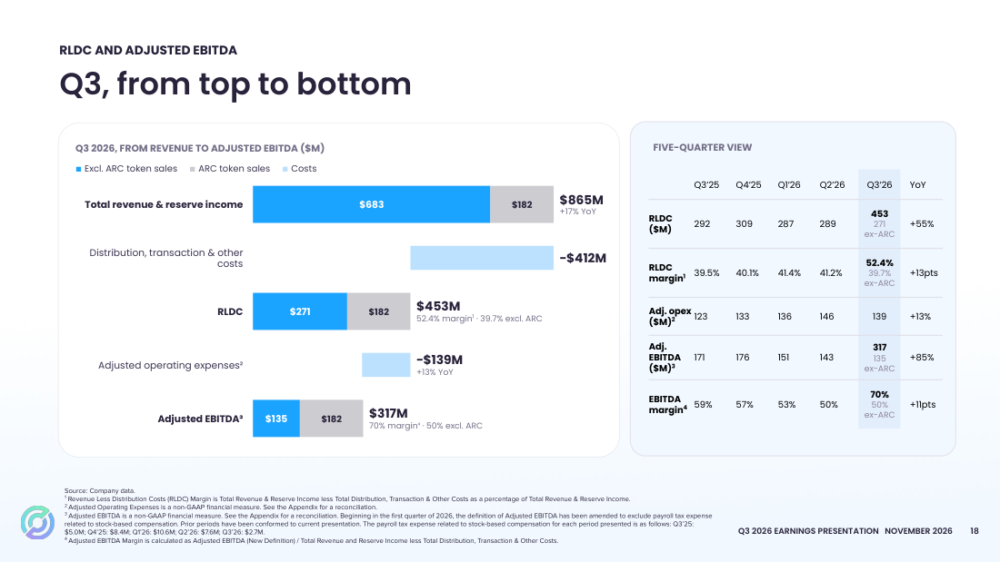
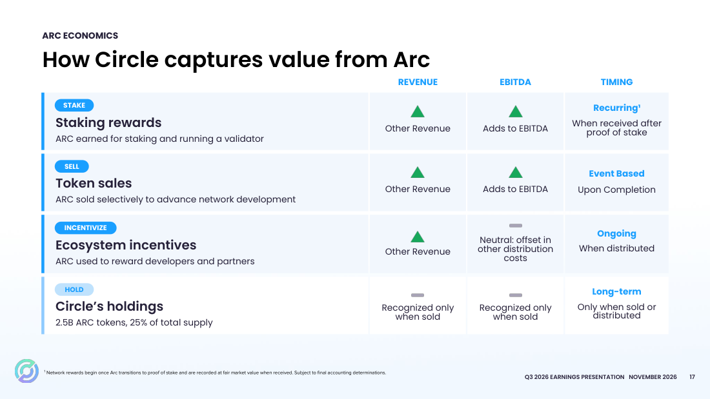
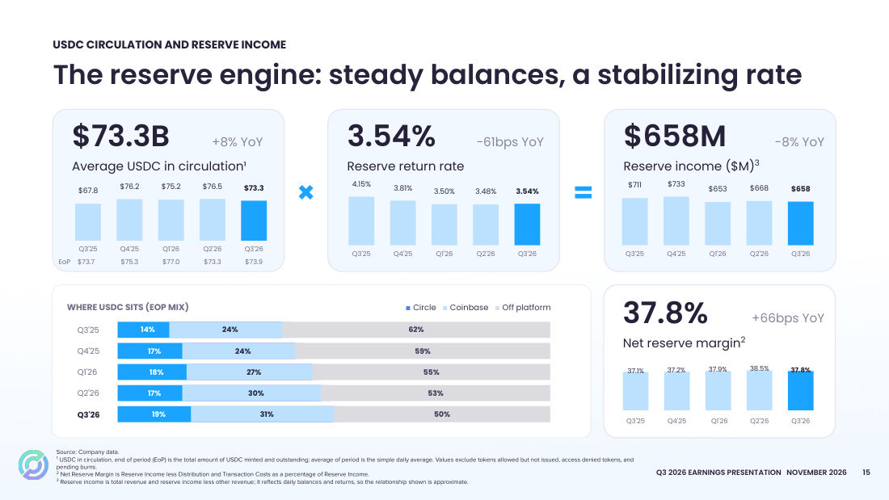
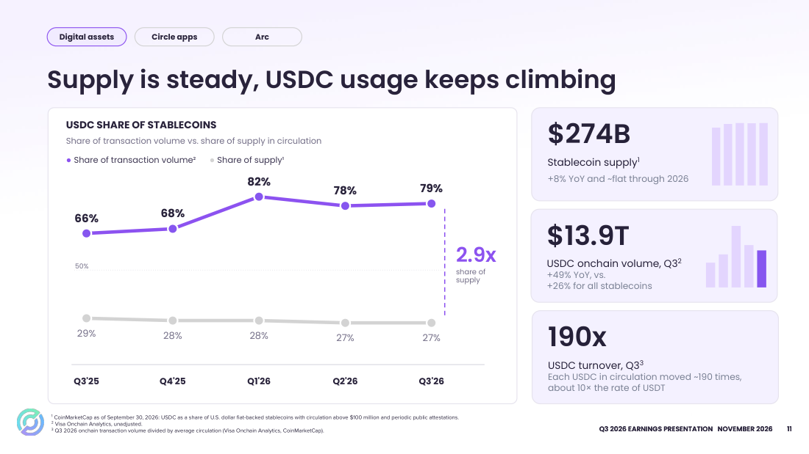
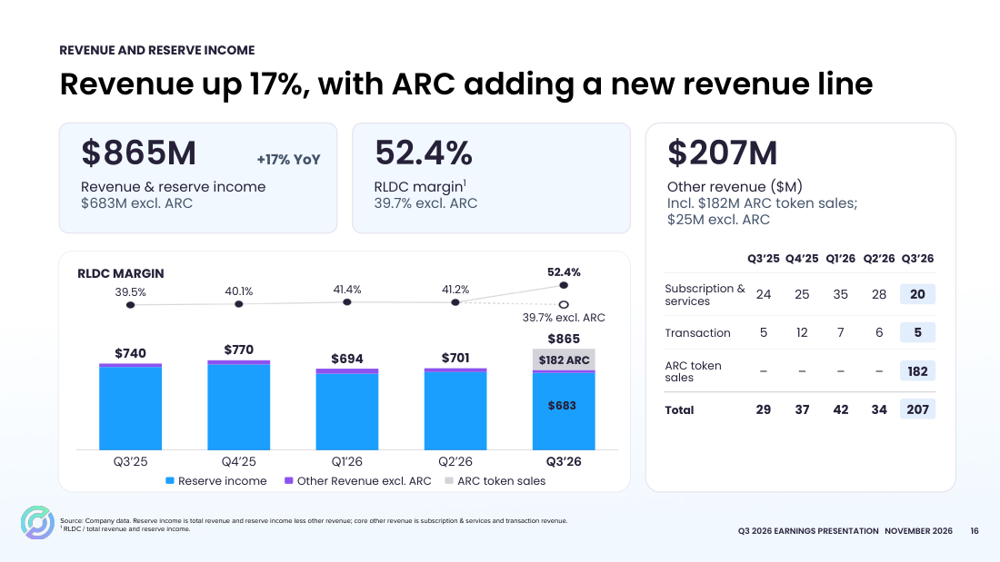
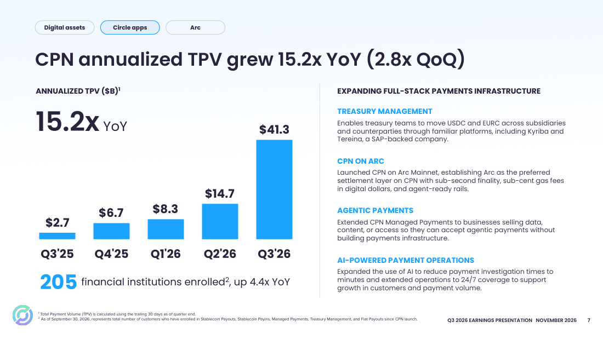

# 서클 2026년 3분기 실적: ARC 판매를 빼면 이익은 줄었다

- 한줄요약: ARC 판매가 3분기를 키웠고 4분기 마진은 더 낮아진다.
- 기준일: 2026-11-04
- 최근 업데이트일: 2026-11-05
- 대상: Circle Internet Group · NYSE CRCL
- 실적 기간: 2026-07-01~2026-09-30 · 연결 US GAAP · 미감사
- 작성 범위: 실적 보도자료 14쪽, 실적 발표자료 28쪽, 컨퍼런스콜 전사문(질의응답 포함) 검토.

## Summary

**서클의 3분기는 발표 수치와 반복 가능한 이익을 나눠 봐야 한다. 매출과 조정 EBITDA는 사용자 제공 예상치를 웃돌았지만, ARC 토큰 사전판매 수익 1억8,200만 달러를 빼면 매출은 전년 대비 약 7.7%, 조정 EBITDA는 약 21.5% 감소한다. 회사가 유지한 연간 가이던스를 역산하면 4분기에는 ARC를 뺀 마진이 한 번 더 내려간다.**

평균 USDC 유통량은 늘었지만 준비자산 수익률 하락으로 이자수익은 줄었다. 컨콜에서 회사는 USDC 거래량 점유율 79%, CPN 처리액 급증, Arc 메인넷 지표를 앞세웠다. 반면 2027년 비이자 매출 전망은 다음 분기로 미뤘고, Binance 재계약으로 4분기 마진이 내려간다는 점을 직접 확인했다.

CFO 제러미 폭스-긴의 퇴임도 이번 콜에서 공식화됐다.

아래 실제 실적은 2026년 11월 4일 회사 보도자료와 발표자료를 기준으로 한다. 예상치는 제공받은 숫자이며 집계기관·관측 시각·조정 기준을 확인하지 못했다. 예상 대비 차이는 참고 계산이고, 독립적으로 검증한 시장 컨센서스는 아니다. [공식 발표 공시](https://www.sec.gov/Archives/edgar/data/1876042/000187604226000309/finalq3epr-110326.htm)

## 발표 숫자와 예상치 비교

금액은 별도 표시가 없으면 백만 달러다. 전년은 2025년 3분기이며 조정 EBITDA는 양쪽 모두 회사의 새 정의를 적용했다. 실제값 근거는 보도자료 9·12쪽이다.

| 지표 | 2026년 3분기 실제 | 전년 동기 | 전년 대비 | 사용자 제공 예상 | 예상 대비 |
| --- | ---: | ---: | ---: | ---: | ---: |
| 총매출 및 준비자산 이자수익 | 864.888 | 739.759 | +16.9% | 776.700 | +11.4% |
| 준비자산 이자수익 | 657.624 | 711.241 | -7.5% | 미제공 | 계산 제외 |
| 기타 매출 | 207.264 | 28.518 | +626.8% | 미제공 | 계산 제외 |
| 영업이익 | 208.334 | 81.020 | +157.1% | 미제공 | 계산 제외 |
| 계속영업 순이익 | 226.012 | 214.385 | +5.4% | 91.600 | +146.7% |
| 조정 EBITDA · 새 정의 | 316.662 | 171.476 | +84.7% | 202.800 | +56.1% |
| 희석 EPS · 달러 | 0.84 | 0.64 | +31.3% | 미제공 | 계산 제외 |

조정 EBITDA는 회사가 반올림해 제시한 증가율 **85%**를 쓴다. 초기 요약의 91%는 같은 정의로 계산한 증가율과 일치하지 않는다.

회사는 2026년부터 주식보상 관련 고용주 급여세를 조정 EBITDA에서 추가 제외했다. 2025년 3분기도 새 정의 171.476으로 재산정했으므로, 구 정의 166.461과 섞어 비교하면 안 된다. 이번 0.84달러 EPS는 **GAAP 희석 EPS**다. [실적·조정 지표 근거](https://www.sec.gov/Archives/edgar/data/1876042/000187604226000309/finalq3epr-110326.htm)

## ARC 판매가 만든 차이

회사 발표자료도 ARC 토큰 판매를 회색 막대로 따로 떼어 보여준다. ARC를 빼면 매출 6억8,300만 달러, RLDC 2억7,100만 달러(마진 39.7%), 조정 EBITDA 1억3,500만 달러(마진 50%)다.

> **RLDC 마진이란?** RLDC는 Revenue Less Distribution Costs의 약자로, **매출에서 유통·거래·기타 원가를 뺀 금액**이다. 서클은 USDC 준비자산에서 이자를 벌지만, 그 상당 부분을 USDC를 퍼뜨려 주는 파트너에게 나눠 준다. Coinbase가 대표적이고 Binance·Hyperliquid도 보상을 받는다. 이 돈이 유통비용이다. 매출이 커 보여도 파트너 몫을 빼야 서클에 실제로 남는 돈이 보인다. 일반 기업의 매출총이익에 가장 가까운 숫자다.
>
> 3분기로 계산하면 매출 8억6,500만 달러에서 유통·거래·기타 원가 4억1,200만 달러를 빼서 RLDC는 4억5,300만 달러다. 이를 매출로 나눈 **RLDC 마진은 52.4%**로, 매출 1달러 가운데 약 52센트가 서클에 남았다는 뜻이다. ARC 토큰 판매에는 파트너 몫이 없어 이번 분기 마진이 크게 올랐다. ARC를 빼면 39.7%로 1년 전(39.5%)과 거의 같다.
>
> 비슷한 지표로 **순준비금 마진**이 있다. 기타 매출을 빼고 준비자산 이자수익만 놓고 파트너 몫을 뺀 비율이다(3분기 37.8%). 두 지표 모두 파트너에게 주는 보상이 늘면 내려간다.

| 지표 · 백만 달러 | 보고 실적 | ARC 수익 182 차감 | 전년 동기 | 차감 후 전년 대비 |
| --- | ---: | ---: | ---: | ---: |
| 총매출 및 준비자산 이자수익 | 864.888 | 682.888 | 739.759 | -7.7% |
| 기타 매출 | 207.264 | 25.264 | 28.518 | -11.4% |
| 매출에서 유통·거래·기타 원가를 차감한 금액 · RLDC | 453.254 | 271.254 | 292.147 | -7.2% |
| 조정 EBITDA · 새 정의 | 316.662 | 134.662 | 171.476 | -21.5% |

차감값은 회사 발표자료의 ARC 제외 수치(683·271·135)와 반올림 범위에서 일치한다. ARC 판매에는 유통비용이 붙지 않는다고 CFO가 밝혔으므로 단순 차감이 회사 방식과 같다.

보고된 조정 EBITDA는 전년보다 145.186 늘었는데 ARC 수익은 182다. EBITDA 급증을 기존 사업의 영업 레버리지로 설명할 수 없다는 뜻이다. ARC를 뺀 EBITDA 135는 직전 분기 143보다도 작다.

회사가 제시한 조정 EBITDA 마진 70%는 **총매출이 아닌 RLDC를 분모로 쓴다**. 총매출 기준으로는 약 36.6%다. [발표자료 16·18쪽](https://seekingalpha.com/article/4962142-circle-internet-group-inc-2026-q3-results-earnings-call-presentation)

### ARC 사전판매는 2억4,200만 달러, 75%를 이미 인식했다

CFO는 ARC 토큰 사전판매 총액이 **2억4,200만 달러**이고, 3분기에 약 75%인 1억8,200만 달러를 인식했다고 밝혔다. 토큰 발행·인도와 퍼블릭 메인넷 출시라는 이행 조건을 3분기에 충족했기 때문이다.

남은 약 6,000만 달러는 앞으로 조건이 충족될 때 인식된다. 연간 기타 매출 가이던스 3억1,000만~3억3,000만 달러는 3분기 ARC 1억8,200만 달러와 나머지 제품 1억3,000만~1억5,000만 달러로 구성된다고 CFO가 설명했다. 남은 6,000만 달러는 2026년 가이던스에 들어 있지 않은 것으로 읽힌다(작성자 해석).

## 컨콜에서 확인한 ARC 수익 구조

CFO는 ARC에서 수익이 나오는 길을 네 가지로 정리했다. 이 가운데 **반복 매출이 되는 것은 스테이킹 보상 하나**이며, 그마저 지분증명 전환 이후에 시작된다.

> **지분증명(Proof of Stake) 전환이란?** 블록체인은 누군가 거래 기록을 검증하고 장부에 올려야 돌아간다. 이 일을 맡는 참여자를 검증인이라고 한다. Arc는 지금 서클과 함께 출범한 **창립 검증인 11곳**이 이 일을 맡는다. 지분증명은 검증 자격을 **그 네트워크의 토큰을 맡겨 둔(스테이킹) 만큼** 주는 방식이다. 토큰을 많이 맡길수록 검증에 더 많이 참여하고, 그 대가로 새로 발행되는 토큰이나 수수료를 보상으로 받는다. 규칙을 어기면 맡긴 토큰을 잃을 수 있어 담보 역할도 한다. 이더리움이 대표적인 지분증명 네트워크다.
>
> 서클에 이 전환이 중요한 이유는 수익 구조 때문이다. 서클은 ARC 토큰 25억 개(전체의 25%)를 갖고 있다. 전환 뒤 이 토큰을 맡기고 검증인으로 참여하면, 은행 예금에 이자가 붙듯 보유 토큰에 비례한 보상을 계속 받을 수 있다. 회사가 Arc의 **주된 반복 수익**으로 꼽은 것이 이 스테이킹 보상이다. 다만 보상은 ARC로 받으므로 매출 금액은 그때 토큰 가격에 따라 달라진다. 발표자료에는 2027년 전환 계획만 있고 구체적인 시점과 보상률은 나오지 않았다.

| 방식 | 회계 처리 | EBITDA 영향 | 반복성 |
| --- | --- | --- | --- |
| 스테이킹 보상 | 지분증명 전환 후 받은 ARC를 시가로 기타 매출 인식 | 더해짐 | 회사가 말한 주된 반복 수익. 보상률·스테이킹 물량·토큰 가격에 좌우 |
| 토큰 판매 | 판매 시 기타 매출 | 원가가 없어 전액 더해짐 | 이벤트성. "선별적으로" 판매 |
| 생태계 보상 | 시가만큼 기타 매출과 같은 금액의 유통비용 동시 인식 | 영향 없음 | 매출만 부풀고 이익은 0 |
| 회사 보유분 | 25%(25억 개). 팔거나 나눠줄 때까지 재무제표 미반영 | 없음 | 장부 밖 가치 |

투자자가 주의할 점은 세 가지다.

- **지분증명 전환 시점은 답하지 않았다.** 마지막 질문(William Blair)이 직접 물었지만 답변은 CPN 이야기로 넘어갔다. 발표자료에는 2027년 전환 계획만 있다.
- **생태계 보상은 매출 성장률을 왜곡할 수 있다.** 기타 매출이 늘어도 같은 금액이 유통비용으로 빠지므로 이익 증가로 읽으면 안 된다.
- **CFO는 Arc가 "30억 달러 규모의 토큰 자산"을 만들었다고 말했다.** 회사 보유 비중 25%를 단순 적용하면 약 7억5,000만 달러지만, 산정 기준과 유동성이 공개되지 않아 이 글의 판단에는 반영하지 않는다.

## 4분기 가이던스를 역산하면 마진이 한 번 더 내려간다

CFO는 세 가지를 말했다. ARC를 뺀 연간 RLDC 마진은 원래 가이던스 38~40%의 **중간값 근처**, 조정 영업비용은 5억7,000만~5억8,500만 달러의 **상단 쪽**, 4분기는 Hyperliquid와 Binance 계약이 처음으로 온전히 반영되는 분기다.

Goldman Sachs 질문에는 "역산해 보면 4분기에 예상하는 마진 하락이 보일 것"이라고 직접 답했다.

아래는 회사가 말한 숫자를 그대로 넣은 **작성자 계산**이다. 4분기 매출은 준비자산 이자수익이 3분기(6억5,800만 달러)와 같고 ARC를 뺀 기타 매출이 3,000만~5,000만 달러라고 가정했다.

| 항목 · 백만 달러 | 1~3분기 누적 | 4분기 역산 | 비교 |
| --- | ---: | ---: | --- |
| ARC 제외 매출 | 2,078 | 약 688~708 | 3분기 683 |
| ARC 제외 RLDC | 847 (마진 40.8%) | 약 222~250 | 3분기 271 |
| ARC 제외 RLDC 마진 | 40.8% | **약 32~36%** (중간값 약 34%) | 3분기 39.7% |
| 조정 영업비용 | 421 | 149~164 (상단 기준 164) | 3분기 139 |
| 조정 EBITDA (RLDC - 조정 영업비용) | — | **약 5,500만~1억 달러**, 중간 약 7,500만 달러 | 3분기 ARC 제외 135, 전년 4분기 176 |

계산 방식: 연간 ARC 제외 RLDC 마진 39%(±0.5%p)에 연간 ARC 제외 매출을 곱하고 1~3분기 누적 847을 빼서 4분기 RLDC를 구했다. 조정 영업비용은 연간 가이던스에서 누적 421을 뺐다. 3분기는 RLDC에서 조정 영업비용을 뺀 값이 조정 EBITDA와 3백만 달러 이내로 맞았다.

마진 가정이 0.5%p 바뀌어도 4분기 RLDC 마진은 32~36% 범위에 머문다. 매출 가정을 ±1,000만 달러 바꿔도 거의 움직이지 않는다.

**회사 가이던스를 그대로 받아들이면 4분기 조정 EBITDA는 3분기 ARC 제외 실적의 절반 안팎**이 된다. 비용 증가는 Arc·AI 인프라와 첼시 FC 후원 등 마케팅이 원인이라고 CFO가 설명했다.

## USDC: 거래는 늘었지만 잔액은 정체됐다

| 지표 | 회사 발표 | 비교 기준과 해석 |
| --- | --- | --- |
| 평균 USDC 유통량 | 733억 달러 · 전년 대비 +8%, 직전 분기 대비 -4% | 사용자 제공 예상 740.8억 달러 대비 약 -1.1% |
| 기말 USDC 유통량 | 739억 달러 · 전년 대비 0%, 직전 분기 대비 +1.1% | 회사 반올림 기준으로 전년과 유사 |
| 준비자산 수익률 | **3.54%** · 전년 대비 -61bp, 직전 분기 대비 +6bp | 사용자 제공 예상 3.52% 대비 +2bp. 보도자료는 3.5%로 반올림 표기 |
| 분기 발행·상환 | 각 약 1,040억 달러, 합계 2,080억 달러 · 전년 대비 +42%, 사상 최대 | 발행과 상환이 같아 순증은 사실상 0 |
| USDC 온체인 거래량 | 13.9조 달러 · 전년 대비 +49% (전체 스테이블코인 +26%) | 결제 매출이나 CPN 처리액과 다른 지표 |
| 거래량 점유율 vs 공급 점유율 | 79% vs 27% | 회전율 약 190배, USDT의 약 10배(회사 계산) |
| 서클 플랫폼 내 USDC | 약 140억 달러 · 유통량의 19% · 전년 대비 +36% | 이 비중이 커질수록 서클이 이자를 더 가져감 |
| 순준비금 마진 | 37.8% · 전년 대비 +66bp, 직전 분기 38.5% 대비 -70bp | CFO는 하락 원인을 Hyperliquid 계약이 처음 온전히 반영된 분기로 설명 |

> 이전 버전의 준비자산 수익률 3.50%는 보도자료의 반올림 표기(3.5%)를 옮긴 것이었다. 발표자료 15쪽의 3.54%로 고쳤고, 예상 대비 차이도 -2bp에서 +2bp로 바뀌었다.

평균 유통량이 약 8% 늘었어도 수익률이 61bp 내려 이자수익은 7.5% 감소했다. 직전 분기보다는 수익률이 6bp 올랐지만 평균 유통량이 4% 줄어 이자수익은 6억6,800만 달러에서 6억5,800만 달러로 줄었다.

USDC가 어디에 있는지도 바뀌고 있다. 기말 기준 **서클 플랫폼 밖에 있는 USDC 비중은 1년 새 62%에서 50%로**, Coinbase 플랫폼 비중은 24%에서 31%로 바뀌었다.

Coinbase 위에 있는 USDC는 이자 대부분을 Coinbase가 가져가므로, 이 흐름은 유통비용 부담을 키운다. 컨콜에서 Compass Point가 유통비용을 물었고, CFO는 파트너별 증감은 밝히지 않고, 직전 분기 대비 마진 하락은 주로 Hyperliquid 계약과 Coinbase 위 잔액 때문이라고 답했다.

회사는 "잔액은 정체됐지만 사용은 늘고 있다"고 정리했다. 거래량 점유율 79%가 잔액 증가로 이어지는지가 다음 분기의 핵심이다.

시장점유율 27%는 회사가 정의한 **유통액 1억 달러 초과, 정기 공개 검증이 있는 미국 달러 법정화폐 담보 스테이블코인** 내 비중이다. [발표자료 11·12·15쪽](https://seekingalpha.com/article/4962142-circle-internet-group-inc-2026-q3-results-earnings-call-presentation)

## 기타 매출: ARC를 빼면 2,500만 달러로 줄었다

| 기타 매출 · 백만 달러 | 2025년 3분기 | 4분기 | 2026년 1분기 | 2분기 | 3분기 |
| --- | ---: | ---: | ---: | ---: | ---: |
| 구독·서비스 | 24 | 25 | 35 | 28 | 20 |
| 거래 | 5 | 12 | 7 | 6 | 5 |
| ARC 토큰 판매 | – | – | – | – | 182 |
| 합계 | 29 | 37 | 42 | 34 | 207 |

ARC를 뺀 기타 매출은 2,500만 달러로 전년보다 11% 줄었고, 5개 분기 중 가장 작다. CFO는 3분기 블록체인 연동 계약이 1건뿐이었기 때문이며 4분기에는 여러 건이 예정돼 늘어난다고 설명했다. 연간 가이던스를 맞추려면 4분기 ARC 제외 기타 매출이 **3,000만~5,000만 달러**여야 한다(1~3분기 누적 1억 달러 기준, 작성자 계산).

## CPN: 처리액은 급증, 수익은 2027년부터

| 항목 | 컨콜·발표자료에서 확인한 내용 |
| --- | --- |
| 연환산 결제처리액(최근 30일 기준) | 9월 말 413억 달러, 전년 대비 15.2배, 직전 분기 대비 2.8배 |
| 최신 수치 | 10월 30일 기준 580억 달러 이상. 7월 31일 230억 달러 대비 150% 이상 증가 |
| 가입 금융기관 | 205곳, 전년 대비 4.4배 |
| 수익화 | "일부 흐름에서 수익화를 시작했다". Tazapay 인수 종결 후 2027년에 "의미 있는 매출" 기대 |
| 2027년 숫자 | 다음 실적 발표에서 제시. 이번에는 언급하지 않음 |

처리액이 매출이 되는 비율에 대해 제러미 알레어 CEO는 분명한 입장을 밝혔다. 기존 결제회사의 10~30bp나 2% 수수료와 비교하는 것은 "잘못된 비교"이며, 서클은 결제 단가를 크게 낮추는 것을 목표로 한다는 것이다.

**CPN 처리액이 커져도 처리액 대비 매출 비율은 낮게 설계된다**는 뜻이다. 회사는 대신 결제망 참여자가 USDC 잔액을 쌓아 두게 하는 것을 함께 노린다고 했다.

CPN 처리액은 연환산 수치이고, Tazapay의 250억 달러와 단순 합산하지 않는다. Tazapay 인수 대가는 **4억 달러어치 클래스 A 보통주**로, 현금이 아니라 신주를 쓰므로 기존 주주 지분이 희석된다. 종결은 2027년 예정이다. [발표자료 7·8쪽](https://seekingalpha.com/article/4962142-circle-internet-group-inc-2026-q3-results-earnings-call-presentation)

## Arc 메인넷 초기 지표

| 지표 | 10월 30일 기준 |
| --- | --- |
| Arc 위 자산 | 약 15억 달러 (USDC 11억, cirBTC 4.1억, EURC 1,000만) |
| 출시 후 USDC 이동액 | 300억 달러 이상, 최근 하루 약 10억 달러 |
| 하루 거래 건수 | 약 50만 건, 출시 후 누적 5,000만 건 이상 |
| 참여 기관·앱 | 100곳 이상, 창립 검증인 11곳 |
| 개발 중 | 프라이버시·결제·AI 에이전트 전용 구간(섹터) |

Arc 위 자산 15억 달러는 전체 USDC 유통량 739억 달러의 약 2%다. 수수료는 1센트 미만이라 거래 건수가 늘어도 수수료 매출은 작다. 서클이 Arc에서 버는 돈은 결국 앞의 스테이킹·토큰 판매 구조에 달려 있다. [발표자료 9쪽](https://seekingalpha.com/article/4962142-circle-internet-group-inc-2026-q3-results-earnings-call-presentation)

## 질의응답에서 나온 것

| 질문자 | 질문 | 답변 요지와 해석 |
| --- | --- | --- |
| 개인 주주 (Say) | 비이자 매출은 언제 의미 있게 커지나 | CEO: CPN·Tazapay·Arc 지분증명이 매출 다변화를 이끈다. CFO: **2027년 기타 매출 전망은 다음 실적 때 제시**. 시점과 규모는 답하지 않음 |
| 개인 주주 (Say) | 경쟁 속 유통량 성장과 마진의 균형 | 유통 파트너 투자를 계속 늘린다. 신생 스테이블코인과 유동성 격차가 경쟁력. 파트너 보상과 유통량 성장의 균형은 "지켜볼 트레이드오프" |
| Citi | 업계의 가장 큰 병목 | 인프라·규제·추상화를 하나씩 해결 중. Lloyds의 USDC 국경 간 결제, Visa Direct USDC 충전, 삼성 월렛 탑재 등을 사례로 듦 |
| Goldman Sachs | Binance 계약 구조·경제성, 최근 Binance 사건 영향 | 세부 경제성은 비공개. CFO: **4분기에 Binance 보상 계약이 온전히 반영돼 마진이 내려간다**. 지난주 해킹 사건은 대응이 잘 됐고 최근 24시간 25억 달러 순유입이 있었다고 CEO가 언급 |
| Clear Street | AI 개인 비서 결제 | 카드망이 첫 단계이고 에이전트 간 결제가 진짜 변화. Stripe 에이전트 지갑이 USDC로 잔액을 보관하는 사례 언급 |
| Compass Point | Coinbase 외 유통비용 감소 이유, Binance 선지급 비용 | **Binance 선지급 비용은 없음**. 파트너별 증감은 비공개 |
| Needham | AI 기반 해킹 위험과 업계 대응 | 발행사의 긴급 동결 능력, 업계 실시간 공조, 정부 대응을 꼽음. 검증인이 알려진 Arc 구조가 보안에 유리하다고 주장 |
| Canaccord | GENIUS법 시행 후 대기업 도입 속도 | 2027년 1월 시행, FASB의 결제용 스테이블코인 현금성자산 회계기준 마무리 단계. 기업 재무 시스템(SAP 연동 등) 통합이 관건 |
| William Blair | CPN 수익 모델, Arc 지분증명 시점 | CPN 수익화 시작, 2027년 의미 있는 매출. **지분증명 시점은 답하지 않음** |

컨콜에서 숫자로 새로 확인된 것은 ARC 사전판매 총액, 4분기 마진 하락 방향, CPN 10월 처리액, Arc 지표다. 2027년 비이자 매출 규모와 Arc 지분증명 시점, 파트너별 유통비용은 여전히 공개되지 않았다.

## 2026년 가이던스는 유지됐다

| 항목 | 회사 가이던스 | 컨콜에서 덧붙인 설명 |
| --- | --- | --- |
| 기타 매출 | 3억1,000만~3억3,000만 달러 | ARC 1억8,200만 달러 + 나머지 제품 1억3,000만~1억5,000만 달러 |
| RLDC 마진 | 41.7~43.7% | ARC를 빼면 원래 범위 38~40%의 중간값 근처 |
| 조정 영업비용 | 5억7,000만~5억8,500만 달러 | 상단 쪽으로 가는 중 |
| USDC 유통량 성장 목표 | 경기 순환을 통과하는 다년 연평균 40% | 변경 없음. "직선으로 성장하지 않는다" |

## 경영진 변화: CFO 퇴임

제러미 폭스-긴 CFO가 이번 콜을 끝으로 물러난다. CEO가 감사를 표했고 본인도 "다음 장"을 언급했다. 후임자와 시점은 콜에서 나오지 않았고 보도자료에도 없다. 2027년 가이던스를 처음 내는 다음 실적 발표를 누가 맡는지 확인이 필요하다.

## 이익과 현금을 볼 때 남는 질문

계속영업 순이익 증가율은 5.4%로 EPS 증가율 31.3%와 다르다. 전년에는 영업외손익 72.071과 법인세 이익 61.294가 있었고, 올해는 각각 영업외손익 19.915와 법인세 비용 2.237이 반영됐다. EPS만으로 순이익 증가 속도를 판단하기 어렵다.

9월 말 일반 현금·현금성자산은 약 17.0억 달러다. 별도로 회사 보유 스테이블코인을 위해 분리된 현금 약 10.2억 달러와 스테이블코인 보유자를 위한 분리 현금 약 735.8억 달러가 표시된다. **보유자 준비자산을 주주가 쓸 수 있는 현금으로 합산하면 안 된다.**

조정 영업비용에서 빠진 항목은 주식보상과 관련 급여세 4,600만 달러, 감가상각 3,400만 달러, 약 5% 인력 감축에 따른 구조조정 비용 900만 달러, Tazapay 관련 인수 비용 800만 달러, 법률 비용 700만 달러, 서클 재단 기부 500만 달러다. 이익의 질을 볼 때 조정 항목과 실제 현금 지출을 구분해야 한다.

보도자료와 발표자료 모두 현금흐름표를 싣지 않았다. 영업현금흐름·잉여현금흐름과 ARC 판매 대금의 회수 시점은 이번 자료로 검증하지 않았다. [발표자료 21~27쪽](https://seekingalpha.com/article/4962142-circle-internet-group-inc-2026-q3-results-earnings-call-presentation)

## 다음 실적에서 판단을 바꿀 조건

| 질문 | 개선을 확인하는 조건 | 주의 신호 |
| --- | --- | --- |
| USDC가 다시 순증하는가 | 평균·기말 유통량이 함께 증가하고 발행이 상환을 웃돎 | 거래량 점유율만 오르고 잔액 정체 |
| 4분기 마진 하락이 얼마나 큰가 | ARC 제외 RLDC 마진이 역산치 34%보다 높음 | 30% 근처까지 하락, 조정 EBITDA 1억 달러 미만 |
| 비이자 수익이 반복되는가 | ARC 제외 기타 매출 4분기 3,000만 달러 이상, 2027년 CPN 매출 가이던스 제시 | 블록체인 연동 계약에 계속 좌우되는 기타 매출 |
| Arc가 반복 수익이 되는가 | 지분증명 전환 시점과 스테이킹 보상 규모 공개 | 토큰 판매·생태계 보상만으로 매출이 커짐 |
| 확장이 주주가치로 이어지는가 | Tazapay 종결 후 CPN 수익 공개, 희석 대비 기여 확인 | 주식 대가 인수와 파트너 보상 증가가 이익을 앞섬 |

현재 주가와 발표 이후 수급을 별도로 검증하지 않아 목표주가와 매매 판단은 산출하지 않았다. 이번 리뷰의 판단은 **3분기 숫자를 키운 것은 ARC 판매이며, 회사 가이던스대로라면 반복 이익은 4분기에 더 약해진다**는 것이다. 이를 뒤집을 근거는 USDC 잔액 순증과 2027년 비이자 매출 가이던스다.

## Update Log

### 2026-11-05 — 컨콜 전사문·발표자료 반영

- **바뀐 것:** 컨퍼런스콜 전사문(질의응답 포함)과 발표자료 28쪽을 검토해 ARC 사전판매 총액, ARC 수익 인식 구조, 4분기 가이던스 역산, CPN·Arc 지표, 질의응답 요약, CFO 퇴임을 추가했다. 준비자산 수익률을 3.50%에서 발표자료의 3.54%로 고쳤다. 발표자료 6쪽을 캡처해 넣었다.
- **판단:** 반복 이익은 확인되지 않았다는 판단을 유지하고, 4분기에 마진이 더 내려간다는 점을 더했다.
- **근거:** [Benzinga 컨콜 전사문](https://www.benzinga.com/news/26/11/62865573/circle-internet-group-q3-2026-earnings-call-transcript) · [발표자료(Seeking Alpha 게재본)](https://seekingalpha.com/article/4962142-circle-internet-group-inc-2026-q3-results-earnings-call-presentation)

### 2026-11-04 — 첫 기록

- **바뀐 것:** 실적 보도자료 14쪽으로 첫 리뷰를 작성했다. 라이브 발언은 자막이 없어 검증하지 못했다.

## Sources

- [Circle 2026년 3분기 실적 보도자료 · SEC 공개본 · 2026-11-04](https://www.sec.gov/Archives/edgar/data/1876042/000187604226000309/finalq3epr-110326.htm) — 재무 수치의 1차 근거.
- [Circle 2026년 3분기 실적 발표자료 28쪽 · Seeking Alpha 게재본 · 2026-11-04](https://seekingalpha.com/article/4962142-circle-internet-group-inc-2026-q3-results-earnings-call-presentation) — 본문 캡처와 ARC 제외 수치, 기타 매출 구성, USDC 보관 위치, CPN·Arc 지표.
- [Circle 2026년 3분기 컨퍼런스콜 전사문 · Benzinga · 2026-11-04](https://www.benzinga.com/news/26/11/62865573/circle-internet-group-q3-2026-earnings-call-transcript) — 경영진 발언과 질의응답. 자동 전사본이라 'Arc'가 'ARK'로 표기되는 등 오기가 있어 숫자는 발표자료와 대조해 썼다.
- [Circle 공식 실적 행사 안내 · 2026-11-04](https://investor.circle.com/events-and-presentations/event-details/2026/Circle-Reports-Third-Quarter-2026-Results/default.aspx) — 행사 시각·영상 연결 확인.

본 글은 공개자료에 근거한 개인 리서치이며 특정 종목의 매수·매도를 권유하지 않는다. AI 도구의 보조를 받아 작성했다.
