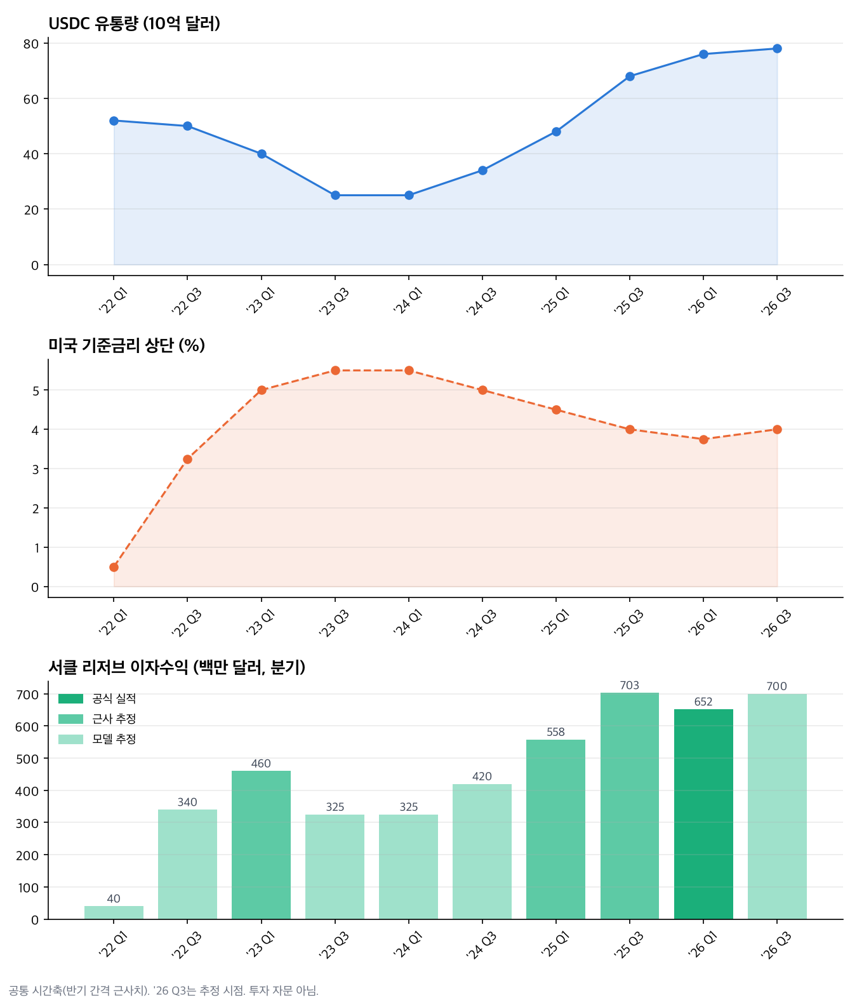

# 서클(CRCL) 금리·USDC 유통량·이자수익

대상: 서클(CRCL)
티커: CRCL
기준일: 2026-09-14
최근 업데이트일: 2026-11-05
분석 범위: 금리 100bp 인상이 USDC 유통량과 서클 리저브 이자수익에 주는 영향
자료 성격: 이자수익 일부 구간은 모델 추정치이며, 반기 간격 근사치 기준

## Summary

**금리가 오르면 서클은 정말 좋아질까**

서클 매출의 약 95%는 리저브 이자수익이며, 이 수익은 USDC 유통량 × 리저브 수익률로 결정됩니다. 약 765억 달러 유통량 기준으로 금리 100bp당 연 약 7.65억 달러의 이자수익이 움직입니다.

[red: 숫자만 보면 금리 인상은 서클 이자수익에 호재 방향입니다.] 그러나 금리 인상은 USDC를 보유하는 기회비용을 키우기 때문에 유통량에는 역풍이 될 수 있습니다.

[blue: 과거에도 USDC 유통량은 금리와 반대로 움직였습니다.] 금리 상승기에는 유통량이 줄었고, 금리 하락기에는 유통량이 급증했습니다.

이자수익은 두 요인의 곱입니다. 2022-2023년에는 금리 상승분이 유통량 감소를 압도해 이자수익이 오히려 상승했고, 2025년 4분기 정점 이후 2026년에는 금리 하락으로 소폭 하락 전환했습니다.

[brown: 따라서 이번 금리 인상의 순효과는 ‘떨어진 단가 회복(+)’과 ‘유통량 이탈 위험(-)’의 줄다리기로 정리됩니다.]

> **2026-11-05 업데이트:** 3분기 실적으로 첫 결과가 나왔다. 준비자산 수익률은 직전 분기보다 6bp 올랐지만(3.48%→3.54%) 평균 유통량이 4% 줄어 이자수익은 6억6,800만 달러에서 6억5,800만 달러로 감소했다. 이 글의 3분기 추정치(유통량 780억 달러, 이자수익 7억 달러)는 빗나갔다. 자세한 내용은 아래 5절과 Update Log에 정리했다.

## 1. 서클 매출은 사실상 이자수익이다

서클의 분기 이자수익은 다음 공식으로 거의 설명됩니다.

분기 이자수익($M) ≈ 유통량($B) × 리저브 수익률(%) × 2.5

- 검증: 2025년 4분기 실측 리저브 수익은 $733M였고, 공식으로 계산하면 73 × 4.0 × 2.5 = 730으로 거의 일치합니다.
- 리저브 수익률은 기준금리 상단보다 약 0.2-0.5%p 낮은 값을 사용했습니다.

공식 실적으로 확인되는 앵커는 아래와 같습니다.

| 시점 | 리저브 수익 | 총매출 | 비고 |
|---|---:|---:|---|
| '25 Q2 | $634.27M | $658.08M | 10-Q 원문 |
| '25 Q4 | $733M | $770M | 공식 실적 |
| '26 Q1 | $652.5M | $694.1M | 리저브 수익률 3.5% |
| FY2025 | $2.637B | $2.75B | 전년비 +64% |

## 2. 금리와 USDC 유통량은 반대로 움직였다

세 그래프는 같은 시간축(2022년 1분기-2026년 3분기)을 공유합니다. 같은 시점을 세로로 대조하면 금리와 유통량, 이자수익의 관계가 한눈에 보입니다.

이자수익 막대 중 가장 진한 색('26 Q1)만 공식 실적이고, 중간 색은 근사 추정, 연한 색은 유통량 × 수익률 모델 추정치입니다. 차트의 '26 Q3 막대는 실적 발표 전 추정치(7억 달러)입니다. 실제 실적은 6억5,800만 달러로 나왔고, 아래 표는 실적으로 고쳤습니다.

| 시점 | USDC 유통량 ($B) | 기준금리 상단 (%) | 리저브 이자수익 ($M) | 이자수익 출처 |
|------|-----------------|------------------|---------------------|--------------|
| '22 Q1 | 52 | 0.50 | 40  | 모델 추정 |
| '22 Q3 | 50 | 3.25 | 340 | 모델 추정 |
| '23 Q1 | 40 | 5.00 | 460 | 모델 추정 |
| '23 Q3 | 25 | 5.50 | 325 | 모델 추정 |
| '24 Q1 | 25 | 5.50 | 325 | 모델 추정 |
| '24 Q3 | 34 | 5.00 | 420 | 모델 추정 |
| '25 Q1 | 48 | 4.50 | 558 | 전년비 역산 추정 |
| '25 Q3 | 68 | 4.00 | 711 | 공식 실적(평균 67.8, 수익률 4.15%) |
| '26 Q1 | 76 | 3.75 | 652 | 공식 실적($652.5M) |
| '26 Q3 | 73 | 4.00 | 658 | 공식 실적(평균 73.3, 수익률 3.54%) · 발표 전 추정 78/700 |

## 3. 구간별로 다시 보기

### 2022-2023년 금리 급등기

금리가 0.5%에서 5.5%로 급등하는 동안 USDC 유통량은 약 520억 달러에서 250억 달러로 반토막이 났습니다. 반면 이자수익은 2023년 초까지 오히려 상승했습니다. 금리 상승분이 유통량 감소를 압도했기 때문입니다.

이후 SVB 뱅크런에 따른 USDC 일시 디페그, FTX 파산, 규제 단속이 겹치면서 유통량이 급감했고 이자수익도 눌렸습니다.

### 2024-2026년 금리 인하기

금리가 5.5%에서 3.75%로 내려오는 동안에도 GENIUS Act 등 규제 명확화와 기관 채택으로 유통량은 3배 넘게 증가했습니다. 이자수익은 2025년 4분기 $733M로 정점을 찍었습니다.

### 2026년 금리 재상승 논의

유통량은 계속 늘고 있지만 리저브 수익률이 3.5%까지 하락하면서 이자수익은 정점 대비 하락 전환했습니다. 금리 인상은 이 단가를 다시 밀어올리는 요인이지만, 유통량 이탈 위험과 상충합니다.

## 4. 이번 금리 인상은 줄다리기다

[red: 금리 인상은 떨어진 리저브 수익률을 다시 끌어올리는 요인입니다.] 2026년 1분기 리저브 수익률은 3.5%까지 내려와 있었습니다.

[blue: 반대로 금리 인상은 USDC 보유의 기회비용을 키워 유통량 이탈 위험을 만듭니다.] 2022-2023년 금리 급등기에 유통량이 약 520억 달러에서 250억 달러로 줄었던 사례가 있습니다.

다만 그 시기에는 SVB 뱅크런, FTX 파산, 규제 단속이 함께 겹쳐 있었습니다. 반대로 2024-2026년에는 금리가 내려오는 동안 규제 명확화와 기관 채택이 유통량을 3배 넘게 키웠습니다.

[brown: 결국 이번 인상의 순효과는 단가 회복(+)과 유통량 이탈 위험(-) 중 어느 쪽이 더 크게 나타나는지에 달려 있습니다.]

## 5. 3분기 실적으로 본 첫 결과

회사 발표자료에 최근 5개 분기 실적이 같은 기준으로 실렸다. 모델 추정 없이 공식 숫자만으로 공식을 다시 확인할 수 있다.

| 분기 | 평균 USDC 유통량 | 준비자산 수익률 | 준비자산 이자수익 | 공식 계산(유통량×수익률×2.5) | 순준비금 마진 |
| --- | ---: | ---: | ---: | ---: | ---: |
| '25 Q3 | $67.8B | 4.15% | $711M | $703M | 37.1% |
| '25 Q4 | $76.2B | 3.81% | $733M | $726M | 37.2% |
| '26 Q1 | $75.2B | 3.50% | $653M | $658M | 37.9% |
| '26 Q2 | $76.5B | 3.48% | $668M | $666M | 38.5% |
| '26 Q3 | $73.3B | 3.54% | $658M | $649M | 37.8% |

공식은 다섯 분기 모두 실제값과 1.5% 안쪽으로 맞았다. 3분기에 확인된 것은 세 가지다.

- **단가는 돌아섰다.** 수익률이 네 분기 연속 내려오다 3분기에 6bp 올랐다. CFO는 9월 연준 인상 이후 평균 금리가 올랐다고 설명했다. 인상이 분기 말에 있었으므로 온전한 효과는 4분기에 나타난다.
- **유통량은 줄었다.** 평균 유통량이 직전 분기보다 4% 줄었다. 기말은 739억 달러로 1.1% 늘었지만 전년과 같다. 회사는 이를 약한 디지털자산 시장 탓으로 돌렸다. 금리 인상 때문이라고 단정할 근거는 아직 없다.
- **이자 증가분을 다 갖지 못한다.** 순준비금 마진은 이자수익에서 유통 파트너에게 주는 비용을 뺀 비율이다. 3분기 37.8%로, 이자 1달러 가운데 약 38센트만 서클에 남는다. 금리 100bp 인상은 733억 달러 기준 이자수익을 연 약 7.3억 달러 늘리지만, 같은 비율이면 서클 몫은 연 약 2.8억 달러다(작성자 계산, 파트너 계약별 차이 무시).

4분기에는 Binance 재계약과 Hyperliquid 계약이 처음으로 한 분기 내내 반영된다. CFO는 이 때문에 4분기 마진이 내려간다고 밝혔다. 금리 인상으로 단가가 올라도 파트너 몫이 커지면 서클에 남는 금액의 증가는 더 작아진다. 금리 인상의 순효과를 볼 때는 유통량, 수익률과 함께 **순준비금 마진**까지 세 가지를 봐야 한다. [3분기 실적 리뷰](/us/circle-2026-q3/)

## 6. 데이터 신뢰도

| 출처 | 대상 | 신뢰도 |
|------|------|--------|
| Circle 공식 보도자료 / 4Q25·1Q26 실적 PDF (circle.com, q4cdn) | 유통량·이자수익 실측 | 매우 높음 (1차 자료) |
| StockTitan 10-Q ('25 Q2 $634.27M) | 리저브 수익 | 매우 높음 (SEC 원문) |
| Yahoo Finance / Zacks ('26 Q1 $652.5M, 3.5%) | 리저브 수익·수익률 | 높음 |
| Coinbase Institutional / CoinMetrics | 2022-2023 유통량·수익 정점 | 높음 (온체인 실측) |
| TheStreet / Bankrate / Richmond Fed | 금리 타임라인 | 높음 |
| 이자수익 재구성 추정('22-'24, '26 Q3) | 리저브 수익 | 중간 (모델 계산값, 실측 구간과 정합성으로 보정) |
| CoinLaw / sqmagazine / Eco | 일부 중간 시점 유통량 | 낮음 (소스 간 수치 상충, 미반영) |

이자수익 중 공식 실적 기반은 '25·'26 일부 시점뿐이고 나머지는 모델 추정입니다. 연도별 세부 분기 수치가 필요하면 Circle IR 페이지의 10-Q/10-K 원문을 직접 확인하는 것이 좋습니다.

## Update Log

### 2026-11-05 — 3분기 실적 반영

- **바뀐 것:** 3분기 공식 실적(평균 유통량 733억 달러, 수익률 3.54%, 이자수익 6억5,800만 달러)으로 '25 Q3·'26 Q3 추정치를 실적으로 바꾸고 6절을 추가했다. 발표 전 추정(780억 달러·7억 달러)은 유통량을 과대 추정했다.
- **판단:** 금리 인상은 단가 회복과 유통량 이탈의 줄다리기라는 틀은 유지한다. 3분기에는 단가 +6bp, 유통량 -4%로 이자수익이 줄었다. 여기에 파트너 비용 증가라는 세 번째 변수를 더했다.
- **근거:** [3분기 보도자료](https://www.sec.gov/Archives/edgar/data/1876042/000187604226000309/finalq3epr-110326.htm) · [3분기 발표자료 15쪽](https://seekingalpha.com/article/4962142-circle-internet-group-inc-2026-q3-results-earnings-call-presentation) · [컨콜 전사문](https://www.benzinga.com/news/26/11/62865573/circle-internet-group-q3-2026-earnings-call-transcript)

## Sources

- Circle 공식 보도자료 및 4Q25·1Q26 실적 자료 (circle.com)
- Circle 10-Q ('25 Q2 리저브 수익, StockTitan 경유)
- Yahoo Finance / Zacks ('26 Q1 리저브 수익·수익률)
- Coinbase Institutional / CoinMetrics (2022-2023 USDC 유통량)
- TheStreet / Bankrate / Richmond Fed (미국 기준금리 타임라인)
- [Circle 2026년 3분기 실적 보도자료 · SEC · 2026-11-04](https://www.sec.gov/Archives/edgar/data/1876042/000187604226000309/finalq3epr-110326.htm)
- [Circle 2026년 3분기 실적 발표자료 · Seeking Alpha 게재본 · 2026-11-04](https://seekingalpha.com/article/4962142-circle-internet-group-inc-2026-q3-results-earnings-call-presentation) — 5개 분기 평균 유통량·수익률·이자수익·순준비금 마진
- [Circle 2026년 3분기 컨퍼런스콜 전사문 · Benzinga · 2026-11-04](https://www.benzinga.com/news/26/11/62865573/circle-internet-group-q3-2026-earnings-call-transcript)
