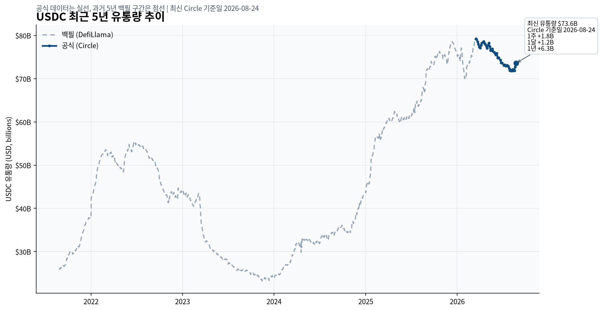

# 서클 USDC: 유통량 상승 파동과 수익모델

기준일: 2026-08-24
최근 업데이트일: 2026-11-05

## Summary

**유통량이 크게 늘었던 6번의 구간과 이유**

[brown: USDC 유통량은 지난 5년 동안 한 방향으로 늘지 않았습니다.] DefiLlama 월말 자료에서는 6번의 상승 파동이 보이지만, 각 구간의 원인은 크립토·DeFi 확장, 준비금형 스테이블코인 선호, 시장 회복, 유통 제휴, 규제 명확성 기대처럼 서로 달랐습니다.

[blue: 위기라고 해서 USDC가 항상 늘어나는 것도 아닙니다.] 2022년 5월 Terra 붕괴 뒤에는 약 `$5B`가 유입됐지만, 2023년 3월 SVB 충격 뒤에는 USDC 자체 준비금에 대한 우려가 생기면서 대규모 환매가 이어졌습니다.

[red: 투자자가 봐야 할 것은 기말 유통량 하나가 아니라 `평균 USDC 유통량 × 준비금 수익률 − 유통비용`입니다.] 2026년 2분기에는 평균 유통량 증가가 준비금 수익을 약 `$147.4M` 늘렸지만, 수익률 하락이 약 `$113.9M`을 상쇄했고 신규 유통 제휴 비용도 증가했습니다.

> **2026-11-05 업데이트:** 3분기 실적으로 보면 8월의 소폭 반등은 새 파동으로 이어지지 않았다. 9월 30일 기말 유통량은 `$73.9B`로 6월 말보다 1.1% 늘었지만 전년과 같고, 평균 유통량은 직전 분기보다 4% 줄었다. 아래 '판단을 바꿀 신호' 점검은 Update Log에 정리했다.

2026년 8월 24일 Circle 공식 유통량은 `$73.6B`입니다. 최근 변화는 7일 `+$1.8B`, 30일 `+$1.2B`, 1년 `+$6.3B`로, 2026년 7월 말 약 `$72.0B`에서의 움직임은 새로운 대형 파동보다 소폭 반등에 가깝습니다.

## 자료 범위

대상: 서클(Circle) USDC
티커: CRCL
검색 마감일: 2026-08-26
분석 범위: USDC 유통량 상승 구간과 Circle 수익모델의 연결

## 데이터 기준과 차트

차트의 회색 점선은 [DefiLlama USDC 5년 일별 시계열](https://stablecoins.llama.fi/stablecoincharts/all?stablecoin=2)을 월말 기준으로 읽은 값입니다. 멀티체인 토큰의 백필, 브리지 분류, 미발행 토큰 처리 방식 때문에 과거 구간이 나중에 수정될 수 있어 절대 수치의 기준점은 Circle 공식 페이지와 SEC 공시로 잡았습니다.

Circle은 공시상 유통량에서 `tokens allowed but not issued`, `access denied tokens`, `pending burns`를 제외합니다. 이 정의 차이는 DefiLlama의 멀티체인 합계와 단기적으로 어긋날 수 있습니다.

| 기준점 | DefiLlama 월말 | Circle·SEC 공식 | 대조 결과 |
| --- | ---: | ---: | --- |
| 2022-12-31 | 약 `$44.6B` | `$44.554B` | 거의 일치 |
| 2023-12-31 | 약 `$24.4B` | `$24.412B` | 거의 일치 |
| 2024-12-31 | 약 `$43.9B` | `$43.857B` | 거의 일치 |
| 2025-12-31 | 약 `$75.3B` | `$75.266B` | 거의 일치 |
| 2026-03-31 | 약 `$77.4B` | `$77.049B` | 종점은 유사 |
| 2026-06-30 | 약 `$73.3B` | `$73.269B` | 거의 일치 |
| 2026-08-24 | 약 `$73.6B` | `$73.6B` | 기준일 일치 |

## 여섯 상승 파동 한눈에 보기

| 구간 | 월말 유통량 | 변화의 성격 | 근거 강도 |
| --- | ---: | --- | --- |
| 1. 2021-08~2022-02 | 약 `$26.2B→$53.6B` | 크립토·DeFi 확장, 결제·거래·멀티체인 채택 확대 | 공시로 확인 + 해석 |
| 2. 2022-04~2022-06 | 약 `$49.3B→$54.9B` | Terra 붕괴 뒤 준비금형 스테이블코인 선호 | 공시로 확인 |
| 3. 2023-11~2024-04 | 약 `$23.8B→$32.6B` | SVB 이후 장기 환매 종료, 디지털자산 시장 회복 | 공시로 확인 + 해석 |
| 4. 2024-10~2025-04 | 약 `$34.8B→$62.0B` | 시장 활동·점유율 회복, 거래소·지갑 유통 확대 | 공시로 확인 + 시점상 동행 |
| 5. 2025-05~2025-11 | 약 `$60.6B→$76.3B` | 규제 명확성 기대, CPN·신규 체인·금융사 제휴 | 시점상 동행 |
| 6. 2026-01~2026-03 | 백필 약 `$70.0B→$77.4B` | 공시상 실제 증가는 약 `$1.8B`, 단일 촉매 미확인 | 공시로 보정 + 해석 |

이 표는 저점과 고점을 기계적으로 찾은 매매 신호가 아닙니다. 월말 자료에서 상승이 몇 달 이어지고 규모가 커진 구간을 사후적으로 묶은 것입니다.

## 1. 2021년 8월~2022년 2월 — 크립토와 DeFi의 동반 확장

DefiLlama 월말 기준 USDC는 2021년 8월 31일 약 `$26.2B`에서 2022년 2월 28일 약 `$53.6B`로 늘었습니다. Circle은 2022년 2월 2일 공식 글에서 2021년 한 해 동안 USDC가 `10x` 성장했고, 2022년 1월 31일 `$50B`를 넘었다고 발표했습니다.

**공시로 확인.** Circle이 당시 제시한 직접 요인은 결제·송금, 거래소와 지갑 지원, DeFi 사용, 멀티체인 확장이었습니다. 2021년에는 Stellar·Tron·Hedera·Avalanche가 추가돼 지원 체인이 8개로 늘었고, 200개가 넘는 블록체인 프로토콜과 223개 지갑이 USDC를 지원했다고 밝혔습니다.

**해석.** 이 구간은 특정 사건 하나보다 크립토 시장과 DeFi의 전체 활동이 커지면서 거래·담보·결제에 쓰이는 달러 토큰 수요가 함께 커진 구조적 확장에 가깝습니다. Circle의 자체 설명이 여러 사용처를 함께 제시한다는 점도 단일 원인 해석을 피하게 합니다.

## 2. 2022년 4~6월 — Terra 이후 준비금형 선호

USDC는 2022년 4월 30일 약 `$49.3B`에서 6월 30일 약 `$54.9B`로 반등했습니다. TerraUSD와 LUNA가 붕괴한 2022년 5월을 사이에 둔 움직임입니다.

**공시로 확인.** Circle CEO는 2022년 7월 6일 기준 유통량이 `$55B`였고, 직전 두 달 동안 다른 스테이블코인이 흔들리는 사이 USDC 유통량이 약 `$5B` 늘었다고 밝혔습니다. 알고리즘형 토큰의 붕괴 뒤 현금과 단기 국채로 준비금을 보유하고 1대1 상환을 제공하는 토큰으로 수요가 이동한 정황이 직접 확인됩니다.

**해석.** 다만 이 현상을 모든 위기에 적용할 수는 없습니다. Terra는 경쟁 토큰과 알고리즘 구조에 대한 신뢰 위기였지만, 다음 해 SVB는 USDC 자체 준비금 접근성에 대한 위기였습니다.

## 3. 2023년 11월~2024년 4월 — SVB 충격 이후의 회복

DefiLlama 월말 기준 USDC는 2023년 11월 30일 약 `$23.8B`에서 2024년 4월 30일 약 `$32.6B`로 회복했습니다. 2023년 3월 SVB 사태 뒤 이어진 장기 환매가 바닥을 통과한 뒤의 첫 뚜렷한 반등입니다.

**공시로 확인.** Circle은 SVB가 2023년 3월 `$3.3B`, 당시 USDC 준비금의 약 `8%`에 해당하는 이체 요청을 처리하지 못했다고 공시했습니다. FDIC가 모든 예금을 보장했고 Circle은 직접 손실을 입지 않았지만, 회사는 SVB 사태가 이후 USDC 유통량 감소에 기여했다고 명시했습니다.

2023년 평균 USDC 유통량은 SVB 붕괴 이후 `39%` 줄었고, 이 효과가 준비금 수익을 약 `$600.7M` 낮췄습니다. 반면 2024년 평균 유통량은 `9%` 늘었고, Circle은 디지털자산 거래 활동, 주요 시장의 점유율 상승, 전략적 제휴와 통합 확대를 이유로 들었습니다.

**해석.** 2023년 11월 이후 반등은 준비금 손실이 없었다는 확인, 환매 압력 정상화, 디지털자산 시장 활동 회복이 겹친 결과로 보는 편이 안전합니다. 특정 뉴스 한 건을 저점의 원인으로 단정할 근거는 확인되지 않았습니다.

## 4. 2024년 10월~2025년 4월 — 시장 회복과 유통망 확대

USDC는 2024년 10월 31일 약 `$34.8B`에서 2025년 4월 30일 약 `$62.0B`로 늘었습니다. 여섯 구간 가운데 2021년 파동과 함께 절대 증가 폭이 가장 큰 편입니다.

**공시로 확인.** Circle의 IPO 공시는 2024년 평균 유통량 증가를 디지털자산 거래 활동, 점유율 상승, 전략적 제휴와 통합 확대에 연결했습니다. 2025년 3월 31일 공식 기말 유통량도 `$60.1B`로 확인돼 DefiLlama의 4월 월말 약 `$62.0B`와 흐름이 이어집니다.

**시점상 동행.** Circle과 Binance는 2024년 12월 11일 전략적 제휴를 발표했습니다. Binance가 2억4천만명 이상의 사용자에게 거래·저축·결제 전반에서 USDC 접근성을 넓히고 기업 재무에도 USDC를 채택한다는 내용입니다.

**해석.** Binance 제휴는 유통 경로 확대를 설명하는 강한 정황이지만, 약 `$27B` 증가를 이 제휴 하나의 효과로 계산할 수는 없습니다. Circle도 2024년 Binance 관련 신규 유통 계약에 일회성 `$60.25M`을 포함한 비용을 지출했다고 공시해, 유통량 증가에는 비용이 붙는다는 점을 보여줍니다.

## 5. 2025년 5~11월 — 규제·결제·멀티체인 확장의 동행

USDC는 2025년 5월 31일 약 `$60.6B`에서 11월 30일 약 `$76.3B`로 다시 늘었습니다. 2025년 12월 31일 SEC 공식 기말 유통량은 `$75.266B`로 연말에도 높은 수준이 유지됐습니다.

**시점상 동행.** Circle Payments Network는 2025년 5월 21일 메인넷을 시작했습니다. 이후 World Chain과 XRPL에서 6월, Sei에서 7월, Plume에서 9월에 네이티브 USDC가 추가됐습니다.

FIS는 2025년 7월 28일 미국 금융기관 고객이 USDC로 국내·국경간 결제를 할 수 있도록 Circle과 제휴했고, Finastra도 8월 27일 은행의 국경간 결제 흐름에 USDC 결제를 연결하는 협업을 발표했습니다. 이는 모두 유통량 상승기와 겹치는 실제 유통·사용처 확장입니다.

**시점상 동행.** 미국 대통령은 2025년 7월 18일 GENIUS Act에 서명했습니다. 다만 SEC 공시에 따르면 이 법은 2027년 1월 18일 또는 시행 규정 확정 120일 뒤 중 이른 날에 효력이 발생하므로, 2025년 유통량 증가를 법 시행 효과라고 부르면 정확하지 않습니다.

**해석.** 이 구간은 규제 명확성에 대한 기대와 제품·체인·금융사 유통 확대가 함께 진행됐습니다. 어느 사건이 얼마만큼의 USDC를 만들었는지는 공시로 분리되지 않아 인과가 아니라 동행 사건으로만 봐야 합니다.

## 6. 2026년 1~3월 — 백필 차트와 공식 수치가 갈리는 구간

DefiLlama 월말 백필은 2026년 1월 31일 약 `$70.0B`에서 3월 31일 약 `$77.4B`로 보입니다. 차트만 보면 약 `$7B` 단기 반등처럼 보이지만, Circle의 2025년 12월 31일 공식 수치는 `$75.266B`였습니다.

**공시로 보정.** Circle의 2026년 1분기 10-Q에서 3월 31일 기말 유통량은 `$77.049B`입니다. 따라서 공식 분기 기준 실제 증가는 약 `$1.8B`, `2.4%`였고 DefiLlama의 1월 저점은 멀티체인 백필이나 분류 변화의 영향을 받았을 가능성이 있습니다.

**해석.** Circle은 2026년 상반기 평균 유통량 증가를 전반적인 수요 증가와 전략적 제휴·통합 확대로 설명했지만, 1~3월 움직임을 단일 촉매에 연결하지 않았습니다. 구조적 네트워크 성장과 단기 시장성 수요를 구분해야 하는 구간입니다.

## 최근 소폭 반등 — 2026년 7월 말~8월 24일

2026년 7월 31일 DefiLlama 월말 유통량은 약 `$72.0B`였고 Circle의 8월 24일 공식 수치는 `$73.6B`입니다. 최근 7일 `+$1.8B`, 30일 `+$1.2B`, 1년 `+$6.3B`였지만, 과거 대형 파동과 비교하면 아직 새로운 상승 사이클로 분류하기 어렵습니다.

**3분기 결과(2026-11-05 추가).** 9월 30일 공식 기말 유통량은 `$73.9B`, 3분기 평균은 `$73.3B`였습니다. 분기 중 발행과 상환이 각각 약 `$104B`로 같아 순증은 사실상 없었습니다. 8월의 반등은 소폭 반등으로 끝났습니다.

**해석.** 단기 변화율은 민팅·환매 시점과 거래 수요에 따라 흔들릴 수 있습니다. 월평균 유통량이 여러 분기 이어서 늘고, 같은 기간 유통비용을 뺀 수익도 개선되는지를 함께 봐야 합니다.

## 위기라고 항상 늘지는 않는다

| 사건 | USDC에 대한 충격 | 유통량 반응 | 읽는 법 |
| --- | --- | --- | --- |
| 2022-05 Terra 붕괴 | 경쟁 알고리즘형 스테이블코인의 신뢰 훼손 | 약 두 달간 `+$5B` | 준비금형 선호 유입 |
| 2023-03 SVB 붕괴 | USDC 준비금 `$3.3B` 접근성 우려 | 이후 장기 환매와 2023년 평균 `-39%` | USDC 자체 신뢰 충격 |

[blue: 위기의 위치가 다르면 반응도 반대가 됩니다.] 경쟁 토큰의 준비금 구조가 흔들릴 때는 USDC가 대안이 될 수 있지만, USDC 준비금이나 상환 인프라가 흔들리면 USDC 자체가 환매 대상이 됩니다.

## 투자 함의 — 유통량보다 경제성을 보자

Circle의 준비금 수익은 대략 `평균 USDC 유통량 × 준비금 수익률`로 결정됩니다. 여기에서 Coinbase·Binance 같은 유통 파트너 비용과 거래비용을 빼야 주주에게 남는 경제성에 가까워집니다.

| 2026년 2분기 지표 | 2026년 2분기 | 2025년 2분기 | 의미 |
| --- | ---: | ---: | --- |
| 평균 USDC 유통량 | `$76.524B` | `$61.039B` | `+25.2%` |
| 준비금 수익률 | `3.5%` | `4.1%` | 평균 수익률 `-66bp` |
| 준비금 수익 | 전년 대비 `+$33.5M` | 기준 | 유통량 효과와 금리 효과의 합 |
| 유통량 증가 효과 | `+$147.4M` | 기준 | 수요·제휴·통합 확대 |
| 수익률 하락 효과 | `-$113.9M` | 기준 | 연준 금리 조치 반영 |
| 유통·거래비용 | 전년 대비 `+$3.9M` | 기준 | 신규 제휴 `+$11.4M`, Coinbase 믹스 `-$7.7M` |

[brown: 유통량이 늘어도 금리가 내려가면 준비금 수익 증가 폭은 작아질 수 있습니다.] 반대로 금리가 유지돼도 유통량을 만들기 위해 지급하는 유통비용이 빨리 늘면 주주에게 남는 몫은 제한됩니다.

Circle은 2026년 2분기 전체 매출의 `95.2%`를 준비금 수익에서 얻었습니다. 3분기에는 ARC 토큰 판매 `$182M`이 더해져 이 비중이 `76.0%`로 내려갔지만, ARC를 빼면 `96.3%`로 여전히 준비금 수익이 대부분입니다. 아직은 유통량, 수익률, 유통비용의 세 변수가 CRCL 실적을 읽는 핵심입니다. 아직은 유통량, 수익률, 유통비용의 세 변수가 CRCL 실적을 읽는 핵심입니다.

## 판단을 바꿀 신호

월평균 USDC 유통량이 두 분기 이상 연속 증가하고, DefiLlama와 Circle 공식 수치가 같은 방향을 보이는지 확인합니다.

- 준비금 수익률 하락을 유통량 증가가 계속 상쇄하는지 확인합니다.
`Revenue less distribution costs`와 RLDC Margin이 유통량 증가와 함께 개선되는지 확인합니다.

- Binance·Coinbase·신규 금융사 제휴가 만든 유통량과 지급한 인센티브의 균형을 확인합니다.
- 준비금 은행, 상환 인프라, 디페그 위험이 다시 부각되면 구조적 성장 가정을 낮춰야 합니다.

## Update Log

### 2026-11-05 — 3분기 실적으로 신호 점검

- **바뀐 것:** 3분기 공식 수치를 넣었다. 기말 유통량 `$73.9B`(직전 분기 +1.1%, 전년 0%), 평균 `$73.3B`(직전 분기 -4%, 전년 +8%), 준비금 수익률 `3.54%`(전년 -61bp), 준비금 수익 `$658M`(전년 -8%), 발행·상환 각 약 `$104B`.
- **판단:** 8월 반등은 새 상승 파동이 아니었다는 기존 해석을 유지한다. 아래 신호 가운데 개선된 것은 없다.

| 이 글의 신호 | 3분기 결과 | 판정 |
| --- | --- | --- |
| 월평균 유통량 두 분기 이상 연속 증가 | 2분기 `$76.5B` → 3분기 `$73.3B` | 미충족 |
| 수익률 하락을 유통량 증가가 상쇄 | 전년 대비 유통량 +8%, 수익률 -61bp로 준비금 수익 -8% | 미충족 |
| RLDC 마진이 유통량과 함께 개선 | ARC 제외 RLDC 마진 39.7%, 2분기 41.2%에서 하락 | 미충족 |
| 제휴 유통량과 인센티브의 균형 | Binance 5년 재계약·Hyperliquid 계약. CFO는 4분기 마진 하락을 예고 | 부담 증가 |
| 준비금·상환 인프라 위험 | 분기 발행·상환 `$208B`로 사상 최대, 1:1 상환 정상 | 이상 없음 |

- **새로 볼 지표:** 회사는 잔액 대신 사용량을 앞세웠다. 3분기 USDC 온체인 거래량은 `$13.9T`로 전년보다 49% 늘었고, 스테이블코인 거래량 점유율은 79%(공급 점유율 27%)다. 거래가 잔액 증가로 이어지는지가 다음 확인 대상이다. 서클 플랫폼 밖 USDC 비중은 1년 새 62%에서 50%로 줄고 Coinbase 비중이 24%에서 31%로 늘었다. [3분기 실적 리뷰](/us/circle-2026-q3/)
- **근거:** [3분기 보도자료](https://www.sec.gov/Archives/edgar/data/1876042/000187604226000309/finalq3epr-110326.htm) · [3분기 발표자료](https://seekingalpha.com/article/4962142-circle-internet-group-inc-2026-q3-results-earnings-call-presentation) · [컨콜 전사문](https://www.benzinga.com/news/26/11/62865573/circle-internet-group-q3-2026-earnings-call-transcript)

## Sources

- DefiLlama, USDC 5년 일별 시계열, 2026-08-26 조회: https://stablecoins.llama.fi/stablecoincharts/all?stablecoin=2
- Circle, USDC 공식 유통량·준비금 페이지, 2026-08-24 기준: https://www.circle.com/usdc
- Circle, `USDC Market Cap Grows to More than $50 Billion`, 2022-02-02: https://www.circle.com/blog/usdc-market-cap-grows-to-more-than-50-billion
- Circle CEO Jeremy Allaire, `Circle's Strength, Stability & Transparency`, 2022-07-07: https://www.circle.com/blog/a-letter-from-our-ceo-circles-strength-stability-transparency
- Circle, Binance 전략적 제휴, 2024-12-11: https://www.circle.com/es/pressroom/circle-and-binance-enter-into-a-strategic-partnership-that-will-accelerate-global-usdc-and-crypto-adoption
- Circle, CPN 메인넷 출시, 2025-05-21: https://www.circle.com/blog/circle-payments-network-cpn-mainnet-is-here-advancing-mainstream-stablecoin-payments-globally
- White House, GENIUS Act 서명 팩트시트, 2025-07-18: https://www.whitehouse.gov/fact-sheets/2025/07/fact-sheet-president-donald-j-trump-signs-genius-act-into-law/
- Circle, World Chain 네이티브 USDC, 2025-06-11: https://www.circle.com/blog/now-live-native-usdc-and-cctp-v2-on-world-chain
- Circle, XRPL 네이티브 USDC, 2025-06-12: https://www.circle.com/blog/now-available-usdc-on-the-xrpl
- Circle, Sei 네이티브 USDC, 2025-07-24: https://www.circle.com/blog/now-available-usdc-cctp-v2-on-sei
- Circle·FIS 제휴, 2025-07-28: https://www.circle.com/pressroom/fis-partners-with-circle-to-unlock-stablecoin-money-movement-functionality-for-financial-institution-customers
- Circle·Finastra 제휴, 2025-08-27: https://www.circle.com/pressroom/finastra-and-circle-forge-strategic-collaboration-to-bring-stablecoin-settlement-to-cross-border-payments
- Circle, Plume 네이티브 USDC, 2025-09-23: https://www.circle.com/blog/now-available-native-usdc-cctp-v2-on-plume
- Circle S-1/A, 2022~2024 유통량·SVB·준비금 수익·유통비용: https://www.sec.gov/Archives/edgar/data/1876042/000119312525084832/d737521ds1a.htm
- Circle 2025 Form 10-K, 유통량·수익률·제휴·GENIUS Act: https://www.sec.gov/Archives/edgar/data/1876042/000187604226000062/crcl-20251231.htm
- Circle 2026년 1분기 Form 10-Q, 2026-03-31 유통량: https://www.sec.gov/Archives/edgar/data/1876042/000187604226000150/crcl-20260331.htm
- Circle 2026년 2분기 Form 10-Q, 평균 유통량·준비금 수익률·유통비용: https://www.sec.gov/Archives/edgar/data/1876042/000187604226000248/crcl-20260630.htm
- Circle 2026년 3분기 실적 보도자료, 2026-11-04: https://www.sec.gov/Archives/edgar/data/1876042/000187604226000309/finalq3epr-110326.htm
- Circle 2026년 3분기 실적 발표자료(Seeking Alpha 게재본), 2026-11-04: https://seekingalpha.com/article/4962142-circle-internet-group-inc-2026-q3-results-earnings-call-presentation
- Circle 2026년 3분기 컨퍼런스콜 전사문(Benzinga), 2026-11-04: https://www.benzinga.com/news/26/11/62865573/circle-internet-group-q3-2026-earnings-call-transcript
