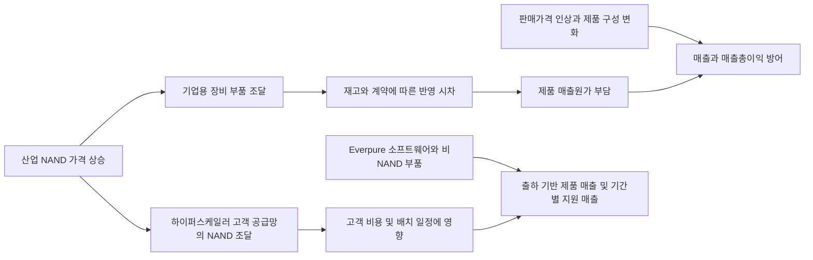

# Everpure: NAND가 비싸졌는데 주가는 왜 올랐나

- 기준일: **2026-10-09, 한국시간**
- 주가 기준: **2026-10-08 미국 정규장 종가 $150.57**. 시간외 가격 제외.
- 대상: Everpure, Inc., NYSE **P**, 이전 Pure Storage / PSTG, CIK 0001474432.
- 범위: 2025년부터의 상승 계기와 NAND 원가 전달 구조. 목표주가·매매 의견은 산출하지 않는다.

## 1. 판단

**NAND 원가 부담이 사라져서 오른 주식이라기보다, 가격 인상으로 부담을 상당 부분 상쇄하면서 더 큰 미래 매출·이익을 기대하게 된 주식이다.** 일반 기업용 사업에는 부품 가격 상승이 실제로 영향을 줬다. 반면 하이퍼스케일러 사업은 고객 공급망이 NAND 포함 모듈을 조달하고 Everpure가 소프트웨어·비NAND 부품·지원에서 수익을 얻어, 동일한 NAND 상승률을 회사 전체 원가에 적용할 수 없다. [공식 계약 Q&A][S8]

시장의 재평가를 설명하는 가장 강한 증거는 2025년 Meta 배치의 매출 인식 시작, 2026년 두 번째 하이퍼스케일러 계약, FY2027 가이던스 상향, FY2028 예비 전망이다. **이 설명은 사건과 주가의 시간적 연결을 바탕으로 한 추론이며 투자자별 매수 원인을 확인한 것은 아니다.** [2025년 경영진 설명][S6] [신규 계약][S7] [장기 전망][S9]

반대 증거도 명확하다. 최근 분기 매출총이익률은 전년보다 낮고, 시스템 대수는 감소했으며 영업현금흐름은 음수다. 하이퍼스케일러가 NAND를 조달해도 회사의 조건부 부품 구매의무는 남는다. 따라서 현재 가격에는 **원가 안정 자체보다 가격 유지, 현금 회수, 신규 사업 확장의 성공**이 중요하다. [Q2 공식 설명][S5] [10-Q][S2]

## 2. $60 출발점과 상승·하락 사건

2025-01-02 종가는 $62.49, 2025-08-27 종가는 $60.86이었다. 사용자가 기억한 약 $60은 실제 거래가격에 부합하지만 특정 매수일로 확정하지 않는다. 2026-10-08까지 가격 상승률은 각각 **+140.95%, +147.40%**다. 티커 변경은 2026-04-17부터이며 동일 주식의 이력을 연결했다. [티커 변경][S10] [주가 자료][S11]

아래 수익률은 **사건 뒤 거래일 종가 ÷ 직전 거래일 종가 − 1**이다. 발표일의 장중 상승과 장 마감 후 발표 반응을 섞지 않았다. 실적일뿐 아니라 하락일을 함께 담아 상승의 인과관계를 과장하지 않는다.

| 사건 발표일 / 반응 거래일 | 직전 → 반응일 종가, USD | 일간 변화 | 확인된 사건 | 해석과 한계 |
| --- | ---: | ---: | --- | --- |
| 2025-08-27 장 마감 후 / 08-28 | 60.86 → 80.54 | +32.34% | FY26 Q2 실적·연간 전망 상향. Meta 배치에서 첫 매출 발생 [S3][S6] | 계약 가능성이 실제 수익화로 전환됐다는 신뢰 상승이 가장 설득력 있는 설명 |
| 2025-12-02 장 마감 후 / 12-03 | 94.72 → 68.85 | −27.31% | FY26 Q3 성장 16%, 연구개발·판매 투자 확대 설명 [S4] | 실적 성장과 주가 상승이 항상 동행하지 않음. 하락분을 NAND 하나로 귀속할 근거 부족 |
| 2026-02-25 장 마감 후 / 02-26 | 73.56 → 65.98 | −10.30% | FY26 Q4 성장 20%, FY27 전망·부품 가격 부담 설명 [S12][S13] | 원가·성장 전망에 대한 시장의 긴장이 남아 있었음 |
| 2026-05-27 장 마감 후 / 05-28 | 85.74 → 73.04 | −14.81% | FY27 Q1 성장 35%, 연간 전망 상향 [S14] | 높은 매출 성장만으로 당시 기대를 만족시켰다고 볼 수 없음 |
| 2026-08-10 장 마감 후 / 08-11 | 97.98 → 109.38 | +11.64% | 두 번째 top-five 하이퍼스케일러 설계 채택·공급계약 [S7] | 첫 고객에 한정된 기술이라는 우려 완화. 고객 실명·계약금액은 공개되지 않음 |
| 2026-08-26 장 마감 후 / 08-27 | 108.90 → 99.24 | −8.87% | FY27 Q2 성장 38%, 연간 전망 대폭 상향, 현금흐름 음수 [S15] | 전망 상향에도 매도 반응. 현금·수요·기대치가 함께 작용했을 가능성; 단일 원인 확정 불가 |
| 2026-09-04 발표 / 09-08 | 99.51 → 101.14 | +1.64% | S&P 500 편입 발표, 09-21 효력 발생 [S16] | 지수 추종 수요는 보조 가설. 09-21에도 +9.14%였으나 그 전부가 지수 편입 효과인지는 확인 불가 |
| 2026-09-23 장 마감 후 / 09-24 | 109.65 → 121.88 | +11.15% | FY28 매출 $7.0–7.3bn, 조정 영업이익 $1.7–1.9bn 예비 전망 [S9] | 다음 회계연도의 이익 규모 확대가 후반부 상승의 직접적인 설명 후보 |

가격은 [Yahoo Finance 이력][S11]에서 내려받아 [price-history.csv](price-history.csv)에 보존했고, 최근 주요 종가는 [Stock Analysis][S17]와 교차 확인했다. 2025-08-28 상승률은 [당시 보도][S18]와도 부합한다. 2026-08-10 당일 +8.81%를 그날 장 마감 후 계약 발표의 반응으로 설명하지 않는다. 전체 기간의 거시환경·업종 수익률을 통제한 사건 연구는 수행하지 않아 각 사건의 독립적인 기여율은 산출하지 않았다.

## 3. 실적: 원가 총액과 원가율은 다른 이야기

단위는 **USD million**, 매출총이익률·영업이익은 GAAP와 non-GAAP를 구분한다. FCF는 회사 정의의 non-GAAP 지표로 영업현금흐름에서 유형자산·자본화 소프트웨어 지출을 차감한다. FY2026은 2026-02-01에 끝났고 FY2027 Q2는 2026-08-02에 끝났다. 달력 2026년 2분기와 혼동하면 안 된다.

| 항목 | FY26 Q2 | FY26 Q3 | FY26 Q4 | FY27 Q1 | FY27 Q2 |
| --- | ---: | ---: | ---: | ---: | ---: |
| 분기 종료일 | 2025-08-03 | 2025-11-02 | 2026-02-01 | 2026-05-03 | 2026-08-02 |
| 발표일 | 2025-08-27 | 2025-12-02 | 2026-02-25 | 2026-05-27 | 2026-08-26 |
| 매출 | 861.0 | 964.5 | 1,058.9 | 1,052.9 | 1,185.9 |
| 매출 성장, YoY | 12.7% | 16.0% | 20.4% | 35.2% | 37.7% |
| 제품 매출 | 446.3 | 534.8 | 618.5 | 576.5 | 686.8 |
| 구독·서비스 매출 | 414.7 | 429.7 | 440.4 | 476.4 | 499.1 |
| GAAP 매출원가 | 256.7 | 267.1 | 318.8 | 329.6 | 374.5 |
| GAAP 매출총이익 | 604.3 | 697.4 | 740.1 | 723.3 | 811.4 |
| GAAP 매출총이익률 | 70.2% | 72.3% | 69.9% | 68.7% | 68.4% |
| non-GAAP 매출총이익률 | 72.1% | 74.1% | 71.4% | 70.1% | 69.9% |
| GAAP 영업이익 | 4.9 | 53.9 | 87.2 | 19.9 | 63.2 |
| non-GAAP 영업이익 | 130.0 | 196.2 | 225.7 | 158.8 | 229.6 |
| 영업현금흐름 | 212.2 | 116.0 | 268.0 | 180.2 | −136.3 |
| FCF | 150.1 | 52.6 | 201.4 | 111.8 | −237.6 |
| 출처 | [Q2 FY26][S3] | [Q3 FY26][S4] | [Q4 FY26][S12] | [Q1 FY27][S14] | [Q2 FY27][S15] |

성장률은 원자료의 당기·전년 동기 매출로 계산했다. 표의 원수치와 계산은 [research-data.json](research-data.json)에 보존했다.

FY27 Q2의 원가는 전년 동기보다 **45.91%** 증가해 매출 증가율 **37.73%**를 웃돌았다. 원가율도 **29.81% → 31.58%, +1.77%p** 상승했다. 따라서 “원가가 많이 올랐다”는 전제는 총액과 비율 양쪽에서 맞다. 그러나 매출총이익 총액은 **34.26%** 증가했다. 매출이 커지면 원가 총액이 증가해도 이익 총액은 함께 늘 수 있다.

같은 분기의 GAAP 영업비용은 $599.5m에서 $748.2m으로 **24.82%** 늘어 매출 증가보다 느렸다. 매출 대비 비중은 **69.62% → 63.09%**로 낮아져, 매출총이익률 하락에도 GAAP 영업이익률은 **0.57% → 5.33%**로 개선됐다. 이는 원가 개선이 아니라 **영업비용의 규모 효과**다. [10-Q 손익표][S2]

## 4. NAND 가격이 회사 이익으로 전달되는 경로

### 산업 가격과 Everpure 조달가격

| 발표·갱신일 | 지표와 적용 기간 | 공개 내용 | 분석에서의 용도 |
| --- | --- | --- | --- |
| 2026-03-31 | 전체 NAND 계약가격, 달력 2Q26 전망 | 전분기 대비 +70–75% 예상 [S19] | 원가 충격의 방향·규모를 보여주는 당시 전망 |
| 2026-07-03 | 전체 NAND 계약가격, 달력 3Q26 전망 | +10–15% 예상 [S20] | 상승 속도 둔화는 가격 하락과 다름 |
| 2026-09-30 | 전체 NAND 계약가격, 달력 4Q26 전망 | +15–20% 예상. 기업용 SSD 수요 강세 [S21] | 기준일에 원가 상승 압력이 계속될 가능성 |
| 2026-09-30 | TrendForce wafer/contract 가격 페이지 갱신 | 종류별 계약가격 서비스 [S22] | 위 공개 전망과 개별 wafer 가격은 다른 지표; 유료 세부 가격은 수치로 사용하지 않음 |

위 수치는 **전망 발표 당시의 분기 상승률**이며 완료 분기의 확정 실현가격이 아니다. 현물가격, NAND wafer/die 계약가격, 완제품 기업용 SSD 가격은 서로 다르다. DirectFlash는 NAND를 직접 관리하는 구조여서 SSD 가격 상승률이 조달원가와 일치하지 않는다. SLC·NOR 부족 수치를 QLC 중심 제품에 적용하거나, 서로 다른 시점의 전망을 곱해 Everpure의 원가 상승률을 만들지 않았다.

### 제품·계약별 차이

| 전달 단계 | 확인한 근거 | 의미와 공개되지 않은 부분 |
| --- | --- | --- |
| NAND·부품 매입 | 제품 원가는 위탁생산업체 비용·부품·물류·공급망 인력 등을 포함 [S2] | NAND만의 원가 비중은 미공시. 전체 원가 상승을 전부 NAND로 분류 불가 |
| 재고·매입 시차 | 완제품 개별법, 부품 가중평균법; 가격·수량·시점이 정해진 계약 [S1][S2] | 구매가격이 즉시 매출원가가 되지는 않음. 오래된 저가 재고가 몇 분기를 보호하는지는 미공시 |
| 판매가격 | FY27 상반기 가격 인상 사실을 10-Q가 명시 [S2] | Q2 조치가 부품 인상을 상당 부분 상쇄했다는 것은 경영진 설명. 정확한 전가율은 미공시 [S5] |
| DirectFlash 효율 | 직접 NAND 관리·과잉 할당 축소·내구성 개선을 회사가 설명 [S1] | 동일 유효용량의 NAND 사용량 감소는 상대적 원가 방어 논리. 독립 검증된 절감률·금액으로 간주하지 않음 |
| 하이퍼스케일러 | 고객이 NAND 포함 모듈을 직접 조달 [S8] | Everpure 매출은 소프트웨어·비NAND 부품 중심. 고객 NAND 비용을 회사 매출원가에 그대로 넣을 수 없음 |
| 구독·서비스 | 장비 감가상각·교체 부품·지원 인력 등 비용 포함 [S2] | 구독도 NAND에서 완전히 자유롭지 않음. 설치 장비 투자와 이후 비용 인식 시점이 다름 |

도식은 계약·회계 근거를 정리한 분석이며, 각 화살표의 정량적 크기는 공개되지 않았다. **NAND가 비싸질수록 필요한 NAND가 적은 구조의 상대적 효율은 더 가치 있어질 수 있지만, NAND 인상이 회사에 절대적으로 유리하다는 뜻은 아니다.** HDD 대비 flash의 초기 구매가격 매력은 오히려 나빠질 수 있다. 고객이 전력·공간·고장·운영비를 포함한 총소유비용을 얼마나 중시하는지가 별도의 변수다.

FY27 Q2 조정 제품 매출총이익률은 **66.2%**, 회사 장기 범위 **65–70%**의 하단 부근이었다. 경영진은 가격 인상으로 비용 증가를 상당 부분 상쇄하면서 점유율을 위해 낮은 쪽 이익률을 유지하겠다고 설명했다. 이는 **완전 전가와 원가 정상화가 이미 달성됐다**는 주장과 다르다. [공식 Q2 설명, pp.11–12][S5]

## 5. 하이퍼스케일러: 소프트웨어 수익과 구매의무를 따로 봐야 한다

공식 Q&A는 두 번째 계약이 기존과 유사한 Master Supply Agreement라고 설명한다. **소프트웨어와 비NAND 부품·일부 예비 부품은 제품 매출, 상대적으로 작은 지원 서비스는 기간에 걸친 구독 매출**이다. 하드웨어 모듈과 NAND는 고객 공급망이 구매한다. 제품군 매출총이익률 **75–85%**는 회사가 제시한 범위이며 전체 회사 GAAP 이익률도, 별도 사업부 확정 실적도 아니다. [계약 Q&A][S8]

10-Q의 회계정책은 공급망 파트너가 제3자 하드웨어를 출하해 영구적인 기능적 IP 사용권이 제공될 때 royalty 제품 매출을 인식한다고 명시한다. 일반 장비는 통제 이전·수행의무 충족 때 제품 매출을 잡고, 서비스는 기간 또는 소비량에 따라 인식한다. 따라서 **royalty가 제품 매출로 분류됐다고 NAND가 포함된 장비 전체 가격을 Everpure가 매출로 잡았다는 뜻은 아니다.** 전체 하이퍼스케일러 매출의 모든 구성요소에 royalty 회계만 적용한다고 단정할 수도 없다. [10-Q MD&A][S2]

FY27 Q2 하이퍼스케일러 매출 기여는 경영진에 따르면 작았고, 두 번째 계약의 FY27 기여도 미미하며 의미 있는 확대는 **FY28 이후**다. 최근의 54% 제품 매출 성장을 이미 대규모 신규 hyperscale 매출로 설명하면 시점이 틀린다. 기존 기업용 사업의 가격·구성·용량 증가와 향후 hyperscale 확대 기대를 분리해야 한다. [Q2 설명][S5] [계약 Q&A][S8]

그렇다고 재고·조달 위험이 고객에게 전부 넘어간 것은 아니다. 최신 10-Q Note 8에는 달력 2027년까지 약 **$1.1bn** 부품 공급 구매약정이 발동했으며, 승인된 위탁생산업체가 채우지 않는 수량은 Everpure가 매입해야 한다고 나온다. 회사는 위탁업체가 대부분 매입할 것으로 예상한다. **이 약정은 순수 NAND 금액으로 공시된 것이 아니며 현재 확정 차입금도 아니다.** 수요가 어긋나면 비용·재고·현금부담으로 전환될 수 있는 조건부 위험이다. [10-Q Note 8][S2]

## 6. 매출 성장의 질과 현금의 반대 증거

**매출 상승 ≠ 시스템 대수 상승.** 경영진은 FY27 Q2 가격·제품 구성·용량 증가가 감소한 시스템 대수를 상쇄했다고 설명한다. 대당 용량과 고성능 구성 확대를 고려하면 대수 감소만으로 수요 붕괴를 확정할 수 없지만, 38% 매출 성장을 모두 물량 증가로 읽어서는 안 된다. 또한 회사의 공급 확보용 선구매와 고객의 주문 앞당김은 별개의 현상이다. 후자의 전체 규모는 공개 자료로 확정하지 않았다. [Q2 설명, pp.8–9][S5]

| 항목, USD million | 2026-02-01 | 2026-08-02 | 해석 |
| --- | ---: | ---: | --- |
| 현금·현금성자산·시장성증권 | 1,547.3 | 1,007.9 | 수익 증가에도 현금 완충력 감소 |
| 재고 | 75.9 | 106.3 | 증가했으나 현금 유출 전체를 설명하기에는 작음 |
| 원재료 재고 | 40.0 | 81.9 | 부품 확보 확대; 순수 NAND 재고로 분류 불가 |
| 기타 채권 | 250.0 | 903.7 | 위탁업체에 매입·매각한 부품 관련 채권과 세금 채권 등이 주된 구성 |
| 제품·서비스 매출채권 | 944.8 | 1,027.7 | 위 기타 채권과 구분 필요 |
| 회전 신용한도 차입잔액 | 0 | 0 | 한도 $500m와 실제 차입금은 다름 |

출처: [10-Q 재무상태표·Notes 5, 7][S2]. 기타 채권 증가를 전부 미회수 NAND 판매대금이나 고객 매출채권으로 간주하지 않았다.

FY27 상반기 영업현금흐름은 **$43.8m**, 전년 동기 **$496.1m**보다 크게 낮다. 회사는 핵심 부품 확보를 위한 전략적 구매를 주요 요인으로 설명하며, Q2 설명에서는 NAND와 기타 부품을 명시한다. Q2 FCF **−$237.6m**에는 **$101.3m**의 자본지출도 포함된다. 이 구매는 미래 공급·가격 위험을 줄이지만 현재 현금을 묶어 둔다. “원가 방어”와 “현금흐름 개선”은 동시에 발생하지 않을 수 있다. [10-Q 현금흐름][S2] [Q2 설명, p.13][S5]

FY27 Q2 비용 처리된 주식보상은 **$159.8m**로 매출의 **13.48%**이며, GAAP 영업이익과 조정 영업이익 사이의 차이를 상당 부분 설명한다. 회사가 성장해도 주당 가치와 현금의 질은 별도로 점검해야 한다. FY26에는 매출 10% 초과 고객·판매 파트너가 없었지만, 이는 신규 hyperscale 고객들이 향후 차지할 비중을 보장하지 않는다. 두 번째 고객의 이름, 고객별 최신 매출, hyperscale 별도 실적은 공개되지 않았다. [Q2 조정표][S15] [10-K Note 2][S1] [Q&A][S8]

## 7. 기대 이익과 밸류에이션

### 실적 전망이 얼마나 커졌나

| 전망 발표일 | 회계연도 | 매출 전망, USD bn | non-GAAP 영업이익, USD bn | 의미 |
| --- | --- | ---: | ---: | --- |
| 2026-02-25 | FY27 | 4.30–4.40 | 0.780–0.820 | 연초 출발점 [S12] |
| 2026-05-27 | FY27 | 4.41–4.51 | 0.820–0.860 | 첫 상향 [S14] |
| 2026-08-26, 09-23 재확인 | FY27 | 5.03–5.07 | 0.940–0.960 | 성장률 37–38% 전망 [S15][S9] |
| 2026-09-23 | FY28 예비 전망 | 7.00–7.30 | 1.700–1.900 | 다음 연도 이익 규모 확대 [S9] |

FY27 매출 중간값은 연초보다 **16.09%**, 조정 영업이익 중간값은 **18.75%** 높아졌다. FY28 중간값은 FY27 중간값보다 매출 **41.58%**, 영업이익 **89.47%** 크다. 중간값 조정 영업이익률도 **18.81% → 25.17%**다. 이는 아직 실현되지 않은 회사 전망이며 GAAP 이익·애널리스트 합의치가 아니다.

**주가 상승에는 이익 전망 확대와 배수 변화가 함께 들어갔을 가능성이 높다.** 다만 서로 다른 날짜·회계연도 전망을 이용해 “상승의 몇 %가 실적, 몇 %가 배수”라고 정밀 분해하지 않는다. FY28로 투자자의 평가 시계가 이동한 영향도 있다.

### 현재 가격에 내재된 부담

2026-10-08 종가 $150.57에 2026-08-31 발행주식 **333,227,251주**를 곱한 참고 시가총액은 **$50.17bn**이다. 주식 수 기준일이 가격 기준일보다 앞선 단순 계산이며 완전희석 시총이 아니다. [10-Q 표지][S2]

| 동일 참고 시총 / 회사 전망 중간값 | FY27 | FY28 예비 전망 |
| --- | ---: | ---: |
| 시가총액 / 매출 | 9.94배 | 7.02배 |
| 시가총액 / non-GAAP 영업이익 | 52.81배 | 27.87배 |

위 두 번째 행은 **P/E 또는 EV/EBIT가 아니다**. 이자·세금·순현금·주식보상·희석을 완전히 반영하지 않는 전망 규모 비교다. FY28 고성장이 실제로 달성돼도 주가가 저절로 추가 상승하는 구조가 아니라 상당한 실행을 이미 요구한다.

보조 비교로 같은 데이터 제공자의 2026-10-08 종가 기반 **TTM P/S**는 Everpure **11.77배**, NetApp **6.14배**다. [Everpure 통계][S23] [NetApp 통계][S24] 공통 과거 매출 기준에서 약 1.92배의 배수 차이는 Everpure에 성장 프리미엄이 붙었다는 관찰에 부합한다. 이는 동등한 사업·이익률 비교도, 과거에서 현재로의 배수 확장을 입증하는 시계열도 아니다. 회사별 최신 재무기간·제품 구성이 다르고, 직접 계산한 FY27 전망 배수와 TTM 배수를 혼합하지 않았다.

성장주 점검 결과는 **매출·영업이익 확대 긍정, 가격 의존도·현금 전환·희석·높은 기대치 유의**다. NAND 효율과 IP의 가치는 수익화가 반복되고 부품 확보에 투입한 현금이 회수될 때 더 강하게 검증된다.

## 8. 결론을 바꿀 지표와 다음 계기

| 점검 지표 | 현재 확인한 기준 | 긍정적인 후속 증거 | 결론을 약화할 증거 |
| --- | --- | --- | --- |
| 일반 제품 마진 | Q2 조정 제품 66.2%, 장기 범위 65–70% [S5] | 추가 NAND 상승에도 범위 유지 | 가격 인상 후에도 지속적인 하단 이탈 |
| 가격과 실수요 | 시스템 대수 감소, 구성·용량·가격이 매출 방어 [S5] | 용량·갱신·사용량이 함께 증가 | 높은 가격 때문에 용량·대수·갱신이 동반 악화 |
| hyperscale 출하 | FY27 후반 기존 사업 확대, 두 번째 계약 FY28 기여 예상 [S5][S8] | 실제 royalty·제품 매출이 전망을 뒷받침 | 배치 지연·취소, 신규 고객 확대 실패 |
| 현금 회수 | 상반기 OCF $43.8m, Q2 기타 채권 $903.7m [S2] | 회수·OCF 회복과 부품 조달 안정 | 기타 채권·재고가 계속 커지고 현금이 소진 |
| FCF 전망 | 경영진 FY27 $600–800m 예상 [S5] | 하반기 회복으로 전망 실현 | 전략적 구매가 반복돼 회복 전망 하향 |
| 공급 구매의무 | 달력 2027년까지 약 $1.1bn 조건부 약정 [S2] | 위탁업체 정상 매입으로 의무 해소 | 회사의 대체 구매·평가손실 발생 |
| FY28 전망 | 매출 $7.0–7.3bn, 조정 영업이익 $1.7–1.9bn [S9] | 향후 정식 가이던스·실적으로 확인 | 전망 축소 또는 마진 목표 후퇴 |

다음 실적과 하이퍼스케일러 배치의 매출 전환, 부품 확보 채권의 현금 회수가 핵심 계기다. 확인되지 않은 다음 실적 발표일은 특정하지 않았다. 특히 FY27 Q2 FCF −$237.6m 이후 FY27 연간 $600–800m을 달성하려면 후반부에 상당한 현금 회복이 필요하다.

**원가 부담이 실제로 낮아졌다는 결론은 아직 지지되지 않는다. 가격 전가와 효율·구성 변화가 부담을 일부 방어했고, 미래 성장·영업 레버리지 기대가 주가에 더 크게 반영됐다는 판단이 현재 자료에 가장 잘 맞는다.** 하이퍼스케일러의 NAND 직접 조달은 이 판단을 강화하지만, 조건부 구매의무와 현금 유출 때문에 원가·자금 위험이 없어졌다고 말할 수는 없다.

## 9. 자료와 검증 범위

[SEC 근거 요약](sec-analysis.md), [공시 참조](sec-reference.md), [기계 판독 캐시](sec-cache.json), [수치·출처](research-data.json), [일별 주가](price-history.csv)를 함께 보존했다. SEC API와 직접 다운로드는 403으로 실패해 공시 본문을 웹으로 확인하고 회사 IR이 제공한 동일 공시 PDF를 대조했다. 표준 companyfacts/XBRL 태그를 추출한 것처럼 표시하지 않았다. 원문 PDF와 전체 추출 텍스트는 작업 캐시에 두고 보고서에는 핵심 사실·계산만 보존했다.

NAND 원가 비중, 유효용량당 절감률, 순수 가격 전가율, 계약 royalty 단가, 고객별 hyperscale 매출은 미공시다. 산업 전망·경영진 설명·확정 공시·분석자의 추론을 구분했다. 기준일 이후 자료를 사용하지 않았다.

[S1]: https://www.sec.gov/Archives/edgar/data/1474432/000147443226000027/pstg-20260201.htm "FY2026 10-K, filed 2026-03-25"
[S2]: https://www.sec.gov/Archives/edgar/data/1474432/000147443226000088/pstg-20260802.htm "FY2027 Q2 10-Q, filed 2026-09-04"
[S3]: https://investor.everpuredata.com/news-and-events/press-releases/press-release-details/2025/Pure-Storage-Announces-Second-Quarter-Fiscal-2026-Financial-Results/default.aspx "2025-08-27 earnings"
[S4]: https://investor.everpuredata.com/news-and-events/press-releases/press-release-details/2025/Pure-Storage-Announces-Third-Quarter-Fiscal-2026-Financial-Results/default.aspx "2025-12-02 earnings"
[S5]: https://s21.q4cdn.com/687136699/files/doc_financials/2027/q2/Q2FY27-Prepared-Remarks.pdf "2026-08-26 prepared remarks"
[S6]: https://s21.q4cdn.com/687136699/files/doc_financials/2026/q2/Pure-Storage-Q2FY26-Prepared-Remarks.pdf "2025-08-27 prepared remarks"
[S7]: https://www.everpuredata.com/company/newsroom/press-releases/everpure-lands-new-design-win-with-second-top-five-hyperscaler.html "2026-08-10 design win"
[S8]: https://investor.everpuredata.com/files/doc_downloads/2026/08/Hyperscaler-Design-Supply-Agreement-QA.pdf "2026-08-10 contract Q&A"
[S9]: https://www.everpuredata.com/au/company/newsroom/press-releases/expanding-business-model-fuels-new-long-term-outlook.html "2026-09-23 Financial Analyst Meeting"
[S10]: https://www.everpuredata.com/uk/company/newsroom/press-releases/everpure-to-change-ticker-symbol.html "2026-04-07 ticker announcement"
[S11]: https://finance.yahoo.com/quote/P/history/ "Yahoo Finance P history, downloaded 2026-10-09 KST"
[S12]: https://s21.q4cdn.com/687136699/files/doc_financials/2026/q4/Everpure-Q4FY2026-Earnings-Press-Release.pdf "2026-02-25 earnings"
[S13]: https://s21.q4cdn.com/687136699/files/doc_financials/2026/q4/Q4FY26-Everpure-Prepared-Remarks.pdf "2026-02-25 prepared remarks"
[S14]: https://s21.q4cdn.com/687136699/files/doc_financials/2027/q1/Everpure-Q1FY2027-Earnings-Press-Release.pdf "2026-05-27 earnings"
[S15]: https://s21.q4cdn.com/687136699/files/doc_financials/2027/q2/Q2FY2027-Earnings-Press-Release.pdf "2026-08-26 earnings"
[S16]: https://press.spglobal.com/2026-09-04-Bloom-Energy%2C-Illumina%2C-and-Everpure-Set-to-Join-S-P-500-Others-to-Join-S-P-100%2C-S-P-MidCap-400%2C-and-S-P-SmallCap-600 "2026-09-04 S&P index announcement"
[S17]: https://stockanalysis.com/stocks/p/history/ "Regular-session price history, checked 2026-10-09 KST"
[S18]: https://www.cnbc.com/2025/08/28/pure-storage-stock-soars-to-record-meta-deal-bolsters-results-outlook.html "2025-08-28 market reaction"
[S19]: https://www.trendforce.com/presscenter/news/20260331-12995.html "2026-03-31 NAND contract forecast"
[S20]: https://www.trendforce.com/presscenter/news/20260703-13134.html "2026-07-03 NAND contract forecast"
[S21]: https://www.trendforce.com/presscenter/news/20260930-13258.html "2026-09-30 NAND contract forecast"
[S22]: https://www.trendforce.com/price/flash/wafer_contract "NAND contract/wafer price page"
[S23]: https://stockanalysis.com/stocks/p/statistics/ "Everpure, price ratios updated 2026-10-08"
[S24]: https://stockanalysis.com/stocks/ntap/statistics/ "NetApp, price ratios updated 2026-10-08"
